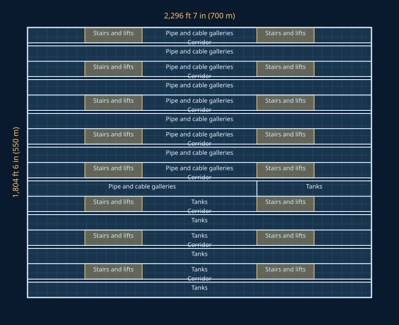
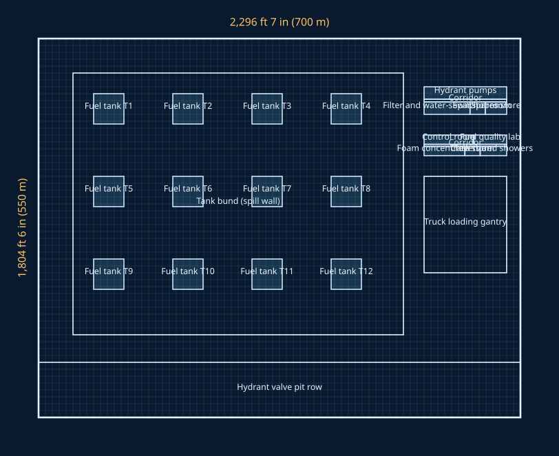
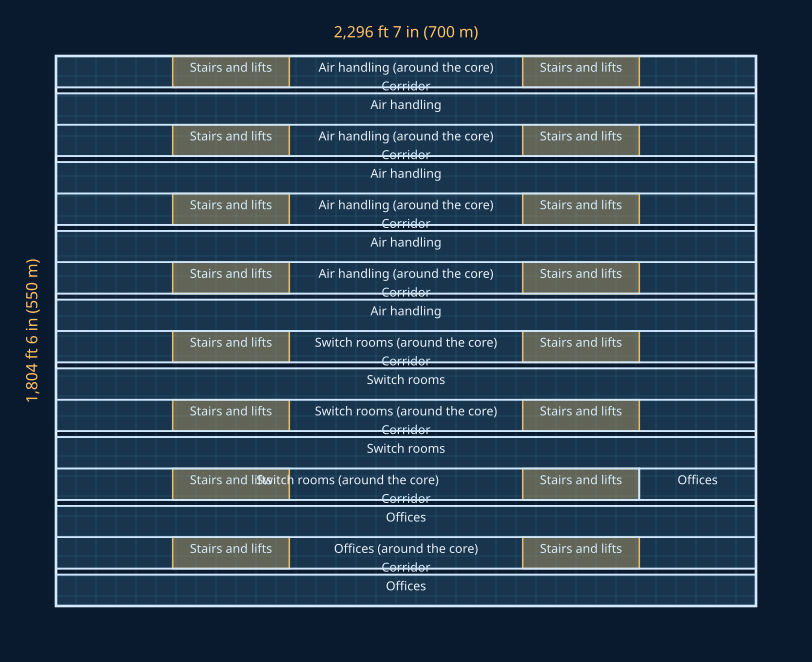

# P8-03 Fuel Farm: plan

Footprint 2,296 ft 7 in (700 m) × 1,804 ft 6 in (550 m) · structural grid 65 ft 7 in (20 m)

## Levels

| Level | Floor above deck | Height | Floor area |
|---|---|---|---|
| Level B1 · Plant level | −19 ft 8 in (6,000 mm) | 19 ft 8 in (6,000 mm) | 3,782,438 sq ft (351,400 m²) |
| Level 1 · Ground floor | 0 ft (0 mm) | 26 ft 3 in (8,000 mm) | 3,151,890 sq ft (292,820 m²) |
| Level 2 · Upper floor | 26 ft 3 in (8,000 mm) | 26 ft 3 in (8,000 mm) | 3,782,438 sq ft (351,400 m²) |

## Elements

| ID | Designation | Type | Name | Level(s) | Size / length | Area | Status |
|---|---|---|---|---|---|---|---|
| L1-001 | D5F3P8B15A2L1R1 | zone | Corridor | L1 | 2,296 ft 7 in (700 m) × 19 ft 8 in (6,000 mm) | 45,208 sq ft (4,200 m²) | proposed |
| L1-002 | D5F3P8B15A2L1R2 | zone | Corridor | L1 | 2,296 ft 7 in (700 m) × 19 ft 8 in (6,000 mm) | 45,208 sq ft (4,200 m²) | proposed |
| L1-003 | D5F3P8B15A2L1R3 | zone | Corridor | L1 | 2,296 ft 7 in (700 m) × 19 ft 8 in (6,000 mm) | 45,208 sq ft (4,200 m²) | proposed |
| L1-004 | D5F3P8B15A2L1R4 | zone | Corridor | L1 | 2,296 ft 7 in (700 m) × 19 ft 8 in (6,000 mm) | 45,208 sq ft (4,200 m²) | proposed |
| L1-005 | D5F3P8B15A2L1R5 | zone | Corridor | L1 | 2,296 ft 7 in (700 m) × 19 ft 8 in (6,000 mm) | 45,208 sq ft (4,200 m²) | proposed |
| L1-006 | D5F3P8B15A2L1R6 | zone | Corridor | L1 | 2,296 ft 7 in (700 m) × 19 ft 8 in (6,000 mm) | 45,208 sq ft (4,200 m²) | proposed |
| L1-007 | D5F3P8B15A2L1R7 | zone | Corridor | L1 | 2,296 ft 7 in (700 m) × 19 ft 8 in (6,000 mm) | 45,208 sq ft (4,200 m²) | proposed |
| L1-008 | D5F3P8B15A2L1R8 | zone | Corridor | L1 | 2,296 ft 7 in (700 m) × 19 ft 8 in (6,000 mm) | 45,208 sq ft (4,200 m²) | proposed |
| L1-009 | D5F3P8B15A2L1R9 | room | Substation | L1 | 382 ft 10 in (117 m) × 103 ft (31 m) | 39,443 sq ft (3,664 m²) | proposed |
| L1-010 | D5F3P8B15A2L1R10 | room | Substation | L1 | 765 ft 9 in (233 m) × 103 ft (31 m) | 78,886 sq ft (7,329 m²) | proposed |
| L1-011 | D5F3P8B15A2L1R11 | room | Substation | L1 | 382 ft 10 in (117 m) × 103 ft (31 m) | 39,443 sq ft (3,664 m²) | proposed |
| L1-012 | D5F3P8B15A2L1R12 | room | Substation | L1 | 2,296 ft 7 in (700 m) × 102 ft 8 in (31 m) | 235,837 sq ft (21,910 m²) | proposed |
| L1-013 | D5F3P8B15A2L1R13 | room | Substation | L1 | 382 ft 10 in (117 m) × 103 ft (31 m) | 39,443 sq ft (3,664 m²) | proposed |
| L1-014 | D5F3P8B15A2L1R14 | room | Substation | L1 | 765 ft 9 in (233 m) × 103 ft (31 m) | 78,886 sq ft (7,329 m²) | proposed |
| L1-015 | D5F3P8B15A2L1R15 | room | Substation | L1 | 382 ft 10 in (117 m) × 103 ft (31 m) | 39,443 sq ft (3,664 m²) | proposed |
| L1-016 | D5F3P8B15A2L1R16 | room | Substation | L1 | 2,296 ft 7 in (700 m) × 103 ft (31 m) | 236,591 sq ft (21,980 m²) | proposed |
| L1-017 | D5F3P8B15A2L1R17 | room | Air handling | L1 | 382 ft 10 in (117 m) × 103 ft (31 m) | 39,443 sq ft (3,664 m²) | proposed |
| L1-018 | D5F3P8B15A2L1R18 | room | Air handling | L1 | 765 ft 9 in (233 m) × 103 ft (31 m) | 78,886 sq ft (7,329 m²) | proposed |
| L1-019 | D5F3P8B15A2L1R19 | room | Air handling | L1 | 382 ft 10 in (117 m) × 103 ft (31 m) | 39,443 sq ft (3,664 m²) | proposed |
| L1-020 | D5F3P8B15A2L1R20 | room | Air handling | L1 | 2,296 ft 7 in (700 m) × 102 ft 8 in (31 m) | 235,837 sq ft (21,910 m²) | proposed |
| L1-021 | D5F3P8B15A2L1R21 | room | Air handling | L1 | 382 ft 10 in (117 m) × 103 ft (31 m) | 39,443 sq ft (3,664 m²) | proposed |
| L1-022 | D5F3P8B15A2L1R22 | room | Air handling | L1 | 765 ft 9 in (233 m) × 103 ft (31 m) | 78,886 sq ft (7,329 m²) | proposed |
| L1-023 | D5F3P8B15A2L1R23 | room | Air handling | L1 | 382 ft 10 in (117 m) × 103 ft (31 m) | 39,443 sq ft (3,664 m²) | proposed |
| L1-024 | D5F3P8B15A2L1R24 | room | Air handling | L1 | 2,296 ft 7 in (700 m) × 103 ft (31 m) | 236,591 sq ft (21,980 m²) | proposed |
| L1-025 | D5F3P8B15A2L1R25 | room | Water pumps and tanks | L1 | 382 ft 10 in (117 m) × 103 ft (31 m) | 39,443 sq ft (3,664 m²) | proposed |
| L1-026 | D5F3P8B15A2L1R26 | room | Water pumps and tanks | L1 | 765 ft 9 in (233 m) × 103 ft (31 m) | 78,886 sq ft (7,329 m²) | proposed |
| L1-027 | D5F3P8B15A2L1R27 | room | Water pumps and tanks | L1 | 382 ft 10 in (117 m) × 103 ft (31 m) | 39,443 sq ft (3,664 m²) | proposed |
| L1-028 | D5F3P8B15A2L1R28 | room | Water pumps and tanks | L1 | 2,296 ft 7 in (700 m) × 102 ft 8 in (31 m) | 235,837 sq ft (21,910 m²) | proposed |
| L1-029 | D5F3P8B15A2L1R29 | room | Water pumps and tanks | L1 | 382 ft 10 in (117 m) × 103 ft (31 m) | 39,443 sq ft (3,664 m²) | proposed |
| L1-030 | D5F3P8B15A2L1R30 | room | Water pumps and tanks | L1 | 765 ft 9 in (233 m) × 103 ft (31 m) | 78,886 sq ft (7,329 m²) | proposed |
| L1-031 | D5F3P8B15A2L1R31 | room | Water pumps and tanks | L1 | 382 ft 10 in (117 m) × 103 ft (31 m) | 39,443 sq ft (3,664 m²) | proposed |
| L1-032 | D5F3P8B15A2L1R32 | room | Water pumps and tanks | L1 | 2,296 ft 7 in (700 m) × 103 ft (31 m) | 236,591 sq ft (21,980 m²) | proposed |
| L1-033 | D5F3P8B15A2L1R33 | room | Control room | L1 | 382 ft 10 in (117 m) × 103 ft (31 m) | 39,443 sq ft (3,664 m²) | proposed |
| L1-034 | D5F3P8B15A2L1R34 | room | Control room | L1 | 765 ft 9 in (233 m) × 103 ft (31 m) | 78,886 sq ft (7,329 m²) | proposed |
| L1-035 | D5F3P8B15A2L1R35 | room | Control room | L1 | 382 ft 10 in (117 m) × 103 ft (31 m) | 39,443 sq ft (3,664 m²) | proposed |
| L1-036 | D5F3P8B15A2L1R36 | room | Workshop and stores | L1 | 2,296 ft 7 in (700 m) × 102 ft 8 in (31 m) | 235,837 sq ft (21,910 m²) | proposed |
| L1-037 | D5F3P8B15A2L1R37 | room | Workshop and stores | L1 | 382 ft 10 in (117 m) × 103 ft (31 m) | 39,443 sq ft (3,664 m²) | proposed |
| L1-038 | D5F3P8B15A2L1R38 | room | Workshop and stores | L1 | 765 ft 9 in (233 m) × 103 ft (31 m) | 78,886 sq ft (7,329 m²) | proposed |
| L1-039 | D5F3P8B15A2L1R39 | room | Workshop and stores | L1 | 382 ft 10 in (117 m) × 103 ft (31 m) | 39,443 sq ft (3,664 m²) | proposed |
| L1-040 | D5F3P8B15A2L1R40 | room | Workshop and stores | L1 | 2,296 ft 7 in (700 m) × 103 ft (31 m) | 236,591 sq ft (21,980 m²) | proposed |
| L1-041 | D5F3P8B15A2LB1R1, D5F3P8B15A2L1R41, D5F3P8B15A2L2R1 | core | Stairs and lifts | LB1, L1, L2 | 382 ft 7 in (117 m) × 103 ft (31 m) | 39,409 sq ft (3,661 m²) | proposed |
| L1-042 | D5F3P8B15A2LB1R2, D5F3P8B15A2L1R42, D5F3P8B15A2L2R2 | core | Stairs and lifts | LB1, L1, L2 | 382 ft 7 in (117 m) × 103 ft (31 m) | 39,409 sq ft (3,661 m²) | proposed |
| L1-043 | D5F3P8B15A2LB1R3, D5F3P8B15A2L1R43, D5F3P8B15A2L2R3 | core | Stairs and lifts | LB1, L1, L2 | 382 ft 7 in (117 m) × 103 ft (31 m) | 39,409 sq ft (3,661 m²) | proposed |
| L1-044 | D5F3P8B15A2LB1R4, D5F3P8B15A2L1R44, D5F3P8B15A2L2R4 | core | Stairs and lifts | LB1, L1, L2 | 382 ft 7 in (117 m) × 103 ft (31 m) | 39,409 sq ft (3,661 m²) | proposed |
| L1-045 | D5F3P8B15A2LB1R5, D5F3P8B15A2L1R45, D5F3P8B15A2L2R5 | core | Stairs and lifts | LB1, L1, L2 | 382 ft 7 in (117 m) × 103 ft (31 m) | 39,409 sq ft (3,661 m²) | proposed |
| L1-046 | D5F3P8B15A2LB1R6, D5F3P8B15A2L1R46, D5F3P8B15A2L2R6 | core | Stairs and lifts | LB1, L1, L2 | 382 ft 7 in (117 m) × 103 ft (31 m) | 39,409 sq ft (3,661 m²) | proposed |
| L1-047 | D5F3P8B15A2LB1R7, D5F3P8B15A2L1R47, D5F3P8B15A2L2R7 | core | Stairs and lifts | LB1, L1, L2 | 382 ft 7 in (117 m) × 103 ft (31 m) | 39,409 sq ft (3,661 m²) | proposed |
| L1-048 | D5F3P8B15A2LB1R8, D5F3P8B15A2L1R48, D5F3P8B15A2L2R8 | core | Stairs and lifts | LB1, L1, L2 | 382 ft 7 in (117 m) × 103 ft (31 m) | 39,409 sq ft (3,661 m²) | proposed |
| L1-049 | D5F3P8B15A2LB1R9, D5F3P8B15A2L1R49, D5F3P8B15A2L2R9 | core | Stairs and lifts | LB1, L1, L2 | 382 ft 7 in (117 m) × 103 ft (31 m) | 39,409 sq ft (3,661 m²) | proposed |
| L1-050 | D5F3P8B15A2LB1R10, D5F3P8B15A2L1R50, D5F3P8B15A2L2R10 | core | Stairs and lifts | LB1, L1, L2 | 382 ft 7 in (117 m) × 103 ft (31 m) | 39,409 sq ft (3,661 m²) | proposed |
| L1-051 | D5F3P8B15A2LB1R11, D5F3P8B15A2L1R51, D5F3P8B15A2L2R11 | core | Stairs and lifts | LB1, L1, L2 | 382 ft 7 in (117 m) × 103 ft (31 m) | 39,409 sq ft (3,661 m²) | proposed |
| L1-052 | D5F3P8B15A2LB1R12, D5F3P8B15A2L1R52, D5F3P8B15A2L2R12 | core | Stairs and lifts | LB1, L1, L2 | 382 ft 7 in (117 m) × 103 ft (31 m) | 39,409 sq ft (3,661 m²) | proposed |
| L1-053 | D5F3P8B15A2LB1R13, D5F3P8B15A2L1R53, D5F3P8B15A2L2R13 | core | Stairs and lifts | LB1, L1, L2 | 382 ft 7 in (117 m) × 103 ft (31 m) | 39,409 sq ft (3,661 m²) | proposed |
| L1-054 | D5F3P8B15A2LB1R14, D5F3P8B15A2L1R54, D5F3P8B15A2L2R14 | core | Stairs and lifts | LB1, L1, L2 | 382 ft 7 in (117 m) × 103 ft (31 m) | 39,409 sq ft (3,661 m²) | proposed |
| L1-055 | D5F3P8B15A2LB1R15, D5F3P8B15A2L1R55, D5F3P8B15A2L2R15 | core | Stairs and lifts | LB1, L1, L2 | 382 ft 7 in (117 m) × 103 ft (31 m) | 39,409 sq ft (3,661 m²) | proposed |
| L1-056 | D5F3P8B15A2LB1R16, D5F3P8B15A2L1R56, D5F3P8B15A2L2R16 | core | Stairs and lifts | LB1, L1, L2 | 382 ft 7 in (117 m) × 103 ft (31 m) | 39,409 sq ft (3,661 m²) | proposed |
| LT-001 | D5F3P8B15A2L2R17 | zone | Corridor | L2 | 2,296 ft 7 in (700 m) × 19 ft 8 in (6,000 mm) | 45,208 sq ft (4,200 m²) | proposed |
| LT-002 | D5F3P8B15A2L2R18 | zone | Corridor | L2 | 2,296 ft 7 in (700 m) × 19 ft 8 in (6,000 mm) | 45,208 sq ft (4,200 m²) | proposed |
| LT-003 | D5F3P8B15A2L2R19 | zone | Corridor | L2 | 2,296 ft 7 in (700 m) × 19 ft 8 in (6,000 mm) | 45,208 sq ft (4,200 m²) | proposed |
| LT-004 | D5F3P8B15A2L2R20 | zone | Corridor | L2 | 2,296 ft 7 in (700 m) × 19 ft 8 in (6,000 mm) | 45,208 sq ft (4,200 m²) | proposed |
| LT-005 | D5F3P8B15A2L2R21 | zone | Corridor | L2 | 2,296 ft 7 in (700 m) × 19 ft 8 in (6,000 mm) | 45,208 sq ft (4,200 m²) | proposed |
| LT-006 | D5F3P8B15A2L2R22 | zone | Corridor | L2 | 2,296 ft 7 in (700 m) × 19 ft 8 in (6,000 mm) | 45,208 sq ft (4,200 m²) | proposed |
| LT-007 | D5F3P8B15A2L2R23 | zone | Corridor | L2 | 2,296 ft 7 in (700 m) × 19 ft 8 in (6,000 mm) | 45,208 sq ft (4,200 m²) | proposed |
| LT-008 | D5F3P8B15A2L2R24 | zone | Corridor | L2 | 2,296 ft 7 in (700 m) × 19 ft 8 in (6,000 mm) | 45,208 sq ft (4,200 m²) | proposed |
| LT-009 | D5F3P8B15A2L2R25 | room | Air handling (around the core) | L2 | 2,296 ft 7 in (700 m) × 103 ft (31 m) | 236,591 sq ft (21,980 m²) | proposed |
| LT-010 | D5F3P8B15A2L2R26 | room | Air handling | L2 | 2,296 ft 7 in (700 m) × 102 ft 8 in (31 m) | 235,837 sq ft (21,910 m²) | proposed |
| LT-011 | D5F3P8B15A2L2R27 | room | Air handling (around the core) | L2 | 2,296 ft 7 in (700 m) × 103 ft (31 m) | 236,591 sq ft (21,980 m²) | proposed |
| LT-012 | D5F3P8B15A2L2R28 | room | Air handling | L2 | 2,296 ft 7 in (700 m) × 103 ft (31 m) | 236,591 sq ft (21,980 m²) | proposed |
| LT-013 | D5F3P8B15A2L2R29 | room | Air handling (around the core) | L2 | 2,296 ft 7 in (700 m) × 103 ft (31 m) | 236,591 sq ft (21,980 m²) | proposed |
| LT-014 | D5F3P8B15A2L2R30 | room | Air handling | L2 | 2,296 ft 7 in (700 m) × 102 ft 8 in (31 m) | 235,837 sq ft (21,910 m²) | proposed |
| LT-015 | D5F3P8B15A2L2R31 | room | Air handling (around the core) | L2 | 2,296 ft 7 in (700 m) × 103 ft (31 m) | 236,591 sq ft (21,980 m²) | proposed |
| LT-016 | D5F3P8B15A2L2R32 | room | Air handling | L2 | 2,296 ft 7 in (700 m) × 103 ft (31 m) | 236,591 sq ft (21,980 m²) | proposed |
| LT-017 | D5F3P8B15A2L2R33 | room | Switch rooms (around the core) | L2 | 2,296 ft 7 in (700 m) × 103 ft (31 m) | 236,591 sq ft (21,980 m²) | proposed |
| LT-018 | D5F3P8B15A2L2R34 | room | Switch rooms | L2 | 2,296 ft 7 in (700 m) × 102 ft 8 in (31 m) | 235,837 sq ft (21,910 m²) | proposed |
| LT-019 | D5F3P8B15A2L2R35 | room | Switch rooms (around the core) | L2 | 2,296 ft 7 in (700 m) × 103 ft (31 m) | 236,591 sq ft (21,980 m²) | proposed |
| LT-020 | D5F3P8B15A2L2R36 | room | Switch rooms | L2 | 2,296 ft 7 in (700 m) × 103 ft (31 m) | 236,591 sq ft (21,980 m²) | proposed |
| LT-021 | D5F3P8B15A2L2R37 | room | Switch rooms (around the core) | L2 | 1,913 ft 9 in (583 m) × 103 ft (31 m) | 197,148 sq ft (18,316 m²) | proposed |
| LT-022 | D5F3P8B15A2L2R38 | room | Offices | L2 | 382 ft 10 in (117 m) × 103 ft (31 m) | 39,443 sq ft (3,664 m²) | proposed |
| LT-023 | D5F3P8B15A2L2R39 | room | Offices | L2 | 2,296 ft 7 in (700 m) × 102 ft 8 in (31 m) | 235,837 sq ft (21,910 m²) | proposed |
| LT-024 | D5F3P8B15A2L2R40 | room | Offices (around the core) | L2 | 2,296 ft 7 in (700 m) × 103 ft (31 m) | 236,591 sq ft (21,980 m²) | proposed |
| LT-025 | D5F3P8B15A2L2R41 | room | Offices | L2 | 2,296 ft 7 in (700 m) × 103 ft (31 m) | 236,591 sq ft (21,980 m²) | proposed |
| BB1-001 | D5F3P8B15A2LB1R17 | zone | Corridor | LB1 | 2,296 ft 7 in (700 m) × 19 ft 8 in (6,000 mm) | 45,208 sq ft (4,200 m²) | proposed |
| BB1-002 | D5F3P8B15A2LB1R18 | zone | Corridor | LB1 | 2,296 ft 7 in (700 m) × 19 ft 8 in (6,000 mm) | 45,208 sq ft (4,200 m²) | proposed |
| BB1-003 | D5F3P8B15A2LB1R19 | zone | Corridor | LB1 | 2,296 ft 7 in (700 m) × 19 ft 8 in (6,000 mm) | 45,208 sq ft (4,200 m²) | proposed |
| BB1-004 | D5F3P8B15A2LB1R20 | zone | Corridor | LB1 | 2,296 ft 7 in (700 m) × 19 ft 8 in (6,000 mm) | 45,208 sq ft (4,200 m²) | proposed |
| BB1-005 | D5F3P8B15A2LB1R21 | zone | Corridor | LB1 | 2,296 ft 7 in (700 m) × 19 ft 8 in (6,000 mm) | 45,208 sq ft (4,200 m²) | proposed |
| BB1-006 | D5F3P8B15A2LB1R22 | zone | Corridor | LB1 | 2,296 ft 7 in (700 m) × 19 ft 8 in (6,000 mm) | 45,208 sq ft (4,200 m²) | proposed |
| BB1-007 | D5F3P8B15A2LB1R23 | zone | Corridor | LB1 | 2,296 ft 7 in (700 m) × 19 ft 8 in (6,000 mm) | 45,208 sq ft (4,200 m²) | proposed |
| BB1-008 | D5F3P8B15A2LB1R24 | zone | Corridor | LB1 | 2,296 ft 7 in (700 m) × 19 ft 8 in (6,000 mm) | 45,208 sq ft (4,200 m²) | proposed |
| BB1-009 | D5F3P8B15A2LB1R25 | room | Pipe and cable galleries | LB1 | 2,296 ft 7 in (700 m) × 103 ft (31 m) | 236,591 sq ft (21,980 m²) | proposed |
| BB1-010 | D5F3P8B15A2LB1R26 | room | Pipe and cable galleries | LB1 | 2,296 ft 7 in (700 m) × 102 ft 8 in (31 m) | 235,837 sq ft (21,910 m²) | proposed |
| BB1-011 | D5F3P8B15A2LB1R27 | room | Pipe and cable galleries | LB1 | 2,296 ft 7 in (700 m) × 103 ft (31 m) | 236,591 sq ft (21,980 m²) | proposed |
| BB1-012 | D5F3P8B15A2LB1R28 | room | Pipe and cable galleries | LB1 | 2,296 ft 7 in (700 m) × 103 ft (31 m) | 236,591 sq ft (21,980 m²) | proposed |
| BB1-013 | D5F3P8B15A2LB1R29 | room | Pipe and cable galleries | LB1 | 2,296 ft 7 in (700 m) × 103 ft (31 m) | 236,591 sq ft (21,980 m²) | proposed |
| BB1-014 | D5F3P8B15A2LB1R30 | room | Pipe and cable galleries | LB1 | 2,296 ft 7 in (700 m) × 102 ft 8 in (31 m) | 235,837 sq ft (21,910 m²) | proposed |
| BB1-015 | D5F3P8B15A2LB1R31 | room | Pipe and cable galleries | LB1 | 2,296 ft 7 in (700 m) × 103 ft (31 m) | 236,591 sq ft (21,980 m²) | proposed |
| BB1-016 | D5F3P8B15A2LB1R32 | room | Pipe and cable galleries | LB1 | 2,296 ft 7 in (700 m) × 103 ft (31 m) | 236,591 sq ft (21,980 m²) | proposed |
| BB1-017 | D5F3P8B15A2LB1R33 | room | Pipe and cable galleries | LB1 | 2,296 ft 7 in (700 m) × 103 ft (31 m) | 236,591 sq ft (21,980 m²) | proposed |
| BB1-018 | D5F3P8B15A2LB1R34 | room | Pipe and cable galleries | LB1 | 1,531 ft 2 in (467 m) × 102 ft 8 in (31 m) | 157,236 sq ft (14,608 m²) | proposed |
| BB1-019 | D5F3P8B15A2LB1R35 | room | Tanks | LB1 | 765 ft 5 in (233 m) × 102 ft 8 in (31 m) | 78,601 sq ft (7,302 m²) | proposed |
| BB1-020 | D5F3P8B15A2LB1R36 | room | Tanks | LB1 | 2,296 ft 7 in (700 m) × 103 ft (31 m) | 236,591 sq ft (21,980 m²) | proposed |
| BB1-021 | D5F3P8B15A2LB1R37 | room | Tanks | LB1 | 2,296 ft 7 in (700 m) × 103 ft (31 m) | 236,591 sq ft (21,980 m²) | proposed |
| BB1-022 | D5F3P8B15A2LB1R38 | room | Tanks | LB1 | 2,296 ft 7 in (700 m) × 103 ft (31 m) | 236,591 sq ft (21,980 m²) | proposed |
| BB1-023 | D5F3P8B15A2LB1R39 | room | Tanks | LB1 | 2,296 ft 7 in (700 m) × 102 ft 8 in (31 m) | 235,837 sq ft (21,910 m²) | proposed |
| BB1-024 | D5F3P8B15A2LB1R40 | room | Tanks | LB1 | 2,296 ft 7 in (700 m) × 103 ft (31 m) | 236,591 sq ft (21,980 m²) | proposed |
| BB1-025 | D5F3P8B15A2LB1R41 | room | Tanks | LB1 | 2,296 ft 7 in (700 m) × 103 ft (31 m) | 236,591 sq ft (21,980 m²) | proposed |
| D-107 |  | door | Main entrance | L1 | 78 ft 9 in (24 m), 78 ft 9 in (24 m) wide | — | proposed |
| D-108 |  | door | Second entrance | L1 | 78 ft 9 in (24 m), 78 ft 9 in (24 m) wide | — | proposed |
| D-109 |  | door | Side door | L1 | 19 ft 8 in (6,000 mm), 19 ft 8 in (6,000 mm) wide | — | proposed |
| D-110 |  | door | Side door | L1 | 19 ft 8 in (6,000 mm), 19 ft 8 in (6,000 mm) wide | — | proposed |

## Drawings

### Level B1 · Plant level

### Level 1 · Ground floor

### Level 2 · Upper floor

