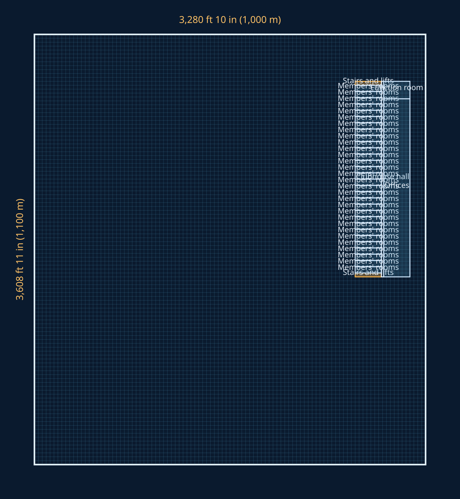

# P8-04 Owner Hangars: plan

Footprint 3,280 ft 10 in (1,000 m) × 3,608 ft 11 in (1,100 m) · structural grid 32 ft 10 in (10 m)

## Levels

| Level | Floor above deck | Height | Floor area |
|---|---|---|---|
| Level 1 · Ground floor | 0 ft (0 mm) | 39 ft 4 in (12 m) | 4,013,432 sq ft (372,860 m²) |
| Level 2 · Clubhouse upper | 39 ft 4 in (12 m) | 16 ft 5 in (5,000 mm) | 706,758 sq ft (65,660 m²) |

## Elements

| ID | Designation | Type | Name | Level(s) | Size / length | Area | Status |
|---|---|---|---|---|---|---|---|
| E001 | D5F3P8B9A1L1R1 | room | Bay A 1 | L1 | 131 ft 3 in (40 m) × 98 ft 5 in (30 m) | 12,917 sq ft (1,200 m²) | proposed |
| E002 | D5F3P8B9A1L1R2 | room | Bay A 2 | L1 | 131 ft 3 in (40 m) × 98 ft 5 in (30 m) | 12,917 sq ft (1,200 m²) | proposed |
| E003 | D5F3P8B9A1L1R3 | room | Bay A 3 | L1 | 131 ft 3 in (40 m) × 98 ft 5 in (30 m) | 12,917 sq ft (1,200 m²) | proposed |
| E004 | D5F3P8B9A1L1R4 | room | Bay A 4 | L1 | 131 ft 3 in (40 m) × 98 ft 5 in (30 m) | 12,917 sq ft (1,200 m²) | proposed |
| E005 | D5F3P8B9A1L1R5 | room | Bay A 5 | L1 | 131 ft 3 in (40 m) × 98 ft 5 in (30 m) | 12,917 sq ft (1,200 m²) | proposed |
| E006 | D5F3P8B9A1L1R6 | room | Bay A 6 | L1 | 131 ft 3 in (40 m) × 98 ft 5 in (30 m) | 12,917 sq ft (1,200 m²) | proposed |
| E007 | D5F3P8B9A1L1R7 | room | Bay A 7 | L1 | 131 ft 3 in (40 m) × 98 ft 5 in (30 m) | 12,917 sq ft (1,200 m²) | proposed |
| E008 | D5F3P8B9A1L1R8 | room | Bay A 8 | L1 | 131 ft 3 in (40 m) × 98 ft 5 in (30 m) | 12,917 sq ft (1,200 m²) | proposed |
| E009 | D5F3P8B9A1L1R9 | room | Bay A 9 | L1 | 131 ft 3 in (40 m) × 98 ft 5 in (30 m) | 12,917 sq ft (1,200 m²) | proposed |
| E010 | D5F3P8B9A1L1R10 | room | Bay A 10 | L1 | 131 ft 3 in (40 m) × 98 ft 5 in (30 m) | 12,917 sq ft (1,200 m²) | proposed |
| E011 | D5F3P8B9A1L1R11 | room | Bay A 11 | L1 | 131 ft 3 in (40 m) × 98 ft 5 in (30 m) | 12,917 sq ft (1,200 m²) | proposed |
| E012 | D5F3P8B9A1L1R12 | room | Bay A 12 | L1 | 131 ft 3 in (40 m) × 98 ft 5 in (30 m) | 12,917 sq ft (1,200 m²) | proposed |
| E013 | D5F3P8B9A1L1R13 | room | Bay A 13 | L1 | 131 ft 3 in (40 m) × 98 ft 5 in (30 m) | 12,917 sq ft (1,200 m²) | proposed |
| E014 | D5F3P8B9A1L1R14 | room | Bay A 14 | L1 | 131 ft 3 in (40 m) × 98 ft 5 in (30 m) | 12,917 sq ft (1,200 m²) | proposed |
| E015 | D5F3P8B9A1L1R15 | room | Bay A 15 | L1 | 131 ft 3 in (40 m) × 98 ft 5 in (30 m) | 12,917 sq ft (1,200 m²) | proposed |
| E016 | D5F3P8B9A1L1R16 | room | Bay A 16 | L1 | 131 ft 3 in (40 m) × 98 ft 5 in (30 m) | 12,917 sq ft (1,200 m²) | proposed |
| E017 | D5F3P8B9A1L1R17 | room | Bay A 17 | L1 | 131 ft 3 in (40 m) × 98 ft 5 in (30 m) | 12,917 sq ft (1,200 m²) | proposed |
| E018 | D5F3P8B9A1L1R18 | room | Bay A 18 | L1 | 131 ft 3 in (40 m) × 98 ft 5 in (30 m) | 12,917 sq ft (1,200 m²) | proposed |
| E019 | D5F3P8B9A1L1R19 | room | Bay A 19 | L1 | 131 ft 3 in (40 m) × 98 ft 5 in (30 m) | 12,917 sq ft (1,200 m²) | proposed |
| E020 | D5F3P8B9A1L1R20 | room | Bay A 20 | L1 | 131 ft 3 in (40 m) × 98 ft 5 in (30 m) | 12,917 sq ft (1,200 m²) | proposed |
| E021 | D5F3P8B9A1L1R21 | room | Bay A 21 | L1 | 131 ft 3 in (40 m) × 98 ft 5 in (30 m) | 12,917 sq ft (1,200 m²) | proposed |
| E022 | D5F3P8B9A1L1R22 | room | Bay A 22 | L1 | 131 ft 3 in (40 m) × 98 ft 5 in (30 m) | 12,917 sq ft (1,200 m²) | proposed |
| E023 | D5F3P8B9A1L1R23 | room | Bay A 23 | L1 | 131 ft 3 in (40 m) × 98 ft 5 in (30 m) | 12,917 sq ft (1,200 m²) | proposed |
| E024 | D5F3P8B9A1L1R24 | room | Bay A 24 | L1 | 131 ft 3 in (40 m) × 98 ft 5 in (30 m) | 12,917 sq ft (1,200 m²) | proposed |
| E025 | D5F3P8B9A1L1R25 | room | Bay A 25 | L1 | 131 ft 3 in (40 m) × 98 ft 5 in (30 m) | 12,917 sq ft (1,200 m²) | proposed |
| E026 | D5F3P8B9A1L1R26 | room | Bay A 26 | L1 | 131 ft 3 in (40 m) × 98 ft 5 in (30 m) | 12,917 sq ft (1,200 m²) | proposed |
| E027 | D5F3P8B9A1L1R27 | room | Bay A 27 | L1 | 131 ft 3 in (40 m) × 98 ft 5 in (30 m) | 12,917 sq ft (1,200 m²) | proposed |
| E028 | D5F3P8B9A1L1R28 | room | Bay A 28 | L1 | 131 ft 3 in (40 m) × 98 ft 5 in (30 m) | 12,917 sq ft (1,200 m²) | proposed |
| E029 | D5F3P8B9A1L1R29 | room | Bay A 29 | L1 | 131 ft 3 in (40 m) × 98 ft 5 in (30 m) | 12,917 sq ft (1,200 m²) | proposed |
| E030 | D5F3P8B9A1L1R30 | room | Bay A 30 | L1 | 131 ft 3 in (40 m) × 98 ft 5 in (30 m) | 12,917 sq ft (1,200 m²) | proposed |
| E031 | D5F3P8B9A1L1R31 | room | Bay A 31 | L1 | 131 ft 3 in (40 m) × 98 ft 5 in (30 m) | 12,917 sq ft (1,200 m²) | proposed |
| E032 | D5F3P8B9A1L1R32 | room | Bay A 32 | L1 | 131 ft 3 in (40 m) × 98 ft 5 in (30 m) | 12,917 sq ft (1,200 m²) | proposed |
| E033 | D5F3P8B9A1L1R33 | room | Bay B 1 | L1 | 131 ft 3 in (40 m) × 98 ft 5 in (30 m) | 12,917 sq ft (1,200 m²) | proposed |
| E034 | D5F3P8B9A1L1R34 | room | Bay B 2 | L1 | 131 ft 3 in (40 m) × 98 ft 5 in (30 m) | 12,917 sq ft (1,200 m²) | proposed |
| E035 | D5F3P8B9A1L1R35 | room | Bay B 3 | L1 | 131 ft 3 in (40 m) × 98 ft 5 in (30 m) | 12,917 sq ft (1,200 m²) | proposed |
| E036 | D5F3P8B9A1L1R36 | room | Bay B 4 | L1 | 131 ft 3 in (40 m) × 98 ft 5 in (30 m) | 12,917 sq ft (1,200 m²) | proposed |
| E037 | D5F3P8B9A1L1R37 | room | Bay B 5 | L1 | 131 ft 3 in (40 m) × 98 ft 5 in (30 m) | 12,917 sq ft (1,200 m²) | proposed |
| E038 | D5F3P8B9A1L1R38 | room | Bay B 6 | L1 | 131 ft 3 in (40 m) × 98 ft 5 in (30 m) | 12,917 sq ft (1,200 m²) | proposed |
| E039 | D5F3P8B9A1L1R39 | room | Bay B 7 | L1 | 131 ft 3 in (40 m) × 98 ft 5 in (30 m) | 12,917 sq ft (1,200 m²) | proposed |
| E040 | D5F3P8B9A1L1R40 | room | Bay B 8 | L1 | 131 ft 3 in (40 m) × 98 ft 5 in (30 m) | 12,917 sq ft (1,200 m²) | proposed |
| E041 | D5F3P8B9A1L1R41 | room | Bay B 9 | L1 | 131 ft 3 in (40 m) × 98 ft 5 in (30 m) | 12,917 sq ft (1,200 m²) | proposed |
| E042 | D5F3P8B9A1L1R42 | room | Bay B 10 | L1 | 131 ft 3 in (40 m) × 98 ft 5 in (30 m) | 12,917 sq ft (1,200 m²) | proposed |
| E043 | D5F3P8B9A1L1R43 | room | Bay B 11 | L1 | 131 ft 3 in (40 m) × 98 ft 5 in (30 m) | 12,917 sq ft (1,200 m²) | proposed |
| E044 | D5F3P8B9A1L1R44 | room | Bay B 12 | L1 | 131 ft 3 in (40 m) × 98 ft 5 in (30 m) | 12,917 sq ft (1,200 m²) | proposed |
| E045 | D5F3P8B9A1L1R45 | room | Bay B 13 | L1 | 131 ft 3 in (40 m) × 98 ft 5 in (30 m) | 12,917 sq ft (1,200 m²) | proposed |
| E046 | D5F3P8B9A1L1R46 | room | Bay B 14 | L1 | 131 ft 3 in (40 m) × 98 ft 5 in (30 m) | 12,917 sq ft (1,200 m²) | proposed |
| E047 | D5F3P8B9A1L1R47 | room | Bay B 15 | L1 | 131 ft 3 in (40 m) × 98 ft 5 in (30 m) | 12,917 sq ft (1,200 m²) | proposed |
| E048 | D5F3P8B9A1L1R48 | room | Bay B 16 | L1 | 131 ft 3 in (40 m) × 98 ft 5 in (30 m) | 12,917 sq ft (1,200 m²) | proposed |
| E049 | D5F3P8B9A1L1R49 | room | Bay B 17 | L1 | 131 ft 3 in (40 m) × 98 ft 5 in (30 m) | 12,917 sq ft (1,200 m²) | proposed |
| E050 | D5F3P8B9A1L1R50 | room | Bay B 18 | L1 | 131 ft 3 in (40 m) × 98 ft 5 in (30 m) | 12,917 sq ft (1,200 m²) | proposed |
| E051 | D5F3P8B9A1L1R51 | room | Bay B 19 | L1 | 131 ft 3 in (40 m) × 98 ft 5 in (30 m) | 12,917 sq ft (1,200 m²) | proposed |
| E052 | D5F3P8B9A1L1R52 | room | Bay B 20 | L1 | 131 ft 3 in (40 m) × 98 ft 5 in (30 m) | 12,917 sq ft (1,200 m²) | proposed |
| E053 | D5F3P8B9A1L1R53 | room | Bay B 21 | L1 | 131 ft 3 in (40 m) × 98 ft 5 in (30 m) | 12,917 sq ft (1,200 m²) | proposed |
| E054 | D5F3P8B9A1L1R54 | room | Bay B 22 | L1 | 131 ft 3 in (40 m) × 98 ft 5 in (30 m) | 12,917 sq ft (1,200 m²) | proposed |
| E055 | D5F3P8B9A1L1R55 | room | Bay B 23 | L1 | 131 ft 3 in (40 m) × 98 ft 5 in (30 m) | 12,917 sq ft (1,200 m²) | proposed |
| E056 | D5F3P8B9A1L1R56 | room | Bay B 24 | L1 | 131 ft 3 in (40 m) × 98 ft 5 in (30 m) | 12,917 sq ft (1,200 m²) | proposed |
| E057 | D5F3P8B9A1L1R57 | room | Bay B 25 | L1 | 131 ft 3 in (40 m) × 98 ft 5 in (30 m) | 12,917 sq ft (1,200 m²) | proposed |
| E058 | D5F3P8B9A1L1R58 | room | Bay B 26 | L1 | 131 ft 3 in (40 m) × 98 ft 5 in (30 m) | 12,917 sq ft (1,200 m²) | proposed |
| E059 | D5F3P8B9A1L1R59 | room | Bay B 27 | L1 | 131 ft 3 in (40 m) × 98 ft 5 in (30 m) | 12,917 sq ft (1,200 m²) | proposed |
| E060 | D5F3P8B9A1L1R60 | room | Bay B 28 | L1 | 131 ft 3 in (40 m) × 98 ft 5 in (30 m) | 12,917 sq ft (1,200 m²) | proposed |
| E061 | D5F3P8B9A1L1R61 | room | Bay B 29 | L1 | 131 ft 3 in (40 m) × 98 ft 5 in (30 m) | 12,917 sq ft (1,200 m²) | proposed |
| E062 | D5F3P8B9A1L1R62 | room | Bay B 30 | L1 | 131 ft 3 in (40 m) × 98 ft 5 in (30 m) | 12,917 sq ft (1,200 m²) | proposed |
| E063 | D5F3P8B9A1L1R63 | room | Bay B 31 | L1 | 131 ft 3 in (40 m) × 98 ft 5 in (30 m) | 12,917 sq ft (1,200 m²) | proposed |
| E064 | D5F3P8B9A1L1R64 | room | Bay B 32 | L1 | 131 ft 3 in (40 m) × 98 ft 5 in (30 m) | 12,917 sq ft (1,200 m²) | proposed |
| E065 | D5F3P8B9A1L1R65 | zone | Taxilane 1 | L1 | 360 ft 11 in (110 m) × 3,149 ft 7 in (960 m) | 1,136,669 sq ft (105,600 m²) | proposed |
| E066 | D5F3P8B9A1L1R66 | room | Bay C 1 | L1 | 131 ft 3 in (40 m) × 98 ft 5 in (30 m) | 12,917 sq ft (1,200 m²) | proposed |
| E067 | D5F3P8B9A1L1R67 | room | Bay C 2 | L1 | 131 ft 3 in (40 m) × 98 ft 5 in (30 m) | 12,917 sq ft (1,200 m²) | proposed |
| E068 | D5F3P8B9A1L1R68 | room | Bay C 3 | L1 | 131 ft 3 in (40 m) × 98 ft 5 in (30 m) | 12,917 sq ft (1,200 m²) | proposed |
| E069 | D5F3P8B9A1L1R69 | room | Bay C 4 | L1 | 131 ft 3 in (40 m) × 98 ft 5 in (30 m) | 12,917 sq ft (1,200 m²) | proposed |
| E070 | D5F3P8B9A1L1R70 | room | Bay C 5 | L1 | 131 ft 3 in (40 m) × 98 ft 5 in (30 m) | 12,917 sq ft (1,200 m²) | proposed |
| E071 | D5F3P8B9A1L1R71 | room | Bay C 6 | L1 | 131 ft 3 in (40 m) × 98 ft 5 in (30 m) | 12,917 sq ft (1,200 m²) | proposed |
| E072 | D5F3P8B9A1L1R72 | room | Bay C 7 | L1 | 131 ft 3 in (40 m) × 98 ft 5 in (30 m) | 12,917 sq ft (1,200 m²) | proposed |
| E073 | D5F3P8B9A1L1R73 | room | Bay C 8 | L1 | 131 ft 3 in (40 m) × 98 ft 5 in (30 m) | 12,917 sq ft (1,200 m²) | proposed |
| E074 | D5F3P8B9A1L1R74 | room | Bay C 9 | L1 | 131 ft 3 in (40 m) × 98 ft 5 in (30 m) | 12,917 sq ft (1,200 m²) | proposed |
| E075 | D5F3P8B9A1L1R75 | room | Bay C 10 | L1 | 131 ft 3 in (40 m) × 98 ft 5 in (30 m) | 12,917 sq ft (1,200 m²) | proposed |
| E076 | D5F3P8B9A1L1R76 | room | Bay C 11 | L1 | 131 ft 3 in (40 m) × 98 ft 5 in (30 m) | 12,917 sq ft (1,200 m²) | proposed |
| E077 | D5F3P8B9A1L1R77 | room | Bay C 12 | L1 | 131 ft 3 in (40 m) × 98 ft 5 in (30 m) | 12,917 sq ft (1,200 m²) | proposed |
| E078 | D5F3P8B9A1L1R78 | room | Bay C 13 | L1 | 131 ft 3 in (40 m) × 98 ft 5 in (30 m) | 12,917 sq ft (1,200 m²) | proposed |
| E079 | D5F3P8B9A1L1R79 | room | Bay C 14 | L1 | 131 ft 3 in (40 m) × 98 ft 5 in (30 m) | 12,917 sq ft (1,200 m²) | proposed |
| E080 | D5F3P8B9A1L1R80 | room | Bay C 15 | L1 | 131 ft 3 in (40 m) × 98 ft 5 in (30 m) | 12,917 sq ft (1,200 m²) | proposed |
| E081 | D5F3P8B9A1L1R81 | room | Bay C 16 | L1 | 131 ft 3 in (40 m) × 98 ft 5 in (30 m) | 12,917 sq ft (1,200 m²) | proposed |
| E082 | D5F3P8B9A1L1R82 | room | Bay C 17 | L1 | 131 ft 3 in (40 m) × 98 ft 5 in (30 m) | 12,917 sq ft (1,200 m²) | proposed |
| E083 | D5F3P8B9A1L1R83 | room | Bay C 18 | L1 | 131 ft 3 in (40 m) × 98 ft 5 in (30 m) | 12,917 sq ft (1,200 m²) | proposed |
| E084 | D5F3P8B9A1L1R84 | room | Bay C 19 | L1 | 131 ft 3 in (40 m) × 98 ft 5 in (30 m) | 12,917 sq ft (1,200 m²) | proposed |
| E085 | D5F3P8B9A1L1R85 | room | Bay C 20 | L1 | 131 ft 3 in (40 m) × 98 ft 5 in (30 m) | 12,917 sq ft (1,200 m²) | proposed |
| E086 | D5F3P8B9A1L1R86 | room | Bay C 21 | L1 | 131 ft 3 in (40 m) × 98 ft 5 in (30 m) | 12,917 sq ft (1,200 m²) | proposed |
| E087 | D5F3P8B9A1L1R87 | room | Bay C 22 | L1 | 131 ft 3 in (40 m) × 98 ft 5 in (30 m) | 12,917 sq ft (1,200 m²) | proposed |
| E088 | D5F3P8B9A1L1R88 | room | Bay C 23 | L1 | 131 ft 3 in (40 m) × 98 ft 5 in (30 m) | 12,917 sq ft (1,200 m²) | proposed |
| E089 | D5F3P8B9A1L1R89 | room | Bay C 24 | L1 | 131 ft 3 in (40 m) × 98 ft 5 in (30 m) | 12,917 sq ft (1,200 m²) | proposed |
| E090 | D5F3P8B9A1L1R90 | room | Bay C 25 | L1 | 131 ft 3 in (40 m) × 98 ft 5 in (30 m) | 12,917 sq ft (1,200 m²) | proposed |
| E091 | D5F3P8B9A1L1R91 | room | Bay C 26 | L1 | 131 ft 3 in (40 m) × 98 ft 5 in (30 m) | 12,917 sq ft (1,200 m²) | proposed |
| E092 | D5F3P8B9A1L1R92 | room | Bay C 27 | L1 | 131 ft 3 in (40 m) × 98 ft 5 in (30 m) | 12,917 sq ft (1,200 m²) | proposed |
| E093 | D5F3P8B9A1L1R93 | room | Bay C 28 | L1 | 131 ft 3 in (40 m) × 98 ft 5 in (30 m) | 12,917 sq ft (1,200 m²) | proposed |
| E094 | D5F3P8B9A1L1R94 | room | Bay C 29 | L1 | 131 ft 3 in (40 m) × 98 ft 5 in (30 m) | 12,917 sq ft (1,200 m²) | proposed |
| E095 | D5F3P8B9A1L1R95 | room | Bay C 30 | L1 | 131 ft 3 in (40 m) × 98 ft 5 in (30 m) | 12,917 sq ft (1,200 m²) | proposed |
| E096 | D5F3P8B9A1L1R96 | room | Bay C 31 | L1 | 131 ft 3 in (40 m) × 98 ft 5 in (30 m) | 12,917 sq ft (1,200 m²) | proposed |
| E097 | D5F3P8B9A1L1R97 | room | Bay C 32 | L1 | 131 ft 3 in (40 m) × 98 ft 5 in (30 m) | 12,917 sq ft (1,200 m²) | proposed |
| E098 | D5F3P8B9A1L1R98 | room | Bay D 1 | L1 | 131 ft 3 in (40 m) × 98 ft 5 in (30 m) | 12,917 sq ft (1,200 m²) | proposed |
| E099 | D5F3P8B9A1L1R99 | room | Bay D 2 | L1 | 131 ft 3 in (40 m) × 98 ft 5 in (30 m) | 12,917 sq ft (1,200 m²) | proposed |
| E100 | D5F3P8B9A1L1R100 | room | Bay D 3 | L1 | 131 ft 3 in (40 m) × 98 ft 5 in (30 m) | 12,917 sq ft (1,200 m²) | proposed |
| E101 | D5F3P8B9A1L1R101 | room | Bay D 4 | L1 | 131 ft 3 in (40 m) × 98 ft 5 in (30 m) | 12,917 sq ft (1,200 m²) | proposed |
| E102 | D5F3P8B9A1L1R102 | room | Bay D 5 | L1 | 131 ft 3 in (40 m) × 98 ft 5 in (30 m) | 12,917 sq ft (1,200 m²) | proposed |
| E103 | D5F3P8B9A1L1R103 | room | Bay D 6 | L1 | 131 ft 3 in (40 m) × 98 ft 5 in (30 m) | 12,917 sq ft (1,200 m²) | proposed |
| E104 | D5F3P8B9A1L1R104 | room | Bay D 7 | L1 | 131 ft 3 in (40 m) × 98 ft 5 in (30 m) | 12,917 sq ft (1,200 m²) | proposed |
| E105 | D5F3P8B9A1L1R105 | room | Bay D 8 | L1 | 131 ft 3 in (40 m) × 98 ft 5 in (30 m) | 12,917 sq ft (1,200 m²) | proposed |
| E106 | D5F3P8B9A1L1R106 | room | Bay D 9 | L1 | 131 ft 3 in (40 m) × 98 ft 5 in (30 m) | 12,917 sq ft (1,200 m²) | proposed |
| E107 | D5F3P8B9A1L1R107 | room | Bay D 10 | L1 | 131 ft 3 in (40 m) × 98 ft 5 in (30 m) | 12,917 sq ft (1,200 m²) | proposed |
| E108 | D5F3P8B9A1L1R108 | room | Bay D 11 | L1 | 131 ft 3 in (40 m) × 98 ft 5 in (30 m) | 12,917 sq ft (1,200 m²) | proposed |
| E109 | D5F3P8B9A1L1R109 | room | Bay D 12 | L1 | 131 ft 3 in (40 m) × 98 ft 5 in (30 m) | 12,917 sq ft (1,200 m²) | proposed |
| E110 | D5F3P8B9A1L1R110 | room | Bay D 13 | L1 | 131 ft 3 in (40 m) × 98 ft 5 in (30 m) | 12,917 sq ft (1,200 m²) | proposed |
| E111 | D5F3P8B9A1L1R111 | room | Bay D 14 | L1 | 131 ft 3 in (40 m) × 98 ft 5 in (30 m) | 12,917 sq ft (1,200 m²) | proposed |
| E112 | D5F3P8B9A1L1R112 | room | Bay D 15 | L1 | 131 ft 3 in (40 m) × 98 ft 5 in (30 m) | 12,917 sq ft (1,200 m²) | proposed |
| E113 | D5F3P8B9A1L1R113 | room | Bay D 16 | L1 | 131 ft 3 in (40 m) × 98 ft 5 in (30 m) | 12,917 sq ft (1,200 m²) | proposed |
| E114 | D5F3P8B9A1L1R114 | room | Bay D 17 | L1 | 131 ft 3 in (40 m) × 98 ft 5 in (30 m) | 12,917 sq ft (1,200 m²) | proposed |
| E115 | D5F3P8B9A1L1R115 | room | Bay D 18 | L1 | 131 ft 3 in (40 m) × 98 ft 5 in (30 m) | 12,917 sq ft (1,200 m²) | proposed |
| E116 | D5F3P8B9A1L1R116 | room | Bay D 19 | L1 | 131 ft 3 in (40 m) × 98 ft 5 in (30 m) | 12,917 sq ft (1,200 m²) | proposed |
| E117 | D5F3P8B9A1L1R117 | room | Bay D 20 | L1 | 131 ft 3 in (40 m) × 98 ft 5 in (30 m) | 12,917 sq ft (1,200 m²) | proposed |
| E118 | D5F3P8B9A1L1R118 | room | Bay D 21 | L1 | 131 ft 3 in (40 m) × 98 ft 5 in (30 m) | 12,917 sq ft (1,200 m²) | proposed |
| E119 | D5F3P8B9A1L1R119 | room | Bay D 22 | L1 | 131 ft 3 in (40 m) × 98 ft 5 in (30 m) | 12,917 sq ft (1,200 m²) | proposed |
| E120 | D5F3P8B9A1L1R120 | room | Bay D 23 | L1 | 131 ft 3 in (40 m) × 98 ft 5 in (30 m) | 12,917 sq ft (1,200 m²) | proposed |
| E121 | D5F3P8B9A1L1R121 | room | Bay D 24 | L1 | 131 ft 3 in (40 m) × 98 ft 5 in (30 m) | 12,917 sq ft (1,200 m²) | proposed |
| E122 | D5F3P8B9A1L1R122 | room | Bay D 25 | L1 | 131 ft 3 in (40 m) × 98 ft 5 in (30 m) | 12,917 sq ft (1,200 m²) | proposed |
| E123 | D5F3P8B9A1L1R123 | room | Bay D 26 | L1 | 131 ft 3 in (40 m) × 98 ft 5 in (30 m) | 12,917 sq ft (1,200 m²) | proposed |
| E124 | D5F3P8B9A1L1R124 | room | Bay D 27 | L1 | 131 ft 3 in (40 m) × 98 ft 5 in (30 m) | 12,917 sq ft (1,200 m²) | proposed |
| E125 | D5F3P8B9A1L1R125 | room | Bay D 28 | L1 | 131 ft 3 in (40 m) × 98 ft 5 in (30 m) | 12,917 sq ft (1,200 m²) | proposed |
| E126 | D5F3P8B9A1L1R126 | room | Bay D 29 | L1 | 131 ft 3 in (40 m) × 98 ft 5 in (30 m) | 12,917 sq ft (1,200 m²) | proposed |
| E127 | D5F3P8B9A1L1R127 | room | Bay D 30 | L1 | 131 ft 3 in (40 m) × 98 ft 5 in (30 m) | 12,917 sq ft (1,200 m²) | proposed |
| E128 | D5F3P8B9A1L1R128 | room | Bay D 31 | L1 | 131 ft 3 in (40 m) × 98 ft 5 in (30 m) | 12,917 sq ft (1,200 m²) | proposed |
| E129 | D5F3P8B9A1L1R129 | room | Bay D 32 | L1 | 131 ft 3 in (40 m) × 98 ft 5 in (30 m) | 12,917 sq ft (1,200 m²) | proposed |
| E130 | D5F3P8B9A1L1R130 | zone | Taxilane 2 | L1 | 360 ft 11 in (110 m) × 3,149 ft 7 in (960 m) | 1,136,669 sq ft (105,600 m²) | proposed |
| E131 | D5F3P8B9A1L1R131 | room | Bay E 1 | L1 | 131 ft 3 in (40 m) × 98 ft 5 in (30 m) | 12,917 sq ft (1,200 m²) | proposed |
| E132 | D5F3P8B9A1L1R132 | room | Bay E 2 | L1 | 131 ft 3 in (40 m) × 98 ft 5 in (30 m) | 12,917 sq ft (1,200 m²) | proposed |
| E133 | D5F3P8B9A1L1R133 | room | Bay E 3 | L1 | 131 ft 3 in (40 m) × 98 ft 5 in (30 m) | 12,917 sq ft (1,200 m²) | proposed |
| E134 | D5F3P8B9A1L1R134 | room | Bay E 4 | L1 | 131 ft 3 in (40 m) × 98 ft 5 in (30 m) | 12,917 sq ft (1,200 m²) | proposed |
| E135 | D5F3P8B9A1L1R135 | room | Bay E 5 | L1 | 131 ft 3 in (40 m) × 98 ft 5 in (30 m) | 12,917 sq ft (1,200 m²) | proposed |
| E136 | D5F3P8B9A1L1R136 | room | Bay E 6 | L1 | 131 ft 3 in (40 m) × 98 ft 5 in (30 m) | 12,917 sq ft (1,200 m²) | proposed |
| E137 | D5F3P8B9A1L1R137 | room | Bay E 7 | L1 | 131 ft 3 in (40 m) × 98 ft 5 in (30 m) | 12,917 sq ft (1,200 m²) | proposed |
| E138 | D5F3P8B9A1L1R138 | room | Bay E 8 | L1 | 131 ft 3 in (40 m) × 98 ft 5 in (30 m) | 12,917 sq ft (1,200 m²) | proposed |
| E139 | D5F3P8B9A1L1R139 | room | Bay E 9 | L1 | 131 ft 3 in (40 m) × 98 ft 5 in (30 m) | 12,917 sq ft (1,200 m²) | proposed |
| E140 | D5F3P8B9A1L1R140 | room | Bay E 10 | L1 | 131 ft 3 in (40 m) × 98 ft 5 in (30 m) | 12,917 sq ft (1,200 m²) | proposed |
| E141 | D5F3P8B9A1L1R141 | room | Bay E 11 | L1 | 131 ft 3 in (40 m) × 98 ft 5 in (30 m) | 12,917 sq ft (1,200 m²) | proposed |
| E142 | D5F3P8B9A1L1R142 | room | Bay E 12 | L1 | 131 ft 3 in (40 m) × 98 ft 5 in (30 m) | 12,917 sq ft (1,200 m²) | proposed |
| E143 | D5F3P8B9A1L1R143 | room | Bay E 13 | L1 | 131 ft 3 in (40 m) × 98 ft 5 in (30 m) | 12,917 sq ft (1,200 m²) | proposed |
| E144 | D5F3P8B9A1L1R144 | room | Bay E 14 | L1 | 131 ft 3 in (40 m) × 98 ft 5 in (30 m) | 12,917 sq ft (1,200 m²) | proposed |
| E145 | D5F3P8B9A1L1R145 | room | Bay E 15 | L1 | 131 ft 3 in (40 m) × 98 ft 5 in (30 m) | 12,917 sq ft (1,200 m²) | proposed |
| E146 | D5F3P8B9A1L1R146 | room | Bay E 16 | L1 | 131 ft 3 in (40 m) × 98 ft 5 in (30 m) | 12,917 sq ft (1,200 m²) | proposed |
| E147 | D5F3P8B9A1L1R147 | room | Bay E 17 | L1 | 131 ft 3 in (40 m) × 98 ft 5 in (30 m) | 12,917 sq ft (1,200 m²) | proposed |
| E148 | D5F3P8B9A1L1R148 | room | Bay E 18 | L1 | 131 ft 3 in (40 m) × 98 ft 5 in (30 m) | 12,917 sq ft (1,200 m²) | proposed |
| E149 | D5F3P8B9A1L1R149 | room | Bay E 19 | L1 | 131 ft 3 in (40 m) × 98 ft 5 in (30 m) | 12,917 sq ft (1,200 m²) | proposed |
| E150 | D5F3P8B9A1L1R150 | room | Bay E 20 | L1 | 131 ft 3 in (40 m) × 98 ft 5 in (30 m) | 12,917 sq ft (1,200 m²) | proposed |
| E151 | D5F3P8B9A1L1R151 | room | Bay E 21 | L1 | 131 ft 3 in (40 m) × 98 ft 5 in (30 m) | 12,917 sq ft (1,200 m²) | proposed |
| E152 | D5F3P8B9A1L1R152 | room | Bay E 22 | L1 | 131 ft 3 in (40 m) × 98 ft 5 in (30 m) | 12,917 sq ft (1,200 m²) | proposed |
| E153 | D5F3P8B9A1L1R153 | room | Bay E 23 | L1 | 131 ft 3 in (40 m) × 98 ft 5 in (30 m) | 12,917 sq ft (1,200 m²) | proposed |
| E154 | D5F3P8B9A1L1R154 | room | Bay E 24 | L1 | 131 ft 3 in (40 m) × 98 ft 5 in (30 m) | 12,917 sq ft (1,200 m²) | proposed |
| E155 | D5F3P8B9A1L1R155 | room | Bay E 25 | L1 | 131 ft 3 in (40 m) × 98 ft 5 in (30 m) | 12,917 sq ft (1,200 m²) | proposed |
| E156 | D5F3P8B9A1L1R156 | room | Bay E 26 | L1 | 131 ft 3 in (40 m) × 98 ft 5 in (30 m) | 12,917 sq ft (1,200 m²) | proposed |
| E157 | D5F3P8B9A1L1R157 | room | Bay E 27 | L1 | 131 ft 3 in (40 m) × 98 ft 5 in (30 m) | 12,917 sq ft (1,200 m²) | proposed |
| E158 | D5F3P8B9A1L1R158 | room | Bay E 28 | L1 | 131 ft 3 in (40 m) × 98 ft 5 in (30 m) | 12,917 sq ft (1,200 m²) | proposed |
| E159 | D5F3P8B9A1L1R159 | room | Bay E 29 | L1 | 131 ft 3 in (40 m) × 98 ft 5 in (30 m) | 12,917 sq ft (1,200 m²) | proposed |
| E160 | D5F3P8B9A1L1R160 | room | Bay E 30 | L1 | 131 ft 3 in (40 m) × 98 ft 5 in (30 m) | 12,917 sq ft (1,200 m²) | proposed |
| E161 | D5F3P8B9A1L1R161 | room | Bay E 31 | L1 | 131 ft 3 in (40 m) × 98 ft 5 in (30 m) | 12,917 sq ft (1,200 m²) | proposed |
| E162 | D5F3P8B9A1L1R162 | room | Bay E 32 | L1 | 131 ft 3 in (40 m) × 98 ft 5 in (30 m) | 12,917 sq ft (1,200 m²) | proposed |
| E163 | D5F3P8B9A1L1R163 | room | Bay F 1 | L1 | 131 ft 3 in (40 m) × 98 ft 5 in (30 m) | 12,917 sq ft (1,200 m²) | proposed |
| E164 | D5F3P8B9A1L1R164 | room | Bay F 2 | L1 | 131 ft 3 in (40 m) × 98 ft 5 in (30 m) | 12,917 sq ft (1,200 m²) | proposed |
| E165 | D5F3P8B9A1L1R165 | room | Bay F 3 | L1 | 131 ft 3 in (40 m) × 98 ft 5 in (30 m) | 12,917 sq ft (1,200 m²) | proposed |
| E166 | D5F3P8B9A1L1R166 | room | Bay F 4 | L1 | 131 ft 3 in (40 m) × 98 ft 5 in (30 m) | 12,917 sq ft (1,200 m²) | proposed |
| E167 | D5F3P8B9A1L1R167 | room | Bay F 5 | L1 | 131 ft 3 in (40 m) × 98 ft 5 in (30 m) | 12,917 sq ft (1,200 m²) | proposed |
| E168 | D5F3P8B9A1L1R168 | room | Bay F 6 | L1 | 131 ft 3 in (40 m) × 98 ft 5 in (30 m) | 12,917 sq ft (1,200 m²) | proposed |
| E169 | D5F3P8B9A1L1R169 | room | Bay F 7 | L1 | 131 ft 3 in (40 m) × 98 ft 5 in (30 m) | 12,917 sq ft (1,200 m²) | proposed |
| E170 | D5F3P8B9A1L1R170 | room | Bay F 8 | L1 | 131 ft 3 in (40 m) × 98 ft 5 in (30 m) | 12,917 sq ft (1,200 m²) | proposed |
| E171 | D5F3P8B9A1L1R171 | room | Bay F 9 | L1 | 131 ft 3 in (40 m) × 98 ft 5 in (30 m) | 12,917 sq ft (1,200 m²) | proposed |
| E172 | D5F3P8B9A1L1R172 | room | Bay F 10 | L1 | 131 ft 3 in (40 m) × 98 ft 5 in (30 m) | 12,917 sq ft (1,200 m²) | proposed |
| E173 | D5F3P8B9A1L1R173 | room | Bay F 11 | L1 | 131 ft 3 in (40 m) × 98 ft 5 in (30 m) | 12,917 sq ft (1,200 m²) | proposed |
| E174 | D5F3P8B9A1L1R174 | room | Bay F 12 | L1 | 131 ft 3 in (40 m) × 98 ft 5 in (30 m) | 12,917 sq ft (1,200 m²) | proposed |
| E175 | D5F3P8B9A1L1R175 | room | Bay F 13 | L1 | 131 ft 3 in (40 m) × 98 ft 5 in (30 m) | 12,917 sq ft (1,200 m²) | proposed |
| E176 | D5F3P8B9A1L1R176 | room | Bay F 14 | L1 | 131 ft 3 in (40 m) × 98 ft 5 in (30 m) | 12,917 sq ft (1,200 m²) | proposed |
| E177 | D5F3P8B9A1L1R177 | room | Bay F 15 | L1 | 131 ft 3 in (40 m) × 98 ft 5 in (30 m) | 12,917 sq ft (1,200 m²) | proposed |
| E178 | D5F3P8B9A1L1R178 | room | Bay F 16 | L1 | 131 ft 3 in (40 m) × 98 ft 5 in (30 m) | 12,917 sq ft (1,200 m²) | proposed |
| E179 | D5F3P8B9A1L1R179 | room | Bay F 17 | L1 | 131 ft 3 in (40 m) × 98 ft 5 in (30 m) | 12,917 sq ft (1,200 m²) | proposed |
| E180 | D5F3P8B9A1L1R180 | room | Bay F 18 | L1 | 131 ft 3 in (40 m) × 98 ft 5 in (30 m) | 12,917 sq ft (1,200 m²) | proposed |
| E181 | D5F3P8B9A1L1R181 | room | Bay F 19 | L1 | 131 ft 3 in (40 m) × 98 ft 5 in (30 m) | 12,917 sq ft (1,200 m²) | proposed |
| E182 | D5F3P8B9A1L1R182 | room | Bay F 20 | L1 | 131 ft 3 in (40 m) × 98 ft 5 in (30 m) | 12,917 sq ft (1,200 m²) | proposed |
| E183 | D5F3P8B9A1L1R183 | room | Bay F 21 | L1 | 131 ft 3 in (40 m) × 98 ft 5 in (30 m) | 12,917 sq ft (1,200 m²) | proposed |
| E184 | D5F3P8B9A1L1R184 | room | Bay F 22 | L1 | 131 ft 3 in (40 m) × 98 ft 5 in (30 m) | 12,917 sq ft (1,200 m²) | proposed |
| E185 | D5F3P8B9A1L1R185 | room | Bay F 23 | L1 | 131 ft 3 in (40 m) × 98 ft 5 in (30 m) | 12,917 sq ft (1,200 m²) | proposed |
| E186 | D5F3P8B9A1L1R186 | room | Bay F 24 | L1 | 131 ft 3 in (40 m) × 98 ft 5 in (30 m) | 12,917 sq ft (1,200 m²) | proposed |
| E187 | D5F3P8B9A1L1R187 | room | Bay F 25 | L1 | 131 ft 3 in (40 m) × 98 ft 5 in (30 m) | 12,917 sq ft (1,200 m²) | proposed |
| E188 | D5F3P8B9A1L1R188 | room | Bay F 26 | L1 | 131 ft 3 in (40 m) × 98 ft 5 in (30 m) | 12,917 sq ft (1,200 m²) | proposed |
| E189 | D5F3P8B9A1L1R189 | room | Bay F 27 | L1 | 131 ft 3 in (40 m) × 98 ft 5 in (30 m) | 12,917 sq ft (1,200 m²) | proposed |
| E190 | D5F3P8B9A1L1R190 | room | Bay F 28 | L1 | 131 ft 3 in (40 m) × 98 ft 5 in (30 m) | 12,917 sq ft (1,200 m²) | proposed |
| E191 | D5F3P8B9A1L1R191 | room | Bay F 29 | L1 | 131 ft 3 in (40 m) × 98 ft 5 in (30 m) | 12,917 sq ft (1,200 m²) | proposed |
| E192 | D5F3P8B9A1L1R192 | room | Bay F 30 | L1 | 131 ft 3 in (40 m) × 98 ft 5 in (30 m) | 12,917 sq ft (1,200 m²) | proposed |
| E193 | D5F3P8B9A1L1R193 | room | Bay F 31 | L1 | 131 ft 3 in (40 m) × 98 ft 5 in (30 m) | 12,917 sq ft (1,200 m²) | proposed |
| E194 | D5F3P8B9A1L1R194 | room | Bay F 32 | L1 | 131 ft 3 in (40 m) × 98 ft 5 in (30 m) | 12,917 sq ft (1,200 m²) | proposed |
| E195 | D5F3P8B9A1L1R195 | zone | Taxilane 3 | L1 | 360 ft 11 in (110 m) × 3,149 ft 7 in (960 m) | 1,136,669 sq ft (105,600 m²) | proposed |
| E196 | D5F3P8B9A1L1R196 | room | Bay G 1 | L1 | 131 ft 3 in (40 m) × 98 ft 5 in (30 m) | 12,917 sq ft (1,200 m²) | proposed |
| E197 | D5F3P8B9A1L1R197 | room | Bay G 2 | L1 | 131 ft 3 in (40 m) × 98 ft 5 in (30 m) | 12,917 sq ft (1,200 m²) | proposed |
| E198 | D5F3P8B9A1L1R198 | room | Bay G 3 | L1 | 131 ft 3 in (40 m) × 98 ft 5 in (30 m) | 12,917 sq ft (1,200 m²) | proposed |
| E199 | D5F3P8B9A1L1R199 | room | Bay G 4 | L1 | 131 ft 3 in (40 m) × 98 ft 5 in (30 m) | 12,917 sq ft (1,200 m²) | proposed |
| E200 | D5F3P8B9A1L1R200 | room | Bay G 5 | L1 | 131 ft 3 in (40 m) × 98 ft 5 in (30 m) | 12,917 sq ft (1,200 m²) | proposed |
| E201 | D5F3P8B9A1L1R201 | room | Bay G 6 | L1 | 131 ft 3 in (40 m) × 98 ft 5 in (30 m) | 12,917 sq ft (1,200 m²) | proposed |
| E202 | D5F3P8B9A1L1R202 | room | Bay G 7 | L1 | 131 ft 3 in (40 m) × 98 ft 5 in (30 m) | 12,917 sq ft (1,200 m²) | proposed |
| E203 | D5F3P8B9A1L1R203 | room | Bay G 8 | L1 | 131 ft 3 in (40 m) × 98 ft 5 in (30 m) | 12,917 sq ft (1,200 m²) | proposed |
| E204 | D5F3P8B9A1L1R204 | room | Bay G 9 | L1 | 131 ft 3 in (40 m) × 98 ft 5 in (30 m) | 12,917 sq ft (1,200 m²) | proposed |
| E205 | D5F3P8B9A1L1R205 | room | Bay G 10 | L1 | 131 ft 3 in (40 m) × 98 ft 5 in (30 m) | 12,917 sq ft (1,200 m²) | proposed |
| E206 | D5F3P8B9A1L1R206 | room | Bay G 11 | L1 | 131 ft 3 in (40 m) × 98 ft 5 in (30 m) | 12,917 sq ft (1,200 m²) | proposed |
| E207 | D5F3P8B9A1L1R207 | room | Bay G 12 | L1 | 131 ft 3 in (40 m) × 98 ft 5 in (30 m) | 12,917 sq ft (1,200 m²) | proposed |
| E208 | D5F3P8B9A1L1R208 | room | Bay G 13 | L1 | 131 ft 3 in (40 m) × 98 ft 5 in (30 m) | 12,917 sq ft (1,200 m²) | proposed |
| E209 | D5F3P8B9A1L1R209 | room | Bay G 14 | L1 | 131 ft 3 in (40 m) × 98 ft 5 in (30 m) | 12,917 sq ft (1,200 m²) | proposed |
| E210 | D5F3P8B9A1L1R210 | room | Bay G 15 | L1 | 131 ft 3 in (40 m) × 98 ft 5 in (30 m) | 12,917 sq ft (1,200 m²) | proposed |
| E211 | D5F3P8B9A1L1R211 | room | Bay G 16 | L1 | 131 ft 3 in (40 m) × 98 ft 5 in (30 m) | 12,917 sq ft (1,200 m²) | proposed |
| E212 | D5F3P8B9A1L1R212 | room | Bay G 17 | L1 | 131 ft 3 in (40 m) × 98 ft 5 in (30 m) | 12,917 sq ft (1,200 m²) | proposed |
| E213 | D5F3P8B9A1L1R213 | room | Bay G 18 | L1 | 131 ft 3 in (40 m) × 98 ft 5 in (30 m) | 12,917 sq ft (1,200 m²) | proposed |
| E214 | D5F3P8B9A1L1R214 | room | Bay G 19 | L1 | 131 ft 3 in (40 m) × 98 ft 5 in (30 m) | 12,917 sq ft (1,200 m²) | proposed |
| E215 | D5F3P8B9A1L1R215 | room | Bay G 20 | L1 | 131 ft 3 in (40 m) × 98 ft 5 in (30 m) | 12,917 sq ft (1,200 m²) | proposed |
| E216 | D5F3P8B9A1L1R216 | room | Bay G 21 | L1 | 131 ft 3 in (40 m) × 98 ft 5 in (30 m) | 12,917 sq ft (1,200 m²) | proposed |
| E217 | D5F3P8B9A1L1R217 | room | Bay G 22 | L1 | 131 ft 3 in (40 m) × 98 ft 5 in (30 m) | 12,917 sq ft (1,200 m²) | proposed |
| E218 | D5F3P8B9A1L1R218 | room | Bay G 23 | L1 | 131 ft 3 in (40 m) × 98 ft 5 in (30 m) | 12,917 sq ft (1,200 m²) | proposed |
| E219 | D5F3P8B9A1L1R219 | room | Bay G 24 | L1 | 131 ft 3 in (40 m) × 98 ft 5 in (30 m) | 12,917 sq ft (1,200 m²) | proposed |
| E220 | D5F3P8B9A1L1R220 | room | Bay G 25 | L1 | 131 ft 3 in (40 m) × 98 ft 5 in (30 m) | 12,917 sq ft (1,200 m²) | proposed |
| E221 | D5F3P8B9A1L1R221 | room | Bay G 26 | L1 | 131 ft 3 in (40 m) × 98 ft 5 in (30 m) | 12,917 sq ft (1,200 m²) | proposed |
| E222 | D5F3P8B9A1L1R222 | room | Bay G 27 | L1 | 131 ft 3 in (40 m) × 98 ft 5 in (30 m) | 12,917 sq ft (1,200 m²) | proposed |
| E223 | D5F3P8B9A1L1R223 | room | Bay G 28 | L1 | 131 ft 3 in (40 m) × 98 ft 5 in (30 m) | 12,917 sq ft (1,200 m²) | proposed |
| E224 | D5F3P8B9A1L1R224 | room | Bay G 29 | L1 | 131 ft 3 in (40 m) × 98 ft 5 in (30 m) | 12,917 sq ft (1,200 m²) | proposed |
| E225 | D5F3P8B9A1L1R225 | room | Bay G 30 | L1 | 131 ft 3 in (40 m) × 98 ft 5 in (30 m) | 12,917 sq ft (1,200 m²) | proposed |
| E226 | D5F3P8B9A1L1R226 | room | Bay G 31 | L1 | 131 ft 3 in (40 m) × 98 ft 5 in (30 m) | 12,917 sq ft (1,200 m²) | proposed |
| E227 | D5F3P8B9A1L1R227 | room | Bay G 32 | L1 | 131 ft 3 in (40 m) × 98 ft 5 in (30 m) | 12,917 sq ft (1,200 m²) | proposed |
| E228 | D5F3P8B9A1L1R228 | room | Bay H 1 | L1 | 131 ft 3 in (40 m) × 98 ft 5 in (30 m) | 12,917 sq ft (1,200 m²) | proposed |
| E229 | D5F3P8B9A1L1R229 | room | Bay H 2 | L1 | 131 ft 3 in (40 m) × 98 ft 5 in (30 m) | 12,917 sq ft (1,200 m²) | proposed |
| E230 | D5F3P8B9A1L1R230 | room | Bay H 3 | L1 | 131 ft 3 in (40 m) × 98 ft 5 in (30 m) | 12,917 sq ft (1,200 m²) | proposed |
| E231 | D5F3P8B9A1L1R231 | room | Bay H 4 | L1 | 131 ft 3 in (40 m) × 98 ft 5 in (30 m) | 12,917 sq ft (1,200 m²) | proposed |
| E232 | D5F3P8B9A1L1R232 | room | Bay H 5 | L1 | 131 ft 3 in (40 m) × 98 ft 5 in (30 m) | 12,917 sq ft (1,200 m²) | proposed |
| E233 | D5F3P8B9A1L1R233 | room | Bay H 6 | L1 | 131 ft 3 in (40 m) × 98 ft 5 in (30 m) | 12,917 sq ft (1,200 m²) | proposed |
| E234 | D5F3P8B9A1L1R234 | room | Bay H 7 | L1 | 131 ft 3 in (40 m) × 98 ft 5 in (30 m) | 12,917 sq ft (1,200 m²) | proposed |
| E235 | D5F3P8B9A1L1R235 | room | Bay H 8 | L1 | 131 ft 3 in (40 m) × 98 ft 5 in (30 m) | 12,917 sq ft (1,200 m²) | proposed |
| E236 | D5F3P8B9A1L1R236 | room | Bay H 9 | L1 | 131 ft 3 in (40 m) × 98 ft 5 in (30 m) | 12,917 sq ft (1,200 m²) | proposed |
| E237 | D5F3P8B9A1L1R237 | room | Bay H 10 | L1 | 131 ft 3 in (40 m) × 98 ft 5 in (30 m) | 12,917 sq ft (1,200 m²) | proposed |
| E238 | D5F3P8B9A1L1R238 | room | Bay H 11 | L1 | 131 ft 3 in (40 m) × 98 ft 5 in (30 m) | 12,917 sq ft (1,200 m²) | proposed |
| E239 | D5F3P8B9A1L1R239 | room | Bay H 12 | L1 | 131 ft 3 in (40 m) × 98 ft 5 in (30 m) | 12,917 sq ft (1,200 m²) | proposed |
| E240 | D5F3P8B9A1L1R240 | room | Bay H 13 | L1 | 131 ft 3 in (40 m) × 98 ft 5 in (30 m) | 12,917 sq ft (1,200 m²) | proposed |
| E241 | D5F3P8B9A1L1R241 | room | Bay H 14 | L1 | 131 ft 3 in (40 m) × 98 ft 5 in (30 m) | 12,917 sq ft (1,200 m²) | proposed |
| E242 | D5F3P8B9A1L1R242 | room | Bay H 15 | L1 | 131 ft 3 in (40 m) × 98 ft 5 in (30 m) | 12,917 sq ft (1,200 m²) | proposed |
| E243 | D5F3P8B9A1L1R243 | room | Bay H 16 | L1 | 131 ft 3 in (40 m) × 98 ft 5 in (30 m) | 12,917 sq ft (1,200 m²) | proposed |
| E244 | D5F3P8B9A1L1R244 | room | Bay H 17 | L1 | 131 ft 3 in (40 m) × 98 ft 5 in (30 m) | 12,917 sq ft (1,200 m²) | proposed |
| E245 | D5F3P8B9A1L1R245 | room | Bay H 18 | L1 | 131 ft 3 in (40 m) × 98 ft 5 in (30 m) | 12,917 sq ft (1,200 m²) | proposed |
| E246 | D5F3P8B9A1L1R246 | room | Bay H 19 | L1 | 131 ft 3 in (40 m) × 98 ft 5 in (30 m) | 12,917 sq ft (1,200 m²) | proposed |
| E247 | D5F3P8B9A1L1R247 | room | Bay H 20 | L1 | 131 ft 3 in (40 m) × 98 ft 5 in (30 m) | 12,917 sq ft (1,200 m²) | proposed |
| E248 | D5F3P8B9A1L1R248 | room | Bay H 21 | L1 | 131 ft 3 in (40 m) × 98 ft 5 in (30 m) | 12,917 sq ft (1,200 m²) | proposed |
| E249 | D5F3P8B9A1L1R249 | room | Bay H 22 | L1 | 131 ft 3 in (40 m) × 98 ft 5 in (30 m) | 12,917 sq ft (1,200 m²) | proposed |
| E250 | D5F3P8B9A1L1R250 | room | Bay H 23 | L1 | 131 ft 3 in (40 m) × 98 ft 5 in (30 m) | 12,917 sq ft (1,200 m²) | proposed |
| E251 | D5F3P8B9A1L1R251 | room | Bay H 24 | L1 | 131 ft 3 in (40 m) × 98 ft 5 in (30 m) | 12,917 sq ft (1,200 m²) | proposed |
| E252 | D5F3P8B9A1L1R252 | room | Bay H 25 | L1 | 131 ft 3 in (40 m) × 98 ft 5 in (30 m) | 12,917 sq ft (1,200 m²) | proposed |
| E253 | D5F3P8B9A1L1R253 | room | Bay H 26 | L1 | 131 ft 3 in (40 m) × 98 ft 5 in (30 m) | 12,917 sq ft (1,200 m²) | proposed |
| E254 | D5F3P8B9A1L1R254 | room | Bay H 27 | L1 | 131 ft 3 in (40 m) × 98 ft 5 in (30 m) | 12,917 sq ft (1,200 m²) | proposed |
| E255 | D5F3P8B9A1L1R255 | room | Bay H 28 | L1 | 131 ft 3 in (40 m) × 98 ft 5 in (30 m) | 12,917 sq ft (1,200 m²) | proposed |
| E256 | D5F3P8B9A1L1R256 | room | Bay H 29 | L1 | 131 ft 3 in (40 m) × 98 ft 5 in (30 m) | 12,917 sq ft (1,200 m²) | proposed |
| E257 | D5F3P8B9A1L1R257 | room | Bay H 30 | L1 | 131 ft 3 in (40 m) × 98 ft 5 in (30 m) | 12,917 sq ft (1,200 m²) | proposed |
| E258 | D5F3P8B9A1L1R258 | room | Bay H 31 | L1 | 131 ft 3 in (40 m) × 98 ft 5 in (30 m) | 12,917 sq ft (1,200 m²) | proposed |
| E259 | D5F3P8B9A1L1R259 | room | Bay H 32 | L1 | 131 ft 3 in (40 m) × 98 ft 5 in (30 m) | 12,917 sq ft (1,200 m²) | proposed |
| E260 | D5F3P8B9A1L1R260 | zone | Taxilane 4 | L1 | 262 ft 6 in (80 m) × 3,149 ft 7 in (960 m) | 826,668 sq ft (76,800 m²) | proposed |
| E261 | D5F3P8B9A1L1R261, D5F3P8B9A1L2R1 | core | Stairs and lifts | L1, L2 | 219 ft 10 in (67 m) × 32 ft 10 in (10 m) | 7,212 sq ft (670 m²) | proposed |
| E262 | D5F3P8B9A1L1R262, D5F3P8B9A1L2R2 | core | Stairs and lifts | L1, L2 | 219 ft 10 in (67 m) × 32 ft 10 in (10 m) | 7,212 sq ft (670 m²) | proposed |
| E263 | D5F3P8B9A1L1R263 | zone | Clubhouse hall | L1 | 19 ft 8 in (6,000 mm) × 1,640 ft 5 in (500 m) | 32,292 sq ft (3,000 m²) | proposed |
| E264 | D5F3P8B9A1L1R264 | room | Owners' lounge | L1 | 219 ft 10 in (67 m) × 1,211 ft 3 in (369 m) | 266,260 sq ft (24,736 m²) | proposed |
| E265 | D5F3P8B9A1L1R265 | room | Leasing office | L1 | 219 ft 10 in (67 m) × 363 ft 6 in (111 m) | 79,907 sq ft (7,424 m²) | proposed |
| E266 | D5F3P8B9A1L1R266 | room | Pilot shop | L1 | 219 ft 10 in (67 m) × 78 ft 5 in (24 m) | 17,236 sq ft (1,601 m²) | proposed |
| E267 | D5F3P8B9A1L1R267 | room | Café | L1 | 219 ft 10 in (67 m) × 73 ft 6 in (22 m) | 16,154 sq ft (1,501 m²) | proposed |
| E268 | D5F3P8B9A1L1R268 | room | Flight planning room | L1 | 219 ft 10 in (67 m) × 48 ft 11 in (15 m) | 10,746 sq ft (998 m²) | proposed |
| E269 | D5F3P8B9A1L1R269 | room | Lockers and showers | L1 | 219 ft 10 in (67 m) × 58 ft 9 in (18 m) | 12,909 sq ft (1,199 m²) | proposed |
| E270 | D5F3P8B9A1L1R270 | room | Owner stores | L1 | 219 ft 10 in (67 m) × 1,380 ft 11 in (421 m) | 303,546 sq ft (28,200 m²) | proposed |
| E271 | D5F3P8B9A1L2R3 | zone | Clubhouse hall | L2 | 19 ft 8 in (6,000 mm) × 1,640 ft 5 in (500 m) | 32,292 sq ft (3,000 m²) | proposed |
| E272 | D5F3P8B9A1L2R4 | room | Members' rooms | L2 | 219 ft 10 in (67 m) × 52 ft 6 in (16 m) | 11,539 sq ft (1,072 m²) | proposed |
| E273 | D5F3P8B9A1L2R5 | room | Members' rooms | L2 | 219 ft 10 in (67 m) × 52 ft 6 in (16 m) | 11,539 sq ft (1,072 m²) | proposed |
| E274 | D5F3P8B9A1L2R6 | room | Members' rooms | L2 | 219 ft 10 in (67 m) × 52 ft 6 in (16 m) | 11,539 sq ft (1,072 m²) | proposed |
| E275 | D5F3P8B9A1L2R7 | room | Members' rooms | L2 | 219 ft 10 in (67 m) × 52 ft 6 in (16 m) | 11,539 sq ft (1,072 m²) | proposed |
| E276 | D5F3P8B9A1L2R8 | room | Members' rooms | L2 | 219 ft 10 in (67 m) × 52 ft 6 in (16 m) | 11,539 sq ft (1,072 m²) | proposed |
| E277 | D5F3P8B9A1L2R9 | room | Members' rooms | L2 | 219 ft 10 in (67 m) × 52 ft 6 in (16 m) | 11,539 sq ft (1,072 m²) | proposed |
| E278 | D5F3P8B9A1L2R10 | room | Members' rooms | L2 | 219 ft 10 in (67 m) × 52 ft 6 in (16 m) | 11,539 sq ft (1,072 m²) | proposed |
| E279 | D5F3P8B9A1L2R11 | room | Members' rooms | L2 | 219 ft 10 in (67 m) × 52 ft 6 in (16 m) | 11,539 sq ft (1,072 m²) | proposed |
| E280 | D5F3P8B9A1L2R12 | room | Members' rooms | L2 | 219 ft 10 in (67 m) × 52 ft 6 in (16 m) | 11,539 sq ft (1,072 m²) | proposed |
| E281 | D5F3P8B9A1L2R13 | room | Members' rooms | L2 | 219 ft 10 in (67 m) × 52 ft 6 in (16 m) | 11,539 sq ft (1,072 m²) | proposed |
| E282 | D5F3P8B9A1L2R14 | room | Members' rooms | L2 | 219 ft 10 in (67 m) × 52 ft 6 in (16 m) | 11,539 sq ft (1,072 m²) | proposed |
| E283 | D5F3P8B9A1L2R15 | room | Members' rooms | L2 | 219 ft 10 in (67 m) × 52 ft 6 in (16 m) | 11,539 sq ft (1,072 m²) | proposed |
| E284 | D5F3P8B9A1L2R16 | room | Members' rooms | L2 | 219 ft 10 in (67 m) × 52 ft 6 in (16 m) | 11,539 sq ft (1,072 m²) | proposed |
| E285 | D5F3P8B9A1L2R17 | room | Members' rooms | L2 | 219 ft 10 in (67 m) × 52 ft 6 in (16 m) | 11,539 sq ft (1,072 m²) | proposed |
| E286 | D5F3P8B9A1L2R18 | room | Members' rooms | L2 | 219 ft 10 in (67 m) × 52 ft 6 in (16 m) | 11,539 sq ft (1,072 m²) | proposed |
| E287 | D5F3P8B9A1L2R19 | room | Members' rooms | L2 | 219 ft 10 in (67 m) × 52 ft 6 in (16 m) | 11,539 sq ft (1,072 m²) | proposed |
| E288 | D5F3P8B9A1L2R20 | room | Members' rooms | L2 | 219 ft 10 in (67 m) × 52 ft 6 in (16 m) | 11,539 sq ft (1,072 m²) | proposed |
| E289 | D5F3P8B9A1L2R21 | room | Members' rooms | L2 | 219 ft 10 in (67 m) × 52 ft 6 in (16 m) | 11,539 sq ft (1,072 m²) | proposed |
| E290 | D5F3P8B9A1L2R22 | room | Members' rooms | L2 | 219 ft 10 in (67 m) × 52 ft 6 in (16 m) | 11,539 sq ft (1,072 m²) | proposed |
| E291 | D5F3P8B9A1L2R23 | room | Members' rooms | L2 | 219 ft 10 in (67 m) × 52 ft 6 in (16 m) | 11,539 sq ft (1,072 m²) | proposed |
| E292 | D5F3P8B9A1L2R24 | room | Members' rooms | L2 | 219 ft 10 in (67 m) × 52 ft 6 in (16 m) | 11,539 sq ft (1,072 m²) | proposed |
| E293 | D5F3P8B9A1L2R25 | room | Members' rooms | L2 | 219 ft 10 in (67 m) × 52 ft 6 in (16 m) | 11,539 sq ft (1,072 m²) | proposed |
| E294 | D5F3P8B9A1L2R26 | room | Members' rooms | L2 | 219 ft 10 in (67 m) × 52 ft 6 in (16 m) | 11,539 sq ft (1,072 m²) | proposed |
| E295 | D5F3P8B9A1L2R27 | room | Members' rooms | L2 | 219 ft 10 in (67 m) × 52 ft 6 in (16 m) | 11,539 sq ft (1,072 m²) | proposed |
| E296 | D5F3P8B9A1L2R28 | room | Members' rooms | L2 | 219 ft 10 in (67 m) × 52 ft 6 in (16 m) | 11,539 sq ft (1,072 m²) | proposed |
| E297 | D5F3P8B9A1L2R29 | room | Members' rooms | L2 | 219 ft 10 in (67 m) × 52 ft 6 in (16 m) | 11,539 sq ft (1,072 m²) | proposed |
| E298 | D5F3P8B9A1L2R30 | room | Members' rooms | L2 | 219 ft 10 in (67 m) × 52 ft 6 in (16 m) | 11,539 sq ft (1,072 m²) | proposed |
| E299 | D5F3P8B9A1L2R31 | room | Members' rooms | L2 | 219 ft 10 in (67 m) × 52 ft 6 in (16 m) | 11,539 sq ft (1,072 m²) | proposed |
| E300 | D5F3P8B9A1L2R32 | room | Members' rooms | L2 | 219 ft 10 in (67 m) × 52 ft 6 in (16 m) | 11,539 sq ft (1,072 m²) | proposed |
| E301 | D5F3P8B9A1L2R33 | room | Members' rooms | L2 | 219 ft 10 in (67 m) × 52 ft 6 in (16 m) | 11,539 sq ft (1,072 m²) | proposed |
| E302 | D5F3P8B9A1L2R34 | room | Function room | L2 | 219 ft 10 in (67 m) × 147 ft (45 m) | 32,309 sq ft (3,002 m²) | proposed |
| E303 | D5F3P8B9A1L2R35 | room | Offices | L2 | 219 ft 10 in (67 m) × 1,493 ft 5 in (455 m) | 328,282 sq ft (30,498 m²) | proposed |
| E304 | D5F3P8B9A1L1R271 | zone | Visitor parking | L1 | 459 ft 4 in (140 m) × 1,246 ft 9 in (380 m) | 572,640 sq ft (53,200 m²) | proposed |
| E305 |  | door | Clubhouse entrance | L1 | 65 ft 7 in (20 m), 65 ft 7 in (20 m) wide | — | proposed |

## Drawings

### Level 1 · Ground floor

### Level 2 · Clubhouse upper

