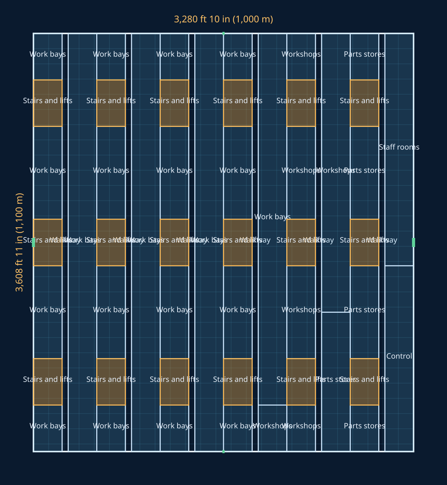

# P8-04 Owner Hangars: plan

Footprint 3,280 ft 10 in (1,000 m) × 3,608 ft 11 in (1,100 m) · structural grid 131 ft 3 in (40 m)

## Levels

| Level | Floor above deck | Height | Floor area |
|---|---|---|---|
| Level 1 · Ground floor | 0 ft (0 mm) | 65 ft 7 in (20 m) | 8,920,019 sq ft (828,697 m²) |
| Level 2 · Office level | 65 ft 7 in (20 m) | 14 ft 9 in (4,500 mm) | 1,444,517 sq ft (134,200 m²) |

## Elements

| ID | Designation | Type | Name | Level(s) | Size / length | Area | Status |
|---|---|---|---|---|---|---|---|
| L1-001 | D5F3P8B9A1L1R1 | zone | Walkway | L1 | 52 ft 6 in (16 m) × 3,608 ft 11 in (1,100 m) | 189,445 sq ft (17,600 m²) | proposed |
| L1-002 | D5F3P8B9A1L1R2 | zone | Walkway | L1 | 52 ft 6 in (16 m) × 3,608 ft 11 in (1,100 m) | 189,445 sq ft (17,600 m²) | proposed |
| L1-003 | D5F3P8B9A1L1R3 | zone | Walkway | L1 | 52 ft 6 in (16 m) × 3,608 ft 11 in (1,100 m) | 189,445 sq ft (17,600 m²) | proposed |
| L1-004 | D5F3P8B9A1L1R4 | zone | Walkway | L1 | 52 ft 6 in (16 m) × 3,608 ft 11 in (1,100 m) | 189,445 sq ft (17,600 m²) | proposed |
| L1-005 | D5F3P8B9A1L1R5 | zone | Walkway | L1 | 52 ft 6 in (16 m) × 3,608 ft 11 in (1,100 m) | 189,445 sq ft (17,600 m²) | proposed |
| L1-006 | D5F3P8B9A1L1R6 | zone | Walkway | L1 | 52 ft 6 in (16 m) × 3,608 ft 11 in (1,100 m) | 189,445 sq ft (17,600 m²) | proposed |
| L1-007 | D5F3P8B9A1L1R7 | room | Work bays | L1 | 247 ft 1 in (75 m) × 400 ft 11 in (122 m) | 99,046 sq ft (9,202 m²) | proposed |
| L1-008 | D5F3P8B9A1L1R8 | room | Work bays | L1 | 247 ft 1 in (75 m) × 802 ft 2 in (244 m) | 198,173 sq ft (18,411 m²) | proposed |
| L1-009 | D5F3P8B9A1L1R9 | room | Work bays | L1 | 247 ft 1 in (75 m) × 802 ft 2 in (244 m) | 198,173 sq ft (18,411 m²) | proposed |
| L1-010 | D5F3P8B9A1L1R10 | room | Work bays | L1 | 247 ft 1 in (75 m) × 400 ft 11 in (122 m) | 99,046 sq ft (9,202 m²) | proposed |
| L1-011 | D5F3P8B9A1L1R11 | room | Work bays | L1 | 247 ft 5 in (75 m) × 3,608 ft 11 in (1,100 m) | 892,759 sq ft (82,940 m²) | proposed |
| L1-012 | D5F3P8B9A1L1R12 | room | Work bays | L1 | 247 ft 1 in (75 m) × 400 ft 11 in (122 m) | 99,046 sq ft (9,202 m²) | proposed |
| L1-013 | D5F3P8B9A1L1R13 | room | Work bays | L1 | 247 ft 1 in (75 m) × 802 ft 2 in (244 m) | 198,173 sq ft (18,411 m²) | proposed |
| L1-014 | D5F3P8B9A1L1R14 | room | Work bays | L1 | 247 ft 1 in (75 m) × 802 ft 2 in (244 m) | 198,173 sq ft (18,411 m²) | proposed |
| L1-015 | D5F3P8B9A1L1R15 | room | Work bays | L1 | 247 ft 1 in (75 m) × 400 ft 11 in (122 m) | 99,046 sq ft (9,202 m²) | proposed |
| L1-016 | D5F3P8B9A1L1R16 | room | Work bays | L1 | 247 ft 1 in (75 m) × 3,608 ft 11 in (1,100 m) | 891,575 sq ft (82,830 m²) | proposed |
| L1-017 | D5F3P8B9A1L1R17 | room | Work bays | L1 | 247 ft 5 in (75 m) × 400 ft 11 in (122 m) | 99,177 sq ft (9,214 m²) | proposed |
| L1-018 | D5F3P8B9A1L1R18 | room | Work bays | L1 | 247 ft 5 in (75 m) × 802 ft 2 in (244 m) | 198,436 sq ft (18,435 m²) | proposed |
| L1-019 | D5F3P8B9A1L1R19 | room | Work bays | L1 | 247 ft 5 in (75 m) × 802 ft 2 in (244 m) | 198,436 sq ft (18,435 m²) | proposed |
| L1-020 | D5F3P8B9A1L1R20 | room | Work bays | L1 | 247 ft 5 in (75 m) × 400 ft 11 in (122 m) | 99,177 sq ft (9,214 m²) | proposed |
| L1-021 | D5F3P8B9A1L1R21 | room | Work bays | L1 | 247 ft 1 in (75 m) × 3,608 ft 11 in (1,100 m) | 891,575 sq ft (82,830 m²) | proposed |
| L1-022 | D5F3P8B9A1L1R22 | room | Work bays | L1 | 247 ft 1 in (75 m) × 400 ft 11 in (122 m) | 99,046 sq ft (9,202 m²) | proposed |
| L1-023 | D5F3P8B9A1L1R23 | room | Work bays | L1 | 247 ft 1 in (75 m) × 802 ft 2 in (244 m) | 198,173 sq ft (18,411 m²) | proposed |
| L1-024 | D5F3P8B9A1L1R24 | room | Work bays | L1 | 247 ft 1 in (75 m) × 802 ft 2 in (244 m) | 198,173 sq ft (18,411 m²) | proposed |
| L1-025 | D5F3P8B9A1L1R25 | room | Work bays | L1 | 247 ft 1 in (75 m) × 400 ft 11 in (122 m) | 99,046 sq ft (9,202 m²) | proposed |
| L1-026 | D5F3P8B9A1L1R26 | room | Work bays | L1 | 247 ft 5 in (75 m) × 3,208 ft (978 m) | 793,581 sq ft (73,726 m²) | proposed |
| L1-027 | D5F3P8B9A1L1R27 | room | Workshops | L1 | 247 ft 5 in (75 m) × 400 ft 11 in (122 m) | 99,177 sq ft (9,214 m²) | proposed |
| L1-028 | D5F3P8B9A1L1R28 | room | Workshops | L1 | 247 ft 1 in (75 m) × 400 ft 11 in (122 m) | 99,046 sq ft (9,202 m²) | proposed |
| L1-029 | D5F3P8B9A1L1R29 | room | Workshops | L1 | 247 ft 1 in (75 m) × 802 ft 2 in (244 m) | 198,173 sq ft (18,411 m²) | proposed |
| L1-030 | D5F3P8B9A1L1R30 | room | Workshops | L1 | 247 ft 1 in (75 m) × 802 ft 2 in (244 m) | 198,173 sq ft (18,411 m²) | proposed |
| L1-031 | D5F3P8B9A1L1R31 | room | Workshops | L1 | 247 ft 1 in (75 m) × 400 ft 11 in (122 m) | 99,046 sq ft (9,202 m²) | proposed |
| L1-032 | D5F3P8B9A1L1R32 | room | Workshops | L1 | 247 ft 1 in (75 m) × 2,405 ft 10 in (733 m) | 594,356 sq ft (55,217 m²) | proposed |
| L1-033 | D5F3P8B9A1L1R33 | room | Parts stores | L1 | 247 ft 1 in (75 m) × 1,203 ft 1 in (367 m) | 297,219 sq ft (27,613 m²) | proposed |
| L1-034 | D5F3P8B9A1L1R34 | room | Parts stores | L1 | 247 ft 5 in (75 m) × 400 ft 11 in (122 m) | 99,177 sq ft (9,214 m²) | proposed |
| L1-035 | D5F3P8B9A1L1R35 | room | Parts stores | L1 | 247 ft 5 in (75 m) × 802 ft 2 in (244 m) | 198,436 sq ft (18,435 m²) | proposed |
| L1-036 | D5F3P8B9A1L1R36 | room | Parts stores | L1 | 247 ft 5 in (75 m) × 802 ft 2 in (244 m) | 198,436 sq ft (18,435 m²) | proposed |
| L1-037 | D5F3P8B9A1L1R37 | room | Parts stores | L1 | 247 ft 5 in (75 m) × 400 ft 11 in (122 m) | 99,177 sq ft (9,214 m²) | proposed |
| L1-038 | D5F3P8B9A1L1R38 | room | Staff rooms | L1 | 247 ft 1 in (75 m) × 2,004 ft 11 in (611 m) | 495,310 sq ft (46,016 m²) | proposed |
| L1-039 | D5F3P8B9A1L1R39 | room | Control | L1 | 247 ft 1 in (75 m) × 1,604 ft (489 m) | 396,264 sq ft (36,814 m²) | proposed |
| L1-040 | D5F3P8B9A1L1R40, D5F3P8B9A1L2R1 | core | Stairs and lifts | L1, L2 | 247 ft 1 in (75 m) × 400 ft 11 in (122 m) | 99,046 sq ft (9,202 m²) | proposed |
| L1-041 | D5F3P8B9A1L1R41, D5F3P8B9A1L2R2 | core | Stairs and lifts | L1, L2 | 247 ft 1 in (75 m) × 400 ft 11 in (122 m) | 99,046 sq ft (9,202 m²) | proposed |
| L1-042 | D5F3P8B9A1L1R42, D5F3P8B9A1L2R3 | core | Stairs and lifts | L1, L2 | 247 ft 1 in (75 m) × 400 ft 11 in (122 m) | 99,046 sq ft (9,202 m²) | proposed |
| L1-043 | D5F3P8B9A1L1R43, D5F3P8B9A1L2R4 | core | Stairs and lifts | L1, L2 | 247 ft 1 in (75 m) × 400 ft 11 in (122 m) | 99,046 sq ft (9,202 m²) | proposed |
| L1-044 | D5F3P8B9A1L1R44, D5F3P8B9A1L2R5 | core | Stairs and lifts | L1, L2 | 247 ft 1 in (75 m) × 400 ft 11 in (122 m) | 99,046 sq ft (9,202 m²) | proposed |
| L1-045 | D5F3P8B9A1L1R45, D5F3P8B9A1L2R6 | core | Stairs and lifts | L1, L2 | 247 ft 1 in (75 m) × 400 ft 11 in (122 m) | 99,046 sq ft (9,202 m²) | proposed |
| L1-046 | D5F3P8B9A1L1R46, D5F3P8B9A1L2R7 | core | Stairs and lifts | L1, L2 | 247 ft 5 in (75 m) × 400 ft 11 in (122 m) | 99,177 sq ft (9,214 m²) | proposed |
| L1-047 | D5F3P8B9A1L1R47, D5F3P8B9A1L2R8 | core | Stairs and lifts | L1, L2 | 247 ft 5 in (75 m) × 400 ft 11 in (122 m) | 99,177 sq ft (9,214 m²) | proposed |
| L1-048 | D5F3P8B9A1L1R48, D5F3P8B9A1L2R9 | core | Stairs and lifts | L1, L2 | 247 ft 5 in (75 m) × 400 ft 11 in (122 m) | 99,177 sq ft (9,214 m²) | proposed |
| L1-049 | D5F3P8B9A1L1R49, D5F3P8B9A1L2R10 | core | Stairs and lifts | L1, L2 | 247 ft 1 in (75 m) × 400 ft 11 in (122 m) | 99,046 sq ft (9,202 m²) | proposed |
| L1-050 | D5F3P8B9A1L1R50, D5F3P8B9A1L2R11 | core | Stairs and lifts | L1, L2 | 247 ft 1 in (75 m) × 400 ft 11 in (122 m) | 99,046 sq ft (9,202 m²) | proposed |
| L1-051 | D5F3P8B9A1L1R51, D5F3P8B9A1L2R12 | core | Stairs and lifts | L1, L2 | 247 ft 1 in (75 m) × 400 ft 11 in (122 m) | 99,046 sq ft (9,202 m²) | proposed |
| L1-052 | D5F3P8B9A1L1R52, D5F3P8B9A1L2R13 | core | Stairs and lifts | L1, L2 | 247 ft 1 in (75 m) × 400 ft 11 in (122 m) | 99,046 sq ft (9,202 m²) | proposed |
| L1-053 | D5F3P8B9A1L1R53, D5F3P8B9A1L2R14 | core | Stairs and lifts | L1, L2 | 247 ft 1 in (75 m) × 400 ft 11 in (122 m) | 99,046 sq ft (9,202 m²) | proposed |
| L1-054 | D5F3P8B9A1L1R54, D5F3P8B9A1L2R15 | core | Stairs and lifts | L1, L2 | 247 ft 1 in (75 m) × 400 ft 11 in (122 m) | 99,046 sq ft (9,202 m²) | proposed |
| L1-055 | D5F3P8B9A1L1R55, D5F3P8B9A1L2R16 | core | Stairs and lifts | L1, L2 | 247 ft 5 in (75 m) × 400 ft 11 in (122 m) | 99,177 sq ft (9,214 m²) | proposed |
| L1-056 | D5F3P8B9A1L1R56, D5F3P8B9A1L2R17 | core | Stairs and lifts | L1, L2 | 247 ft 5 in (75 m) × 400 ft 11 in (122 m) | 99,177 sq ft (9,214 m²) | proposed |
| L1-057 | D5F3P8B9A1L1R57, D5F3P8B9A1L2R18 | core | Stairs and lifts | L1, L2 | 247 ft 5 in (75 m) × 400 ft 11 in (122 m) | 99,177 sq ft (9,214 m²) | proposed |
| L2-001 | D5F3P8B9A1L2R19 | zone | Corridor | L2 | 9 ft 10 in (3,000 mm) × 3,608 ft 11 in (1,100 m) | 35,521 sq ft (3,300 m²) | proposed |
| L2-002 | D5F3P8B9A1L2R20 | room | Offices | L2 | 200 ft 2 in (61 m) × 3,608 ft 11 in (1,100 m) | 722,258 sq ft (67,100 m²) | proposed |
| L2-003 | D5F3P8B9A1L2R21 | room | Control room | L2 | 200 ft 2 in (61 m) × 1,203 ft 1 in (367 m) | 240,775 sq ft (22,369 m²) | proposed |
| L2-004 | D5F3P8B9A1L2R22 | room | Training rooms | L2 | 200 ft 2 in (61 m) × 1,202 ft 9 in (367 m) | 240,709 sq ft (22,363 m²) | proposed |
| L2-005 | D5F3P8B9A1L2R23 | room | Staff rooms | L2 | 200 ft 2 in (61 m) × 1,203 ft 1 in (367 m) | 240,775 sq ft (22,369 m²) | proposed |
| D-63 |  | door | Main entrance | L1 | 78 ft 9 in (24 m), 78 ft 9 in (24 m) wide | — | proposed |
| D-64 |  | door | Second entrance | L1 | 78 ft 9 in (24 m), 78 ft 9 in (24 m) wide | — | proposed |
| D-65 |  | door | Side door | L1 | 19 ft 8 in (6,000 mm), 19 ft 8 in (6,000 mm) wide | — | proposed |
| D-66 |  | door | Side door | L1 | 19 ft 8 in (6,000 mm), 19 ft 8 in (6,000 mm) wide | — | proposed |

## Drawings

### Level 1 · Ground floor

### Level 2 · Office level

