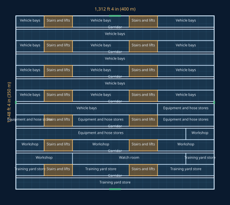
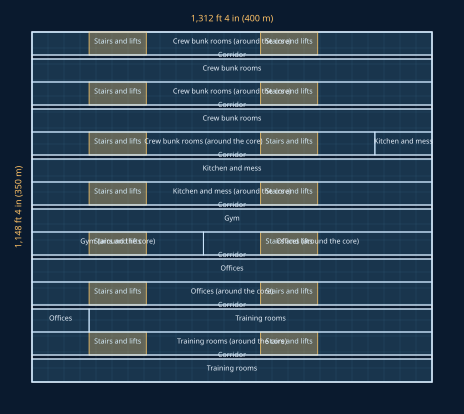
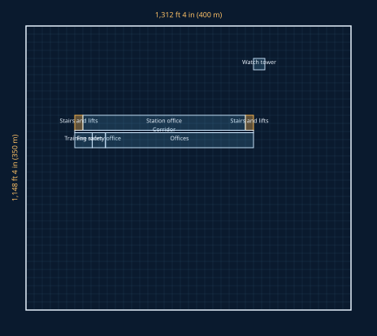
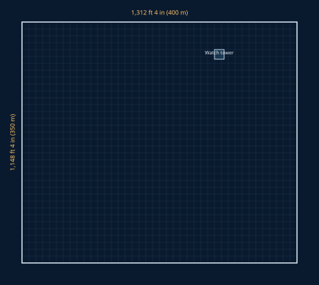

# P8-05 Shuttle Yards Fire Station: plan

Footprint 1,312 ft 4 in (400 m) × 1,148 ft 4 in (350 m) · structural grid 32 ft 10 in (10 m)

## Levels

| Level | Floor above deck | Height | Floor area |
|---|---|---|---|
| Level 1 · Ground floor | 0 ft (0 mm) | 14 ft 9 in (4,500 mm) | 264,426 sq ft (24,566 m²) |
| Level 2 · Level 2 | 14 ft 9 in (4,500 mm) | 14 ft 9 in (4,500 mm) | 264,426 sq ft (24,566 m²) |
| Level 3 · Level 3 | 29 ft 6 in (9,000 mm) | 14 ft 9 in (4,500 mm) | 85,745 sq ft (7,966 m²) |
| Level 4 · Watch cab | 44 ft 3 in (14 m) | 14 ft 9 in (4,500 mm) | 2,110 sq ft (196 m²) |

## Elements

| ID | Designation | Type | Name | Level(s) | Size / length | Area | Status |
|---|---|---|---|---|---|---|---|
| E001 | D5F3P8B12A1L1R1 | zone | Airside forecourt | L1 | 1,312 ft 4 in (400 m) × 131 ft 3 in (40 m) | 172,223 sq ft (16,000 m²) | proposed |
| E002 | D5F3P8B12A1L1R2, D5F3P8B12A1L2R1 | room | Crash tender bay 1 | L1, L2 | 90 ft 3 in (28 m) × 229 ft 8 in (70 m) | 20,721 sq ft (1,925 m²) | proposed |
| E003 | D5F3P8B12A1L1R3, D5F3P8B12A1L2R2 | room | Crash tender bay 2 | L1, L2 | 90 ft 3 in (28 m) × 229 ft 8 in (70 m) | 20,721 sq ft (1,925 m²) | proposed |
| E004 | D5F3P8B12A1L1R4, D5F3P8B12A1L2R3 | room | Crash tender bay 3 | L1, L2 | 90 ft 3 in (28 m) × 229 ft 8 in (70 m) | 20,721 sq ft (1,925 m²) | proposed |
| E005 | D5F3P8B12A1L1R5, D5F3P8B12A1L2R4 | room | Crash tender bay 4 | L1, L2 | 90 ft 3 in (28 m) × 229 ft 8 in (70 m) | 20,721 sq ft (1,925 m²) | proposed |
| E006 | D5F3P8B12A1L1R6, D5F3P8B12A1L2R5 | room | Crash tender bay 5 | L1, L2 | 90 ft 3 in (28 m) × 229 ft 8 in (70 m) | 20,721 sq ft (1,925 m²) | proposed |
| E007 | D5F3P8B12A1L1R7, D5F3P8B12A1L2R6 | room | Crash tender bay 6 | L1, L2 | 90 ft 3 in (28 m) × 229 ft 8 in (70 m) | 20,721 sq ft (1,925 m²) | proposed |
| E008 | D5F3P8B12A1L1R8, D5F3P8B12A1L2R7 | room | Crash tender bay 7 | L1, L2 | 90 ft 3 in (28 m) × 229 ft 8 in (70 m) | 20,721 sq ft (1,925 m²) | proposed |
| E009 | D5F3P8B12A1L1R9, D5F3P8B12A1L2R8 | room | Crash tender bay 8 | L1, L2 | 90 ft 3 in (28 m) × 229 ft 8 in (70 m) | 20,721 sq ft (1,925 m²) | proposed |
| E010 | D5F3P8B12A1L1R10, D5F3P8B12A1L2R9, D5F3P8B12A1L3R1 | core | Stairs and lifts | L1, L2, L3 | 32 ft 10 in (10 m) × 60 ft 8 in (18 m) | 1,991 sq ft (185 m²) | proposed |
| E011 | D5F3P8B12A1L1R11, D5F3P8B12A1L2R10, D5F3P8B12A1L3R2 | core | Stairs and lifts | L1, L2, L3 | 32 ft 10 in (10 m) × 60 ft 8 in (18 m) | 1,991 sq ft (185 m²) | proposed |
| E012 | D5F3P8B12A1L1R12 | zone | Corridor | L1 | 721 ft 9 in (220 m) × 9 ft 10 in (3,000 mm) | 7,104 sq ft (660 m²) | proposed |
| E013 | D5F3P8B12A1L1R13 | room | Watch room | L1 | 174 ft 10 in (53 m) × 60 ft 8 in (18 m) | 10,614 sq ft (986 m²) | proposed |
| E014 | D5F3P8B12A1L1R14 | room | Breathing apparatus room | L1 | 262 ft 6 in (80 m) × 60 ft 8 in (18 m) | 15,931 sq ft (1,480 m²) | proposed |
| E015 | D5F3P8B12A1L1R15 | room | Decontamination | L1 | 218 ft 10 in (67 m) × 60 ft 8 in (18 m) | 13,282 sq ft (1,234 m²) | proposed |
| E016 | D5F3P8B12A1L1R16 | room | Equipment store | L1 | 159 ft 5 in (49 m) × 60 ft 8 in (18 m) | 9,678 sq ft (899 m²) | proposed |
| E017 | D5F3P8B12A1L1R17 | room | Workshop | L1 | 562 ft 4 in (171 m) × 60 ft 8 in (18 m) | 34,131 sq ft (3,171 m²) | proposed |
| E018 | D5F3P8B12A1L2R11 | zone | Corridor | L2 | 721 ft 9 in (220 m) × 9 ft 10 in (3,000 mm) | 7,104 sq ft (660 m²) | proposed |
| E019 | D5F3P8B12A1L2R12 | room | Bunk rooms | L2 | 18 ft 1 in (5,500 mm) × 60 ft 8 in (18 m) | 1,095 sq ft (102 m²) | proposed |
| E020 | D5F3P8B12A1L2R13 | room | Bunk rooms | L2 | 18 ft 1 in (5,500 mm) × 60 ft 8 in (18 m) | 1,095 sq ft (102 m²) | proposed |
| E021 | D5F3P8B12A1L2R14 | room | Bunk rooms | L2 | 17 ft 9 in (5,400 mm) × 60 ft 8 in (18 m) | 1,075 sq ft (100 m²) | proposed |
| E022 | D5F3P8B12A1L2R15 | room | Bunk rooms | L2 | 18 ft 1 in (5,500 mm) × 60 ft 8 in (18 m) | 1,095 sq ft (102 m²) | proposed |
| E023 | D5F3P8B12A1L2R16 | room | Bunk rooms | L2 | 18 ft 1 in (5,500 mm) × 60 ft 8 in (18 m) | 1,095 sq ft (102 m²) | proposed |
| E024 | D5F3P8B12A1L2R17 | room | Bunk rooms | L2 | 18 ft 1 in (5,500 mm) × 60 ft 8 in (18 m) | 1,095 sq ft (102 m²) | proposed |
| E025 | D5F3P8B12A1L2R18 | room | Bunk rooms | L2 | 18 ft 1 in (5,500 mm) × 60 ft 8 in (18 m) | 1,095 sq ft (102 m²) | proposed |
| E026 | D5F3P8B12A1L2R19 | room | Bunk rooms | L2 | 17 ft 9 in (5,400 mm) × 60 ft 8 in (18 m) | 1,075 sq ft (100 m²) | proposed |
| E027 | D5F3P8B12A1L2R20 | room | Bunk rooms | L2 | 18 ft 1 in (5,500 mm) × 60 ft 8 in (18 m) | 1,095 sq ft (102 m²) | proposed |
| E028 | D5F3P8B12A1L2R21 | room | Bunk rooms | L2 | 18 ft 1 in (5,500 mm) × 60 ft 8 in (18 m) | 1,095 sq ft (102 m²) | proposed |
| E029 | D5F3P8B12A1L2R22 | room | Bunk rooms | L2 | 18 ft 1 in (5,500 mm) × 60 ft 8 in (18 m) | 1,095 sq ft (102 m²) | proposed |
| E030 | D5F3P8B12A1L2R23 | room | Bunk rooms | L2 | 18 ft 1 in (5,500 mm) × 60 ft 8 in (18 m) | 1,095 sq ft (102 m²) | proposed |
| E031 | D5F3P8B12A1L2R24 | room | Bunk rooms | L2 | 17 ft 9 in (5,400 mm) × 60 ft 8 in (18 m) | 1,075 sq ft (100 m²) | proposed |
| E032 | D5F3P8B12A1L2R25 | room | Bunk rooms | L2 | 18 ft 1 in (5,500 mm) × 60 ft 8 in (18 m) | 1,095 sq ft (102 m²) | proposed |
| E033 | D5F3P8B12A1L2R26 | room | Bunk rooms | L2 | 18 ft 1 in (5,500 mm) × 60 ft 8 in (18 m) | 1,095 sq ft (102 m²) | proposed |
| E034 | D5F3P8B12A1L2R27 | room | Bunk rooms | L2 | 18 ft 1 in (5,500 mm) × 60 ft 8 in (18 m) | 1,095 sq ft (102 m²) | proposed |
| E035 | D5F3P8B12A1L2R28 | room | Bunk rooms | L2 | 18 ft 1 in (5,500 mm) × 60 ft 8 in (18 m) | 1,095 sq ft (102 m²) | proposed |
| E036 | D5F3P8B12A1L2R29 | room | Bunk rooms | L2 | 17 ft 9 in (5,400 mm) × 60 ft 8 in (18 m) | 1,075 sq ft (100 m²) | proposed |
| E037 | D5F3P8B12A1L2R30 | room | Bunk rooms | L2 | 18 ft 1 in (5,500 mm) × 60 ft 8 in (18 m) | 1,095 sq ft (102 m²) | proposed |
| E038 | D5F3P8B12A1L2R31 | room | Bunk rooms | L2 | 18 ft 1 in (5,500 mm) × 60 ft 8 in (18 m) | 1,095 sq ft (102 m²) | proposed |
| E039 | D5F3P8B12A1L2R32 | room | Bunk rooms | L2 | 18 ft 1 in (5,500 mm) × 60 ft 8 in (18 m) | 1,095 sq ft (102 m²) | proposed |
| E040 | D5F3P8B12A1L2R33 | room | Bunk rooms | L2 | 17 ft 9 in (5,400 mm) × 60 ft 8 in (18 m) | 1,075 sq ft (100 m²) | proposed |
| E041 | D5F3P8B12A1L2R34 | room | Bunk rooms | L2 | 18 ft 1 in (5,500 mm) × 60 ft 8 in (18 m) | 1,095 sq ft (102 m²) | proposed |
| E042 | D5F3P8B12A1L2R35 | room | Bunk rooms | L2 | 18 ft 1 in (5,500 mm) × 60 ft 8 in (18 m) | 1,095 sq ft (102 m²) | proposed |
| E043 | D5F3P8B12A1L2R36 | room | Kitchen | L2 | 224 ft 9 in (68 m) × 60 ft 8 in (18 m) | 13,641 sq ft (1,267 m²) | proposed |
| E044 | D5F3P8B12A1L2R37 | room | Mess | L2 | 400 ft 11 in (122 m) × 60 ft 8 in (18 m) | 24,334 sq ft (2,261 m²) | proposed |
| E045 | D5F3P8B12A1L2R38 | room | Gym | L2 | 320 ft 10 in (98 m) × 60 ft 8 in (18 m) | 19,475 sq ft (1,809 m²) | proposed |
| E046 | D5F3P8B12A1L3R3 | zone | Corridor | L3 | 721 ft 9 in (220 m) × 9 ft 10 in (3,000 mm) | 7,104 sq ft (660 m²) | proposed |
| E047 | D5F3P8B12A1L3R4 | room | Station office | L3 | 656 ft 2 in (200 m) × 60 ft 8 in (18 m) | 39,826 sq ft (3,700 m²) | proposed |
| E048 | D5F3P8B12A1L3R5 | room | Training room | L3 | 70 ft 10 in (22 m) × 60 ft 8 in (18 m) | 4,301 sq ft (400 m²) | proposed |
| E049 | D5F3P8B12A1L3R6 | room | Fire safety office | L3 | 53 ft 2 in (16 m) × 60 ft 8 in (18 m) | 3,226 sq ft (300 m²) | proposed |
| E050 | D5F3P8B12A1L3R7 | room | Offices | L3 | 597 ft 9 in (182 m) × 60 ft 8 in (18 m) | 36,282 sq ft (3,371 m²) | proposed |
| E051 | D5F3P8B12A1L1R18, D5F3P8B12A1L2R39, D5F3P8B12A1L3R8, D5F3P8B12A1L4R1 | room | Watch tower | L1, L2, L3, L4 | 45 ft 11 in (14 m) × 45 ft 11 in (14 m) | 2,110 sq ft (196 m²) | proposed |
| E052 | D5F3P8B12A1L1R19 | zone | Training ground | L1 | 295 ft 3 in (90 m) × 590 ft 7 in (180 m) | 174,375 sq ft (16,200 m²) | proposed |
| E053 | D5F3P8B12A1L1R20, D5F3P8B12A1L2R40 | room | Fire training rig (mock craft) | L1, L2 | 131 ft 3 in (40 m) × 98 ft 5 in (30 m) | 12,917 sq ft (1,200 m²) | proposed |
| E054 | D5F3P8B12A1L1R21 | zone | Drill yard | L1 | 721 ft 9 in (220 m) × 557 ft 9 in (170 m) | 402,570 sq ft (37,400 m²) | proposed |
| E055 |  | door | Appliance doors (airside) | L1 | 721 ft 9 in (220 m), 721 ft 9 in (220 m) wide | — | proposed |
| E056 |  | door | Appliance doors (road side) | L1 | 131 ft 3 in (40 m), 131 ft 3 in (40 m) wide | — | proposed |

## Drawings

### Level 1 · Ground floor

### Level 2 · Level 2

### Level 3 · Level 3

### Level 4 · Watch cab

