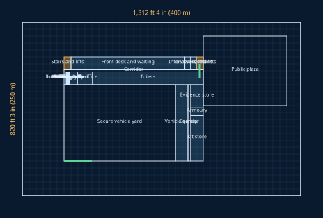
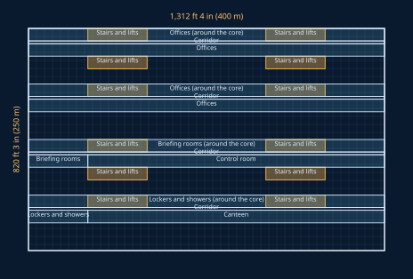

# P8-06 Shuttle Yards Police Post: plan

Footprint 1,312 ft 4 in (400 m) × 820 ft 3 in (250 m) · structural grid 32 ft 10 in (10 m)

## Levels

| Level | Floor above deck | Height | Floor area |
|---|---|---|---|
| Level 1 · Ground floor | 0 ft (0 mm) | 13 ft 9 in (4,200 mm) | 118,295 sq ft (10,990 m²) |
| Level 2 · Upper floor | 13 ft 9 in (4,200 mm) | 13 ft 9 in (4,200 mm) | 75,670 sq ft (7,030 m²) |

## Elements

| ID | Designation | Type | Name | Level(s) | Size / length | Area | Status |
|---|---|---|---|---|---|---|---|
| E001 | D5F3P8B13A1L1R1, D5F3P8B13A1L2R1 | core | Stairs and lifts | L1, L2 | 32 ft 10 in (10 m) × 60 ft 8 in (18 m) | 1,991 sq ft (185 m²) | proposed |
| E002 | D5F3P8B13A1L1R2, D5F3P8B13A1L2R2 | core | Stairs and lifts | L1, L2 | 32 ft 10 in (10 m) × 60 ft 8 in (18 m) | 1,991 sq ft (185 m²) | proposed |
| E003 | D5F3P8B13A1L1R3 | zone | Corridor | L1 | 656 ft 2 in (200 m) × 9 ft 10 in (3,000 mm) | 6,458 sq ft (600 m²) | proposed |
| E004 | D5F3P8B13A1L1R4 | room | Front desk and waiting | L1 | 536 ft 9 in (164 m) × 60 ft 8 in (18 m) | 32,578 sq ft (3,027 m²) | proposed |
| E005 | D5F3P8B13A1L1R5 | room | Interview rooms | L1 | 26 ft 11 in (8,200 mm) × 60 ft 8 in (18 m) | 1,633 sq ft (152 m²) | proposed |
| E006 | D5F3P8B13A1L1R6 | room | Interview rooms | L1 | 26 ft 11 in (8,200 mm) × 60 ft 8 in (18 m) | 1,633 sq ft (152 m²) | proposed |
| E007 | D5F3P8B13A1L1R7 | room | Interview rooms | L1 | 5 ft 3 in (1,600 mm) × 60 ft 8 in (18 m) | 319 sq ft (30 m²) | proposed |
| E008 | D5F3P8B13A1L1R8 | room | Interview rooms | L1 | 5 ft 3 in (1,600 mm) × 60 ft 8 in (18 m) | 319 sq ft (30 m²) | proposed |
| E009 | D5F3P8B13A1L1R9 | room | Holding cells | L1 | 2 ft 4 in (700 mm) × 60 ft 8 in (18 m) | 139 sq ft (13 m²) | proposed |
| E010 | D5F3P8B13A1L1R10 | room | Holding cells | L1 | 2 ft (600 mm) × 60 ft 8 in (18 m) | 119 sq ft (11 m²) | proposed |
| E011 | D5F3P8B13A1L1R11 | room | Holding cells | L1 | 2 ft 4 in (700 mm) × 60 ft 8 in (18 m) | 139 sq ft (13 m²) | proposed |
| E012 | D5F3P8B13A1L1R12 | room | Holding cells | L1 | 2 ft (600 mm) × 60 ft 8 in (18 m) | 119 sq ft (11 m²) | proposed |
| E013 | D5F3P8B13A1L1R13 | room | Holding cells | L1 | 2 ft 4 in (700 mm) × 60 ft 8 in (18 m) | 139 sq ft (13 m²) | proposed |
| E014 | D5F3P8B13A1L1R14 | room | Holding cells | L1 | 2 ft (600 mm) × 60 ft 8 in (18 m) | 119 sq ft (11 m²) | proposed |
| E015 | D5F3P8B13A1L1R15 | room | Holding cells | L1 | 2 ft 4 in (700 mm) × 60 ft 8 in (18 m) | 139 sq ft (13 m²) | proposed |
| E016 | D5F3P8B13A1L1R16 | room | Holding cells | L1 | 2 ft (600 mm) × 60 ft 8 in (18 m) | 119 sq ft (11 m²) | proposed |
| E017 | D5F3P8B13A1L1R17 | room | Custody desk | L1 | 35 ft 5 in (11 m) × 60 ft 8 in (18 m) | 2,151 sq ft (200 m²) | proposed |
| E018 | D5F3P8B13A1L1R18 | room | Duty office | L1 | 71 ft 2 in (22 m) × 60 ft 8 in (18 m) | 4,321 sq ft (401 m²) | proposed |
| E019 | D5F3P8B13A1L1R19 | room | Toilets | L1 | 522 ft (159 m) × 60 ft 8 in (18 m) | 31,682 sq ft (2,943 m²) | proposed |
| E020 | D5F3P8B13A1L2R3 | zone | Corridor | L2 | 656 ft 2 in (200 m) × 9 ft 10 in (3,000 mm) | 6,458 sq ft (600 m²) | proposed |
| E021 | D5F3P8B13A1L2R4 | room | Open office | L2 | 590 ft 7 in (180 m) × 60 ft 8 in (18 m) | 35,844 sq ft (3,330 m²) | proposed |
| E022 | D5F3P8B13A1L2R5 | room | Briefing room | L2 | 53 ft 2 in (16 m) × 60 ft 8 in (18 m) | 3,226 sq ft (300 m²) | proposed |
| E023 | D5F3P8B13A1L2R6 | room | Control room | L2 | 70 ft 10 in (22 m) × 60 ft 8 in (18 m) | 4,301 sq ft (400 m²) | proposed |
| E024 | D5F3P8B13A1L2R7 | room | Lockers and showers | L2 | 88 ft 11 in (27 m) × 60 ft 8 in (18 m) | 5,396 sq ft (501 m²) | proposed |
| E025 | D5F3P8B13A1L2R8 | room | Canteen | L2 | 443 ft 3 in (135 m) × 60 ft 8 in (18 m) | 26,903 sq ft (2,499 m²) | proposed |
| E026 | D5F3P8B13A1L1R20 | zone | Corridor | L1 | 13 ft 1 in (4,000 mm) × 360 ft 11 in (110 m) | 4,736 sq ft (440 m²) | proposed |
| E027 | D5F3P8B13A1L1R21 | room | Vehicle garage | L1 | 59 ft 1 in (18 m) × 360 ft 11 in (110 m) | 21,313 sq ft (1,980 m²) | proposed |
| E028 | D5F3P8B13A1L1R22 | room | Evidence store | L1 | 59 ft 1 in (18 m) × 109 ft 3 in (33 m) | 6,452 sq ft (599 m²) | proposed |
| E029 | D5F3P8B13A1L1R23 | room | Armoury | L1 | 59 ft 1 in (18 m) × 36 ft 5 in (11 m) | 2,151 sq ft (200 m²) | proposed |
| E030 | D5F3P8B13A1L1R24 | room | Kit store | L1 | 59 ft 1 in (18 m) × 215 ft 3 in (66 m) | 12,710 sq ft (1,181 m²) | proposed |
| E031 | D5F3P8B13A1L1R25 | zone | Secure vehicle yard | L1 | 524 ft 11 in (160 m) × 360 ft 11 in (110 m) | 189,445 sq ft (17,600 m²) | proposed |
| E032 | D5F3P8B13A1L1R26 | zone | Public plaza | L1 | 393 ft 8 in (120 m) × 328 ft 1 in (100 m) | 129,167 sq ft (12,000 m²) | proposed |
| E033 |  | door | Public entrance | L1 | 65 ft 7 in (20 m), 65 ft 7 in (20 m) wide | — | proposed |
| E034 |  | door | Vehicle gate | L1 | 131 ft 3 in (40 m), 131 ft 3 in (40 m) wide | — | proposed |

## Drawings

### Level 1 · Ground floor

### Level 2 · Upper floor

