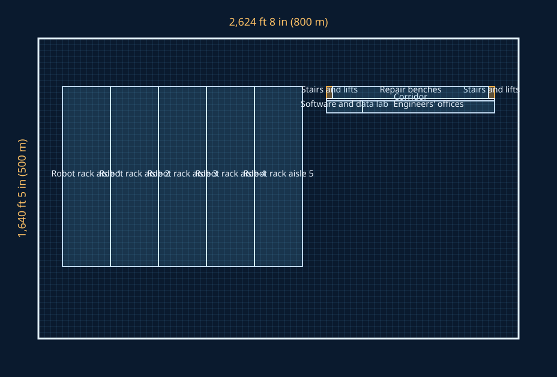
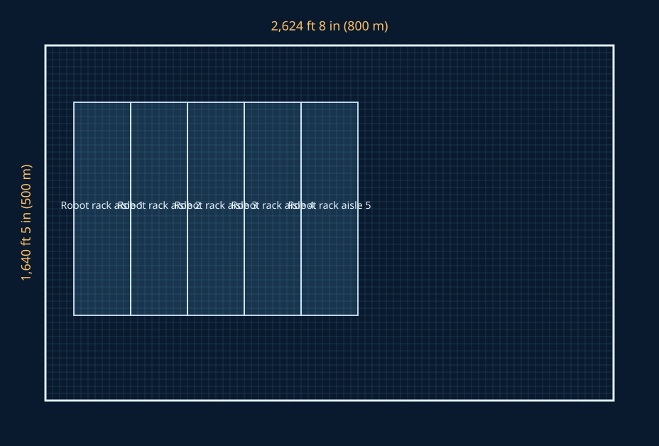

# P8-07 Parts & Avionics: plan

Footprint 2,624 ft 8 in (800 m) × 1,640 ft 5 in (500 m) · structural grid 32 ft 10 in (10 m)

## Levels

| Level | Floor above deck | Height | Floor area |
|---|---|---|---|
| Level 1 · Ground floor | 0 ft (0 mm) | 16 ft 5 in (5,000 mm) | 1,487,842 sq ft (138,225 m²) |
| Level 2 · Level 2 | 16 ft 5 in (5,000 mm) | 16 ft 5 in (5,000 mm) | 1,487,842 sq ft (138,225 m²) |
| Level 3 · Level 3 | 32 ft 10 in (10 m) | 16 ft 5 in (5,000 mm) | 1,407,920 sq ft (130,800 m²) |
| Level 4 · Rack top | 49 ft 3 in (15 m) | 16 ft 5 in (5,000 mm) | 1,291,669 sq ft (120,000 m²) |

## Elements

| ID | Designation | Type | Name | Level(s) | Size / length | Area | Status |
|---|---|---|---|---|---|---|---|
| E001 | D5F3P8B16A1L1R1 | zone | Airside dispatch | L1 | 2,362 ft 2 in (720 m) × 196 ft 10 in (60 m) | 465,001 sq ft (43,200 m²) | proposed |
| E002 | D5F3P8B16A1L1R2, D5F3P8B16A1L2R1, D5F3P8B16A1L3R1, D5F3P8B16A1L4R1 | room | Robot rack aisle 1 | L1, L2, L3, L4 | 262 ft 6 in (80 m) × 984 ft 3 in (300 m) | 258,334 sq ft (24,000 m²) | proposed |
| E003 | D5F3P8B16A1L1R3, D5F3P8B16A1L2R2, D5F3P8B16A1L3R2, D5F3P8B16A1L4R2 | room | Robot rack aisle 2 | L1, L2, L3, L4 | 262 ft 6 in (80 m) × 984 ft 3 in (300 m) | 258,334 sq ft (24,000 m²) | proposed |
| E004 | D5F3P8B16A1L1R4, D5F3P8B16A1L2R3, D5F3P8B16A1L3R3, D5F3P8B16A1L4R3 | room | Robot rack aisle 3 | L1, L2, L3, L4 | 262 ft 6 in (80 m) × 984 ft 3 in (300 m) | 258,334 sq ft (24,000 m²) | proposed |
| E005 | D5F3P8B16A1L1R5, D5F3P8B16A1L2R4, D5F3P8B16A1L3R4, D5F3P8B16A1L4R4 | room | Robot rack aisle 4 | L1, L2, L3, L4 | 262 ft 6 in (80 m) × 984 ft 3 in (300 m) | 258,334 sq ft (24,000 m²) | proposed |
| E006 | D5F3P8B16A1L1R6, D5F3P8B16A1L2R5, D5F3P8B16A1L3R5, D5F3P8B16A1L4R5 | room | Robot rack aisle 5 | L1, L2, L3, L4 | 262 ft 6 in (80 m) × 984 ft 3 in (300 m) | 258,334 sq ft (24,000 m²) | proposed |
| E007 | D5F3P8B16A1L1R7, D5F3P8B16A1L2R6, D5F3P8B16A1L3R6 | core | Stairs and lifts | L1, L2, L3 | 32 ft 10 in (10 m) × 65 ft 7 in (20 m) | 2,153 sq ft (200 m²) | proposed |
| E008 | D5F3P8B16A1L1R8, D5F3P8B16A1L2R7, D5F3P8B16A1L3R7 | core | Stairs and lifts | L1, L2, L3 | 32 ft 10 in (10 m) × 65 ft 7 in (20 m) | 2,153 sq ft (200 m²) | proposed |
| E009 | D5F3P8B16A1L1R9 | zone | Corridor | L1 | 918 ft 8 in (280 m) × 13 ft 1 in (4,000 mm) | 12,056 sq ft (1,120 m²) | proposed |
| E010 | D5F3P8B16A1L1R10 | room | Avionics test benches | L1 | 853 ft (260 m) × 65 ft 7 in (20 m) | 55,972 sq ft (5,200 m²) | proposed |
| E011 | D5F3P8B16A1L1R11 | room | Clean room | L1 | 196 ft 10 in (60 m) × 65 ft 7 in (20 m) | 12,917 sq ft (1,200 m²) | proposed |
| E012 | D5F3P8B16A1L1R12 | room | Antenna and radar lab | L1 | 164 ft 1 in (50 m) × 65 ft 7 in (20 m) | 10,764 sq ft (1,000 m²) | proposed |
| E013 | D5F3P8B16A1L1R13 | room | Calibration lab | L1 | 131 ft 3 in (40 m) × 65 ft 7 in (20 m) | 8,611 sq ft (800 m²) | proposed |
| E014 | D5F3P8B16A1L1R14 | room | Static-safe store | L1 | 426 ft 6 in (130 m) × 65 ft 7 in (20 m) | 27,986 sq ft (2,600 m²) | proposed |
| E015 | D5F3P8B16A1L2R8, D5F3P8B16A1L3R8 | zone | Corridor | L2, L3 | 918 ft 8 in (280 m) × 13 ft 1 in (4,000 mm) | 12,056 sq ft (1,120 m²) | proposed |
| E016 | D5F3P8B16A1L2R9, D5F3P8B16A1L3R9 | room | Repair benches | L2, L3 | 853 ft (260 m) × 65 ft 7 in (20 m) | 55,972 sq ft (5,200 m²) | proposed |
| E017 | D5F3P8B16A1L2R10, D5F3P8B16A1L3R10 | room | Software and data lab | L2, L3 | 196 ft 10 in (60 m) × 65 ft 7 in (20 m) | 12,917 sq ft (1,200 m²) | proposed |
| E018 | D5F3P8B16A1L2R11, D5F3P8B16A1L3R11 | room | Engineers' offices | L2, L3 | 721 ft 9 in (220 m) × 65 ft 7 in (20 m) | 47,361 sq ft (4,400 m²) | proposed |
| E019 | D5F3P8B16A1L1R15, D5F3P8B16A1L2R12 | core | Stairs and lifts | L1, L2 | 32 ft 10 in (10 m) × 44 ft 3 in (14 m) | 1,453 sq ft (135 m²) | proposed |
| E020 | D5F3P8B16A1L1R16 | zone | Corridor | L1 | 918 ft 8 in (280 m) × 9 ft 10 in (3,000 mm) | 9,042 sq ft (840 m²) | proposed |
| E021 | D5F3P8B16A1L1R17 | room | Trade counter | L1 | 442 ft 11 in (135 m) × 44 ft 3 in (14 m) | 19,617 sq ft (1,822 m²) | proposed |
| E022 | D5F3P8B16A1L1R18 | room | Trade counter | L1 | 221 ft 5 in (68 m) × 44 ft 3 in (14 m) | 9,809 sq ft (911 m²) | proposed |
| E023 | D5F3P8B16A1L1R19 | room | Will-call lockers | L1 | 221 ft 5 in (68 m) × 44 ft 3 in (14 m) | 9,809 sq ft (911 m²) | proposed |
| E024 | D5F3P8B16A1L1R20 | room | Goods-in inspection | L1 | 364 ft 6 in (111 m) × 44 ft 3 in (14 m) | 16,144 sq ft (1,500 m²) | proposed |
| E025 | D5F3P8B16A1L1R21 | room | Returns | L1 | 554 ft 2 in (169 m) × 44 ft 3 in (14 m) | 24,543 sq ft (2,280 m²) | proposed |
| E026 | D5F3P8B16A1L2R13 | zone | Corridor | L2 | 918 ft 8 in (280 m) × 9 ft 10 in (3,000 mm) | 9,042 sq ft (840 m²) | proposed |
| E027 | D5F3P8B16A1L2R14 | room | Purchasing | L2 | 442 ft 11 in (135 m) × 44 ft 3 in (14 m) | 19,617 sq ft (1,822 m²) | proposed |
| E028 | D5F3P8B16A1L2R15 | room | Purchasing | L2 | 442 ft 11 in (135 m) × 44 ft 3 in (14 m) | 19,617 sq ft (1,822 m²) | proposed |
| E029 | D5F3P8B16A1L2R16 | room | Offices | L2 | 918 ft 8 in (280 m) × 44 ft 3 in (14 m) | 40,688 sq ft (3,780 m²) | proposed |
| E030 | D5F3P8B16A1L1R22 | zone | Truck docks | L1 | 1,312 ft 4 in (400 m) × 295 ft 3 in (90 m) | 387,501 sq ft (36,000 m²) | proposed |
| E031 | D5F3P8B16A1L1R23 | zone | Staff garden | L1 | 918 ft 8 in (280 m) × 557 ft 9 in (170 m) | 512,362 sq ft (47,600 m²) | proposed |
| E032 |  | door | Airside dispatch doors | L1 | 918 ft 8 in (280 m), 918 ft 8 in (280 m) wide | — | proposed |
| E033 |  | door | Trade counter entrance | L1 | 65 ft 7 in (20 m), 65 ft 7 in (20 m) wide | — | proposed |

## Drawings

### Level 1 · Ground floor

### Level 2 · Level 2

### Level 3 · Level 3

### Level 4 · Rack top

