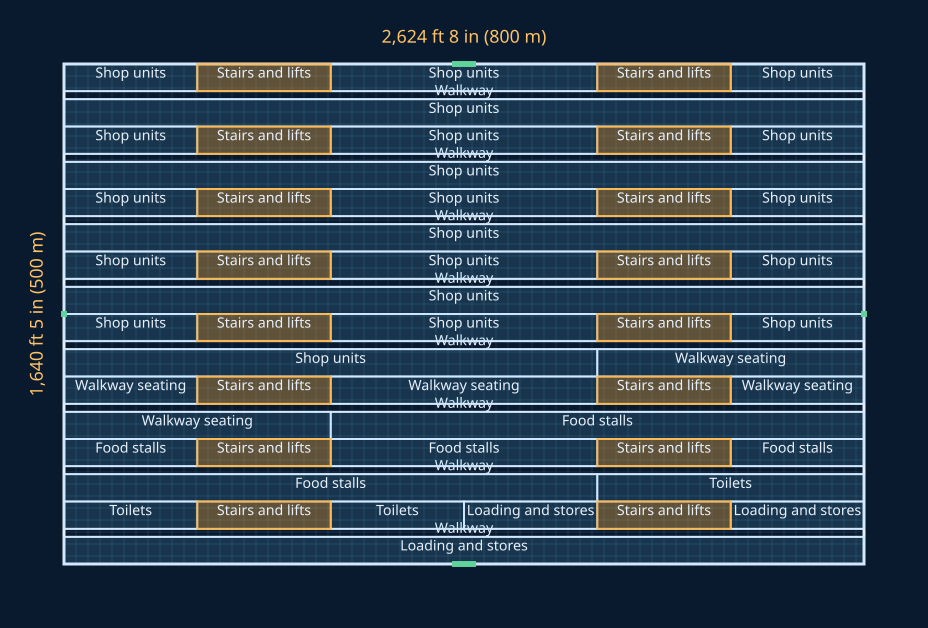
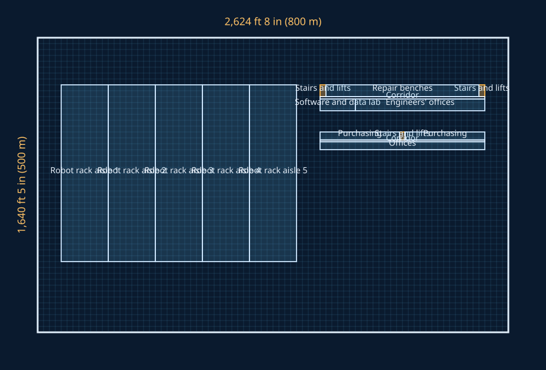

# P8-07 Parts & Avionics: plan

Footprint 2,624 ft 8 in (800 m) × 1,640 ft 5 in (500 m) · structural grid 39 ft 4 in (12 m)

## Levels

| Level | Floor above deck | Height | Floor area |
|---|---|---|---|
| Level 1 · Ground floor | 0 ft (0 mm) | 18 ft 1 in (5,500 mm) | 3,128,397 sq ft (290,638 m²) |
| Level 2 · Upper floor | 18 ft 1 in (5,500 mm) | 18 ft 1 in (5,500 mm) | 3,754,452 sq ft (348,800 m²) |

## Elements

| ID | Designation | Type | Name | Level(s) | Size / length | Area | Status |
|---|---|---|---|---|---|---|---|
| L1-001 | D5F3P8B16A1L1R1 | zone | Walkway | L1 | 2,624 ft 8 in (800 m) × 26 ft 3 in (8,000 mm) | 68,889 sq ft (6,400 m²) | proposed |
| L1-002 | D5F3P8B16A1L1R2 | zone | Walkway | L1 | 2,624 ft 8 in (800 m) × 26 ft 3 in (8,000 mm) | 68,889 sq ft (6,400 m²) | proposed |
| L1-003 | D5F3P8B16A1L1R3 | zone | Walkway | L1 | 2,624 ft 8 in (800 m) × 26 ft 3 in (8,000 mm) | 68,889 sq ft (6,400 m²) | proposed |
| L1-004 | D5F3P8B16A1L1R4 | zone | Walkway | L1 | 2,624 ft 8 in (800 m) × 26 ft 3 in (8,000 mm) | 68,889 sq ft (6,400 m²) | proposed |
| L1-005 | D5F3P8B16A1L1R5 | zone | Walkway | L1 | 2,624 ft 8 in (800 m) × 26 ft 3 in (8,000 mm) | 68,889 sq ft (6,400 m²) | proposed |
| L1-006 | D5F3P8B16A1L1R6 | zone | Walkway | L1 | 2,624 ft 8 in (800 m) × 26 ft 3 in (8,000 mm) | 68,889 sq ft (6,400 m²) | proposed |
| L1-007 | D5F3P8B16A1L1R7 | zone | Walkway | L1 | 2,624 ft 8 in (800 m) × 26 ft 3 in (8,000 mm) | 68,889 sq ft (6,400 m²) | proposed |
| L1-008 | D5F3P8B16A1L1R8 | zone | Walkway | L1 | 2,624 ft 8 in (800 m) × 26 ft 3 in (8,000 mm) | 68,889 sq ft (6,400 m²) | proposed |
| L1-009 | D5F3P8B16A1L1R9 | room | Shop units | L1 | 437 ft 4 in (133 m) × 89 ft 3 in (27 m) | 39,027 sq ft (3,626 m²) | proposed |
| L1-010 | D5F3P8B16A1L1R10 | room | Shop units | L1 | 874 ft 8 in (267 m) × 89 ft 3 in (27 m) | 78,055 sq ft (7,252 m²) | proposed |
| L1-011 | D5F3P8B16A1L1R11 | room | Shop units | L1 | 437 ft 4 in (133 m) × 89 ft 3 in (27 m) | 39,027 sq ft (3,626 m²) | proposed |
| L1-012 | D5F3P8B16A1L1R12 | room | Shop units | L1 | 2,624 ft 8 in (800 m) × 89 ft 7 in (27 m) | 235,084 sq ft (21,840 m²) | proposed |
| L1-013 | D5F3P8B16A1L1R13 | room | Shop units | L1 | 437 ft 4 in (133 m) × 89 ft 7 in (27 m) | 39,171 sq ft (3,639 m²) | proposed |
| L1-014 | D5F3P8B16A1L1R14 | room | Shop units | L1 | 874 ft 8 in (267 m) × 89 ft 7 in (27 m) | 78,342 sq ft (7,278 m²) | proposed |
| L1-015 | D5F3P8B16A1L1R15 | room | Shop units | L1 | 437 ft 4 in (133 m) × 89 ft 7 in (27 m) | 39,171 sq ft (3,639 m²) | proposed |
| L1-016 | D5F3P8B16A1L1R16 | room | Shop units | L1 | 2,624 ft 8 in (800 m) × 89 ft 3 in (27 m) | 234,223 sq ft (21,760 m²) | proposed |
| L1-017 | D5F3P8B16A1L1R17 | room | Shop units | L1 | 437 ft 4 in (133 m) × 89 ft 3 in (27 m) | 39,027 sq ft (3,626 m²) | proposed |
| L1-018 | D5F3P8B16A1L1R18 | room | Shop units | L1 | 874 ft 8 in (267 m) × 89 ft 3 in (27 m) | 78,055 sq ft (7,252 m²) | proposed |
| L1-019 | D5F3P8B16A1L1R19 | room | Shop units | L1 | 437 ft 4 in (133 m) × 89 ft 3 in (27 m) | 39,027 sq ft (3,626 m²) | proposed |
| L1-020 | D5F3P8B16A1L1R20 | room | Shop units | L1 | 2,624 ft 8 in (800 m) × 89 ft 7 in (27 m) | 235,084 sq ft (21,840 m²) | proposed |
| L1-021 | D5F3P8B16A1L1R21 | room | Shop units | L1 | 437 ft 4 in (133 m) × 89 ft 7 in (27 m) | 39,171 sq ft (3,639 m²) | proposed |
| L1-022 | D5F3P8B16A1L1R22 | room | Shop units | L1 | 874 ft 8 in (267 m) × 89 ft 7 in (27 m) | 78,342 sq ft (7,278 m²) | proposed |
| L1-023 | D5F3P8B16A1L1R23 | room | Shop units | L1 | 437 ft 4 in (133 m) × 89 ft 7 in (27 m) | 39,171 sq ft (3,639 m²) | proposed |
| L1-024 | D5F3P8B16A1L1R24 | room | Shop units | L1 | 2,624 ft 8 in (800 m) × 89 ft 3 in (27 m) | 234,223 sq ft (21,760 m²) | proposed |
| L1-025 | D5F3P8B16A1L1R25 | room | Shop units | L1 | 437 ft 4 in (133 m) × 89 ft 3 in (27 m) | 39,027 sq ft (3,626 m²) | proposed |
| L1-026 | D5F3P8B16A1L1R26 | room | Shop units | L1 | 874 ft 8 in (267 m) × 89 ft 3 in (27 m) | 78,055 sq ft (7,252 m²) | proposed |
| L1-027 | D5F3P8B16A1L1R27 | room | Shop units | L1 | 437 ft 4 in (133 m) × 89 ft 3 in (27 m) | 39,027 sq ft (3,626 m²) | proposed |
| L1-028 | D5F3P8B16A1L1R28 | room | Shop units | L1 | 1,749 ft 8 in (533 m) × 89 ft 7 in (27 m) | 156,713 sq ft (14,559 m²) | proposed |
| L1-029 | D5F3P8B16A1L1R29 | room | Walkway seating | L1 | 875 ft (267 m) × 89 ft 7 in (27 m) | 78,371 sq ft (7,281 m²) | proposed |
| L1-030 | D5F3P8B16A1L1R30 | room | Walkway seating | L1 | 437 ft 4 in (133 m) × 89 ft 7 in (27 m) | 39,171 sq ft (3,639 m²) | proposed |
| L1-031 | D5F3P8B16A1L1R31 | room | Walkway seating | L1 | 874 ft 8 in (267 m) × 89 ft 7 in (27 m) | 78,342 sq ft (7,278 m²) | proposed |
| L1-032 | D5F3P8B16A1L1R32 | room | Walkway seating | L1 | 437 ft 4 in (133 m) × 89 ft 7 in (27 m) | 39,171 sq ft (3,639 m²) | proposed |
| L1-033 | D5F3P8B16A1L1R33 | room | Walkway seating | L1 | 875 ft (267 m) × 89 ft 3 in (27 m) | 78,084 sq ft (7,254 m²) | proposed |
| L1-034 | D5F3P8B16A1L1R34 | room | Food stalls | L1 | 1,749 ft 8 in (533 m) × 89 ft 3 in (27 m) | 156,139 sq ft (14,506 m²) | proposed |
| L1-035 | D5F3P8B16A1L1R35 | room | Food stalls | L1 | 437 ft 4 in (133 m) × 89 ft 3 in (27 m) | 39,027 sq ft (3,626 m²) | proposed |
| L1-036 | D5F3P8B16A1L1R36 | room | Food stalls | L1 | 874 ft 8 in (267 m) × 89 ft 3 in (27 m) | 78,055 sq ft (7,252 m²) | proposed |
| L1-037 | D5F3P8B16A1L1R37 | room | Food stalls | L1 | 437 ft 4 in (133 m) × 89 ft 3 in (27 m) | 39,027 sq ft (3,626 m²) | proposed |
| L1-038 | D5F3P8B16A1L1R38 | room | Food stalls | L1 | 1,749 ft 8 in (533 m) × 89 ft 7 in (27 m) | 156,713 sq ft (14,559 m²) | proposed |
| L1-039 | D5F3P8B16A1L1R39 | room | Toilets | L1 | 875 ft (267 m) × 89 ft 7 in (27 m) | 78,371 sq ft (7,281 m²) | proposed |
| L1-040 | D5F3P8B16A1L1R40 | room | Toilets | L1 | 437 ft 4 in (133 m) × 89 ft 7 in (27 m) | 39,171 sq ft (3,639 m²) | proposed |
| L1-041 | D5F3P8B16A1L1R41 | room | Toilets | L1 | 437 ft 4 in (133 m) × 89 ft 7 in (27 m) | 39,171 sq ft (3,639 m²) | proposed |
| L1-042 | D5F3P8B16A1L1R42 | room | Loading and stores | L1 | 437 ft 4 in (133 m) × 89 ft 7 in (27 m) | 39,171 sq ft (3,639 m²) | proposed |
| L1-043 | D5F3P8B16A1L1R43 | room | Loading and stores | L1 | 437 ft 4 in (133 m) × 89 ft 7 in (27 m) | 39,171 sq ft (3,639 m²) | proposed |
| L1-044 | D5F3P8B16A1L1R44 | room | Loading and stores | L1 | 2,624 ft 8 in (800 m) × 89 ft 3 in (27 m) | 234,223 sq ft (21,760 m²) | proposed |
| L1-045 | D5F3P8B16A1L1R45, D5F3P8B16A1L2R1 | core | Stairs and lifts | L1, L2 | 437 ft 8 in (133 m) × 89 ft 3 in (27 m) | 39,057 sq ft (3,628 m²) | proposed |
| L1-046 | D5F3P8B16A1L1R46, D5F3P8B16A1L2R2 | core | Stairs and lifts | L1, L2 | 437 ft 8 in (133 m) × 89 ft 3 in (27 m) | 39,057 sq ft (3,628 m²) | proposed |
| L1-047 | D5F3P8B16A1L1R47, D5F3P8B16A1L2R3 | core | Stairs and lifts | L1, L2 | 437 ft 8 in (133 m) × 89 ft 7 in (27 m) | 39,200 sq ft (3,642 m²) | proposed |
| L1-048 | D5F3P8B16A1L1R48, D5F3P8B16A1L2R4 | core | Stairs and lifts | L1, L2 | 437 ft 8 in (133 m) × 89 ft 7 in (27 m) | 39,200 sq ft (3,642 m²) | proposed |
| L1-049 | D5F3P8B16A1L1R49, D5F3P8B16A1L2R5 | core | Stairs and lifts | L1, L2 | 437 ft 8 in (133 m) × 89 ft 3 in (27 m) | 39,057 sq ft (3,628 m²) | proposed |
| L1-050 | D5F3P8B16A1L1R50, D5F3P8B16A1L2R6 | core | Stairs and lifts | L1, L2 | 437 ft 8 in (133 m) × 89 ft 3 in (27 m) | 39,057 sq ft (3,628 m²) | proposed |
| L1-051 | D5F3P8B16A1L1R51, D5F3P8B16A1L2R7 | core | Stairs and lifts | L1, L2 | 437 ft 8 in (133 m) × 89 ft 7 in (27 m) | 39,200 sq ft (3,642 m²) | proposed |
| L1-052 | D5F3P8B16A1L1R52, D5F3P8B16A1L2R8 | core | Stairs and lifts | L1, L2 | 437 ft 8 in (133 m) × 89 ft 7 in (27 m) | 39,200 sq ft (3,642 m²) | proposed |
| L1-053 | D5F3P8B16A1L1R53, D5F3P8B16A1L2R9 | core | Stairs and lifts | L1, L2 | 437 ft 8 in (133 m) × 89 ft 3 in (27 m) | 39,057 sq ft (3,628 m²) | proposed |
| L1-054 | D5F3P8B16A1L1R54, D5F3P8B16A1L2R10 | core | Stairs and lifts | L1, L2 | 437 ft 8 in (133 m) × 89 ft 3 in (27 m) | 39,057 sq ft (3,628 m²) | proposed |
| L1-055 | D5F3P8B16A1L1R55, D5F3P8B16A1L2R11 | core | Stairs and lifts | L1, L2 | 437 ft 8 in (133 m) × 89 ft 7 in (27 m) | 39,200 sq ft (3,642 m²) | proposed |
| L1-056 | D5F3P8B16A1L1R56, D5F3P8B16A1L2R12 | core | Stairs and lifts | L1, L2 | 437 ft 8 in (133 m) × 89 ft 7 in (27 m) | 39,200 sq ft (3,642 m²) | proposed |
| L1-057 | D5F3P8B16A1L1R57, D5F3P8B16A1L2R13 | core | Stairs and lifts | L1, L2 | 437 ft 8 in (133 m) × 89 ft 3 in (27 m) | 39,057 sq ft (3,628 m²) | proposed |
| L1-058 | D5F3P8B16A1L1R58, D5F3P8B16A1L2R14 | core | Stairs and lifts | L1, L2 | 437 ft 8 in (133 m) × 89 ft 3 in (27 m) | 39,057 sq ft (3,628 m²) | proposed |
| L1-059 | D5F3P8B16A1L1R59, D5F3P8B16A1L2R15 | core | Stairs and lifts | L1, L2 | 437 ft 8 in (133 m) × 89 ft 7 in (27 m) | 39,200 sq ft (3,642 m²) | proposed |
| L1-060 | D5F3P8B16A1L1R60, D5F3P8B16A1L2R16 | core | Stairs and lifts | L1, L2 | 437 ft 8 in (133 m) × 89 ft 7 in (27 m) | 39,200 sq ft (3,642 m²) | proposed |
| LT-001 | D5F3P8B16A1L2R17 | zone | Walkway | L2 | 2,624 ft 8 in (800 m) × 26 ft 3 in (8,000 mm) | 68,889 sq ft (6,400 m²) | proposed |
| LT-002 | D5F3P8B16A1L2R18 | zone | Walkway | L2 | 2,624 ft 8 in (800 m) × 26 ft 3 in (8,000 mm) | 68,889 sq ft (6,400 m²) | proposed |
| LT-003 | D5F3P8B16A1L2R19 | zone | Walkway | L2 | 2,624 ft 8 in (800 m) × 26 ft 3 in (8,000 mm) | 68,889 sq ft (6,400 m²) | proposed |
| LT-004 | D5F3P8B16A1L2R20 | zone | Walkway | L2 | 2,624 ft 8 in (800 m) × 26 ft 3 in (8,000 mm) | 68,889 sq ft (6,400 m²) | proposed |
| LT-005 | D5F3P8B16A1L2R21 | zone | Walkway | L2 | 2,624 ft 8 in (800 m) × 26 ft 3 in (8,000 mm) | 68,889 sq ft (6,400 m²) | proposed |
| LT-006 | D5F3P8B16A1L2R22 | zone | Walkway | L2 | 2,624 ft 8 in (800 m) × 26 ft 3 in (8,000 mm) | 68,889 sq ft (6,400 m²) | proposed |
| LT-007 | D5F3P8B16A1L2R23 | zone | Walkway | L2 | 2,624 ft 8 in (800 m) × 26 ft 3 in (8,000 mm) | 68,889 sq ft (6,400 m²) | proposed |
| LT-008 | D5F3P8B16A1L2R24 | zone | Walkway | L2 | 2,624 ft 8 in (800 m) × 26 ft 3 in (8,000 mm) | 68,889 sq ft (6,400 m²) | proposed |
| LT-009 | D5F3P8B16A1L2R25 | room | Shop units (around the core) | L2 | 2,624 ft 8 in (800 m) × 89 ft 3 in (27 m) | 234,223 sq ft (21,760 m²) | proposed |
| LT-010 | D5F3P8B16A1L2R26 | room | Shop units | L2 | 2,624 ft 8 in (800 m) × 89 ft 7 in (27 m) | 235,084 sq ft (21,840 m²) | proposed |
| LT-011 | D5F3P8B16A1L2R27 | room | Shop units (around the core) | L2 | 2,624 ft 8 in (800 m) × 89 ft 7 in (27 m) | 235,084 sq ft (21,840 m²) | proposed |
| LT-012 | D5F3P8B16A1L2R28 | room | Shop units | L2 | 2,624 ft 8 in (800 m) × 89 ft 3 in (27 m) | 234,223 sq ft (21,760 m²) | proposed |
| LT-013 | D5F3P8B16A1L2R29 | room | Shop units (around the core) | L2 | 2,624 ft 8 in (800 m) × 89 ft 3 in (27 m) | 234,223 sq ft (21,760 m²) | proposed |
| LT-014 | D5F3P8B16A1L2R30 | room | Shop units | L2 | 2,624 ft 8 in (800 m) × 89 ft 7 in (27 m) | 235,084 sq ft (21,840 m²) | proposed |
| LT-015 | D5F3P8B16A1L2R31 | room | Shop units (around the core) | L2 | 2,624 ft 8 in (800 m) × 89 ft 7 in (27 m) | 235,084 sq ft (21,840 m²) | proposed |
| LT-016 | D5F3P8B16A1L2R32 | room | Shop units | L2 | 2,624 ft 8 in (800 m) × 89 ft 3 in (27 m) | 234,223 sq ft (21,760 m²) | proposed |
| LT-017 | D5F3P8B16A1L2R33 | room | Restaurants (around the core) | L2 | 2,624 ft 8 in (800 m) × 89 ft 3 in (27 m) | 234,223 sq ft (21,760 m²) | proposed |
| LT-018 | D5F3P8B16A1L2R34 | room | Restaurants | L2 | 2,624 ft 8 in (800 m) × 89 ft 7 in (27 m) | 235,084 sq ft (21,840 m²) | proposed |
| LT-019 | D5F3P8B16A1L2R35 | room | Restaurants (around the core) | L2 | 2,624 ft 8 in (800 m) × 89 ft 7 in (27 m) | 235,084 sq ft (21,840 m²) | proposed |
| LT-020 | D5F3P8B16A1L2R36 | room | Restaurants | L2 | 2,624 ft 8 in (800 m) × 89 ft 3 in (27 m) | 234,223 sq ft (21,760 m²) | proposed |
| LT-021 | D5F3P8B16A1L2R37 | room | Offices (around the core) | L2 | 2,624 ft 8 in (800 m) × 89 ft 3 in (27 m) | 234,223 sq ft (21,760 m²) | proposed |
| LT-022 | D5F3P8B16A1L2R38 | room | Offices | L2 | 1,749 ft 8 in (533 m) × 89 ft 7 in (27 m) | 156,713 sq ft (14,559 m²) | proposed |
| LT-023 | D5F3P8B16A1L2R39 | room | Plant rooms | L2 | 875 ft (267 m) × 89 ft 7 in (27 m) | 78,371 sq ft (7,281 m²) | proposed |
| LT-024 | D5F3P8B16A1L2R40 | room | Plant rooms (around the core) | L2 | 2,624 ft 8 in (800 m) × 89 ft 7 in (27 m) | 235,084 sq ft (21,840 m²) | proposed |
| LT-025 | D5F3P8B16A1L2R41 | room | Plant rooms | L2 | 2,624 ft 8 in (800 m) × 89 ft 3 in (27 m) | 234,223 sq ft (21,760 m²) | proposed |
| D-86 |  | door | Main entrance | L1 | 78 ft 9 in (24 m), 78 ft 9 in (24 m) wide | — | proposed |
| D-87 |  | door | Second entrance | L1 | 78 ft 9 in (24 m), 78 ft 9 in (24 m) wide | — | proposed |
| D-88 |  | door | Side door | L1 | 19 ft 8 in (6,000 mm), 19 ft 8 in (6,000 mm) wide | — | proposed |
| D-89 |  | door | Side door | L1 | 19 ft 8 in (6,000 mm), 19 ft 8 in (6,000 mm) wide | — | proposed |

## Drawings

### Level 1 · Ground floor

### Level 2 · Upper floor

