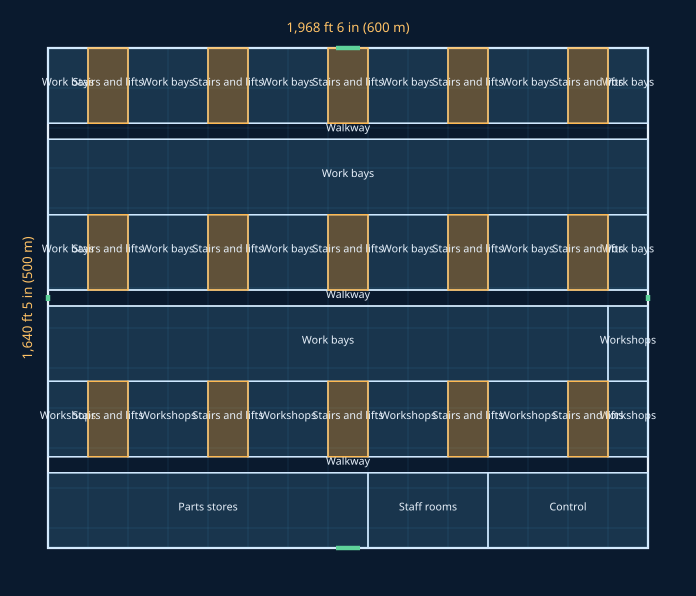
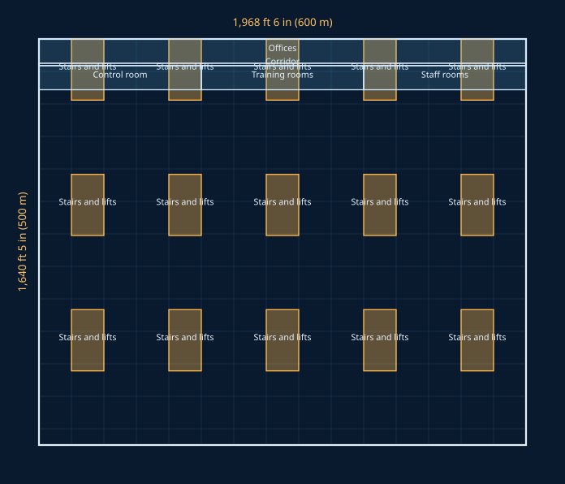
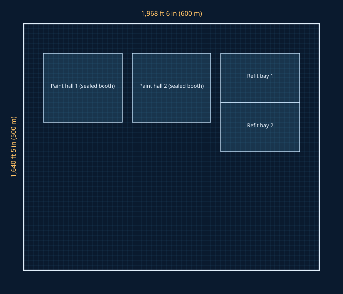

# P8-08 Paint & Refit: plan

Footprint 1,968 ft 6 in (600 m) × 1,640 ft 5 in (500 m) · structural grid 32 ft 10 in (10 m)

## Levels

| Level | Floor above deck | Height | Floor area |
|---|---|---|---|
| Level 1 · Ground floor | 0 ft (0 mm) | 18 ft 1 in (5,500 mm) | 1,400,062 sq ft (130,070 m²) |
| Level 2 · Level 2 | 18 ft 1 in (5,500 mm) | 18 ft 1 in (5,500 mm) | 1,400,062 sq ft (130,070 m²) |
| Level 3 · Hall upper | 36 ft 1 in (11 m) | 18 ft 1 in (5,500 mm) | 826,668 sq ft (76,800 m²) |
| Level 4 · Hall roof space | 54 ft 2 in (16 m) | 18 ft 1 in (5,500 mm) | 826,668 sq ft (76,800 m²) |

## Elements

| ID | Designation | Type | Name | Level(s) | Size / length | Area | Status |
|---|---|---|---|---|---|---|---|
| E001 | D5F3P8B16A2L1R1 | zone | Apron | L1 | 1,968 ft 6 in (600 m) × 196 ft 10 in (60 m) | 387,501 sq ft (36,000 m²) | proposed |
| E002 | D5F3P8B16A2L1R2, D5F3P8B16A2L2R1, D5F3P8B16A2L3R1, D5F3P8B16A2L4R1 | room | Paint hall 1 (sealed booth) | L1, L2, L3, L4 | 524 ft 11 in (160 m) × 459 ft 4 in (140 m) | 241,112 sq ft (22,400 m²) | proposed |
| E003 | D5F3P8B16A2L1R3, D5F3P8B16A2L2R2, D5F3P8B16A2L3R2, D5F3P8B16A2L4R2 | room | Paint hall 2 (sealed booth) | L1, L2, L3, L4 | 524 ft 11 in (160 m) × 459 ft 4 in (140 m) | 241,112 sq ft (22,400 m²) | proposed |
| E004 | D5F3P8B16A2L1R4, D5F3P8B16A2L2R3, D5F3P8B16A2L3R3, D5F3P8B16A2L4R3 | room | Refit bay 1 | L1, L2, L3, L4 | 524 ft 11 in (160 m) × 328 ft 1 in (100 m) | 172,223 sq ft (16,000 m²) | proposed |
| E005 | D5F3P8B16A2L1R5, D5F3P8B16A2L2R4, D5F3P8B16A2L3R4, D5F3P8B16A2L4R4 | room | Refit bay 2 | L1, L2, L3, L4 | 524 ft 11 in (160 m) × 328 ft 1 in (100 m) | 172,223 sq ft (16,000 m²) | proposed |
| E006 | D5F3P8B16A2L1R6, D5F3P8B16A2L2R5 | room | Sanding and masking bay 1 | L1, L2 | 278 ft 10 in (85 m) × 196 ft 10 in (60 m) | 54,896 sq ft (5,100 m²) | proposed |
| E007 | D5F3P8B16A2L1R7, D5F3P8B16A2L2R6 | room | Sanding and masking bay 2 | L1, L2 | 278 ft 10 in (85 m) × 196 ft 10 in (60 m) | 54,896 sq ft (5,100 m²) | proposed |
| E008 | D5F3P8B16A2L1R8, D5F3P8B16A2L2R7 | room | Sanding and masking bay 3 | L1, L2 | 278 ft 10 in (85 m) × 196 ft 10 in (60 m) | 54,896 sq ft (5,100 m²) | proposed |
| E009 | D5F3P8B16A2L1R9, D5F3P8B16A2L2R8 | room | Sanding and masking bay 4 | L1, L2 | 278 ft 10 in (85 m) × 196 ft 10 in (60 m) | 54,896 sq ft (5,100 m²) | proposed |
| E010 | D5F3P8B16A2L1R10, D5F3P8B16A2L2R9 | core | Stairs and lifts | L1, L2 | 32 ft 10 in (10 m) × 60 ft 8 in (18 m) | 1,991 sq ft (185 m²) | proposed |
| E011 | D5F3P8B16A2L1R11, D5F3P8B16A2L2R10 | core | Stairs and lifts | L1, L2 | 32 ft 10 in (10 m) × 60 ft 8 in (18 m) | 1,991 sq ft (185 m²) | proposed |
| E012 | D5F3P8B16A2L1R12 | zone | Corridor | L1 | 1,706 ft (520 m) × 9 ft 10 in (3,000 mm) | 16,792 sq ft (1,560 m²) | proposed |
| E013 | D5F3P8B16A2L1R13 | room | Paint mixing room | L1 | 615 ft 2 in (188 m) × 60 ft 8 in (18 m) | 37,337 sq ft (3,469 m²) | proposed |
| E014 | D5F3P8B16A2L1R14 | room | Solvent store (blast-proof) | L1 | 410 ft 1 in (125 m) × 60 ft 8 in (18 m) | 24,892 sq ft (2,312 m²) | proposed |
| E015 | D5F3P8B16A2L1R15 | room | Masking and stencil shop | L1 | 615 ft 2 in (188 m) × 60 ft 8 in (18 m) | 37,337 sq ft (3,469 m²) | proposed |
| E016 | D5F3P8B16A2L1R16 | room | Upholstery and interiors shop | L1 | 532 ft 2 in (162 m) × 60 ft 8 in (18 m) | 32,299 sq ft (3,001 m²) | proposed |
| E017 | D5F3P8B16A2L1R17 | room | Changing rooms | L1 | 70 ft 10 in (22 m) × 60 ft 8 in (18 m) | 4,301 sq ft (400 m²) | proposed |
| E018 | D5F3P8B16A2L1R18 | room | Changing rooms | L1 | 70 ft 10 in (22 m) × 60 ft 8 in (18 m) | 4,301 sq ft (400 m²) | proposed |
| E019 | D5F3P8B16A2L1R19 | room | Stores | L1 | 1,032 ft 2 in (315 m) × 60 ft 8 in (18 m) | 62,647 sq ft (5,820 m²) | proposed |
| E020 | D5F3P8B16A2L2R11 | zone | Corridor | L2 | 1,706 ft (520 m) × 9 ft 10 in (3,000 mm) | 16,792 sq ft (1,560 m²) | proposed |
| E021 | D5F3P8B16A2L2R12 | room | Design studio (liveries) | L2 | 1,640 ft 5 in (500 m) × 60 ft 8 in (18 m) | 99,566 sq ft (9,250 m²) | proposed |
| E022 | D5F3P8B16A2L2R13 | room | Quality office | L2 | 106 ft 4 in (32 m) × 60 ft 8 in (18 m) | 6,452 sq ft (599 m²) | proposed |
| E023 | D5F3P8B16A2L2R14 | room | Canteen | L2 | 177 ft 6 in (54 m) × 60 ft 8 in (18 m) | 10,773 sq ft (1,001 m²) | proposed |
| E024 | D5F3P8B16A2L2R15 | room | Offices | L2 | 1,422 ft 3 in (434 m) × 60 ft 8 in (18 m) | 86,324 sq ft (8,020 m²) | proposed |
| E025 | D5F3P8B16A2L1R20, D5F3P8B16A2L2R16 | room | Exhaust air treatment plant | L1, L2 | 459 ft 4 in (140 m) × 328 ft 1 in (100 m) | 150,695 sq ft (14,000 m²) | proposed |
| E026 | D5F3P8B16A2L1R21 | zone | Service yard | L1 | 1,181 ft 1 in (360 m) × 459 ft 4 in (140 m) | 542,501 sq ft (50,400 m²) | proposed |
| E027 |  | door | Paint hall 1 door | L1 | 459 ft 4 in (140 m), 459 ft 4 in (140 m) wide | — | proposed |
| E028 |  | door | Paint hall 2 door | L1 | 459 ft 4 in (140 m), 459 ft 4 in (140 m) wide | — | proposed |
| E029 |  | door | Refit hangar door | L1 | 459 ft 4 in (140 m), 459 ft 4 in (140 m) wide | — | proposed |

## Drawings

### Level 1 · Ground floor

### Level 2 · Level 2

### Level 3 · Hall upper

### Level 4 · Hall roof space

