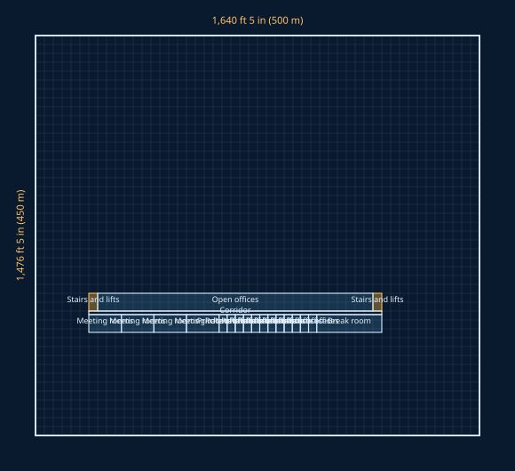

# P8-09 Yard Offices: plan

Footprint 1,640 ft 5 in (500 m) × 1,476 ft 5 in (450 m) · structural grid 32 ft 10 in (10 m)

## Levels

| Level | Floor above deck | Height | Floor area |
|---|---|---|---|
| Level 1 · Ground floor | 0 ft (0 mm) | 16 ft 5 in (5,000 mm) | 230,348 sq ft (21,400 m²) |
| Level 2 · Level 2 | 16 ft 5 in (5,000 mm) | 13 ft 1 in (4,000 mm) | 230,348 sq ft (21,400 m²) |
| Level 3 · Level 3 | 29 ft 6 in (9,000 mm) | 13 ft 1 in (4,000 mm) | 230,348 sq ft (21,400 m²) |
| Level 4 · Level 4 | 42 ft 8 in (13 m) | 13 ft 1 in (4,000 mm) | 230,348 sq ft (21,400 m²) |
| Level 5 · Level 5 | 55 ft 9 in (17 m) | 13 ft 1 in (4,000 mm) | 137,778 sq ft (12,800 m²) |

## Elements

| ID | Designation | Type | Name | Level(s) | Size / length | Area | Status |
|---|---|---|---|---|---|---|---|
| E001 | D5F3P8B16A3L1R1, D5F3P8B16A3L2R1, D5F3P8B16A3L3R1, D5F3P8B16A3L4R1, D5F3P8B16A3L5R1 | core | Stairs and lifts | L1, L2, L3, L4, L5 | 32 ft 10 in (10 m) × 65 ft 7 in (20 m) | 2,153 sq ft (200 m²) | proposed |
| E002 | D5F3P8B16A3L1R2, D5F3P8B16A3L2R2, D5F3P8B16A3L3R2, D5F3P8B16A3L4R2, D5F3P8B16A3L5R2 | core | Stairs and lifts | L1, L2, L3, L4, L5 | 32 ft 10 in (10 m) × 65 ft 7 in (20 m) | 2,153 sq ft (200 m²) | proposed |
| E003 | D5F3P8B16A3L1R3 | zone | Corridor | L1 | 1,082 ft 8 in (330 m) × 13 ft 1 in (4,000 mm) | 14,208 sq ft (1,320 m²) | proposed |
| E004 | D5F3P8B16A3L1R4 | room | Entrance hall | L1 | 663 ft 5 in (202 m) × 65 ft 7 in (20 m) | 43,529 sq ft (4,044 m²) | proposed |
| E005 | D5F3P8B16A3L1R5 | room | Customs and permits desk | L1 | 353 ft 8 in (108 m) × 65 ft 7 in (20 m) | 23,207 sq ft (2,156 m²) | proposed |
| E006 | D5F3P8B16A3L1R6 | room | Leasing and berth rights office | L1 | 196 ft 10 in (60 m) × 65 ft 7 in (20 m) | 12,917 sq ft (1,200 m²) | proposed |
| E007 | D5F3P8B16A3L1R7 | room | Bank and insurance desk | L1 | 98 ft 5 in (30 m) × 65 ft 7 in (20 m) | 6,458 sq ft (600 m²) | proposed |
| E008 | D5F3P8B16A3L1R8 | room | Café | L1 | 131 ft 3 in (40 m) × 65 ft 7 in (20 m) | 8,611 sq ft (800 m²) | proposed |
| E009 | D5F3P8B16A3L1R9 | room | Toilets | L1 | 656 ft 2 in (200 m) × 65 ft 7 in (20 m) | 43,056 sq ft (4,000 m²) | proposed |
| E010 | D5F3P8B16A3L2R3, D5F3P8B16A3L3R3, D5F3P8B16A3L4R3, D5F3P8B16A3L5R3 | zone | Corridor | L2, L3, L4, L5 | 1,082 ft 8 in (330 m) × 13 ft 1 in (4,000 mm) | 14,208 sq ft (1,320 m²) | proposed |
| E011 | D5F3P8B16A3L2R4, D5F3P8B16A3L3R4, D5F3P8B16A3L4R4, D5F3P8B16A3L5R4 | room | Open offices | L2, L3, L4, L5 | 1,017 ft 1 in (310 m) × 65 ft 7 in (20 m) | 66,736 sq ft (6,200 m²) | proposed |
| E012 | D5F3P8B16A3L2R5, D5F3P8B16A3L3R5, D5F3P8B16A3L4R5, D5F3P8B16A3L5R5 | room | Meeting rooms | L2, L3, L4, L5 | 120 ft 5 in (37 m) × 65 ft 7 in (20 m) | 7,901 sq ft (734 m²) | proposed |
| E013 | D5F3P8B16A3L2R6, D5F3P8B16A3L3R6, D5F3P8B16A3L4R6, D5F3P8B16A3L5R6 | room | Meeting rooms | L2, L3, L4, L5 | 120 ft 1 in (37 m) × 65 ft 7 in (20 m) | 7,879 sq ft (732 m²) | proposed |
| E014 | D5F3P8B16A3L2R7, D5F3P8B16A3L3R7, D5F3P8B16A3L4R7, D5F3P8B16A3L5R7 | room | Meeting rooms | L2, L3, L4, L5 | 120 ft 5 in (37 m) × 65 ft 7 in (20 m) | 7,901 sq ft (734 m²) | proposed |
| E015 | D5F3P8B16A3L2R8, D5F3P8B16A3L3R8, D5F3P8B16A3L4R8, D5F3P8B16A3L5R8 | room | Meeting rooms | L2, L3, L4, L5 | 120 ft 5 in (37 m) × 65 ft 7 in (20 m) | 7,901 sq ft (734 m²) | proposed |
| E016 | D5F3P8B16A3L2R9, D5F3P8B16A3L3R9, D5F3P8B16A3L4R9, D5F3P8B16A3L5R9 | room | Private offices | L2, L3, L4, L5 | 29 ft 10 in (9,100 mm) × 65 ft 7 in (20 m) | 1,959 sq ft (182 m²) | proposed |
| E017 | D5F3P8B16A3L2R10, D5F3P8B16A3L3R10, D5F3P8B16A3L4R10, D5F3P8B16A3L5R10 | room | Private offices | L2, L3, L4, L5 | 30 ft 2 in (9,200 mm) × 65 ft 7 in (20 m) | 1,981 sq ft (184 m²) | proposed |
| E018 | D5F3P8B16A3L2R11, D5F3P8B16A3L3R11, D5F3P8B16A3L4R11, D5F3P8B16A3L5R11 | room | Private offices | L2, L3, L4, L5 | 30 ft 2 in (9,200 mm) × 65 ft 7 in (20 m) | 1,981 sq ft (184 m²) | proposed |
| E019 | D5F3P8B16A3L2R12, D5F3P8B16A3L3R12, D5F3P8B16A3L4R12, D5F3P8B16A3L5R12 | room | Private offices | L2, L3, L4, L5 | 29 ft 10 in (9,100 mm) × 65 ft 7 in (20 m) | 1,959 sq ft (182 m²) | proposed |
| E020 | D5F3P8B16A3L2R13, D5F3P8B16A3L3R13, D5F3P8B16A3L4R13, D5F3P8B16A3L5R13 | room | Private offices | L2, L3, L4, L5 | 30 ft 2 in (9,200 mm) × 65 ft 7 in (20 m) | 1,981 sq ft (184 m²) | proposed |
| E021 | D5F3P8B16A3L2R14, D5F3P8B16A3L3R14, D5F3P8B16A3L4R14, D5F3P8B16A3L5R14 | room | Private offices | L2, L3, L4, L5 | 30 ft 2 in (9,200 mm) × 65 ft 7 in (20 m) | 1,981 sq ft (184 m²) | proposed |
| E022 | D5F3P8B16A3L2R15, D5F3P8B16A3L3R15, D5F3P8B16A3L4R15, D5F3P8B16A3L5R15 | room | Private offices | L2, L3, L4, L5 | 29 ft 10 in (9,100 mm) × 65 ft 7 in (20 m) | 1,959 sq ft (182 m²) | proposed |
| E023 | D5F3P8B16A3L2R16, D5F3P8B16A3L3R16, D5F3P8B16A3L4R16, D5F3P8B16A3L5R16 | room | Private offices | L2, L3, L4, L5 | 30 ft 2 in (9,200 mm) × 65 ft 7 in (20 m) | 1,981 sq ft (184 m²) | proposed |
| E024 | D5F3P8B16A3L2R17, D5F3P8B16A3L3R17, D5F3P8B16A3L4R17, D5F3P8B16A3L5R17 | room | Private offices | L2, L3, L4, L5 | 30 ft 2 in (9,200 mm) × 65 ft 7 in (20 m) | 1,981 sq ft (184 m²) | proposed |
| E025 | D5F3P8B16A3L2R18, D5F3P8B16A3L3R18, D5F3P8B16A3L4R18, D5F3P8B16A3L5R18 | room | Private offices | L2, L3, L4, L5 | 29 ft 10 in (9,100 mm) × 65 ft 7 in (20 m) | 1,959 sq ft (182 m²) | proposed |
| E026 | D5F3P8B16A3L2R19, D5F3P8B16A3L3R19, D5F3P8B16A3L4R19, D5F3P8B16A3L5R19 | room | Private offices | L2, L3, L4, L5 | 30 ft 2 in (9,200 mm) × 65 ft 7 in (20 m) | 1,981 sq ft (184 m²) | proposed |
| E027 | D5F3P8B16A3L2R20, D5F3P8B16A3L3R20, D5F3P8B16A3L4R20, D5F3P8B16A3L5R20 | room | Private offices | L2, L3, L4, L5 | 30 ft 2 in (9,200 mm) × 65 ft 7 in (20 m) | 1,981 sq ft (184 m²) | proposed |
| E028 | D5F3P8B16A3L2R21, D5F3P8B16A3L3R21, D5F3P8B16A3L4R21, D5F3P8B16A3L5R21 | room | Break room | L2, L3, L4, L5 | 240 ft 6 in (73 m) × 65 ft 7 in (20 m) | 15,780 sq ft (1,466 m²) | proposed |
| E029 | D5F3P8B16A3L1R10, D5F3P8B16A3L2R22, D5F3P8B16A3L3R22, D5F3P8B16A3L4R22 | core | Stairs and lifts | L1, L2, L3, L4 | 65 ft 7 in (20 m) × 32 ft 10 in (10 m) | 2,153 sq ft (200 m²) | proposed |
| E030 | D5F3P8B16A3L1R11 | zone | Corridor | L1 | 13 ft 1 in (4,000 mm) × 721 ft 9 in (220 m) | 9,472 sq ft (880 m²) | proposed |
| E031 | D5F3P8B16A3L1R12 | room | Conference hall | L1 | 65 ft 7 in (20 m) × 344 ft 6 in (105 m) | 22,604 sq ft (2,100 m²) | proposed |
| E032 | D5F3P8B16A3L1R13 | room | Conference hall | L1 | 65 ft 7 in (20 m) × 344 ft 6 in (105 m) | 22,604 sq ft (2,100 m²) | proposed |
| E033 | D5F3P8B16A3L1R14 | room | Training rooms | L1 | 65 ft 7 in (20 m) × 24 ft 7 in (7,500 mm) | 1,615 sq ft (150 m²) | proposed |
| E034 | D5F3P8B16A3L1R15 | room | Training rooms | L1 | 65 ft 7 in (20 m) × 24 ft 7 in (7,500 mm) | 1,615 sq ft (150 m²) | proposed |
| E035 | D5F3P8B16A3L1R16 | room | Training rooms | L1 | 65 ft 7 in (20 m) × 24 ft 7 in (7,500 mm) | 1,615 sq ft (150 m²) | proposed |
| E036 | D5F3P8B16A3L1R17 | room | Kitchen | L1 | 65 ft 7 in (20 m) × 648 ft (198 m) | 42,517 sq ft (3,950 m²) | proposed |
| E037 | D5F3P8B16A3L2R23, D5F3P8B16A3L3R23, D5F3P8B16A3L4R23 | zone | Corridor | L2, L3, L4 | 13 ft 1 in (4,000 mm) × 721 ft 9 in (220 m) | 9,472 sq ft (880 m²) | proposed |
| E038 | D5F3P8B16A3L2R24, D5F3P8B16A3L3R24, D5F3P8B16A3L4R24 | room | Yard management | L2, L3, L4 | 65 ft 7 in (20 m) × 344 ft 6 in (105 m) | 22,604 sq ft (2,100 m²) | proposed |
| E039 | D5F3P8B16A3L2R25, D5F3P8B16A3L3R25, D5F3P8B16A3L4R25 | room | Yard management | L2, L3, L4 | 65 ft 7 in (20 m) × 344 ft 6 in (105 m) | 22,604 sq ft (2,100 m²) | proposed |
| E040 | D5F3P8B16A3L2R26, D5F3P8B16A3L3R26, D5F3P8B16A3L4R26 | room | Records | L2, L3, L4 | 65 ft 7 in (20 m) × 131 ft 3 in (40 m) | 8,611 sq ft (800 m²) | proposed |
| E041 | D5F3P8B16A3L2R27, D5F3P8B16A3L3R27, D5F3P8B16A3L4R27 | room | Offices | L2, L3, L4 | 65 ft 7 in (20 m) × 590 ft 7 in (180 m) | 38,750 sq ft (3,600 m²) | proposed |
| E042 | D5F3P8B16A3L1R18 | zone | Office garden | L1 | 938 ft 4 in (286 m) × 721 ft 9 in (220 m) | 677,265 sq ft (62,920 m²) | proposed |
| E043 | D5F3P8B16A3L1R19 | zone | Entrance plaza | L1 | 1,082 ft 8 in (330 m) × 328 ft 1 in (100 m) | 355,209 sq ft (33,000 m²) | proposed |
| E044 |  | door | Main entrance | L1 | 65 ft 7 in (20 m), 65 ft 7 in (20 m) wide | — | proposed |

## Drawings

### Level 1 · Ground floor

### Level 2 · Level 2

### Level 3 · Level 3

### Level 4 · Level 4

### Level 5 · Level 5

