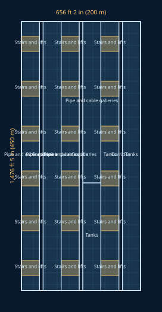

# P8-10 Shuttle Yards Utility Plant: plan

Footprint 656 ft 2 in (200 m) × 1,476 ft 5 in (450 m) · structural grid 65 ft 7 in (20 m)

## Levels

| Level | Floor above deck | Height | Floor area |
|---|---|---|---|
| Level B1 · Plant level | −19 ft 8 in (6,000 mm) | 19 ft 8 in (6,000 mm) | 881,564 sq ft (81,900 m²) |
| Level 1 · Ground floor | 0 ft (0 mm) | 26 ft 3 in (8,000 mm) | 734,637 sq ft (68,250 m²) |
| Level 2 · Upper floor | 26 ft 3 in (8,000 mm) | 26 ft 3 in (8,000 mm) | 881,564 sq ft (81,900 m²) |

## Elements

| ID | Designation | Type | Name | Level(s) | Size / length | Area | Status |
|---|---|---|---|---|---|---|---|
| L1-001 | D5F3P8B16A4L1R1 | zone | Corridor | L1 | 19 ft 8 in (6,000 mm) × 1,476 ft 5 in (450 m) | 29,063 sq ft (2,700 m²) | proposed |
| L1-002 | D5F3P8B16A4L1R2 | zone | Corridor | L1 | 19 ft 8 in (6,000 mm) × 1,476 ft 5 in (450 m) | 29,063 sq ft (2,700 m²) | proposed |
| L1-003 | D5F3P8B16A4L1R3 | zone | Corridor | L1 | 19 ft 8 in (6,000 mm) × 1,476 ft 5 in (450 m) | 29,063 sq ft (2,700 m²) | proposed |
| L1-004 | D5F3P8B16A4L1R4 | room | Substation | L1 | 99 ft 5 in (30 m) × 82 ft (25 m) | 8,154 sq ft (758 m²) | proposed |
| L1-005 | D5F3P8B16A4L1R5 | room | Substation | L1 | 99 ft 5 in (30 m) × 164 ft 1 in (50 m) | 16,307 sq ft (1,515 m²) | proposed |
| L1-006 | D5F3P8B16A4L1R6 | room | Substation | L1 | 99 ft 5 in (30 m) × 164 ft 1 in (50 m) | 16,307 sq ft (1,515 m²) | proposed |
| L1-007 | D5F3P8B16A4L1R7 | room | Substation | L1 | 99 ft 5 in (30 m) × 164 ft 1 in (50 m) | 16,307 sq ft (1,515 m²) | proposed |
| L1-008 | D5F3P8B16A4L1R8 | room | Substation | L1 | 99 ft 5 in (30 m) × 164 ft 1 in (50 m) | 16,307 sq ft (1,515 m²) | proposed |
| L1-009 | D5F3P8B16A4L1R9 | room | Substation | L1 | 99 ft 5 in (30 m) × 164 ft 1 in (50 m) | 16,307 sq ft (1,515 m²) | proposed |
| L1-010 | D5F3P8B16A4L1R10 | room | Substation | L1 | 99 ft 5 in (30 m) × 82 ft (25 m) | 8,154 sq ft (758 m²) | proposed |
| L1-011 | D5F3P8B16A4L1R11 | room | Substation | L1 | 99 ft 9 in (30 m) × 902 ft 3 in (275 m) | 89,986 sq ft (8,360 m²) | proposed |
| L1-012 | D5F3P8B16A4L1R12 | room | Air handling | L1 | 99 ft 9 in (30 m) × 574 ft 2 in (175 m) | 57,264 sq ft (5,320 m²) | proposed |
| L1-013 | D5F3P8B16A4L1R13 | room | Air handling | L1 | 99 ft 5 in (30 m) × 82 ft (25 m) | 8,154 sq ft (758 m²) | proposed |
| L1-014 | D5F3P8B16A4L1R14 | room | Air handling | L1 | 99 ft 5 in (30 m) × 164 ft 1 in (50 m) | 16,307 sq ft (1,515 m²) | proposed |
| L1-015 | D5F3P8B16A4L1R15 | room | Air handling | L1 | 99 ft 5 in (30 m) × 164 ft 1 in (50 m) | 16,307 sq ft (1,515 m²) | proposed |
| L1-016 | D5F3P8B16A4L1R16 | room | Air handling | L1 | 99 ft 5 in (30 m) × 164 ft 1 in (50 m) | 16,307 sq ft (1,515 m²) | proposed |
| L1-017 | D5F3P8B16A4L1R17 | room | Air handling | L1 | 99 ft 5 in (30 m) × 164 ft 1 in (50 m) | 16,307 sq ft (1,515 m²) | proposed |
| L1-018 | D5F3P8B16A4L1R18 | room | Air handling | L1 | 99 ft 5 in (30 m) × 164 ft 1 in (50 m) | 16,307 sq ft (1,515 m²) | proposed |
| L1-019 | D5F3P8B16A4L1R19 | room | Air handling | L1 | 99 ft 5 in (30 m) × 82 ft (25 m) | 8,154 sq ft (758 m²) | proposed |
| L1-020 | D5F3P8B16A4L1R20 | room | Air handling | L1 | 99 ft 5 in (30 m) × 246 ft 1 in (75 m) | 24,461 sq ft (2,272 m²) | proposed |
| L1-021 | D5F3P8B16A4L1R21 | room | Water pumps and tanks | L1 | 99 ft 5 in (30 m) × 1,230 ft 4 in (375 m) | 122,305 sq ft (11,363 m²) | proposed |
| L1-022 | D5F3P8B16A4L1R22 | room | Water pumps and tanks | L1 | 99 ft 9 in (30 m) × 82 ft (25 m) | 8,181 sq ft (760 m²) | proposed |
| L1-023 | D5F3P8B16A4L1R23 | room | Water pumps and tanks | L1 | 99 ft 9 in (30 m) × 164 ft 1 in (50 m) | 16,361 sq ft (1,520 m²) | proposed |
| L1-024 | D5F3P8B16A4L1R24 | room | Water pumps and tanks | L1 | 99 ft 9 in (30 m) × 164 ft 1 in (50 m) | 16,361 sq ft (1,520 m²) | proposed |
| L1-025 | D5F3P8B16A4L1R25 | room | Water pumps and tanks | L1 | 99 ft 9 in (30 m) × 164 ft 1 in (50 m) | 16,361 sq ft (1,520 m²) | proposed |
| L1-026 | D5F3P8B16A4L1R26 | room | Water pumps and tanks | L1 | 99 ft 9 in (30 m) × 82 ft (25 m) | 8,181 sq ft (760 m²) | proposed |
| L1-027 | D5F3P8B16A4L1R27 | room | Control room | L1 | 99 ft 9 in (30 m) × 82 ft (25 m) | 8,181 sq ft (760 m²) | proposed |
| L1-028 | D5F3P8B16A4L1R28 | room | Control room | L1 | 99 ft 9 in (30 m) × 164 ft 1 in (50 m) | 16,361 sq ft (1,520 m²) | proposed |
| L1-029 | D5F3P8B16A4L1R29 | room | Control room | L1 | 99 ft 9 in (30 m) × 82 ft (25 m) | 8,181 sq ft (760 m²) | proposed |
| L1-030 | D5F3P8B16A4L1R30 | room | Workshop and stores | L1 | 99 ft 5 in (30 m) × 1,476 ft 5 in (450 m) | 146,766 sq ft (13,635 m²) | proposed |
| L1-031 | D5F3P8B16A4LB1R1, D5F3P8B16A4L1R31, D5F3P8B16A4L2R1 | core | Stairs and lifts | LB1, L1, L2 | 99 ft 5 in (30 m) × 82 ft (25 m) | 8,154 sq ft (758 m²) | proposed |
| L1-032 | D5F3P8B16A4LB1R2, D5F3P8B16A4L1R32, D5F3P8B16A4L2R2 | core | Stairs and lifts | LB1, L1, L2 | 99 ft 5 in (30 m) × 82 ft (25 m) | 8,154 sq ft (758 m²) | proposed |
| L1-033 | D5F3P8B16A4LB1R3, D5F3P8B16A4L1R33, D5F3P8B16A4L2R3 | core | Stairs and lifts | LB1, L1, L2 | 99 ft 5 in (30 m) × 82 ft (25 m) | 8,154 sq ft (758 m²) | proposed |
| L1-034 | D5F3P8B16A4LB1R4, D5F3P8B16A4L1R34, D5F3P8B16A4L2R4 | core | Stairs and lifts | LB1, L1, L2 | 99 ft 5 in (30 m) × 82 ft (25 m) | 8,154 sq ft (758 m²) | proposed |
| L1-035 | D5F3P8B16A4LB1R5, D5F3P8B16A4L1R35, D5F3P8B16A4L2R5 | core | Stairs and lifts | LB1, L1, L2 | 99 ft 5 in (30 m) × 82 ft (25 m) | 8,154 sq ft (758 m²) | proposed |
| L1-036 | D5F3P8B16A4LB1R6, D5F3P8B16A4L1R36, D5F3P8B16A4L2R6 | core | Stairs and lifts | LB1, L1, L2 | 99 ft 5 in (30 m) × 82 ft (25 m) | 8,154 sq ft (758 m²) | proposed |
| L1-037 | D5F3P8B16A4LB1R7, D5F3P8B16A4L1R37, D5F3P8B16A4L2R7 | core | Stairs and lifts | LB1, L1, L2 | 99 ft 5 in (30 m) × 82 ft (25 m) | 8,154 sq ft (758 m²) | proposed |
| L1-038 | D5F3P8B16A4LB1R8, D5F3P8B16A4L1R38, D5F3P8B16A4L2R8 | core | Stairs and lifts | LB1, L1, L2 | 99 ft 5 in (30 m) × 82 ft (25 m) | 8,154 sq ft (758 m²) | proposed |
| L1-039 | D5F3P8B16A4LB1R9, D5F3P8B16A4L1R39, D5F3P8B16A4L2R9 | core | Stairs and lifts | LB1, L1, L2 | 99 ft 5 in (30 m) × 82 ft (25 m) | 8,154 sq ft (758 m²) | proposed |
| L1-040 | D5F3P8B16A4LB1R10, D5F3P8B16A4L1R40, D5F3P8B16A4L2R10 | core | Stairs and lifts | LB1, L1, L2 | 99 ft 5 in (30 m) × 82 ft (25 m) | 8,154 sq ft (758 m²) | proposed |
| L1-041 | D5F3P8B16A4LB1R11, D5F3P8B16A4L1R41, D5F3P8B16A4L2R11 | core | Stairs and lifts | LB1, L1, L2 | 99 ft 5 in (30 m) × 82 ft (25 m) | 8,154 sq ft (758 m²) | proposed |
| L1-042 | D5F3P8B16A4LB1R12, D5F3P8B16A4L1R42, D5F3P8B16A4L2R12 | core | Stairs and lifts | LB1, L1, L2 | 99 ft 5 in (30 m) × 82 ft (25 m) | 8,154 sq ft (758 m²) | proposed |
| L1-043 | D5F3P8B16A4LB1R13, D5F3P8B16A4L1R43, D5F3P8B16A4L2R13 | core | Stairs and lifts | LB1, L1, L2 | 99 ft 9 in (30 m) × 82 ft (25 m) | 8,181 sq ft (760 m²) | proposed |
| L1-044 | D5F3P8B16A4LB1R14, D5F3P8B16A4L1R44, D5F3P8B16A4L2R14 | core | Stairs and lifts | LB1, L1, L2 | 99 ft 9 in (30 m) × 82 ft (25 m) | 8,181 sq ft (760 m²) | proposed |
| L1-045 | D5F3P8B16A4LB1R15, D5F3P8B16A4L1R45, D5F3P8B16A4L2R15 | core | Stairs and lifts | LB1, L1, L2 | 99 ft 9 in (30 m) × 82 ft (25 m) | 8,181 sq ft (760 m²) | proposed |
| L1-046 | D5F3P8B16A4LB1R16, D5F3P8B16A4L1R46, D5F3P8B16A4L2R16 | core | Stairs and lifts | LB1, L1, L2 | 99 ft 9 in (30 m) × 82 ft (25 m) | 8,181 sq ft (760 m²) | proposed |
| L1-047 | D5F3P8B16A4LB1R17, D5F3P8B16A4L1R47, D5F3P8B16A4L2R17 | core | Stairs and lifts | LB1, L1, L2 | 99 ft 9 in (30 m) × 82 ft (25 m) | 8,181 sq ft (760 m²) | proposed |
| L1-048 | D5F3P8B16A4LB1R18, D5F3P8B16A4L1R48, D5F3P8B16A4L2R18 | core | Stairs and lifts | LB1, L1, L2 | 99 ft 9 in (30 m) × 82 ft (25 m) | 8,181 sq ft (760 m²) | proposed |
| LT-001 | D5F3P8B16A4L2R19 | zone | Corridor | L2 | 19 ft 8 in (6,000 mm) × 1,476 ft 5 in (450 m) | 29,063 sq ft (2,700 m²) | proposed |
| LT-002 | D5F3P8B16A4L2R20 | zone | Corridor | L2 | 19 ft 8 in (6,000 mm) × 1,476 ft 5 in (450 m) | 29,063 sq ft (2,700 m²) | proposed |
| LT-003 | D5F3P8B16A4L2R21 | zone | Corridor | L2 | 19 ft 8 in (6,000 mm) × 1,476 ft 5 in (450 m) | 29,063 sq ft (2,700 m²) | proposed |
| LT-004 | D5F3P8B16A4L2R22 | room | Air handling (around the core) | L2 | 99 ft 5 in (30 m) × 1,476 ft 5 in (450 m) | 146,766 sq ft (13,635 m²) | proposed |
| LT-005 | D5F3P8B16A4L2R23 | room | Air handling | L2 | 99 ft 9 in (30 m) × 1,476 ft 5 in (450 m) | 147,250 sq ft (13,680 m²) | proposed |
| LT-006 | D5F3P8B16A4L2R24 | room | Air handling (around the core) | L2 | 99 ft 5 in (30 m) × 1,476 ft 5 in (450 m) | 146,766 sq ft (13,635 m²) | proposed |
| LT-007 | D5F3P8B16A4L2R25 | room | Switch rooms | L2 | 99 ft 5 in (30 m) × 1,476 ft 5 in (450 m) | 146,766 sq ft (13,635 m²) | proposed |
| LT-008 | D5F3P8B16A4L2R26 | room | Switch rooms (around the core) | L2 | 99 ft 9 in (30 m) × 1,148 ft 4 in (350 m) | 114,528 sq ft (10,640 m²) | proposed |
| LT-009 | D5F3P8B16A4L2R27 | room | Offices (around the core) | L2 | 99 ft 9 in (30 m) × 328 ft 1 in (100 m) | 32,722 sq ft (3,040 m²) | proposed |
| LT-010 | D5F3P8B16A4L2R28 | room | Offices | L2 | 99 ft 5 in (30 m) × 1,476 ft 5 in (450 m) | 146,766 sq ft (13,635 m²) | proposed |
| BB1-001 | D5F3P8B16A4LB1R19 | zone | Corridor | LB1 | 19 ft 8 in (6,000 mm) × 1,476 ft 5 in (450 m) | 29,063 sq ft (2,700 m²) | proposed |
| BB1-002 | D5F3P8B16A4LB1R20 | zone | Corridor | LB1 | 19 ft 8 in (6,000 mm) × 1,476 ft 5 in (450 m) | 29,063 sq ft (2,700 m²) | proposed |
| BB1-003 | D5F3P8B16A4LB1R21 | zone | Corridor | LB1 | 19 ft 8 in (6,000 mm) × 1,476 ft 5 in (450 m) | 29,063 sq ft (2,700 m²) | proposed |
| BB1-004 | D5F3P8B16A4LB1R22 | room | Pipe and cable galleries | LB1 | 99 ft 5 in (30 m) × 1,476 ft 5 in (450 m) | 146,766 sq ft (13,635 m²) | proposed |
| BB1-005 | D5F3P8B16A4LB1R23 | room | Pipe and cable galleries | LB1 | 99 ft 9 in (30 m) × 1,476 ft 5 in (450 m) | 147,250 sq ft (13,680 m²) | proposed |
| BB1-006 | D5F3P8B16A4LB1R24 | room | Pipe and cable galleries | LB1 | 99 ft 5 in (30 m) × 1,476 ft 5 in (450 m) | 146,766 sq ft (13,635 m²) | proposed |
| BB1-007 | D5F3P8B16A4LB1R25 | room | Pipe and cable galleries | LB1 | 99 ft 5 in (30 m) × 885 ft 10 in (270 m) | 88,060 sq ft (8,181 m²) | proposed |
| BB1-008 | D5F3P8B16A4LB1R26 | room | Tanks | LB1 | 99 ft 5 in (30 m) × 590 ft 7 in (180 m) | 58,706 sq ft (5,454 m²) | proposed |
| BB1-009 | D5F3P8B16A4LB1R27 | room | Tanks | LB1 | 99 ft 9 in (30 m) × 1,476 ft 5 in (450 m) | 147,250 sq ft (13,680 m²) | proposed |
| BB1-010 | D5F3P8B16A4LB1R28 | room | Tanks | LB1 | 99 ft 5 in (30 m) × 1,476 ft 5 in (450 m) | 146,766 sq ft (13,635 m²) | proposed |
| D-69 |  | door | Main entrance | L1 | 78 ft 9 in (24 m), 78 ft 9 in (24 m) wide | — | proposed |
| D-70 |  | door | Second entrance | L1 | 78 ft 9 in (24 m), 78 ft 9 in (24 m) wide | — | proposed |
| D-71 |  | door | Side door | L1 | 19 ft 8 in (6,000 mm), 19 ft 8 in (6,000 mm) wide | — | proposed |
| D-72 |  | door | Side door | L1 | 19 ft 8 in (6,000 mm), 19 ft 8 in (6,000 mm) wide | — | proposed |

## Drawings

### Level B1 · Plant level

### Level 1 · Ground floor

### Level 2 · Upper floor

