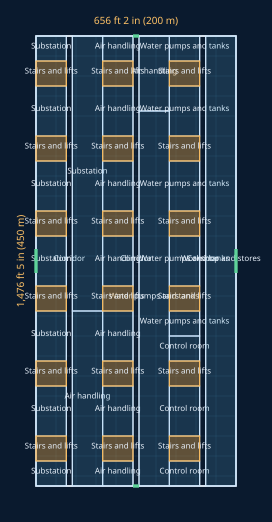
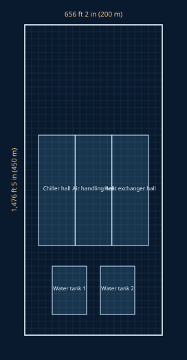

# P8-10 Shuttle Yards Utility Plant: plan

Footprint 656 ft 2 in (200 m) × 1,476 ft 5 in (450 m) · structural grid 32 ft 10 in (10 m)

## Levels

| Level | Floor above deck | Height | Floor area |
|---|---|---|---|
| Level 1 · Ground floor | 0 ft (0 mm) | 26 ft 3 in (8,000 mm) | 530,015 sq ft (49,240 m²) |
| Level 2 · Upper plant | 26 ft 3 in (8,000 mm) | 19 ft 8 in (6,000 mm) | 350,904 sq ft (32,600 m²) |

## Elements

| ID | Designation | Type | Name | Level(s) | Size / length | Area | Status |
|---|---|---|---|---|---|---|---|
| E001 | D5F3P8B16A4L1R1 | zone | Corridor | L1 | 524 ft 11 in (160 m) × 19 ft 8 in (6,000 mm) | 10,333 sq ft (960 m²) | proposed |
| E002 | D5F3P8B16A4L1R2 | room | Transformer bays | L1 | 87 ft 7 in (27 m) × 170 ft 7 in (52 m) | 14,945 sq ft (1,388 m²) | proposed |
| E003 | D5F3P8B16A4L1R3 | room | Transformer bays | L1 | 87 ft 3 in (27 m) × 170 ft 7 in (52 m) | 14,889 sq ft (1,383 m²) | proposed |
| E004 | D5F3P8B16A4L1R4 | room | Transformer bays | L1 | 87 ft 7 in (27 m) × 170 ft 7 in (52 m) | 14,945 sq ft (1,388 m²) | proposed |
| E005 | D5F3P8B16A4L1R5 | room | Transformer bays | L1 | 87 ft 7 in (27 m) × 170 ft 7 in (52 m) | 14,945 sq ft (1,388 m²) | proposed |
| E006 | D5F3P8B16A4L1R6 | room | Transformer bays | L1 | 87 ft 3 in (27 m) × 170 ft 7 in (52 m) | 14,889 sq ft (1,383 m²) | proposed |
| E007 | D5F3P8B16A4L1R7 | room | Transformer bays | L1 | 87 ft 7 in (27 m) × 170 ft 7 in (52 m) | 14,945 sq ft (1,388 m²) | proposed |
| E008 | D5F3P8B16A4L1R8 | room | Switch room | L1 | 157 ft 10 in (48 m) × 170 ft 7 in (52 m) | 26,923 sq ft (2,501 m²) | proposed |
| E009 | D5F3P8B16A4L1R9 | room | Battery room | L1 | 75 ft 9 in (23 m) × 170 ft 7 in (52 m) | 12,930 sq ft (1,201 m²) | proposed |
| E010 | D5F3P8B16A4L1R10 | room | Control room | L1 | 37 ft 9 in (12 m) × 170 ft 7 in (52 m) | 6,437 sq ft (598 m²) | proposed |
| E011 | D5F3P8B16A4L1R11 | room | Cable room | L1 | 253 ft 7 in (77 m) × 170 ft 7 in (52 m) | 43,267 sq ft (4,020 m²) | proposed |
| E012 | D5F3P8B16A4L1R12, D5F3P8B16A4L2R1 | room | Chiller hall | L1, L2 | 174 ft 10 in (53 m) × 524 ft 11 in (160 m) | 91,795 sq ft (8,528 m²) | proposed |
| E013 | D5F3P8B16A4L1R13, D5F3P8B16A4L2R2 | room | Air handling hall | L1, L2 | 175 ft 2 in (53 m) × 524 ft 11 in (160 m) | 91,967 sq ft (8,544 m²) | proposed |
| E014 | D5F3P8B16A4L1R14, D5F3P8B16A4L2R3 | room | Heat exchanger hall | L1, L2 | 174 ft 10 in (53 m) × 524 ft 11 in (160 m) | 91,795 sq ft (8,528 m²) | proposed |
| E015 | D5F3P8B16A4L1R15, D5F3P8B16A4L2R4 | room | Water tank 1 | L1, L2 | 164 ft 1 in (50 m) × 229 ft 8 in (70 m) | 37,674 sq ft (3,500 m²) | proposed |
| E016 | D5F3P8B16A4L1R16, D5F3P8B16A4L2R5 | room | Water tank 2 | L1, L2 | 164 ft 1 in (50 m) × 229 ft 8 in (70 m) | 37,674 sq ft (3,500 m²) | proposed |
| E017 |  | door | Service gate | L1 | 65 ft 7 in (20 m), 65 ft 7 in (20 m) wide | — | proposed |

## Drawings

### Level 1 · Ground floor

### Level 2 · Upper plant

