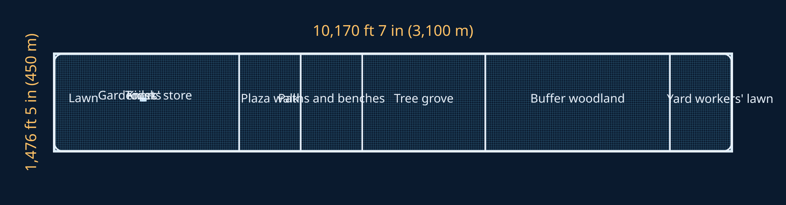

# P8-13 Atrium Edge Park: plan

Footprint 10,170 ft 7 in (3,100 m) × 1,476 ft 5 in (450 m) · structural grid 32 ft 10 in (10 m)

## Levels

| Level | Floor above deck | Height | Floor area |
|---|---|---|---|
| Level 1 · Ground | 0 ft (0 mm) | 13 ft 1 in (4,000 mm) | 3,100 sq ft (288 m²) |

## Elements

| ID | Designation | Type | Name | Level(s) | Size / length | Area | Status |
|---|---|---|---|---|---|---|---|
| E001 | D5F3P8B10A1R1 | zone | Lawn | L1 | 2,776 ft 3 in (846 m) × 1,475 ft 5 in (450 m) | 4,086,792 sq ft (379,675 m²) | proposed |
| E002 | D5F3P8B10A1R2 | room | Kiosk | L1 | 26 ft 3 in (8,000 mm) × 39 ft 4 in (12 m) | 1,033 sq ft (96 m²) | proposed |
| E003 | D5F3P8B10A1R3 | room | Toilets | L1 | 26 ft 3 in (8,000 mm) × 39 ft 4 in (12 m) | 1,033 sq ft (96 m²) | proposed |
| E004 | D5F3P8B10A1R4 | room | Gardeners' store | L1 | 26 ft 3 in (8,000 mm) × 39 ft 4 in (12 m) | 1,033 sq ft (96 m²) | proposed |
| E005 | D5F3P8B10A1R5 | zone | Plaza walk | L1 | 923 ft 7 in (282 m) × 1,475 ft 1 in (450 m) | 1,362,306 sq ft (126,562 m²) | proposed |
| E006 | D5F3P8B10A1R6 | zone | Paths and benches | L1 | 923 ft 7 in (282 m) × 1,475 ft 5 in (450 m) | 1,362,306 sq ft (126,562 m²) | proposed |
| E007 | D5F3P8B10A1R7 | zone | Tree grove | L1 | 1,847 ft 5 in (563 m) × 1,475 ft 5 in (450 m) | 2,725,097 sq ft (253,170 m²) | proposed |
| E008 | D5F3P8B10A1R8 | zone | Buffer woodland | L1 | 2,770 ft 8 in (845 m) × 1,475 ft 5 in (450 m) | 4,086,919 sq ft (379,687 m²) | proposed |
| E009 | D5F3P8B10A1R9 | zone | Yard workers' lawn | L1 | 929 ft 2 in (283 m) × 1,475 ft 1 in (450 m) | 1,362,176 sq ft (126,550 m²) | proposed |

## Drawings

### Level 1 · Ground

