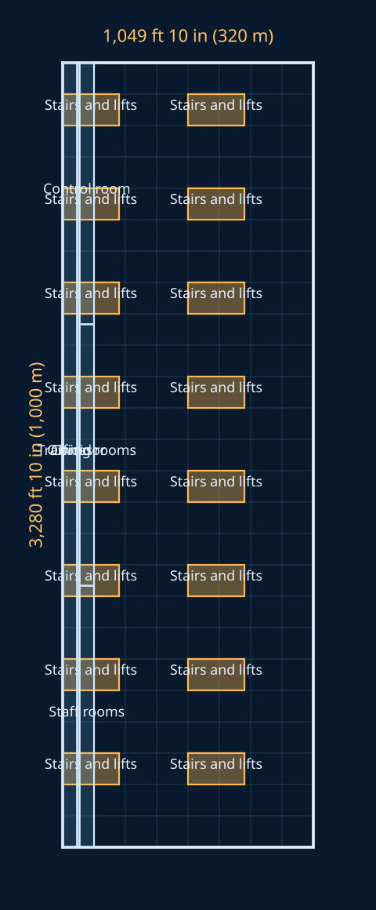
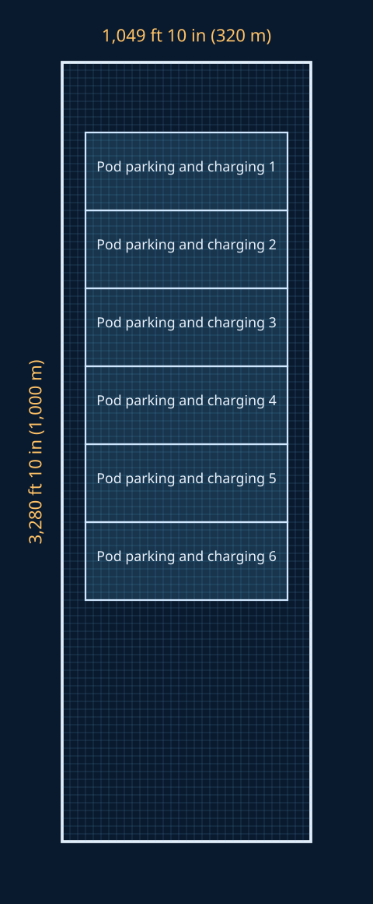

# P8-14 Shuttle Yards Pod Depot: plan

Footprint 1,049 ft 10 in (320 m) × 3,280 ft 10 in (1,000 m) · structural grid 32 ft 10 in (10 m)

## Levels

| Level | Floor above deck | Height | Floor area |
|---|---|---|---|
| Level 1 · Ground deck | 0 ft (0 mm) | 14 ft 9 in (4,500 mm) | 2,058,598 sq ft (191,250 m²) |
| Level 2 · Deck 2 | 14 ft 9 in (4,500 mm) | 13 ft 1 in (4,000 mm) | 1,778,736 sq ft (165,250 m²) |
| Level 3 · Deck 3 | 27 ft 11 in (8,500 mm) | 13 ft 1 in (4,000 mm) | 1,679,170 sq ft (156,000 m²) |

## Elements

| ID | Designation | Type | Name | Level(s) | Size / length | Area | Status |
|---|---|---|---|---|---|---|---|
| E001 | D5F3P8B6A1L1R1, D5F3P8B6A1L2R1 | core | Stairs and lifts | L1, L2 | 32 ft 10 in (10 m) × 60 ft 8 in (18 m) | 1,991 sq ft (185 m²) | proposed |
| E002 | D5F3P8B6A1L1R2, D5F3P8B6A1L2R2 | core | Stairs and lifts | L1, L2 | 32 ft 10 in (10 m) × 60 ft 8 in (18 m) | 1,991 sq ft (185 m²) | proposed |
| E003 | D5F3P8B6A1L1R3 | zone | Corridor | L1 | 853 ft (260 m) × 9 ft 10 in (3,000 mm) | 8,396 sq ft (780 m²) | proposed |
| E004 | D5F3P8B6A1L1R4 | room | Dispatch desk | L1 | 337 ft 7 in (103 m) × 60 ft 8 in (18 m) | 20,491 sq ft (1,904 m²) | proposed |
| E005 | D5F3P8B6A1L1R5 | room | Drivers' room | L1 | 449 ft 10 in (137 m) × 60 ft 8 in (18 m) | 27,301 sq ft (2,536 m²) | proposed |
| E006 | D5F3P8B6A1L1R6 | room | Pod booking hall | L1 | 354 ft 8 in (108 m) × 60 ft 8 in (18 m) | 21,526 sq ft (2,000 m²) | proposed |
| E007 | D5F3P8B6A1L1R7 | room | Toilets | L1 | 498 ft 4 in (152 m) × 60 ft 8 in (18 m) | 30,248 sq ft (2,810 m²) | proposed |
| E008 | D5F3P8B6A1L2R3 | zone | Corridor | L2 | 853 ft (260 m) × 9 ft 10 in (3,000 mm) | 8,396 sq ft (780 m²) | proposed |
| E009 | D5F3P8B6A1L2R4 | room | Fleet control | L2 | 787 ft 5 in (240 m) × 60 ft 8 in (18 m) | 47,792 sq ft (4,440 m²) | proposed |
| E010 | D5F3P8B6A1L2R5 | room | Offices | L2 | 853 ft (260 m) × 60 ft 8 in (18 m) | 51,774 sq ft (4,810 m²) | proposed |
| E011 | D5F3P8B6A1L1R8, D5F3P8B6A1L2R6, D5F3P8B6A1L3R1 | room | Pod parking and charging 1 | L1, L2, L3 | 853 ft (260 m) × 328 ft 1 in (100 m) | 279,862 sq ft (26,000 m²) | proposed |
| E012 | D5F3P8B6A1L1R9, D5F3P8B6A1L2R7, D5F3P8B6A1L3R2 | room | Pod parking and charging 2 | L1, L2, L3 | 853 ft (260 m) × 328 ft 1 in (100 m) | 279,862 sq ft (26,000 m²) | proposed |
| E013 | D5F3P8B6A1L1R10, D5F3P8B6A1L2R8, D5F3P8B6A1L3R3 | room | Pod parking and charging 3 | L1, L2, L3 | 853 ft (260 m) × 328 ft 1 in (100 m) | 279,862 sq ft (26,000 m²) | proposed |
| E014 | D5F3P8B6A1L1R11, D5F3P8B6A1L2R9, D5F3P8B6A1L3R4 | room | Pod parking and charging 4 | L1, L2, L3 | 853 ft (260 m) × 328 ft 1 in (100 m) | 279,862 sq ft (26,000 m²) | proposed |
| E015 | D5F3P8B6A1L1R12, D5F3P8B6A1L2R10, D5F3P8B6A1L3R5 | room | Pod parking and charging 5 | L1, L2, L3 | 853 ft (260 m) × 328 ft 1 in (100 m) | 279,862 sq ft (26,000 m²) | proposed |
| E016 | D5F3P8B6A1L1R13, D5F3P8B6A1L2R11, D5F3P8B6A1L3R6 | room | Pod parking and charging 6 | L1, L2, L3 | 853 ft (260 m) × 328 ft 1 in (100 m) | 279,862 sq ft (26,000 m²) | proposed |
| E017 | D5F3P8B6A1L1R14 | room | Pod wash | L1 | 213 ft 3 in (65 m) × 328 ft 1 in (100 m) | 69,965 sq ft (6,500 m²) | proposed |
| E018 | D5F3P8B6A1L1R15 | room | Service bay | L1 | 213 ft 3 in (65 m) × 328 ft 1 in (100 m) | 69,965 sq ft (6,500 m²) | proposed |
| E019 | D5F3P8B6A1L1R16 | room | Battery swap | L1 | 213 ft 3 in (65 m) × 328 ft 1 in (100 m) | 69,965 sq ft (6,500 m²) | proposed |
| E020 | D5F3P8B6A1L1R17 | room | Tyre and brake bay | L1 | 213 ft 3 in (65 m) × 328 ft 1 in (100 m) | 69,965 sq ft (6,500 m²) | proposed |
| E021 | D5F3P8B6A1L1R18 | zone | Pod lanes | L1 | 1,049 ft 10 in (320 m) × 557 ft 9 in (170 m) | 585,557 sq ft (54,400 m²) | proposed |

## Drawings

### Level 1 · Ground deck

### Level 2 · Deck 2

### Level 3 · Deck 3

