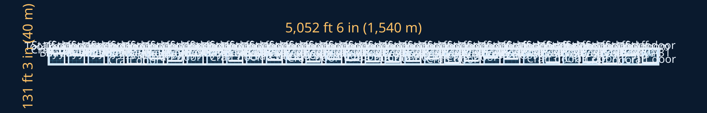

# P8-15 Hangar Row A: plan

Footprint 5,052 ft 6 in (1,540 m) × 131 ft 3 in (40 m) · structural grid 32 ft 10 in (10 m)

## Levels

| Level | Floor above deck | Height | Floor area |
|---|---|---|---|
| Level 1 · Bay floor | 0 ft (0 mm) | 32 ft 10 in (10 m) | 533,890 sq ft (49,600 m²) |

## Elements

| ID | Designation | Type | Name | Level(s) | Size / length | Area | Status |
|---|---|---|---|---|---|---|---|
| E001 | D5F3P8B8A2R1 | room | Bay A1 | L1 | 131 ft 3 in (40 m) × 131 ft 3 in (40 m) | 17,222 sq ft (1,600 m²) | proposed |
| E002 |  | fixture | Craft door | L1 | 105 ft (32 m) × 6 ft 7 in (2,000 mm) | 689 sq ft (64 m²) | proposed |
| E003 |  | fixture | Tool room | L1 | 26 ft 3 in (8,000 mm) × 23 ft 7 in (7,200 mm) | 620 sq ft (58 m²) | proposed |
| E004 |  | fixture | Staff door | L1 | 13 ft 1 in (4,000 mm) × 6 ft 7 in (2,000 mm) | 86 sq ft (8 m²) | proposed |
| E005 | D5F3P8B8A2R2 | zone | Bay wall | L1 | 32 ft 10 in (10 m) × 131 ft 3 in (40 m) | 4,306 sq ft (400 m²) | proposed |
| E006 | D5F3P8B8A2R3 | room | Bay A2 | L1 | 131 ft 3 in (40 m) × 131 ft 3 in (40 m) | 17,222 sq ft (1,600 m²) | proposed |
| E007 |  | fixture | Craft door | L1 | 105 ft (32 m) × 6 ft 3 in (1,900 mm) | 654 sq ft (61 m²) | proposed |
| E008 |  | fixture | Tool room | L1 | 26 ft 3 in (8,000 mm) × 23 ft 7 in (7,200 mm) | 620 sq ft (58 m²) | proposed |
| E009 |  | fixture | Staff door | L1 | 13 ft 1 in (4,000 mm) × 6 ft 7 in (2,000 mm) | 86 sq ft (8 m²) | proposed |
| E010 | D5F3P8B8A2R4 | zone | Bay wall | L1 | 32 ft 10 in (10 m) × 131 ft 3 in (40 m) | 4,306 sq ft (400 m²) | proposed |
| E011 | D5F3P8B8A2R5 | room | Bay A3 | L1 | 131 ft 3 in (40 m) × 131 ft 3 in (40 m) | 17,222 sq ft (1,600 m²) | proposed |
| E012 |  | fixture | Craft door | L1 | 105 ft (32 m) × 6 ft 3 in (1,900 mm) | 654 sq ft (61 m²) | proposed |
| E013 |  | fixture | Tool room | L1 | 26 ft 3 in (8,000 mm) × 23 ft 7 in (7,200 mm) | 620 sq ft (58 m²) | proposed |
| E014 |  | fixture | Staff door | L1 | 13 ft 1 in (4,000 mm) × 6 ft 7 in (2,000 mm) | 86 sq ft (8 m²) | proposed |
| E015 | D5F3P8B8A2R6 | zone | Bay wall | L1 | 32 ft 10 in (10 m) × 131 ft 3 in (40 m) | 4,306 sq ft (400 m²) | proposed |
| E016 | D5F3P8B8A2R7 | room | Bay A4 | L1 | 131 ft 3 in (40 m) × 131 ft 3 in (40 m) | 17,222 sq ft (1,600 m²) | proposed |
| E017 |  | fixture | Craft door | L1 | 105 ft (32 m) × 6 ft 3 in (1,900 mm) | 654 sq ft (61 m²) | proposed |
| E018 |  | fixture | Tool room | L1 | 26 ft 3 in (8,000 mm) × 23 ft 7 in (7,200 mm) | 620 sq ft (58 m²) | proposed |
| E019 |  | fixture | Staff door | L1 | 13 ft 1 in (4,000 mm) × 6 ft 7 in (2,000 mm) | 86 sq ft (8 m²) | proposed |
| E020 | D5F3P8B8A2R8 | zone | Bay wall | L1 | 32 ft 10 in (10 m) × 131 ft 3 in (40 m) | 4,306 sq ft (400 m²) | proposed |
| E021 | D5F3P8B8A2R9 | room | Bay A5 | L1 | 131 ft 3 in (40 m) × 131 ft 3 in (40 m) | 17,222 sq ft (1,600 m²) | proposed |
| E022 |  | fixture | Craft door | L1 | 105 ft (32 m) × 6 ft 3 in (1,900 mm) | 654 sq ft (61 m²) | proposed |
| E023 |  | fixture | Tool room | L1 | 26 ft 3 in (8,000 mm) × 23 ft 7 in (7,200 mm) | 620 sq ft (58 m²) | proposed |
| E024 |  | fixture | Staff door | L1 | 13 ft 1 in (4,000 mm) × 6 ft 7 in (2,000 mm) | 86 sq ft (8 m²) | proposed |
| E025 | D5F3P8B8A2R10 | zone | Bay wall | L1 | 32 ft 10 in (10 m) × 131 ft 3 in (40 m) | 4,306 sq ft (400 m²) | proposed |
| E026 | D5F3P8B8A2R11 | room | Bay A6 | L1 | 131 ft 3 in (40 m) × 131 ft 3 in (40 m) | 17,222 sq ft (1,600 m²) | proposed |
| E027 |  | fixture | Craft door | L1 | 105 ft (32 m) × 6 ft 3 in (1,900 mm) | 654 sq ft (61 m²) | proposed |
| E028 |  | fixture | Tool room | L1 | 26 ft 3 in (8,000 mm) × 23 ft 7 in (7,200 mm) | 620 sq ft (58 m²) | proposed |
| E029 |  | fixture | Staff door | L1 | 13 ft 1 in (4,000 mm) × 6 ft 7 in (2,000 mm) | 86 sq ft (8 m²) | proposed |
| E030 | D5F3P8B8A2R12 | zone | Bay wall | L1 | 32 ft 10 in (10 m) × 131 ft 3 in (40 m) | 4,306 sq ft (400 m²) | proposed |
| E031 | D5F3P8B8A2R13 | room | Bay A7 | L1 | 131 ft 3 in (40 m) × 131 ft 3 in (40 m) | 17,222 sq ft (1,600 m²) | proposed |
| E032 |  | fixture | Craft door | L1 | 105 ft (32 m) × 6 ft 3 in (1,900 mm) | 654 sq ft (61 m²) | proposed |
| E033 |  | fixture | Tool room | L1 | 26 ft 3 in (8,000 mm) × 23 ft 7 in (7,200 mm) | 620 sq ft (58 m²) | proposed |
| E034 |  | fixture | Staff door | L1 | 13 ft 1 in (4,000 mm) × 6 ft 7 in (2,000 mm) | 86 sq ft (8 m²) | proposed |
| E035 | D5F3P8B8A2R14 | zone | Bay wall | L1 | 32 ft 10 in (10 m) × 131 ft 3 in (40 m) | 4,306 sq ft (400 m²) | proposed |
| E036 | D5F3P8B8A2R15 | room | Bay A8 | L1 | 131 ft 3 in (40 m) × 131 ft 3 in (40 m) | 17,222 sq ft (1,600 m²) | proposed |
| E037 |  | fixture | Craft door | L1 | 105 ft (32 m) × 6 ft 7 in (2,000 mm) | 689 sq ft (64 m²) | proposed |
| E038 |  | fixture | Tool room | L1 | 26 ft 3 in (8,000 mm) × 23 ft 7 in (7,200 mm) | 620 sq ft (58 m²) | proposed |
| E039 |  | fixture | Staff door | L1 | 13 ft 1 in (4,000 mm) × 6 ft 7 in (2,000 mm) | 86 sq ft (8 m²) | proposed |
| E040 | D5F3P8B8A2R16 | zone | Bay wall | L1 | 32 ft 10 in (10 m) × 131 ft 3 in (40 m) | 4,306 sq ft (400 m²) | proposed |
| E041 | D5F3P8B8A2R17 | room | Bay A9 | L1 | 131 ft 3 in (40 m) × 131 ft 3 in (40 m) | 17,222 sq ft (1,600 m²) | proposed |
| E042 |  | fixture | Craft door | L1 | 105 ft (32 m) × 6 ft 3 in (1,900 mm) | 654 sq ft (61 m²) | proposed |
| E043 |  | fixture | Tool room | L1 | 26 ft 3 in (8,000 mm) × 23 ft 7 in (7,200 mm) | 620 sq ft (58 m²) | proposed |
| E044 |  | fixture | Staff door | L1 | 13 ft 1 in (4,000 mm) × 6 ft 7 in (2,000 mm) | 86 sq ft (8 m²) | proposed |
| E045 | D5F3P8B8A2R18 | zone | Bay wall | L1 | 32 ft 10 in (10 m) × 131 ft 3 in (40 m) | 4,306 sq ft (400 m²) | proposed |
| E046 | D5F3P8B8A2R19 | room | Bay A10 | L1 | 131 ft 3 in (40 m) × 131 ft 3 in (40 m) | 17,222 sq ft (1,600 m²) | proposed |
| E047 |  | fixture | Craft door | L1 | 105 ft (32 m) × 6 ft 3 in (1,900 mm) | 654 sq ft (61 m²) | proposed |
| E048 |  | fixture | Tool room | L1 | 26 ft 3 in (8,000 mm) × 23 ft 7 in (7,200 mm) | 620 sq ft (58 m²) | proposed |
| E049 |  | fixture | Staff door | L1 | 13 ft 1 in (4,000 mm) × 6 ft 7 in (2,000 mm) | 86 sq ft (8 m²) | proposed |
| E050 | D5F3P8B8A2R20 | zone | Bay wall | L1 | 32 ft 10 in (10 m) × 131 ft 3 in (40 m) | 4,306 sq ft (400 m²) | proposed |
| E051 | D5F3P8B8A2R21 | room | Bay A11 | L1 | 131 ft 3 in (40 m) × 131 ft 3 in (40 m) | 17,222 sq ft (1,600 m²) | proposed |
| E052 |  | fixture | Craft door | L1 | 105 ft (32 m) × 6 ft 3 in (1,900 mm) | 654 sq ft (61 m²) | proposed |
| E053 |  | fixture | Tool room | L1 | 26 ft 3 in (8,000 mm) × 23 ft 7 in (7,200 mm) | 620 sq ft (58 m²) | proposed |
| E054 |  | fixture | Staff door | L1 | 13 ft 1 in (4,000 mm) × 6 ft 7 in (2,000 mm) | 86 sq ft (8 m²) | proposed |
| E055 | D5F3P8B8A2R22 | zone | Bay wall | L1 | 32 ft 10 in (10 m) × 131 ft 3 in (40 m) | 4,306 sq ft (400 m²) | proposed |
| E056 | D5F3P8B8A2R23 | room | Bay A12 | L1 | 131 ft 3 in (40 m) × 131 ft 3 in (40 m) | 17,222 sq ft (1,600 m²) | proposed |
| E057 |  | fixture | Craft door | L1 | 105 ft (32 m) × 6 ft 3 in (1,900 mm) | 654 sq ft (61 m²) | proposed |
| E058 |  | fixture | Tool room | L1 | 26 ft 3 in (8,000 mm) × 23 ft 7 in (7,200 mm) | 620 sq ft (58 m²) | proposed |
| E059 |  | fixture | Staff door | L1 | 13 ft 1 in (4,000 mm) × 6 ft 7 in (2,000 mm) | 86 sq ft (8 m²) | proposed |
| E060 | D5F3P8B8A2R24 | zone | Bay wall | L1 | 32 ft 10 in (10 m) × 131 ft 3 in (40 m) | 4,306 sq ft (400 m²) | proposed |
| E061 | D5F3P8B8A2R25 | room | Bay A13 | L1 | 131 ft 3 in (40 m) × 131 ft 3 in (40 m) | 17,222 sq ft (1,600 m²) | proposed |
| E062 |  | fixture | Craft door | L1 | 105 ft (32 m) × 6 ft 3 in (1,900 mm) | 654 sq ft (61 m²) | proposed |
| E063 |  | fixture | Tool room | L1 | 26 ft 3 in (8,000 mm) × 23 ft 7 in (7,200 mm) | 620 sq ft (58 m²) | proposed |
| E064 |  | fixture | Staff door | L1 | 13 ft 1 in (4,000 mm) × 6 ft 7 in (2,000 mm) | 86 sq ft (8 m²) | proposed |
| E065 | D5F3P8B8A2R26 | zone | Bay wall | L1 | 32 ft 10 in (10 m) × 131 ft 3 in (40 m) | 4,306 sq ft (400 m²) | proposed |
| E066 | D5F3P8B8A2R27 | room | Bay A14 | L1 | 131 ft 3 in (40 m) × 131 ft 3 in (40 m) | 17,222 sq ft (1,600 m²) | proposed |
| E067 |  | fixture | Craft door | L1 | 105 ft (32 m) × 6 ft 3 in (1,900 mm) | 654 sq ft (61 m²) | proposed |
| E068 |  | fixture | Tool room | L1 | 26 ft 3 in (8,000 mm) × 23 ft 7 in (7,200 mm) | 620 sq ft (58 m²) | proposed |
| E069 |  | fixture | Staff door | L1 | 13 ft 1 in (4,000 mm) × 6 ft 7 in (2,000 mm) | 86 sq ft (8 m²) | proposed |
| E070 | D5F3P8B8A2R28 | zone | Bay wall | L1 | 32 ft 10 in (10 m) × 131 ft 3 in (40 m) | 4,306 sq ft (400 m²) | proposed |
| E071 | D5F3P8B8A2R29 | room | Bay A15 | L1 | 131 ft 3 in (40 m) × 131 ft 3 in (40 m) | 17,222 sq ft (1,600 m²) | proposed |
| E072 |  | fixture | Craft door | L1 | 105 ft (32 m) × 6 ft 7 in (2,000 mm) | 689 sq ft (64 m²) | proposed |
| E073 |  | fixture | Tool room | L1 | 26 ft 3 in (8,000 mm) × 23 ft 7 in (7,200 mm) | 620 sq ft (58 m²) | proposed |
| E074 |  | fixture | Staff door | L1 | 13 ft 1 in (4,000 mm) × 6 ft 7 in (2,000 mm) | 86 sq ft (8 m²) | proposed |
| E075 | D5F3P8B8A2R30 | zone | Bay wall | L1 | 32 ft 10 in (10 m) × 131 ft 3 in (40 m) | 4,306 sq ft (400 m²) | proposed |
| E076 | D5F3P8B8A2R31 | room | Bay A16 | L1 | 131 ft 3 in (40 m) × 131 ft 3 in (40 m) | 17,222 sq ft (1,600 m²) | proposed |
| E077 |  | fixture | Craft door | L1 | 105 ft (32 m) × 6 ft 3 in (1,900 mm) | 654 sq ft (61 m²) | proposed |
| E078 |  | fixture | Tool room | L1 | 26 ft 3 in (8,000 mm) × 23 ft 7 in (7,200 mm) | 620 sq ft (58 m²) | proposed |
| E079 |  | fixture | Staff door | L1 | 13 ft 1 in (4,000 mm) × 6 ft 7 in (2,000 mm) | 86 sq ft (8 m²) | proposed |
| E080 | D5F3P8B8A2R32 | zone | Bay wall | L1 | 32 ft 10 in (10 m) × 131 ft 3 in (40 m) | 4,306 sq ft (400 m²) | proposed |
| E081 | D5F3P8B8A2R33 | room | Bay A17 | L1 | 131 ft 3 in (40 m) × 131 ft 3 in (40 m) | 17,222 sq ft (1,600 m²) | proposed |
| E082 |  | fixture | Craft door | L1 | 105 ft (32 m) × 6 ft 3 in (1,900 mm) | 654 sq ft (61 m²) | proposed |
| E083 |  | fixture | Tool room | L1 | 26 ft 3 in (8,000 mm) × 23 ft 7 in (7,200 mm) | 620 sq ft (58 m²) | proposed |
| E084 |  | fixture | Staff door | L1 | 13 ft 1 in (4,000 mm) × 6 ft 7 in (2,000 mm) | 86 sq ft (8 m²) | proposed |
| E085 | D5F3P8B8A2R34 | zone | Bay wall | L1 | 32 ft 10 in (10 m) × 131 ft 3 in (40 m) | 4,306 sq ft (400 m²) | proposed |
| E086 | D5F3P8B8A2R35 | room | Bay A18 | L1 | 131 ft 3 in (40 m) × 131 ft 3 in (40 m) | 17,222 sq ft (1,600 m²) | proposed |
| E087 |  | fixture | Craft door | L1 | 105 ft (32 m) × 6 ft 3 in (1,900 mm) | 654 sq ft (61 m²) | proposed |
| E088 |  | fixture | Tool room | L1 | 26 ft 3 in (8,000 mm) × 23 ft 7 in (7,200 mm) | 620 sq ft (58 m²) | proposed |
| E089 |  | fixture | Staff door | L1 | 13 ft 1 in (4,000 mm) × 6 ft 7 in (2,000 mm) | 86 sq ft (8 m²) | proposed |
| E090 | D5F3P8B8A2R36 | zone | Bay wall | L1 | 32 ft 10 in (10 m) × 131 ft 3 in (40 m) | 4,306 sq ft (400 m²) | proposed |
| E091 | D5F3P8B8A2R37 | room | Bay A19 | L1 | 131 ft 3 in (40 m) × 131 ft 3 in (40 m) | 17,222 sq ft (1,600 m²) | proposed |
| E092 |  | fixture | Craft door | L1 | 105 ft (32 m) × 6 ft 3 in (1,900 mm) | 654 sq ft (61 m²) | proposed |
| E093 |  | fixture | Tool room | L1 | 26 ft 3 in (8,000 mm) × 23 ft 7 in (7,200 mm) | 620 sq ft (58 m²) | proposed |
| E094 |  | fixture | Staff door | L1 | 13 ft 1 in (4,000 mm) × 6 ft 7 in (2,000 mm) | 86 sq ft (8 m²) | proposed |
| E095 | D5F3P8B8A2R38 | zone | Bay wall | L1 | 32 ft 10 in (10 m) × 131 ft 3 in (40 m) | 4,306 sq ft (400 m²) | proposed |
| E096 | D5F3P8B8A2R39 | room | Bay A20 | L1 | 131 ft 3 in (40 m) × 131 ft 3 in (40 m) | 17,222 sq ft (1,600 m²) | proposed |
| E097 |  | fixture | Craft door | L1 | 105 ft (32 m) × 6 ft 3 in (1,900 mm) | 654 sq ft (61 m²) | proposed |
| E098 |  | fixture | Tool room | L1 | 26 ft 3 in (8,000 mm) × 23 ft 7 in (7,200 mm) | 620 sq ft (58 m²) | proposed |
| E099 |  | fixture | Staff door | L1 | 13 ft 1 in (4,000 mm) × 6 ft 7 in (2,000 mm) | 86 sq ft (8 m²) | proposed |
| E100 | D5F3P8B8A2R40 | zone | Bay wall | L1 | 32 ft 10 in (10 m) × 131 ft 3 in (40 m) | 4,306 sq ft (400 m²) | proposed |
| E101 | D5F3P8B8A2R41 | room | Bay A21 | L1 | 131 ft 3 in (40 m) × 131 ft 3 in (40 m) | 17,222 sq ft (1,600 m²) | proposed |
| E102 |  | fixture | Craft door | L1 | 105 ft (32 m) × 6 ft 3 in (1,900 mm) | 654 sq ft (61 m²) | proposed |
| E103 |  | fixture | Tool room | L1 | 26 ft 3 in (8,000 mm) × 23 ft 7 in (7,200 mm) | 620 sq ft (58 m²) | proposed |
| E104 |  | fixture | Staff door | L1 | 13 ft 1 in (4,000 mm) × 6 ft 7 in (2,000 mm) | 86 sq ft (8 m²) | proposed |
| E105 | D5F3P8B8A2R42 | zone | Bay wall | L1 | 32 ft 10 in (10 m) × 131 ft 3 in (40 m) | 4,306 sq ft (400 m²) | proposed |
| E106 | D5F3P8B8A2R43 | room | Bay A22 | L1 | 131 ft 3 in (40 m) × 131 ft 3 in (40 m) | 17,222 sq ft (1,600 m²) | proposed |
| E107 |  | fixture | Craft door | L1 | 105 ft (32 m) × 6 ft 3 in (1,900 mm) | 654 sq ft (61 m²) | proposed |
| E108 |  | fixture | Tool room | L1 | 26 ft 3 in (8,000 mm) × 23 ft 7 in (7,200 mm) | 620 sq ft (58 m²) | proposed |
| E109 |  | fixture | Staff door | L1 | 13 ft 1 in (4,000 mm) × 6 ft 7 in (2,000 mm) | 86 sq ft (8 m²) | proposed |
| E110 | D5F3P8B8A2R44 | zone | Bay wall | L1 | 32 ft 10 in (10 m) × 131 ft 3 in (40 m) | 4,306 sq ft (400 m²) | proposed |
| E111 | D5F3P8B8A2R45 | room | Bay A23 | L1 | 131 ft 3 in (40 m) × 131 ft 3 in (40 m) | 17,222 sq ft (1,600 m²) | proposed |
| E112 |  | fixture | Craft door | L1 | 105 ft (32 m) × 6 ft 3 in (1,900 mm) | 654 sq ft (61 m²) | proposed |
| E113 |  | fixture | Tool room | L1 | 26 ft 3 in (8,000 mm) × 23 ft 7 in (7,200 mm) | 620 sq ft (58 m²) | proposed |
| E114 |  | fixture | Staff door | L1 | 13 ft 1 in (4,000 mm) × 6 ft 7 in (2,000 mm) | 86 sq ft (8 m²) | proposed |
| E115 | D5F3P8B8A2R46 | zone | Bay wall | L1 | 32 ft 10 in (10 m) × 131 ft 3 in (40 m) | 4,306 sq ft (400 m²) | proposed |
| E116 | D5F3P8B8A2R47 | room | Bay A24 | L1 | 131 ft 3 in (40 m) × 131 ft 3 in (40 m) | 17,222 sq ft (1,600 m²) | proposed |
| E117 |  | fixture | Craft door | L1 | 105 ft (32 m) × 6 ft 7 in (2,000 mm) | 689 sq ft (64 m²) | proposed |
| E118 |  | fixture | Tool room | L1 | 26 ft 3 in (8,000 mm) × 23 ft 7 in (7,200 mm) | 620 sq ft (58 m²) | proposed |
| E119 |  | fixture | Staff door | L1 | 13 ft 1 in (4,000 mm) × 6 ft 7 in (2,000 mm) | 86 sq ft (8 m²) | proposed |
| E120 | D5F3P8B8A2R48 | zone | Bay wall | L1 | 32 ft 10 in (10 m) × 131 ft 3 in (40 m) | 4,306 sq ft (400 m²) | proposed |
| E121 | D5F3P8B8A2R49 | room | Bay A25 | L1 | 131 ft 3 in (40 m) × 131 ft 3 in (40 m) | 17,222 sq ft (1,600 m²) | proposed |
| E122 |  | fixture | Craft door | L1 | 105 ft (32 m) × 6 ft 7 in (2,000 mm) | 689 sq ft (64 m²) | proposed |
| E123 |  | fixture | Tool room | L1 | 26 ft 3 in (8,000 mm) × 23 ft 7 in (7,200 mm) | 620 sq ft (58 m²) | proposed |
| E124 |  | fixture | Staff door | L1 | 13 ft 1 in (4,000 mm) × 6 ft 7 in (2,000 mm) | 86 sq ft (8 m²) | proposed |
| E125 | D5F3P8B8A2R50 | zone | Bay wall | L1 | 32 ft 10 in (10 m) × 131 ft 3 in (40 m) | 4,306 sq ft (400 m²) | proposed |
| E126 | D5F3P8B8A2R51 | room | Bay A26 | L1 | 131 ft 3 in (40 m) × 131 ft 3 in (40 m) | 17,222 sq ft (1,600 m²) | proposed |
| E127 |  | fixture | Craft door | L1 | 105 ft (32 m) × 6 ft 3 in (1,900 mm) | 654 sq ft (61 m²) | proposed |
| E128 |  | fixture | Tool room | L1 | 26 ft 3 in (8,000 mm) × 23 ft 7 in (7,200 mm) | 620 sq ft (58 m²) | proposed |
| E129 |  | fixture | Staff door | L1 | 13 ft 1 in (4,000 mm) × 6 ft 7 in (2,000 mm) | 86 sq ft (8 m²) | proposed |
| E130 | D5F3P8B8A2R52 | zone | Bay wall | L1 | 32 ft 10 in (10 m) × 131 ft 3 in (40 m) | 4,306 sq ft (400 m²) | proposed |
| E131 | D5F3P8B8A2R53 | room | Bay A27 | L1 | 131 ft 3 in (40 m) × 131 ft 3 in (40 m) | 17,222 sq ft (1,600 m²) | proposed |
| E132 |  | fixture | Craft door | L1 | 105 ft (32 m) × 6 ft 3 in (1,900 mm) | 654 sq ft (61 m²) | proposed |
| E133 |  | fixture | Tool room | L1 | 26 ft 3 in (8,000 mm) × 23 ft 7 in (7,200 mm) | 620 sq ft (58 m²) | proposed |
| E134 |  | fixture | Staff door | L1 | 13 ft 1 in (4,000 mm) × 6 ft 7 in (2,000 mm) | 86 sq ft (8 m²) | proposed |
| E135 | D5F3P8B8A2R54 | zone | Bay wall | L1 | 32 ft 10 in (10 m) × 131 ft 3 in (40 m) | 4,306 sq ft (400 m²) | proposed |
| E136 | D5F3P8B8A2R55 | room | Bay A28 | L1 | 131 ft 3 in (40 m) × 131 ft 3 in (40 m) | 17,222 sq ft (1,600 m²) | proposed |
| E137 |  | fixture | Craft door | L1 | 105 ft (32 m) × 6 ft 3 in (1,900 mm) | 654 sq ft (61 m²) | proposed |
| E138 |  | fixture | Tool room | L1 | 26 ft 3 in (8,000 mm) × 23 ft 7 in (7,200 mm) | 620 sq ft (58 m²) | proposed |
| E139 |  | fixture | Staff door | L1 | 13 ft 1 in (4,000 mm) × 6 ft 7 in (2,000 mm) | 86 sq ft (8 m²) | proposed |
| E140 | D5F3P8B8A2R56 | zone | Bay wall | L1 | 32 ft 10 in (10 m) × 131 ft 3 in (40 m) | 4,306 sq ft (400 m²) | proposed |
| E141 | D5F3P8B8A2R57 | room | Bay A29 | L1 | 131 ft 3 in (40 m) × 131 ft 3 in (40 m) | 17,222 sq ft (1,600 m²) | proposed |
| E142 |  | fixture | Craft door | L1 | 105 ft (32 m) × 6 ft 7 in (2,000 mm) | 689 sq ft (64 m²) | proposed |
| E143 |  | fixture | Tool room | L1 | 26 ft 3 in (8,000 mm) × 23 ft 7 in (7,200 mm) | 620 sq ft (58 m²) | proposed |
| E144 |  | fixture | Staff door | L1 | 13 ft 1 in (4,000 mm) × 6 ft 7 in (2,000 mm) | 86 sq ft (8 m²) | proposed |
| E145 | D5F3P8B8A2R58 | zone | Bay wall | L1 | 32 ft 10 in (10 m) × 131 ft 3 in (40 m) | 4,306 sq ft (400 m²) | proposed |
| E146 | D5F3P8B8A2R59 | room | Bay A30 | L1 | 131 ft 3 in (40 m) × 131 ft 3 in (40 m) | 17,222 sq ft (1,600 m²) | proposed |
| E147 |  | fixture | Craft door | L1 | 105 ft (32 m) × 6 ft 7 in (2,000 mm) | 689 sq ft (64 m²) | proposed |
| E148 |  | fixture | Tool room | L1 | 26 ft 3 in (8,000 mm) × 23 ft 7 in (7,200 mm) | 620 sq ft (58 m²) | proposed |
| E149 |  | fixture | Staff door | L1 | 13 ft 1 in (4,000 mm) × 6 ft 7 in (2,000 mm) | 86 sq ft (8 m²) | proposed |
| E150 | D5F3P8B8A2R60 | zone | Bay wall | L1 | 32 ft 10 in (10 m) × 131 ft 3 in (40 m) | 4,306 sq ft (400 m²) | proposed |
| E151 | D5F3P8B8A2R61 | room | Bay A31 | L1 | 131 ft 3 in (40 m) × 131 ft 3 in (40 m) | 17,222 sq ft (1,600 m²) | proposed |
| E152 |  | fixture | Craft door | L1 | 105 ft (32 m) × 6 ft 3 in (1,900 mm) | 654 sq ft (61 m²) | proposed |
| E153 |  | fixture | Tool room | L1 | 26 ft 3 in (8,000 mm) × 23 ft 7 in (7,200 mm) | 620 sq ft (58 m²) | proposed |
| E154 |  | fixture | Staff door | L1 | 13 ft 1 in (4,000 mm) × 6 ft 7 in (2,000 mm) | 86 sq ft (8 m²) | proposed |

## Drawings

### Level 1 · Bay floor

