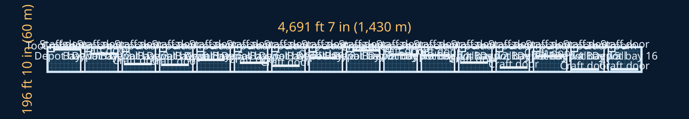

# P8-16 Shuttle Depot: plan

Footprint 4,691 ft 7 in (1,430 m) × 196 ft 10 in (60 m) · structural grid 32 ft 10 in (10 m)

## Levels

| Level | Floor above deck | Height | Floor area |
|---|---|---|---|
| Level 1 · Bay floor | 0 ft (0 mm) | 49 ft 3 in (15 m) | 826,668 sq ft (76,800 m²) |

## Elements

| ID | Designation | Type | Name | Level(s) | Size / length | Area | Status |
|---|---|---|---|---|---|---|---|
| E001 | D5F3P8B15A3R1 | room | Depot bay 1 | L1 | 262 ft 6 in (80 m) × 196 ft 10 in (60 m) | 51,667 sq ft (4,800 m²) | proposed |
| E002 |  | fixture | Craft door | L1 | 210 ft (64 m) × 9 ft 6 in (2,900 mm) | 1,998 sq ft (186 m²) | proposed |
| E003 |  | fixture | Tool room | L1 | 52 ft 6 in (16 m) × 35 ft 5 in (11 m) | 1,860 sq ft (173 m²) | proposed |
| E004 |  | fixture | Staff door | L1 | 26 ft 3 in (8,000 mm) × 9 ft 10 in (3,000 mm) | 258 sq ft (24 m²) | proposed |
| E005 | D5F3P8B15A3R2 | zone | Bay wall | L1 | 32 ft 10 in (10 m) × 196 ft 10 in (60 m) | 6,458 sq ft (600 m²) | proposed |
| E006 | D5F3P8B15A3R3 | room | Depot bay 2 | L1 | 262 ft 6 in (80 m) × 196 ft 10 in (60 m) | 51,667 sq ft (4,800 m²) | proposed |
| E007 |  | fixture | Craft door | L1 | 210 ft (64 m) × 9 ft 6 in (2,900 mm) | 1,998 sq ft (186 m²) | proposed |
| E008 |  | fixture | Tool room | L1 | 52 ft 6 in (16 m) × 35 ft 5 in (11 m) | 1,860 sq ft (173 m²) | proposed |
| E009 |  | fixture | Staff door | L1 | 26 ft 3 in (8,000 mm) × 9 ft 10 in (3,000 mm) | 258 sq ft (24 m²) | proposed |
| E010 | D5F3P8B15A3R4 | zone | Bay wall | L1 | 32 ft 10 in (10 m) × 196 ft 10 in (60 m) | 6,458 sq ft (600 m²) | proposed |
| E011 | D5F3P8B15A3R5 | room | Depot bay 3 | L1 | 262 ft 6 in (80 m) × 196 ft 10 in (60 m) | 51,667 sq ft (4,800 m²) | proposed |
| E012 |  | fixture | Craft door | L1 | 210 ft (64 m) × 9 ft 6 in (2,900 mm) | 1,998 sq ft (186 m²) | proposed |
| E013 |  | fixture | Tool room | L1 | 52 ft 6 in (16 m) × 35 ft 5 in (11 m) | 1,860 sq ft (173 m²) | proposed |
| E014 |  | fixture | Staff door | L1 | 26 ft 3 in (8,000 mm) × 9 ft 10 in (3,000 mm) | 258 sq ft (24 m²) | proposed |
| E015 | D5F3P8B15A3R6 | zone | Bay wall | L1 | 32 ft 10 in (10 m) × 196 ft 10 in (60 m) | 6,458 sq ft (600 m²) | proposed |
| E016 | D5F3P8B15A3R7 | room | Depot bay 4 | L1 | 262 ft 6 in (80 m) × 196 ft 10 in (60 m) | 51,667 sq ft (4,800 m²) | proposed |
| E017 |  | fixture | Craft door | L1 | 210 ft (64 m) × 9 ft 6 in (2,900 mm) | 1,998 sq ft (186 m²) | proposed |
| E018 |  | fixture | Tool room | L1 | 52 ft 6 in (16 m) × 35 ft 5 in (11 m) | 1,860 sq ft (173 m²) | proposed |
| E019 |  | fixture | Staff door | L1 | 26 ft 3 in (8,000 mm) × 9 ft 10 in (3,000 mm) | 258 sq ft (24 m²) | proposed |
| E020 | D5F3P8B15A3R8 | zone | Bay wall | L1 | 32 ft 10 in (10 m) × 196 ft 10 in (60 m) | 6,458 sq ft (600 m²) | proposed |
| E021 | D5F3P8B15A3R9 | room | Depot bay 5 | L1 | 262 ft 6 in (80 m) × 196 ft 10 in (60 m) | 51,667 sq ft (4,800 m²) | proposed |
| E022 |  | fixture | Craft door | L1 | 210 ft (64 m) × 9 ft 6 in (2,900 mm) | 1,998 sq ft (186 m²) | proposed |
| E023 |  | fixture | Tool room | L1 | 52 ft 6 in (16 m) × 35 ft 5 in (11 m) | 1,860 sq ft (173 m²) | proposed |
| E024 |  | fixture | Staff door | L1 | 26 ft 3 in (8,000 mm) × 9 ft 10 in (3,000 mm) | 258 sq ft (24 m²) | proposed |
| E025 | D5F3P8B15A3R10 | zone | Bay wall | L1 | 32 ft 10 in (10 m) × 196 ft 10 in (60 m) | 6,458 sq ft (600 m²) | proposed |
| E026 | D5F3P8B15A3R11 | room | Depot bay 6 | L1 | 262 ft 6 in (80 m) × 196 ft 10 in (60 m) | 51,667 sq ft (4,800 m²) | proposed |
| E027 |  | fixture | Craft door | L1 | 210 ft (64 m) × 9 ft 6 in (2,900 mm) | 1,998 sq ft (186 m²) | proposed |
| E028 |  | fixture | Tool room | L1 | 52 ft 6 in (16 m) × 35 ft 5 in (11 m) | 1,860 sq ft (173 m²) | proposed |
| E029 |  | fixture | Staff door | L1 | 26 ft 3 in (8,000 mm) × 9 ft 10 in (3,000 mm) | 258 sq ft (24 m²) | proposed |
| E030 | D5F3P8B15A3R12 | zone | Bay wall | L1 | 32 ft 10 in (10 m) × 196 ft 10 in (60 m) | 6,458 sq ft (600 m²) | proposed |
| E031 | D5F3P8B15A3R13 | room | Depot bay 7 | L1 | 262 ft 6 in (80 m) × 196 ft 10 in (60 m) | 51,667 sq ft (4,800 m²) | proposed |
| E032 |  | fixture | Craft door | L1 | 210 ft (64 m) × 9 ft 6 in (2,900 mm) | 1,998 sq ft (186 m²) | proposed |
| E033 |  | fixture | Tool room | L1 | 52 ft 6 in (16 m) × 35 ft 5 in (11 m) | 1,860 sq ft (173 m²) | proposed |
| E034 |  | fixture | Staff door | L1 | 26 ft 3 in (8,000 mm) × 9 ft 10 in (3,000 mm) | 258 sq ft (24 m²) | proposed |
| E035 | D5F3P8B15A3R14 | zone | Bay wall | L1 | 32 ft 10 in (10 m) × 196 ft 10 in (60 m) | 6,458 sq ft (600 m²) | proposed |
| E036 | D5F3P8B15A3R15 | room | Depot bay 8 | L1 | 262 ft 6 in (80 m) × 196 ft 10 in (60 m) | 51,667 sq ft (4,800 m²) | proposed |
| E037 |  | fixture | Craft door | L1 | 210 ft (64 m) × 9 ft 6 in (2,900 mm) | 1,998 sq ft (186 m²) | proposed |
| E038 |  | fixture | Tool room | L1 | 52 ft 6 in (16 m) × 35 ft 5 in (11 m) | 1,860 sq ft (173 m²) | proposed |
| E039 |  | fixture | Staff door | L1 | 26 ft 3 in (8,000 mm) × 9 ft 10 in (3,000 mm) | 258 sq ft (24 m²) | proposed |
| E040 | D5F3P8B15A3R16 | zone | Bay wall | L1 | 32 ft 10 in (10 m) × 196 ft 10 in (60 m) | 6,458 sq ft (600 m²) | proposed |
| E041 | D5F3P8B15A3R17 | room | Depot bay 9 | L1 | 262 ft 6 in (80 m) × 196 ft 10 in (60 m) | 51,667 sq ft (4,800 m²) | proposed |
| E042 |  | fixture | Craft door | L1 | 210 ft (64 m) × 9 ft 6 in (2,900 mm) | 1,998 sq ft (186 m²) | proposed |
| E043 |  | fixture | Tool room | L1 | 52 ft 6 in (16 m) × 35 ft 5 in (11 m) | 1,860 sq ft (173 m²) | proposed |
| E044 |  | fixture | Staff door | L1 | 26 ft 3 in (8,000 mm) × 9 ft 10 in (3,000 mm) | 258 sq ft (24 m²) | proposed |
| E045 | D5F3P8B15A3R18 | zone | Bay wall | L1 | 32 ft 10 in (10 m) × 196 ft 10 in (60 m) | 6,458 sq ft (600 m²) | proposed |
| E046 | D5F3P8B15A3R19 | room | Depot bay 10 | L1 | 262 ft 6 in (80 m) × 196 ft 10 in (60 m) | 51,667 sq ft (4,800 m²) | proposed |
| E047 |  | fixture | Craft door | L1 | 210 ft (64 m) × 9 ft 6 in (2,900 mm) | 1,998 sq ft (186 m²) | proposed |
| E048 |  | fixture | Tool room | L1 | 52 ft 6 in (16 m) × 35 ft 5 in (11 m) | 1,860 sq ft (173 m²) | proposed |
| E049 |  | fixture | Staff door | L1 | 26 ft 3 in (8,000 mm) × 9 ft 10 in (3,000 mm) | 258 sq ft (24 m²) | proposed |
| E050 | D5F3P8B15A3R20 | zone | Bay wall | L1 | 32 ft 10 in (10 m) × 196 ft 10 in (60 m) | 6,458 sq ft (600 m²) | proposed |
| E051 | D5F3P8B15A3R21 | room | Depot bay 11 | L1 | 262 ft 6 in (80 m) × 196 ft 10 in (60 m) | 51,667 sq ft (4,800 m²) | proposed |
| E052 |  | fixture | Craft door | L1 | 210 ft (64 m) × 9 ft 2 in (2,800 mm) | 1,929 sq ft (179 m²) | proposed |
| E053 |  | fixture | Tool room | L1 | 52 ft 6 in (16 m) × 35 ft 5 in (11 m) | 1,860 sq ft (173 m²) | proposed |
| E054 |  | fixture | Staff door | L1 | 26 ft 3 in (8,000 mm) × 9 ft 10 in (3,000 mm) | 258 sq ft (24 m²) | proposed |
| E055 | D5F3P8B15A3R22 | zone | Bay wall | L1 | 32 ft 10 in (10 m) × 196 ft 10 in (60 m) | 6,458 sq ft (600 m²) | proposed |
| E056 | D5F3P8B15A3R23 | room | Depot bay 12 | L1 | 262 ft 6 in (80 m) × 196 ft 10 in (60 m) | 51,667 sq ft (4,800 m²) | proposed |
| E057 |  | fixture | Craft door | L1 | 210 ft (64 m) × 9 ft 6 in (2,900 mm) | 1,998 sq ft (186 m²) | proposed |
| E058 |  | fixture | Tool room | L1 | 52 ft 6 in (16 m) × 35 ft 5 in (11 m) | 1,860 sq ft (173 m²) | proposed |
| E059 |  | fixture | Staff door | L1 | 26 ft 3 in (8,000 mm) × 9 ft 10 in (3,000 mm) | 258 sq ft (24 m²) | proposed |
| E060 | D5F3P8B15A3R24 | zone | Bay wall | L1 | 32 ft 10 in (10 m) × 196 ft 10 in (60 m) | 6,458 sq ft (600 m²) | proposed |
| E061 | D5F3P8B15A3R25 | room | Depot bay 13 | L1 | 262 ft 6 in (80 m) × 196 ft 10 in (60 m) | 51,667 sq ft (4,800 m²) | proposed |
| E062 |  | fixture | Craft door | L1 | 210 ft (64 m) × 9 ft 6 in (2,900 mm) | 1,998 sq ft (186 m²) | proposed |
| E063 |  | fixture | Tool room | L1 | 52 ft 6 in (16 m) × 35 ft 5 in (11 m) | 1,860 sq ft (173 m²) | proposed |
| E064 |  | fixture | Staff door | L1 | 26 ft 3 in (8,000 mm) × 9 ft 10 in (3,000 mm) | 258 sq ft (24 m²) | proposed |
| E065 | D5F3P8B15A3R26 | zone | Bay wall | L1 | 32 ft 10 in (10 m) × 196 ft 10 in (60 m) | 6,458 sq ft (600 m²) | proposed |
| E066 | D5F3P8B15A3R27 | room | Depot bay 14 | L1 | 262 ft 6 in (80 m) × 196 ft 10 in (60 m) | 51,667 sq ft (4,800 m²) | proposed |
| E067 |  | fixture | Craft door | L1 | 210 ft (64 m) × 9 ft 2 in (2,800 mm) | 1,929 sq ft (179 m²) | proposed |
| E068 |  | fixture | Tool room | L1 | 52 ft 6 in (16 m) × 35 ft 5 in (11 m) | 1,860 sq ft (173 m²) | proposed |
| E069 |  | fixture | Staff door | L1 | 26 ft 3 in (8,000 mm) × 9 ft 10 in (3,000 mm) | 258 sq ft (24 m²) | proposed |
| E070 | D5F3P8B15A3R28 | zone | Bay wall | L1 | 32 ft 10 in (10 m) × 196 ft 10 in (60 m) | 6,458 sq ft (600 m²) | proposed |
| E071 | D5F3P8B15A3R29 | room | Depot bay 15 | L1 | 262 ft 6 in (80 m) × 196 ft 10 in (60 m) | 51,667 sq ft (4,800 m²) | proposed |
| E072 |  | fixture | Craft door | L1 | 210 ft (64 m) × 9 ft 6 in (2,900 mm) | 1,998 sq ft (186 m²) | proposed |
| E073 |  | fixture | Tool room | L1 | 52 ft 6 in (16 m) × 35 ft 5 in (11 m) | 1,860 sq ft (173 m²) | proposed |
| E074 |  | fixture | Staff door | L1 | 26 ft 3 in (8,000 mm) × 9 ft 10 in (3,000 mm) | 258 sq ft (24 m²) | proposed |
| E075 | D5F3P8B15A3R30 | zone | Bay wall | L1 | 32 ft 10 in (10 m) × 196 ft 10 in (60 m) | 6,458 sq ft (600 m²) | proposed |
| E076 | D5F3P8B15A3R31 | room | Depot bay 16 | L1 | 262 ft 6 in (80 m) × 196 ft 10 in (60 m) | 51,667 sq ft (4,800 m²) | proposed |
| E077 |  | fixture | Craft door | L1 | 210 ft (64 m) × 9 ft 6 in (2,900 mm) | 1,998 sq ft (186 m²) | proposed |
| E078 |  | fixture | Tool room | L1 | 52 ft 6 in (16 m) × 35 ft 5 in (11 m) | 1,860 sq ft (173 m²) | proposed |
| E079 |  | fixture | Staff door | L1 | 26 ft 3 in (8,000 mm) × 9 ft 10 in (3,000 mm) | 258 sq ft (24 m²) | proposed |

## Drawings

### Level 1 · Bay floor

