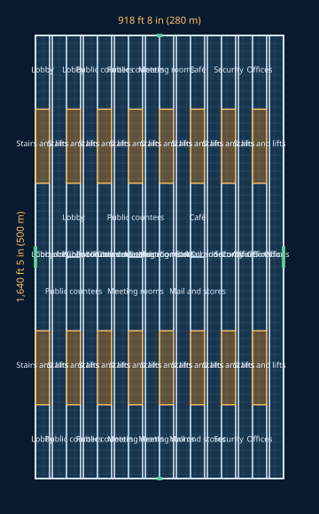
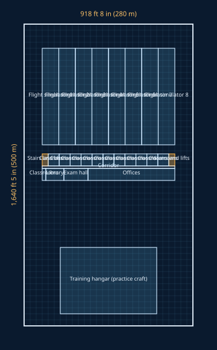
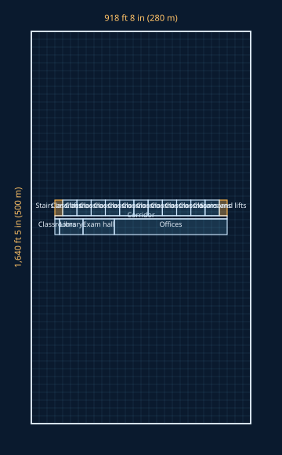

# P8-18 Shuttle Yards Training Centre: plan

Footprint 918 ft 8 in (280 m) × 1,640 ft 5 in (500 m) · structural grid 32 ft 10 in (10 m)

## Levels

| Level | Floor above deck | Height | Floor area |
|---|---|---|---|
| Level 1 · Ground floor | 0 ft (0 mm) | 19 ft 8 in (6,000 mm) | 658,751 sq ft (61,200 m²) |
| Level 2 · Level 2 | 19 ft 8 in (6,000 mm) | 19 ft 8 in (6,000 mm) | 658,751 sq ft (61,200 m²) |
| Level 3 · Level 3 | 39 ft 4 in (12 m) | 13 ft 1 in (4,000 mm) | 90,417 sq ft (8,400 m²) |

## Elements

| ID | Designation | Type | Name | Level(s) | Size / length | Area | Status |
|---|---|---|---|---|---|---|---|
| E001 | D5F3P8B3A1L1R1, D5F3P8B3A1L2R1 | room | Flight simulator 1 | L1, L2 | 90 ft 3 in (28 m) × 524 ft 11 in (160 m) | 47,361 sq ft (4,400 m²) | proposed |
| E002 | D5F3P8B3A1L1R2, D5F3P8B3A1L2R2 | room | Flight simulator 2 | L1, L2 | 90 ft 3 in (28 m) × 524 ft 11 in (160 m) | 47,361 sq ft (4,400 m²) | proposed |
| E003 | D5F3P8B3A1L1R3, D5F3P8B3A1L2R3 | room | Flight simulator 3 | L1, L2 | 90 ft 3 in (28 m) × 524 ft 11 in (160 m) | 47,361 sq ft (4,400 m²) | proposed |
| E004 | D5F3P8B3A1L1R4, D5F3P8B3A1L2R4 | room | Flight simulator 4 | L1, L2 | 90 ft 3 in (28 m) × 524 ft 11 in (160 m) | 47,361 sq ft (4,400 m²) | proposed |
| E005 | D5F3P8B3A1L1R5, D5F3P8B3A1L2R5 | room | Flight simulator 5 | L1, L2 | 90 ft 3 in (28 m) × 524 ft 11 in (160 m) | 47,361 sq ft (4,400 m²) | proposed |
| E006 | D5F3P8B3A1L1R6, D5F3P8B3A1L2R6 | room | Flight simulator 6 | L1, L2 | 90 ft 3 in (28 m) × 524 ft 11 in (160 m) | 47,361 sq ft (4,400 m²) | proposed |
| E007 | D5F3P8B3A1L1R7, D5F3P8B3A1L2R7 | room | Flight simulator 7 | L1, L2 | 90 ft 3 in (28 m) × 524 ft 11 in (160 m) | 47,361 sq ft (4,400 m²) | proposed |
| E008 | D5F3P8B3A1L1R8, D5F3P8B3A1L2R8 | room | Flight simulator 8 | L1, L2 | 90 ft 3 in (28 m) × 524 ft 11 in (160 m) | 47,361 sq ft (4,400 m²) | proposed |
| E009 | D5F3P8B3A1L1R9, D5F3P8B3A1L2R9, D5F3P8B3A1L3R1 | core | Stairs and lifts | L1, L2, L3 | 32 ft 10 in (10 m) × 65 ft 7 in (20 m) | 2,153 sq ft (200 m²) | proposed |
| E010 | D5F3P8B3A1L1R10, D5F3P8B3A1L2R10, D5F3P8B3A1L3R2 | core | Stairs and lifts | L1, L2, L3 | 32 ft 10 in (10 m) × 65 ft 7 in (20 m) | 2,153 sq ft (200 m²) | proposed |
| E011 | D5F3P8B3A1L1R11 | zone | Corridor | L1 | 721 ft 9 in (220 m) × 13 ft 1 in (4,000 mm) | 9,472 sq ft (880 m²) | proposed |
| E012 | D5F3P8B3A1L1R12 | room | Entrance and reception | L1 | 656 ft 2 in (200 m) × 65 ft 7 in (20 m) | 43,056 sq ft (4,000 m²) | proposed |
| E013 | D5F3P8B3A1L1R13 | room | Briefing rooms | L1 | 13 ft 1 in (4,000 mm) × 65 ft 7 in (20 m) | 861 sq ft (80 m²) | proposed |
| E014 | D5F3P8B3A1L1R14 | room | Briefing rooms | L1 | 13 ft 1 in (4,000 mm) × 65 ft 7 in (20 m) | 861 sq ft (80 m²) | proposed |
| E015 | D5F3P8B3A1L1R15 | room | Briefing rooms | L1 | 13 ft 1 in (4,000 mm) × 65 ft 7 in (20 m) | 861 sq ft (80 m²) | proposed |
| E016 | D5F3P8B3A1L1R16 | room | Briefing rooms | L1 | 13 ft 1 in (4,000 mm) × 65 ft 7 in (20 m) | 861 sq ft (80 m²) | proposed |
| E017 | D5F3P8B3A1L1R17 | room | Briefing rooms | L1 | 13 ft 1 in (4,000 mm) × 65 ft 7 in (20 m) | 861 sq ft (80 m²) | proposed |
| E018 | D5F3P8B3A1L1R18 | room | Briefing rooms | L1 | 13 ft 1 in (4,000 mm) × 65 ft 7 in (20 m) | 861 sq ft (80 m²) | proposed |
| E019 | D5F3P8B3A1L1R19 | room | Instructors' room | L1 | 65 ft 7 in (20 m) × 65 ft 7 in (20 m) | 4,306 sq ft (400 m²) | proposed |
| E020 | D5F3P8B3A1L1R20 | room | Café | L1 | 577 ft 5 in (176 m) × 65 ft 7 in (20 m) | 37,889 sq ft (3,520 m²) | proposed |
| E021 | D5F3P8B3A1L2R11, D5F3P8B3A1L3R3 | zone | Corridor | L2, L3 | 721 ft 9 in (220 m) × 13 ft 1 in (4,000 mm) | 9,472 sq ft (880 m²) | proposed |
| E022 | D5F3P8B3A1L2R12, D5F3P8B3A1L3R4 | room | Classrooms | L2, L3 | 59 ft 9 in (18 m) × 65 ft 7 in (20 m) | 3,918 sq ft (364 m²) | proposed |
| E023 | D5F3P8B3A1L2R13, D5F3P8B3A1L3R5 | room | Classrooms | L2, L3 | 59 ft 9 in (18 m) × 65 ft 7 in (20 m) | 3,918 sq ft (364 m²) | proposed |
| E024 | D5F3P8B3A1L2R14, D5F3P8B3A1L3R6 | room | Classrooms | L2, L3 | 59 ft 5 in (18 m) × 65 ft 7 in (20 m) | 3,897 sq ft (362 m²) | proposed |
| E025 | D5F3P8B3A1L2R15, D5F3P8B3A1L3R7 | room | Classrooms | L2, L3 | 59 ft 9 in (18 m) × 65 ft 7 in (20 m) | 3,918 sq ft (364 m²) | proposed |
| E026 | D5F3P8B3A1L2R16, D5F3P8B3A1L3R8 | room | Classrooms | L2, L3 | 59 ft 9 in (18 m) × 65 ft 7 in (20 m) | 3,918 sq ft (364 m²) | proposed |
| E027 | D5F3P8B3A1L2R17, D5F3P8B3A1L3R9 | room | Classrooms | L2, L3 | 59 ft 9 in (18 m) × 65 ft 7 in (20 m) | 3,918 sq ft (364 m²) | proposed |
| E028 | D5F3P8B3A1L2R18, D5F3P8B3A1L3R10 | room | Classrooms | L2, L3 | 59 ft 9 in (18 m) × 65 ft 7 in (20 m) | 3,918 sq ft (364 m²) | proposed |
| E029 | D5F3P8B3A1L2R19, D5F3P8B3A1L3R11 | room | Classrooms | L2, L3 | 59 ft 9 in (18 m) × 65 ft 7 in (20 m) | 3,918 sq ft (364 m²) | proposed |
| E030 | D5F3P8B3A1L2R20, D5F3P8B3A1L3R12 | room | Classrooms | L2, L3 | 59 ft 5 in (18 m) × 65 ft 7 in (20 m) | 3,897 sq ft (362 m²) | proposed |
| E031 | D5F3P8B3A1L2R21, D5F3P8B3A1L3R13 | room | Classrooms | L2, L3 | 59 ft 9 in (18 m) × 65 ft 7 in (20 m) | 3,918 sq ft (364 m²) | proposed |
| E032 | D5F3P8B3A1L2R22, D5F3P8B3A1L3R14 | room | Classrooms | L2, L3 | 59 ft 9 in (18 m) × 65 ft 7 in (20 m) | 3,918 sq ft (364 m²) | proposed |
| E033 | D5F3P8B3A1L2R23, D5F3P8B3A1L3R15 | room | Classrooms | L2, L3 | 19 ft 8 in (6,000 mm) × 65 ft 7 in (20 m) | 1,292 sq ft (120 m²) | proposed |
| E034 | D5F3P8B3A1L2R24, D5F3P8B3A1L3R16 | room | Library | L2, L3 | 98 ft 5 in (30 m) × 65 ft 7 in (20 m) | 6,458 sq ft (600 m²) | proposed |
| E035 | D5F3P8B3A1L2R25, D5F3P8B3A1L3R17 | room | Exam hall | L2, L3 | 131 ft 3 in (40 m) × 65 ft 7 in (20 m) | 8,611 sq ft (800 m²) | proposed |
| E036 | D5F3P8B3A1L2R26, D5F3P8B3A1L3R18 | room | Offices | L2, L3 | 472 ft 5 in (144 m) × 65 ft 7 in (20 m) | 31,000 sq ft (2,880 m²) | proposed |
| E037 | D5F3P8B3A1L1R21 | zone | Ground school courtyard | L1 | 721 ft 9 in (220 m) × 328 ft 1 in (100 m) | 236,806 sq ft (22,000 m²) | proposed |
| E038 | D5F3P8B3A1L1R22, D5F3P8B3A1L2R27 | room | Training hangar (practice craft) | L1, L2 | 524 ft 11 in (160 m) × 360 ft 11 in (110 m) | 189,445 sq ft (17,600 m²) | proposed |
| E039 |  | door | Entrance | L1 | 65 ft 7 in (20 m), 65 ft 7 in (20 m) wide | — | proposed |

## Drawings

### Level 1 · Ground floor

### Level 2 · Level 2

### Level 3 · Level 3

