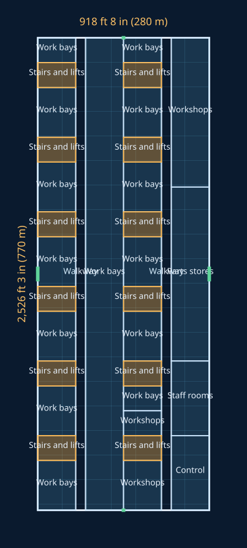
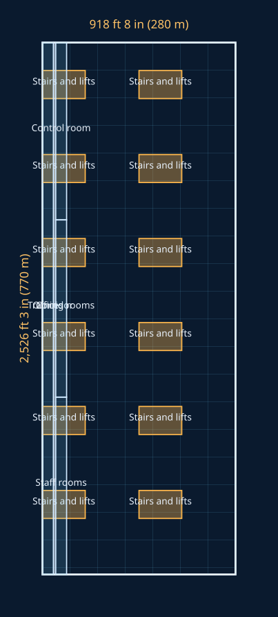
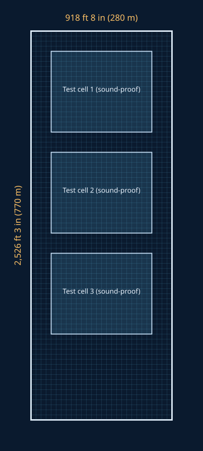

# P8-19 Engine Test Hall: plan

Footprint 918 ft 8 in (280 m) × 2,526 ft 3 in (770 m) · structural grid 32 ft 10 in (10 m)

## Levels

| Level | Floor above deck | Height | Floor area |
|---|---|---|---|
| Level 1 · Ground floor | 0 ft (0 mm) | 19 ft 8 in (6,000 mm) | 1,115,141 sq ft (103,600 m²) |
| Level 2 · Level 2 | 19 ft 8 in (6,000 mm) | 19 ft 8 in (6,000 mm) | 1,115,141 sq ft (103,600 m²) |
| Level 3 · Hall upper | 39 ft 4 in (12 m) | 19 ft 8 in (6,000 mm) | 1,033,335 sq ft (96,000 m²) |

## Elements

| ID | Designation | Type | Name | Level(s) | Size / length | Area | Status |
|---|---|---|---|---|---|---|---|
| E001 | D5F3P8B4A1L1R1, D5F3P8B4A1L2R1, D5F3P8B4A1L3R1 | room | Test cell 1 (sound-proof) | L1, L2, L3 | 656 ft 2 in (200 m) × 524 ft 11 in (160 m) | 344,445 sq ft (32,000 m²) | proposed |
| E002 | D5F3P8B4A1L1R2, D5F3P8B4A1L2R2, D5F3P8B4A1L3R2 | room | Test cell 2 (sound-proof) | L1, L2, L3 | 656 ft 2 in (200 m) × 524 ft 11 in (160 m) | 344,445 sq ft (32,000 m²) | proposed |
| E003 | D5F3P8B4A1L1R3, D5F3P8B4A1L2R3, D5F3P8B4A1L3R3 | room | Test cell 3 (sound-proof) | L1, L2, L3 | 656 ft 2 in (200 m) × 524 ft 11 in (160 m) | 344,445 sq ft (32,000 m²) | proposed |
| E004 | D5F3P8B4A1L1R4, D5F3P8B4A1L2R4 | core | Stairs and lifts | L1, L2 | 32 ft 10 in (10 m) × 65 ft 7 in (20 m) | 2,153 sq ft (200 m²) | proposed |
| E005 | D5F3P8B4A1L1R5, D5F3P8B4A1L2R5 | core | Stairs and lifts | L1, L2 | 32 ft 10 in (10 m) × 65 ft 7 in (20 m) | 2,153 sq ft (200 m²) | proposed |
| E006 | D5F3P8B4A1L1R6 | zone | Corridor | L1 | 656 ft 2 in (200 m) × 13 ft 1 in (4,000 mm) | 8,611 sq ft (800 m²) | proposed |
| E007 | D5F3P8B4A1L1R7 | room | Engine prep shop | L1 | 590 ft 7 in (180 m) × 65 ft 7 in (20 m) | 38,750 sq ft (3,600 m²) | proposed |
| E008 | D5F3P8B4A1L1R8 | room | Engine stands store | L1 | 196 ft 10 in (60 m) × 65 ft 7 in (20 m) | 12,917 sq ft (1,200 m²) | proposed |
| E009 | D5F3P8B4A1L1R9 | room | Fuel and oil room | L1 | 65 ft 7 in (20 m) × 65 ft 7 in (20 m) | 4,306 sq ft (400 m²) | proposed |
| E010 | D5F3P8B4A1L1R10 | room | Workshop | L1 | 393 ft 8 in (120 m) × 65 ft 7 in (20 m) | 25,833 sq ft (2,400 m²) | proposed |
| E011 | D5F3P8B4A1L2R6 | zone | Corridor | L2 | 656 ft 2 in (200 m) × 13 ft 1 in (4,000 mm) | 8,611 sq ft (800 m²) | proposed |
| E012 | D5F3P8B4A1L2R7 | room | Test control rooms | L2 | 196 ft 10 in (60 m) × 65 ft 7 in (20 m) | 12,917 sq ft (1,200 m²) | proposed |
| E013 | D5F3P8B4A1L2R8 | room | Test control rooms | L2 | 196 ft 10 in (60 m) × 65 ft 7 in (20 m) | 12,917 sq ft (1,200 m²) | proposed |
| E014 | D5F3P8B4A1L2R9 | room | Test control rooms | L2 | 196 ft 10 in (60 m) × 65 ft 7 in (20 m) | 12,917 sq ft (1,200 m²) | proposed |
| E015 | D5F3P8B4A1L2R10 | room | Data room | L2 | 98 ft 5 in (30 m) × 65 ft 7 in (20 m) | 6,458 sq ft (600 m²) | proposed |
| E016 | D5F3P8B4A1L2R11 | room | Viewing gallery | L2 | 65 ft 7 in (20 m) × 65 ft 7 in (20 m) | 4,306 sq ft (400 m²) | proposed |
| E017 | D5F3P8B4A1L2R12 | room | Offices | L2 | 492 ft 2 in (150 m) × 65 ft 7 in (20 m) | 32,292 sq ft (3,000 m²) | proposed |
| E018 | D5F3P8B4A1L1R11 | zone | Engine transfer yard | L1 | 656 ft 2 in (200 m) × 229 ft 8 in (70 m) | 150,695 sq ft (14,000 m²) | proposed |

## Drawings

### Level 1 · Ground floor

### Level 2 · Level 2

### Level 3 · Hall upper

