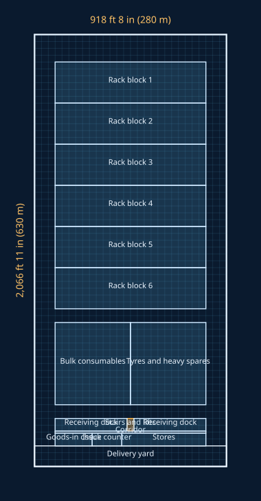
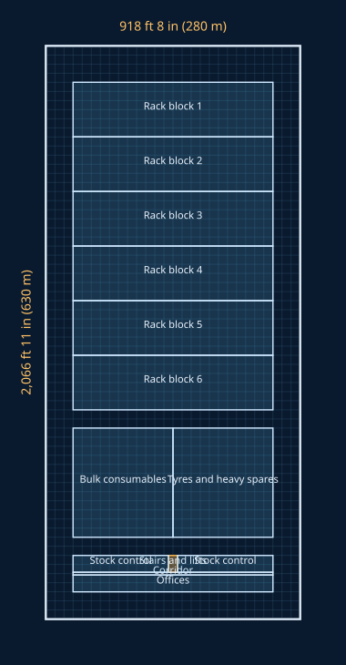
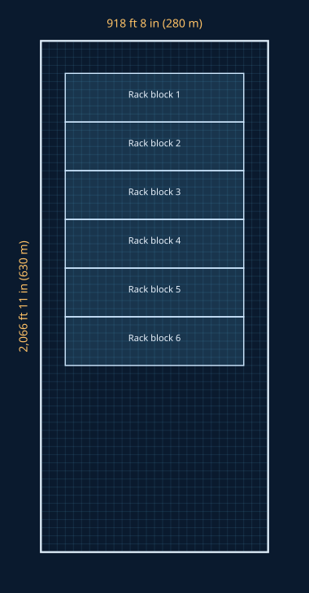

# P8-20 Yard Stores: plan

Footprint 918 ft 8 in (280 m) × 2,066 ft 11 in (630 m) · structural grid 32 ft 10 in (10 m)

## Levels

| Level | Floor above deck | Height | Floor area |
|---|---|---|---|
| Level 1 · Ground floor | 0 ft (0 mm) | 19 ft 8 in (6,000 mm) | 1,222,296 sq ft (113,555 m²) |
| Level 2 · Level 2 | 19 ft 8 in (6,000 mm) | 19 ft 8 in (6,000 mm) | 1,222,296 sq ft (113,555 m²) |
| Level 3 · Rack top | 39 ft 4 in (12 m) | 19 ft 8 in (6,000 mm) | 852,502 sq ft (79,200 m²) |

## Elements

| ID | Designation | Type | Name | Level(s) | Size / length | Area | Status |
|---|---|---|---|---|---|---|---|
| E001 | D5F3P8B5A1L1R1, D5F3P8B5A1L2R1, D5F3P8B5A1L3R1 | room | Rack block 1 | L1, L2, L3 | 721 ft 9 in (220 m) × 196 ft 10 in (60 m) | 142,084 sq ft (13,200 m²) | proposed |
| E002 | D5F3P8B5A1L1R2, D5F3P8B5A1L2R2, D5F3P8B5A1L3R2 | room | Rack block 2 | L1, L2, L3 | 721 ft 9 in (220 m) × 196 ft 10 in (60 m) | 142,084 sq ft (13,200 m²) | proposed |
| E003 | D5F3P8B5A1L1R3, D5F3P8B5A1L2R3, D5F3P8B5A1L3R3 | room | Rack block 3 | L1, L2, L3 | 721 ft 9 in (220 m) × 196 ft 10 in (60 m) | 142,084 sq ft (13,200 m²) | proposed |
| E004 | D5F3P8B5A1L1R4, D5F3P8B5A1L2R4, D5F3P8B5A1L3R4 | room | Rack block 4 | L1, L2, L3 | 721 ft 9 in (220 m) × 196 ft 10 in (60 m) | 142,084 sq ft (13,200 m²) | proposed |
| E005 | D5F3P8B5A1L1R5, D5F3P8B5A1L2R5, D5F3P8B5A1L3R5 | room | Rack block 5 | L1, L2, L3 | 721 ft 9 in (220 m) × 196 ft 10 in (60 m) | 142,084 sq ft (13,200 m²) | proposed |
| E006 | D5F3P8B5A1L1R6, D5F3P8B5A1L2R6, D5F3P8B5A1L3R6 | room | Rack block 6 | L1, L2, L3 | 721 ft 9 in (220 m) × 196 ft 10 in (60 m) | 142,084 sq ft (13,200 m²) | proposed |
| E007 | D5F3P8B5A1L1R7, D5F3P8B5A1L2R7 | room | Bulk consumables | L1, L2 | 360 ft 11 in (110 m) × 393 ft 8 in (120 m) | 142,084 sq ft (13,200 m²) | proposed |
| E008 | D5F3P8B5A1L1R8, D5F3P8B5A1L2R8 | room | Tyres and heavy spares | L1, L2 | 360 ft 11 in (110 m) × 393 ft 8 in (120 m) | 142,084 sq ft (13,200 m²) | proposed |
| E009 | D5F3P8B5A1L1R9, D5F3P8B5A1L2R9 | core | Stairs and lifts | L1, L2 | 32 ft 10 in (10 m) × 60 ft 8 in (18 m) | 1,991 sq ft (185 m²) | proposed |
| E010 | D5F3P8B5A1L1R10 | zone | Corridor | L1 | 721 ft 9 in (220 m) × 9 ft 10 in (3,000 mm) | 7,104 sq ft (660 m²) | proposed |
| E011 | D5F3P8B5A1L1R11 | room | Receiving dock | L1 | 344 ft 6 in (105 m) × 60 ft 8 in (18 m) | 20,909 sq ft (1,942 m²) | proposed |
| E012 | D5F3P8B5A1L1R12 | room | Receiving dock | L1 | 344 ft 6 in (105 m) × 60 ft 8 in (18 m) | 20,909 sq ft (1,942 m²) | proposed |
| E013 | D5F3P8B5A1L1R13 | room | Goods-in check | L1 | 177 ft 6 in (54 m) × 60 ft 8 in (18 m) | 10,773 sq ft (1,001 m²) | proposed |
| E014 | D5F3P8B5A1L1R14 | room | Issue counter | L1 | 141 ft 9 in (43 m) × 60 ft 8 in (18 m) | 8,603 sq ft (799 m²) | proposed |
| E015 | D5F3P8B5A1L1R15 | room | Stores | L1 | 402 ft 7 in (123 m) × 60 ft 8 in (18 m) | 24,434 sq ft (2,270 m²) | proposed |
| E016 | D5F3P8B5A1L2R10 | zone | Corridor | L2 | 721 ft 9 in (220 m) × 9 ft 10 in (3,000 mm) | 7,104 sq ft (660 m²) | proposed |
| E017 | D5F3P8B5A1L2R11 | room | Stock control | L2 | 344 ft 6 in (105 m) × 60 ft 8 in (18 m) | 20,909 sq ft (1,942 m²) | proposed |
| E018 | D5F3P8B5A1L2R12 | room | Stock control | L2 | 344 ft 6 in (105 m) × 60 ft 8 in (18 m) | 20,909 sq ft (1,942 m²) | proposed |
| E019 | D5F3P8B5A1L2R13 | room | Offices | L2 | 721 ft 9 in (220 m) × 60 ft 8 in (18 m) | 43,809 sq ft (4,070 m²) | proposed |
| E020 | D5F3P8B5A1L1R16 | zone | Delivery yard | L1 | 918 ft 8 in (280 m) × 98 ft 5 in (30 m) | 90,417 sq ft (8,400 m²) | proposed |

## Drawings

### Level 1 · Ground floor

### Level 2 · Level 2

### Level 3 · Rack top

