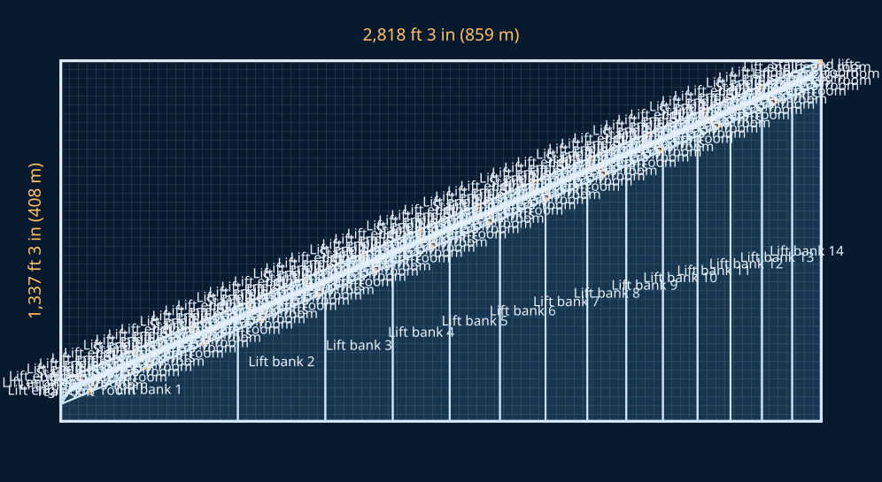

# P1-03 Deck Lift Hall: plan

Footprint 2,818 ft 3 in (859 m) × 1,337 ft 3 in (408 m) · structural grid 32 ft 10 in (10 m)

## Levels

| Level | Floor above deck | Height | Floor area |
|---|---|---|---|
| Level 1 · Hall floor | 0 ft (0 mm) | 32 ft 10 in (10 m) | 2,029,817 sq ft (188,576 m²) |
| Level 2 · Gallery floor | 32 ft 10 in (10 m) | 14 ft 9 in (4,500 mm) | 2,029,807 sq ft (188,575 m²) |

## Elements

| ID | Designation | Type | Name | Level(s) | Size / length | Area | Status |
|---|---|---|---|---|---|---|---|
| E001 | D5F2P1B1A1L1R1, D5F2P1B1A1L2R1 | room | Lift bank 1 | L1, L2 | 656 ft 2 in (200 m) × 340 ft 3 in (104 m) | 132,504 sq ft (12,310 m²) | proposed |
| E002 | D5F2P1B1A1L1R2, D5F2P1B1A1L2R2 | room | Lift bank 2 | L1, L2 | 324 ft 2 in (99 m) × 476 ft 8 in (145 m) | 132,403 sq ft (12,301 m²) | proposed |
| E003 | D5F2P1B1A1L1R3, D5F2P1B1A1L2R3 | room | Lift bank 3 | L1, L2 | 250 ft (76 m) × 582 ft 4 in (178 m) | 132,382 sq ft (12,299 m²) | proposed |
| E004 | D5F2P1B1A1L1R4, D5F2P1B1A1L2R4 | room | Lift bank 4 | L1, L2 | 210 ft 11 in (64 m) × 671 ft 3 in (205 m) | 132,229 sq ft (12,285 m²) | proposed |
| E005 | D5F2P1B1A1L1R5, D5F2P1B1A1L2R5 | room | Lift bank 5 | L1, L2 | 186 ft 4 in (57 m) × 749 ft 8 in (229 m) | 132,397 sq ft (12,300 m²) | proposed |
| E006 | D5F2P1B1A1L1R6, D5F2P1B1A1L2R6 | room | Lift bank 6 | L1, L2 | 168 ft 8 in (51 m) × 820 ft 10 in (250 m) | 132,424 sq ft (12,303 m²) | proposed |
| E007 | D5F2P1B1A1L1R7, D5F2P1B1A1L2R7 | room | Lift bank 7 | L1, L2 | 155 ft 2 in (47 m) × 886 ft 2 in (270 m) | 132,451 sq ft (12,305 m²) | proposed |
| E008 | D5F2P1B1A1L1R8, D5F2P1B1A1L2R8 | room | Lift bank 8 | L1, L2 | 144 ft 4 in (44 m) × 947 ft 2 in (289 m) | 132,327 sq ft (12,294 m²) | proposed |
| E009 | D5F2P1B1A1L1R9, D5F2P1B1A1L2R9 | room | Lift bank 9 | L1, L2 | 135 ft 10 in (41 m) × 1,004 ft 3 in (306 m) | 132,529 sq ft (12,312 m²) | proposed |
| E010 | D5F2P1B1A1L1R10, D5F2P1B1A1L2R10 | room | Lift bank 10 | L1, L2 | 128 ft 3 in (39 m) × 1,058 ft 5 in (323 m) | 132,300 sq ft (12,291 m²) | proposed |
| E011 | D5F2P1B1A1L1R11, D5F2P1B1A1L2R11 | room | Lift bank 11 | L1, L2 | 122 ft 1 in (37 m) × 1,109 ft 11 in (338 m) | 132,318 sq ft (12,293 m²) | proposed |
| E012 | D5F2P1B1A1L1R12, D5F2P1B1A1L2R12 | room | Lift bank 12 | L1, L2 | 116 ft 10 in (36 m) × 1,159 ft 1 in (353 m) | 132,509 sq ft (12,310 m²) | proposed |
| E013 | D5F2P1B1A1L1R13, D5F2P1B1A1L2R13 | room | Lift bank 13 | L1, L2 | 111 ft 11 in (34 m) × 1,206 ft 4 in (368 m) | 132,321 sq ft (12,293 m²) | proposed |
| E014 | D5F2P1B1A1L1R14, D5F2P1B1A1L2R14 | room | Lift bank 14 | L1, L2 | 107 ft 7 in (33 m) × 1,252 ft (382 m) | 132,273 sq ft (12,289 m²) | proposed |
| E015 | D5F2P1B1A1L1R15, D5F2P1B1A1L2R15 | core | Stairs and lifts | L1, L2 | 55 ft 5 in (17 m) × 32 ft 6 in (9,900 mm) | 860 sq ft (80 m²) | proposed |
| E016 | D5F2P1B1A1L1R16, D5F2P1B1A1L2R16 | core | Stairs and lifts | L1, L2 | 50 ft 6 in (15 m) × 34 ft 5 in (10 m) | 857 sq ft (80 m²) | proposed |
| E017 | D5F2P1B1A1L1R17, D5F2P1B1A1L2R17 | core | Stairs and lifts | L1, L2 | 45 ft 7 in (14 m) × 36 ft 5 in (11 m) | 854 sq ft (79 m²) | proposed |
| E018 | D5F2P1B1A1L1R18, D5F2P1B1A1L2R18 | core | Stairs and lifts | L1, L2 | 40 ft 8 in (12 m) × 38 ft 5 in (12 m) | 852 sq ft (79 m²) | proposed |
| E019 | D5F2P1B1A1L1R19, D5F2P1B1A1L2R19 | core | Stairs and lifts | L1, L2 | 35 ft 9 in (11 m) × 40 ft 8 in (12 m) | 852 sq ft (79 m²) | proposed |
| E020 | D5F2P1B1A1L1R20, D5F2P1B1A1L2R20 | core | Stairs and lifts | L1, L2 | 30 ft 10 in (9,400 mm) × 42 ft 8 in (13 m) | 849 sq ft (79 m²) | proposed |
| E021 | D5F2P1B1A1L1R21, D5F2P1B1A1L2R21 | core | Stairs and lifts | L1, L2 | 25 ft 11 in (7,900 mm) × 44 ft 7 in (14 m) | 849 sq ft (79 m²) | proposed |
| E022 | D5F2P1B1A1L1R22, D5F2P1B1A1L2R22 | core | Stairs and lifts | L1, L2 | 27 ft 3 in (8,300 mm) × 46 ft 7 in (14 m) | 859 sq ft (80 m²) | proposed |
| E023 | D5F2P1B1A1L1R23, D5F2P1B1A1L2R23 | core | Stairs and lifts | L1, L2 | 32 ft 2 in (9,800 mm) × 48 ft 11 in (15 m) | 860 sq ft (80 m²) | proposed |
| E024 | D5F2P1B1A1L1R24, D5F2P1B1A1L2R24 | core | Stairs and lifts | L1, L2 | 37 ft 1 in (11 m) × 50 ft 10 in (16 m) | 858 sq ft (80 m²) | proposed |
| E025 | D5F2P1B1A1L1R25, D5F2P1B1A1L2R25 | core | Stairs and lifts | L1, L2 | 42 ft (13 m) × 52 ft 10 in (16 m) | 855 sq ft (79 m²) | proposed |
| E026 | D5F2P1B1A1L1R26, D5F2P1B1A1L2R26 | core | Stairs and lifts | L1, L2 | 46 ft 11 in (14 m) × 54 ft 9 in (17 m) | 861 sq ft (80 m²) | proposed |
| E027 | D5F2P1B1A1L1R27, D5F2P1B1A1L2R27 | core | Stairs and lifts | L1, L2 | 51 ft 6 in (16 m) × 57 ft 1 in (17 m) | 853 sq ft (79 m²) | proposed |
| E028 | D5F2P1B1A1L1R28, D5F2P1B1A1L2R28 | core | Stairs and lifts | L1, L2 | 44 ft 3 in (14 m) × 53 ft 10 in (16 m) | 845 sq ft (79 m²) | proposed |
| E029 | D5F2P1B1A1L1R29, D5F2P1B1A1L2R29 | core | Stairs and lifts | L1, L2 | 52 ft 10 in (16 m) × 33 ft 6 in (10 m) | 854 sq ft (79 m²) | proposed |
| E030 | D5F2P1B1A1L1R30, D5F2P1B1A1L2R30 | core | Stairs and lifts | L1, L2 | 47 ft 11 in (15 m) × 35 ft 1 in (11 m) | 843 sq ft (78 m²) | proposed |
| E031 | D5F2P1B1A1L1R31, D5F2P1B1A1L2R31 | core | Stairs and lifts | L1, L2 | 43 ft (13 m) × 37 ft 5 in (11 m) | 849 sq ft (79 m²) | proposed |
| E032 | D5F2P1B1A1L1R32, D5F2P1B1A1L2R32 | core | Stairs and lifts | L1, L2 | 38 ft 5 in (12 m) × 39 ft 4 in (12 m) | 854 sq ft (79 m²) | proposed |
| E033 | D5F2P1B1A1L1R33, D5F2P1B1A1L2R33 | core | Stairs and lifts | L1, L2 | 33 ft 6 in (10 m) × 41 ft 8 in (13 m) | 856 sq ft (79 m²) | proposed |
| E034 | D5F2P1B1A1L1R34, D5F2P1B1A1L2R34 | core | Stairs and lifts | L1, L2 | 28 ft 7 in (8,700 mm) × 43 ft 8 in (13 m) | 856 sq ft (80 m²) | proposed |
| E035 | D5F2P1B1A1L1R35, D5F2P1B1A1L2R35 | core | Stairs and lifts | L1, L2 | 24 ft 11 in (7,600 mm) × 45 ft 7 in (14 m) | 854 sq ft (79 m²) | proposed |
| E036 | D5F2P1B1A1L1R36, D5F2P1B1A1L2R36 | core | Stairs and lifts | L1, L2 | 29 ft 6 in (9,000 mm) × 47 ft 11 in (15 m) | 855 sq ft (79 m²) | proposed |
| E037 | D5F2P1B1A1L1R37, D5F2P1B1A1L2R37 | core | Stairs and lifts | L1, L2 | 34 ft 5 in (10 m) × 49 ft 10 in (15 m) | 847 sq ft (79 m²) | proposed |
| E038 | D5F2P1B1A1L1R38, D5F2P1B1A1L2R38 | core | Stairs and lifts | L1, L2 | 39 ft 4 in (12 m) × 52 ft 2 in (16 m) | 851 sq ft (79 m²) | proposed |
| E039 | D5F2P1B1A1L1R39, D5F2P1B1A1L2R39 | core | Stairs and lifts | L1, L2 | 44 ft 3 in (14 m) × 53 ft 10 in (16 m) | 847 sq ft (79 m²) | proposed |
| E040 | D5F2P1B1A1L1R40, D5F2P1B1A1L2R40 | core | Stairs and lifts | L1, L2 | 49 ft 3 in (15 m) × 56 ft 1 in (17 m) | 862 sq ft (80 m²) | proposed |
| E041 | D5F2P1B1A1L1R41, D5F2P1B1A1L2R41 | core | Stairs and lifts | L1, L2 | 54 ft 2 in (16 m) × 58 ft 1 in (18 m) | 850 sq ft (79 m²) | proposed |
| E042 | D5F2P1B1A1L1R42 | zone | Corridor | L1 | 2,753 ft 3 in (839 m) × 1,175 ft 10 in (358 m) | 29,399 sq ft (2,731 m²) | proposed |
| E043 | D5F2P1B1A1L1R43 | room | Lift control room | L1 | 32 ft 6 in (9,900 mm) × 56 ft 9 in (17 m) | 858 sq ft (80 m²) | proposed |
| E044 | D5F2P1B1A1L1R44 | room | Waiting hall | L1 | 78 ft 5 in (24 m) × 60 ft (18 m) | 2,405 sq ft (223 m²) | proposed |
| E045 | D5F2P1B1A1L1R45 | room | Toilets | L1 | 48 ft 11 in (15 m) × 30 ft 2 in (9,200 mm) | 648 sq ft (60 m²) | proposed |
| E046 | D5F2P1B1A1L1R46 | room | Lift machine room | L1 | 84 ft 8 in (26 m) × 45 ft 11 in (14 m) | 1,940 sq ft (180 m²) | proposed |
| E047 | D5F2P1B1A1L1R47 | room | Lift machine room | L1 | 83 ft 8 in (26 m) × 46 ft 7 in (14 m) | 1,949 sq ft (181 m²) | proposed |
| E048 | D5F2P1B1A1L1R48 | room | Lift machine room | L1 | 84 ft 4 in (26 m) × 47 ft 11 in (15 m) | 2,015 sq ft (187 m²) | proposed |
| E049 | D5F2P1B1A1L1R49 | room | Lift machine room | L1 | 80 ft 5 in (24 m) × 47 ft 7 in (14 m) | 1,932 sq ft (179 m²) | proposed |
| E050 | D5F2P1B1A1L1R50 | room | Lift machine room | L1 | 78 ft 9 in (24 m) × 48 ft 3 in (15 m) | 1,929 sq ft (179 m²) | proposed |
| E051 | D5F2P1B1A1L1R51 | room | Lift machine room | L1 | 98 ft 1 in (30 m) × 57 ft 9 in (18 m) | 2,675 sq ft (249 m²) | proposed |
| E052 | D5F2P1B1A1L1R52 | room | Lift machine room | L1 | 75 ft 6 in (23 m) × 49 ft 10 in (15 m) | 1,938 sq ft (180 m²) | proposed |
| E053 | D5F2P1B1A1L1R53 | room | Lift machine room | L1 | 74 ft 2 in (23 m) × 50 ft 6 in (15 m) | 1,944 sq ft (181 m²) | proposed |
| E054 | D5F2P1B1A1L1R54 | room | Lift machine room | L1 | 93 ft 2 in (28 m) × 59 ft 9 in (18 m) | 2,668 sq ft (248 m²) | proposed |
| E055 | D5F2P1B1A1L1R55 | room | Lift machine room | L1 | 70 ft 6 in (22 m) × 51 ft 10 in (16 m) | 1,938 sq ft (180 m²) | proposed |
| E056 | D5F2P1B1A1L1R56 | room | Lift machine room | L1 | 69 ft 3 in (21 m) × 52 ft 6 in (16 m) | 1,944 sq ft (181 m²) | proposed |
| E057 | D5F2P1B1A1L1R57 | room | Lift machine room | L1 | 88 ft 3 in (27 m) × 61 ft 8 in (19 m) | 2,660 sq ft (247 m²) | proposed |
| E058 | D5F2P1B1A1L1R58 | room | Lift machine room | L1 | 65 ft 11 in (20 m) × 53 ft 10 in (16 m) | 1,941 sq ft (180 m²) | proposed |
| E059 | D5F2P1B1A1L1R59 | room | Lift machine room | L1 | 64 ft 4 in (20 m) × 54 ft 6 in (17 m) | 1,931 sq ft (179 m²) | proposed |
| E060 | D5F2P1B1A1L1R60 | room | Lift machine room | L1 | 83 ft 4 in (25 m) × 63 ft 8 in (19 m) | 2,652 sq ft (246 m²) | proposed |
| E061 | D5F2P1B1A1L1R61 | room | Lift machine room | L1 | 60 ft 8 in (18 m) × 55 ft 9 in (17 m) | 1,935 sq ft (180 m²) | proposed |
| E062 | D5F2P1B1A1L1R62 | room | Lift machine room | L1 | 59 ft 5 in (18 m) × 56 ft 9 in (17 m) | 1,944 sq ft (181 m²) | proposed |
| E063 | D5F2P1B1A1L1R63 | room | Lift machine room | L1 | 78 ft 5 in (24 m) × 65 ft 11 in (20 m) | 2,669 sq ft (248 m²) | proposed |
| E064 | D5F2P1B1A1L1R64 | room | Lift machine room | L1 | 55 ft 9 in (17 m) × 58 ft 1 in (18 m) | 1,930 sq ft (179 m²) | proposed |
| E065 | D5F2P1B1A1L1R65 | room | Lift machine room | L1 | 55 ft 9 in (17 m) × 58 ft 9 in (18 m) | 1,938 sq ft (180 m²) | proposed |
| E066 | D5F2P1B1A1L1R66 | room | Lift machine room | L1 | 77 ft 5 in (24 m) × 67 ft 11 in (21 m) | 2,661 sq ft (247 m²) | proposed |
| E067 | D5F2P1B1A1L1R67 | room | Lift machine room | L1 | 59 ft 1 in (18 m) × 60 ft 4 in (18 m) | 1,942 sq ft (180 m²) | proposed |
| E068 | D5F2P1B1A1L1R68 | room | Lift machine room | L1 | 60 ft 4 in (18 m) × 60 ft 8 in (18 m) | 1,939 sq ft (180 m²) | proposed |
| E069 | D5F2P1B1A1L1R69 | room | Lift machine room | L1 | 82 ft 4 in (25 m) × 70 ft 3 in (21 m) | 2,675 sq ft (249 m²) | proposed |
| E070 | D5F2P1B1A1L1R70 | room | Lift machine room | L1 | 64 ft (20 m) × 62 ft (19 m) | 1,928 sq ft (179 m²) | proposed |
| E071 | D5F2P1B1A1L1R71 | room | Lift machine room | L1 | 65 ft 3 in (20 m) × 62 ft 8 in (19 m) | 1,923 sq ft (179 m²) | proposed |
| E072 | D5F2P1B1A1L1R72 | room | Lift machine room | L1 | 87 ft 3 in (27 m) × 71 ft 10 in (22 m) | 2,656 sq ft (247 m²) | proposed |
| E073 | D5F2P1B1A1L1R73 | room | Lift machine room | L1 | 68 ft 7 in (21 m) × 64 ft 4 in (20 m) | 1,937 sq ft (180 m²) | proposed |
| E074 | D5F2P1B1A1L1R74 | room | Lift machine room | L1 | 70 ft 3 in (21 m) × 65 ft (20 m) | 1,945 sq ft (181 m²) | proposed |
| E075 | D5F2P1B1A1L1R75 | room | Lift machine room | L1 | 92 ft 2 in (28 m) × 74 ft 2 in (23 m) | 2,673 sq ft (248 m²) | proposed |
| E076 | D5F2P1B1A1L1R76 | room | Lift machine room | L1 | 73 ft 6 in (22 m) × 66 ft 3 in (20 m) | 1,919 sq ft (178 m²) | proposed |
| E077 | D5F2P1B1A1L1R77 | room | Lift machine room | L1 | 75 ft 2 in (23 m) × 66 ft 11 in (20 m) | 1,939 sq ft (180 m²) | proposed |
| E078 | D5F2P1B1A1L1R78 | room | Lift machine room | L1 | 97 ft 1 in (30 m) × 76 ft 1 in (23 m) | 2,666 sq ft (248 m²) | proposed |
| E079 | D5F2P1B1A1L1R79 | room | Lift machine room | L1 | 78 ft 5 in (24 m) × 68 ft 7 in (21 m) | 1,930 sq ft (179 m²) | proposed |
| E080 | D5F2P1B1A1L1R80 | room | Lift machine room | L1 | 80 ft 1 in (24 m) × 68 ft 11 in (21 m) | 1,946 sq ft (181 m²) | proposed |
| E081 | D5F2P1B1A1L1R81 | room | Lift machine room | L1 | 102 ft (31 m) × 78 ft 5 in (24 m) | 2,666 sq ft (248 m²) | proposed |
| E082 | D5F2P1B1A1L1R82 | room | Lift machine room | L1 | 83 ft 4 in (25 m) × 70 ft 6 in (22 m) | 1,935 sq ft (180 m²) | proposed |
| E083 | D5F2P1B1A1L1R83 | room | Lift machine room | L1 | 85 ft (26 m) × 70 ft 10 in (22 m) | 1,941 sq ft (180 m²) | proposed |
| E084 | D5F2P1B1A1L1R84 | room | Lift machine room | L1 | 106 ft 11 in (33 m) × 80 ft 1 in (24 m) | 2,650 sq ft (246 m²) | proposed |
| E085 | D5F2P1B1A1L1R85 | room | Lift machine room | L1 | 53 ft 2 in (16 m) × 72 ft 2 in (22 m) | 1,942 sq ft (180 m²) | proposed |
| E086 | D5F2P1B1A1L1R86 | room | Lift machine room | L1 | 86 ft 3 in (26 m) × 45 ft 3 in (14 m) | 1,942 sq ft (180 m²) | proposed |
| E087 | D5F2P1B1A1L1R87 | room | Lift machine room | L1 | 105 ft 4 in (32 m) × 54 ft 6 in (17 m) | 2,657 sq ft (247 m²) | proposed |
| E088 | D5F2P1B1A1L1R88 | room | Lift machine room | L1 | 83 ft (25 m) × 46 ft 7 in (14 m) | 1,938 sq ft (180 m²) | proposed |
| E089 | D5F2P1B1A1L1R89 | room | Lift machine room | L1 | 81 ft 4 in (25 m) × 47 ft 3 in (14 m) | 1,931 sq ft (179 m²) | proposed |
| E090 | D5F2P1B1A1L1R90 | room | Lift machine room | L1 | 100 ft 5 in (31 m) × 56 ft 5 in (17 m) | 2,649 sq ft (246 m²) | proposed |
| E091 | D5F2P1B1A1L1R91 | room | Lift machine room | L1 | 78 ft 1 in (24 m) × 48 ft 11 in (15 m) | 1,945 sq ft (181 m²) | proposed |
| E092 | D5F2P1B1A1L1R92 | room | Lift machine room | L1 | 76 ft 5 in (23 m) × 49 ft 6 in (15 m) | 1,943 sq ft (181 m²) | proposed |
| E093 | D5F2P1B1A1L1R93 | room | Lift machine room | L1 | 95 ft 6 in (29 m) × 58 ft 9 in (18 m) | 2,666 sq ft (248 m²) | proposed |
| E094 | D5F2P1B1A1L1R94 | room | Lift machine room | L1 | 73 ft 2 in (22 m) × 50 ft 10 in (16 m) | 1,939 sq ft (180 m²) | proposed |
| E095 | D5F2P1B1A1L1R95 | room | Lift machine room | L1 | 71 ft 6 in (22 m) × 51 ft 2 in (16 m) | 1,925 sq ft (179 m²) | proposed |
| E096 | D5F2P1B1A1L1R96 | room | Lift machine room | L1 | 90 ft 7 in (28 m) × 60 ft 8 in (18 m) | 2,649 sq ft (246 m²) | proposed |
| E097 | D5F2P1B1A1L1R97 | room | Lift machine room | L1 | 68 ft 3 in (21 m) × 53 ft 2 in (16 m) | 1,951 sq ft (181 m²) | proposed |
| E098 | D5F2P1B1A1L1R98 | room | Lift machine room | L1 | 66 ft 7 in (20 m) × 53 ft 6 in (16 m) | 1,936 sq ft (180 m²) | proposed |
| E099 | D5F2P1B1A1L1R99 | room | Lift machine room | L1 | 85 ft 11 in (26 m) × 62 ft 8 in (19 m) | 2,661 sq ft (247 m²) | proposed |
| E100 | D5F2P1B1A1L1R100 | room | Lift machine room | L1 | 63 ft 4 in (19 m) × 54 ft 9 in (17 m) | 1,935 sq ft (180 m²) | proposed |
| E101 | D5F2P1B1A1L1R101 | room | Lift machine room | L1 | 61 ft 8 in (19 m) × 55 ft 5 in (17 m) | 1,922 sq ft (179 m²) | proposed |
| E102 | D5F2P1B1A1L1R102 | room | Lift machine room | L1 | 81 ft (25 m) × 64 ft 8 in (20 m) | 2,653 sq ft (247 m²) | proposed |
| E103 | D5F2P1B1A1L1R103 | room | Lift machine room | L1 | 58 ft 1 in (18 m) × 57 ft 1 in (17 m) | 1,936 sq ft (180 m²) | proposed |
| E104 | D5F2P1B1A1L1R104 | room | Lift machine room | L1 | 57 ft 1 in (17 m) × 57 ft 9 in (18 m) | 1,945 sq ft (181 m²) | proposed |
| E105 | D5F2P1B1A1L1R105 | room | Lift machine room | L1 | 76 ft 5 in (23 m) × 66 ft 11 in (20 m) | 2,670 sq ft (248 m²) | proposed |
| E106 | D5F2P1B1A1L1R106 | room | Lift machine room | L1 | 56 ft 5 in (17 m) × 59 ft 1 in (18 m) | 1,921 sq ft (178 m²) | proposed |
| E107 | D5F2P1B1A1L1R107 | room | Lift machine room | L1 | 58 ft 1 in (18 m) × 59 ft 5 in (18 m) | 1,930 sq ft (179 m²) | proposed |
| E108 | D5F2P1B1A1L1R108 | room | Lift machine room | L1 | 80 ft 1 in (24 m) × 68 ft 11 in (21 m) | 2,663 sq ft (247 m²) | proposed |
| E109 | D5F2P1B1A1L1R109 | room | Lift machine room | L1 | 61 ft 4 in (19 m) × 61 ft 4 in (19 m) | 1,942 sq ft (180 m²) | proposed |
| E110 | D5F2P1B1A1L1R110 | room | Lift machine room | L1 | 63 ft (19 m) × 61 ft 8 in (19 m) | 1,943 sq ft (180 m²) | proposed |
| E111 | D5F2P1B1A1L1R111 | room | Lift machine room | L1 | 85 ft (26 m) × 70 ft 10 in (22 m) | 2,655 sq ft (247 m²) | proposed |
| E112 | D5F2P1B1A1L1R112 | room | Lift machine room | L1 | 66 ft 3 in (20 m) × 63 ft (19 m) | 1,929 sq ft (179 m²) | proposed |
| E113 | D5F2P1B1A1L1R113 | room | Lift machine room | L1 | 67 ft 11 in (21 m) × 63 ft 8 in (19 m) | 1,937 sq ft (180 m²) | proposed |
| E114 | D5F2P1B1A1L1R114 | room | Lift machine room | L1 | 89 ft 11 in (27 m) × 73 ft 2 in (22 m) | 2,672 sq ft (248 m²) | proposed |
| E115 | D5F2P1B1A1L1R115 | room | Lift machine room | L1 | 71 ft 2 in (22 m) × 65 ft 3 in (20 m) | 1,941 sq ft (180 m²) | proposed |
| E116 | D5F2P1B1A1L1R116 | room | Lift machine room | L1 | 72 ft 10 in (22 m) × 65 ft 11 in (20 m) | 1,938 sq ft (180 m²) | proposed |
| E117 | D5F2P1B1A1L1R117 | room | Lift machine room | L1 | 94 ft 10 in (29 m) × 75 ft 2 in (23 m) | 2,664 sq ft (248 m²) | proposed |
| E118 | D5F2P1B1A1L1R118 | room | Lift machine room | L1 | 76 ft 1 in (23 m) × 67 ft 3 in (20 m) | 1,923 sq ft (179 m²) | proposed |
| E119 | D5F2P1B1A1L1R119 | room | Lift machine room | L1 | 77 ft 5 in (24 m) × 67 ft 7 in (21 m) | 1,936 sq ft (180 m²) | proposed |
| E120 | D5F2P1B1A1L1R120 | room | Lift machine room | L1 | 99 ft 5 in (30 m) × 77 ft 5 in (24 m) | 2,675 sq ft (249 m²) | proposed |
| E121 | D5F2P1B1A1L1R121 | room | Lift machine room | L1 | 81 ft (25 m) × 69 ft 7 in (21 m) | 1,935 sq ft (180 m²) | proposed |
| E122 | D5F2P1B1A1L1R122 | room | Lift machine room | L1 | 82 ft 4 in (25 m) × 69 ft 11 in (21 m) | 1,936 sq ft (180 m²) | proposed |
| E123 | D5F2P1B1A1L1R123 | room | Lift machine room | L1 | 104 ft 4 in (32 m) × 79 ft 1 in (24 m) | 2,659 sq ft (247 m²) | proposed |
| E124 | D5F2P1B1A1L1R124 | room | Lift machine room | L1 | 85 ft 11 in (26 m) × 71 ft 2 in (22 m) | 1,938 sq ft (180 m²) | proposed |
| E125 | D5F2P1B1A1L1R125 | room | Lift machine room | L1 | 69 ft 11 in (21 m) × 64 ft 8 in (20 m) | 1,327 sq ft (123 m²) | proposed |
| E126 | D5F2P1B1A1L2R42 | zone | Corridor | L2 | 2,753 ft 3 in (839 m) × 1,175 ft 10 in (358 m) | 29,399 sq ft (2,731 m²) | proposed |
| E127 | D5F2P1B1A1L2R43 | room | Tea point | L2 | 32 ft 6 in (9,900 mm) × 52 ft 2 in (16 m) | 362 sq ft (34 m²) | proposed |
| E128 | D5F2P1B1A1L2R44 | room | Lift engineers' room | L2 | 42 ft 4 in (13 m) × 70 ft 6 in (22 m) | 1,617 sq ft (150 m²) | proposed |
| E129 | D5F2P1B1A1L2R45 | room | Lift engineers' room | L2 | 68 ft 3 in (21 m) × 37 ft 1 in (11 m) | 1,280 sq ft (119 m²) | proposed |
| E130 | D5F2P1B1A1L2R46 | room | Lift engineers' room | L2 | 76 ft 1 in (23 m) × 42 ft (13 m) | 1,624 sq ft (151 m²) | proposed |
| E131 | D5F2P1B1A1L2R47 | room | Lift engineers' room | L2 | 75 ft 2 in (23 m) × 42 ft 4 in (13 m) | 1,620 sq ft (151 m²) | proposed |
| E132 | D5F2P1B1A1L2R48 | room | Lift engineers' room | L2 | 73 ft 10 in (22 m) × 42 ft 8 in (13 m) | 1,609 sq ft (149 m²) | proposed |
| E133 | D5F2P1B1A1L2R49 | room | Lift engineers' room | L2 | 75 ft 2 in (23 m) × 44 ft (13 m) | 1,689 sq ft (157 m²) | proposed |
| E134 | D5F2P1B1A1L2R50 | room | Lift engineers' room | L2 | 71 ft 2 in (22 m) × 43 ft 8 in (13 m) | 1,607 sq ft (149 m²) | proposed |
| E135 | D5F2P1B1A1L2R51 | room | Lift engineers' room | L2 | 70 ft 3 in (21 m) × 44 ft 3 in (14 m) | 1,615 sq ft (150 m²) | proposed |
| E136 | D5F2P1B1A1L2R52 | room | Lift engineers' room | L2 | 68 ft 11 in (21 m) × 44 ft 11 in (14 m) | 1,619 sq ft (150 m²) | proposed |
| E137 | D5F2P1B1A1L2R53 | room | Lift engineers' room | L2 | 70 ft 3 in (21 m) × 46 ft 3 in (14 m) | 1,700 sq ft (158 m²) | proposed |
| E138 | D5F2P1B1A1L2R54 | room | Lift engineers' room | L2 | 66 ft 3 in (20 m) × 45 ft 11 in (14 m) | 1,613 sq ft (150 m²) | proposed |
| E139 | D5F2P1B1A1L2R55 | room | Lift engineers' room | L2 | 65 ft 3 in (20 m) × 46 ft 7 in (14 m) | 1,621 sq ft (151 m²) | proposed |
| E140 | D5F2P1B1A1L2R56 | room | Lift engineers' room | L2 | 64 ft (20 m) × 46 ft 7 in (14 m) | 1,603 sq ft (149 m²) | proposed |
| E141 | D5F2P1B1A1L2R57 | room | Lift engineers' room | L2 | 65 ft 3 in (20 m) × 48 ft 3 in (15 m) | 1,691 sq ft (157 m²) | proposed |
| E142 | D5F2P1B1A1L2R58 | room | Lift engineers' room | L2 | 61 ft 4 in (19 m) × 47 ft 11 in (15 m) | 1,608 sq ft (149 m²) | proposed |
| E143 | D5F2P1B1A1L2R59 | room | Lift engineers' room | L2 | 60 ft 4 in (18 m) × 48 ft 3 in (15 m) | 1,609 sq ft (149 m²) | proposed |
| E144 | D5F2P1B1A1L2R60 | room | Lift engineers' room | L2 | 59 ft 5 in (18 m) × 48 ft 11 in (15 m) | 1,617 sq ft (150 m²) | proposed |
| E145 | D5F2P1B1A1L2R61 | room | Lift engineers' room | L2 | 60 ft 4 in (18 m) × 50 ft 2 in (15 m) | 1,691 sq ft (157 m²) | proposed |
| E146 | D5F2P1B1A1L2R62 | room | Lift engineers' room | L2 | 56 ft 9 in (17 m) × 50 ft 2 in (15 m) | 1,626 sq ft (151 m²) | proposed |
| E147 | D5F2P1B1A1L2R63 | room | Lift engineers' room | L2 | 55 ft 5 in (17 m) × 50 ft 6 in (15 m) | 1,614 sq ft (150 m²) | proposed |
| E148 | D5F2P1B1A1L2R64 | room | Lift engineers' room | L2 | 54 ft 6 in (17 m) × 50 ft 10 in (16 m) | 1,612 sq ft (150 m²) | proposed |
| E149 | D5F2P1B1A1L2R65 | room | Lift engineers' room | L2 | 55 ft 5 in (17 m) × 52 ft 2 in (16 m) | 1,686 sq ft (157 m²) | proposed |
| E150 | D5F2P1B1A1L2R66 | room | Lift engineers' room | L2 | 51 ft 10 in (16 m) × 51 ft 10 in (16 m) | 1,613 sq ft (150 m²) | proposed |
| E151 | D5F2P1B1A1L2R67 | room | Lift engineers' room | L2 | 50 ft 6 in (15 m) × 52 ft 6 in (16 m) | 1,609 sq ft (149 m²) | proposed |
| E152 | D5F2P1B1A1L2R68 | room | Lift engineers' room | L2 | 49 ft 6 in (15 m) × 53 ft 2 in (16 m) | 1,622 sq ft (151 m²) | proposed |
| E153 | D5F2P1B1A1L2R69 | room | Lift engineers' room | L2 | 50 ft 6 in (15 m) × 54 ft 6 in (17 m) | 1,698 sq ft (158 m²) | proposed |
| E154 | D5F2P1B1A1L2R70 | room | Lift engineers' room | L2 | 46 ft 11 in (14 m) × 54 ft 2 in (16 m) | 1,616 sq ft (150 m²) | proposed |
| E155 | D5F2P1B1A1L2R71 | room | Lift engineers' room | L2 | 46 ft 3 in (14 m) × 54 ft 9 in (17 m) | 1,611 sq ft (150 m²) | proposed |
| E156 | D5F2P1B1A1L2R72 | room | Lift engineers' room | L2 | 46 ft 11 in (14 m) × 54 ft 9 in (17 m) | 1,607 sq ft (149 m²) | proposed |
| E157 | D5F2P1B1A1L2R73 | room | Lift engineers' room | L2 | 50 ft 2 in (15 m) × 56 ft 5 in (17 m) | 1,691 sq ft (157 m²) | proposed |
| E158 | D5F2P1B1A1L2R74 | room | Lift engineers' room | L2 | 49 ft 6 in (15 m) × 56 ft 5 in (17 m) | 1,616 sq ft (150 m²) | proposed |
| E159 | D5F2P1B1A1L2R75 | room | Lift engineers' room | L2 | 50 ft 10 in (16 m) × 56 ft 5 in (17 m) | 1,616 sq ft (150 m²) | proposed |
| E160 | D5F2P1B1A1L2R76 | room | Lift engineers' room | L2 | 51 ft 10 in (16 m) × 57 ft 1 in (17 m) | 1,609 sq ft (150 m²) | proposed |
| E161 | D5F2P1B1A1L2R77 | room | Lift engineers' room | L2 | 55 ft 1 in (17 m) × 58 ft 9 in (18 m) | 1,702 sq ft (158 m²) | proposed |
| E162 | D5F2P1B1A1L2R78 | room | Lift engineers' room | L2 | 54 ft 6 in (17 m) × 58 ft 5 in (18 m) | 1,619 sq ft (150 m²) | proposed |
| E163 | D5F2P1B1A1L2R79 | room | Lift engineers' room | L2 | 55 ft 9 in (17 m) × 58 ft 9 in (18 m) | 1,627 sq ft (151 m²) | proposed |
| E164 | D5F2P1B1A1L2R80 | room | Lift engineers' room | L2 | 56 ft 9 in (17 m) × 59 ft 5 in (18 m) | 1,610 sq ft (150 m²) | proposed |
| E165 | D5F2P1B1A1L2R81 | room | Lift engineers' room | L2 | 60 ft (18 m) × 60 ft 4 in (18 m) | 1,690 sq ft (157 m²) | proposed |
| E166 | D5F2P1B1A1L2R82 | room | Lift engineers' room | L2 | 59 ft 5 in (18 m) × 60 ft 4 in (18 m) | 1,613 sq ft (150 m²) | proposed |
| E167 | D5F2P1B1A1L2R83 | room | Lift engineers' room | L2 | 60 ft 8 in (18 m) × 60 ft 8 in (18 m) | 1,613 sq ft (150 m²) | proposed |
| E168 | D5F2P1B1A1L2R84 | room | Lift engineers' room | L2 | 61 ft 8 in (19 m) × 61 ft 4 in (19 m) | 1,614 sq ft (150 m²) | proposed |
| E169 | D5F2P1B1A1L2R85 | room | Lift engineers' room | L2 | 65 ft (20 m) × 62 ft 8 in (19 m) | 1,701 sq ft (158 m²) | proposed |
| E170 | D5F2P1B1A1L2R86 | room | Lift engineers' room | L2 | 64 ft 4 in (20 m) × 62 ft 4 in (19 m) | 1,608 sq ft (149 m²) | proposed |
| E171 | D5F2P1B1A1L2R87 | room | Lift engineers' room | L2 | 65 ft 3 in (20 m) × 63 ft (19 m) | 1,619 sq ft (150 m²) | proposed |
| E172 | D5F2P1B1A1L2R88 | room | Lift engineers' room | L2 | 66 ft 7 in (20 m) × 63 ft 4 in (19 m) | 1,619 sq ft (150 m²) | proposed |
| E173 | D5F2P1B1A1L2R89 | room | Lift engineers' room | L2 | 69 ft 11 in (21 m) × 64 ft 8 in (20 m) | 1,685 sq ft (157 m²) | proposed |
| E174 | D5F2P1B1A1L2R90 | room | Lift engineers' room | L2 | 69 ft 3 in (21 m) × 64 ft 8 in (20 m) | 1,607 sq ft (149 m²) | proposed |
| E175 | D5F2P1B1A1L2R91 | room | Lift engineers' room | L2 | 70 ft 3 in (21 m) × 64 ft 8 in (20 m) | 1,611 sq ft (150 m²) | proposed |
| E176 | D5F2P1B1A1L2R92 | room | Lift engineers' room | L2 | 71 ft 6 in (22 m) × 65 ft 3 in (20 m) | 1,614 sq ft (150 m²) | proposed |
| E177 | D5F2P1B1A1L2R93 | room | Lift engineers' room | L2 | 74 ft 10 in (23 m) × 66 ft 11 in (20 m) | 1,695 sq ft (158 m²) | proposed |
| E178 | D5F2P1B1A1L2R94 | room | Lift engineers' room | L2 | 74 ft 2 in (23 m) × 66 ft 7 in (20 m) | 1,624 sq ft (151 m²) | proposed |
| E179 | D5F2P1B1A1L2R95 | room | Lift engineers' room | L2 | 75 ft 2 in (23 m) × 66 ft 11 in (20 m) | 1,621 sq ft (151 m²) | proposed |
| E180 | D5F2P1B1A1L2R96 | room | Lift engineers' room | L2 | 76 ft 5 in (23 m) × 67 ft 7 in (21 m) | 1,612 sq ft (150 m²) | proposed |
| E181 | D5F2P1B1A1L2R97 | room | Lift engineers' room | L2 | 79 ft 9 in (24 m) × 68 ft 7 in (21 m) | 1,687 sq ft (157 m²) | proposed |
| E182 | D5F2P1B1A1L2R98 | room | Lift engineers' room | L2 | 44 ft (13 m) × 68 ft 3 in (21 m) | 1,619 sq ft (150 m²) | proposed |
| E183 | D5F2P1B1A1L2R99 | room | Lift engineers' room | L2 | 77 ft 5 in (24 m) × 41 ft (12 m) | 1,606 sq ft (149 m²) | proposed |
| E184 | D5F2P1B1A1L2R100 | room | Lift engineers' room | L2 | 76 ft 5 in (23 m) × 41 ft 8 in (13 m) | 1,615 sq ft (150 m²) | proposed |
| E185 | D5F2P1B1A1L2R101 | room | Lift engineers' room | L2 | 77 ft 5 in (24 m) × 43 ft (13 m) | 1,688 sq ft (157 m²) | proposed |
| E186 | D5F2P1B1A1L2R102 | room | Lift engineers' room | L2 | 73 ft 10 in (22 m) × 42 ft 8 in (13 m) | 1,613 sq ft (150 m²) | proposed |
| E187 | D5F2P1B1A1L2R103 | room | Lift engineers' room | L2 | 72 ft 6 in (22 m) × 43 ft 4 in (13 m) | 1,614 sq ft (150 m²) | proposed |
| E188 | D5F2P1B1A1L2R104 | room | Lift engineers' room | L2 | 71 ft 6 in (22 m) × 44 ft (13 m) | 1,622 sq ft (151 m²) | proposed |
| E189 | D5F2P1B1A1L2R105 | room | Lift engineers' room | L2 | 72 ft 6 in (22 m) × 44 ft 11 in (14 m) | 1,684 sq ft (156 m²) | proposed |
| E190 | D5F2P1B1A1L2R106 | room | Lift engineers' room | L2 | 68 ft 11 in (21 m) × 44 ft 11 in (14 m) | 1,616 sq ft (150 m²) | proposed |
| E191 | D5F2P1B1A1L2R107 | room | Lift engineers' room | L2 | 67 ft 7 in (21 m) × 45 ft 3 in (14 m) | 1,609 sq ft (149 m²) | proposed |
| E192 | D5F2P1B1A1L2R108 | room | Lift engineers' room | L2 | 66 ft 7 in (20 m) × 45 ft 7 in (14 m) | 1,609 sq ft (149 m²) | proposed |
| E193 | D5F2P1B1A1L2R109 | room | Lift engineers' room | L2 | 67 ft 11 in (21 m) × 47 ft 3 in (14 m) | 1,698 sq ft (158 m²) | proposed |
| E194 | D5F2P1B1A1L2R110 | room | Lift engineers' room | L2 | 64 ft (20 m) × 46 ft 11 in (14 m) | 1,615 sq ft (150 m²) | proposed |
| E195 | D5F2P1B1A1L2R111 | room | Lift engineers' room | L2 | 62 ft 8 in (19 m) × 47 ft 7 in (14 m) | 1,618 sq ft (150 m²) | proposed |
| E196 | D5F2P1B1A1L2R112 | room | Lift engineers' room | L2 | 61 ft 8 in (19 m) × 47 ft 11 in (15 m) | 1,614 sq ft (150 m²) | proposed |
| E197 | D5F2P1B1A1L2R113 | room | Lift engineers' room | L2 | 63 ft (19 m) × 49 ft 3 in (15 m) | 1,691 sq ft (157 m²) | proposed |
| E198 | D5F2P1B1A1L2R114 | room | Lift engineers' room | L2 | 59 ft 1 in (18 m) × 49 ft 3 in (15 m) | 1,618 sq ft (150 m²) | proposed |
| E199 | D5F2P1B1A1L2R115 | room | Lift engineers' room | L2 | 58 ft 1 in (18 m) × 49 ft 3 in (15 m) | 1,612 sq ft (150 m²) | proposed |
| E200 | D5F2P1B1A1L2R116 | room | Lift engineers' room | L2 | 56 ft 9 in (17 m) × 49 ft 10 in (15 m) | 1,609 sq ft (150 m²) | proposed |
| E201 | D5F2P1B1A1L2R117 | room | Lift engineers' room | L2 | 58 ft 1 in (18 m) × 51 ft 2 in (16 m) | 1,692 sq ft (157 m²) | proposed |
| E202 | D5F2P1B1A1L2R118 | room | Lift engineers' room | L2 | 54 ft 2 in (16 m) × 50 ft 10 in (16 m) | 1,610 sq ft (150 m²) | proposed |
| E203 | D5F2P1B1A1L2R119 | room | Lift engineers' room | L2 | 53 ft 2 in (16 m) × 51 ft 6 in (16 m) | 1,617 sq ft (150 m²) | proposed |
| E204 | D5F2P1B1A1L2R120 | room | Lift engineers' room | L2 | 51 ft 10 in (16 m) × 52 ft 2 in (16 m) | 1,613 sq ft (150 m²) | proposed |
| E205 | D5F2P1B1A1L2R121 | room | Lift engineers' room | L2 | 53 ft 2 in (16 m) × 53 ft 2 in (16 m) | 1,687 sq ft (157 m²) | proposed |
| E206 | D5F2P1B1A1L2R122 | room | Lift engineers' room | L2 | 49 ft 3 in (15 m) × 53 ft 2 in (16 m) | 1,613 sq ft (150 m²) | proposed |
| E207 | D5F2P1B1A1L2R123 | room | Lift engineers' room | L2 | 48 ft 3 in (15 m) × 53 ft 6 in (16 m) | 1,612 sq ft (150 m²) | proposed |
| E208 | D5F2P1B1A1L2R124 | room | Lift engineers' room | L2 | 46 ft 11 in (14 m) × 53 ft 10 in (16 m) | 1,606 sq ft (149 m²) | proposed |
| E209 | D5F2P1B1A1L2R125 | room | Lift engineers' room | L2 | 48 ft 7 in (15 m) × 55 ft 5 in (17 m) | 1,691 sq ft (157 m²) | proposed |
| E210 | D5F2P1B1A1L2R126 | room | Lift engineers' room | L2 | 47 ft 3 in (14 m) × 55 ft 1 in (17 m) | 1,608 sq ft (149 m²) | proposed |
| E211 | D5F2P1B1A1L2R127 | room | Lift engineers' room | L2 | 48 ft 3 in (15 m) × 55 ft 9 in (17 m) | 1,619 sq ft (150 m²) | proposed |
| E212 | D5F2P1B1A1L2R128 | room | Lift engineers' room | L2 | 49 ft 6 in (15 m) × 56 ft 1 in (17 m) | 1,626 sq ft (151 m²) | proposed |
| E213 | D5F2P1B1A1L2R129 | room | Lift engineers' room | L2 | 52 ft 10 in (16 m) × 57 ft 9 in (18 m) | 1,701 sq ft (158 m²) | proposed |
| E214 | D5F2P1B1A1L2R130 | room | Lift engineers' room | L2 | 52 ft 2 in (16 m) × 57 ft 5 in (18 m) | 1,627 sq ft (151 m²) | proposed |
| E215 | D5F2P1B1A1L2R131 | room | Lift engineers' room | L2 | 53 ft 2 in (16 m) × 57 ft 9 in (18 m) | 1,614 sq ft (150 m²) | proposed |
| E216 | D5F2P1B1A1L2R132 | room | Lift engineers' room | L2 | 54 ft 6 in (17 m) × 58 ft 1 in (18 m) | 1,613 sq ft (150 m²) | proposed |
| E217 | D5F2P1B1A1L2R133 | room | Lift engineers' room | L2 | 57 ft 9 in (18 m) × 59 ft 5 in (18 m) | 1,689 sq ft (157 m²) | proposed |
| E218 | D5F2P1B1A1L2R134 | room | Lift engineers' room | L2 | 57 ft 1 in (17 m) × 59 ft 1 in (18 m) | 1,617 sq ft (150 m²) | proposed |
| E219 | D5F2P1B1A1L2R135 | room | Lift engineers' room | L2 | 58 ft 1 in (18 m) × 59 ft 9 in (18 m) | 1,609 sq ft (149 m²) | proposed |
| E220 | D5F2P1B1A1L2R136 | room | Lift engineers' room | L2 | 59 ft 5 in (18 m) × 60 ft 4 in (18 m) | 1,623 sq ft (151 m²) | proposed |
| E221 | D5F2P1B1A1L2R137 | room | Lift engineers' room | L2 | 62 ft 8 in (19 m) × 61 ft 8 in (19 m) | 1,700 sq ft (158 m²) | proposed |
| E222 | D5F2P1B1A1L2R138 | room | Lift engineers' room | L2 | 62 ft (19 m) × 61 ft 4 in (19 m) | 1,628 sq ft (151 m²) | proposed |
| E223 | D5F2P1B1A1L2R139 | room | Lift engineers' room | L2 | 63 ft (19 m) × 62 ft (19 m) | 1,608 sq ft (149 m²) | proposed |
| E224 | D5F2P1B1A1L2R140 | room | Lift engineers' room | L2 | 64 ft (20 m) × 62 ft (19 m) | 1,610 sq ft (150 m²) | proposed |
| E225 | D5F2P1B1A1L2R141 | room | Lift engineers' room | L2 | 67 ft 7 in (21 m) × 63 ft 8 in (19 m) | 1,695 sq ft (157 m²) | proposed |
| E226 | D5F2P1B1A1L2R142 | room | Lift engineers' room | L2 | 66 ft 11 in (20 m) × 63 ft 4 in (19 m) | 1,613 sq ft (150 m²) | proposed |
| E227 | D5F2P1B1A1L2R143 | room | Lift engineers' room | L2 | 67 ft 11 in (21 m) × 64 ft (20 m) | 1,613 sq ft (150 m²) | proposed |
| E228 | D5F2P1B1A1L2R144 | room | Lift engineers' room | L2 | 68 ft 11 in (21 m) × 64 ft 4 in (20 m) | 1,621 sq ft (151 m²) | proposed |
| E229 | D5F2P1B1A1L2R145 | room | Lift engineers' room | L2 | 72 ft 2 in (22 m) × 65 ft 11 in (20 m) | 1,701 sq ft (158 m²) | proposed |
| E230 | D5F2P1B1A1L2R146 | room | Lift engineers' room | L2 | 71 ft 6 in (22 m) × 65 ft 7 in (20 m) | 1,619 sq ft (150 m²) | proposed |
| E231 | D5F2P1B1A1L2R147 | room | Lift engineers' room | L2 | 72 ft 10 in (22 m) × 65 ft 11 in (20 m) | 1,619 sq ft (150 m²) | proposed |
| E232 | D5F2P1B1A1L2R148 | room | Lift engineers' room | L2 | 73 ft 10 in (23 m) × 66 ft 3 in (20 m) | 1,604 sq ft (149 m²) | proposed |
| E233 | D5F2P1B1A1L2R149 | room | Lift engineers' room | L2 | 77 ft 1 in (24 m) × 67 ft 7 in (21 m) | 1,693 sq ft (157 m²) | proposed |
| E234 | D5F2P1B1A1L2R150 | room | Lift engineers' room | L2 | 76 ft 5 in (23 m) × 67 ft 3 in (20 m) | 1,611 sq ft (150 m²) | proposed |
| E235 | D5F2P1B1A1L2R151 | room | Lift engineers' room | L2 | 77 ft 9 in (24 m) × 67 ft 11 in (21 m) | 1,614 sq ft (150 m²) | proposed |

## Drawings

### Level 1 · Hall floor

### Level 2 · Gallery floor

