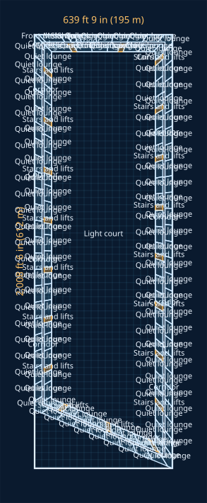
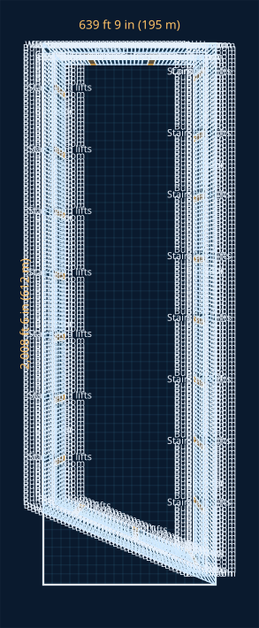

# P1-04 Shift Lodge: plan

Footprint 639 ft 9 in (195 m) × 2,008 ft 6 in (612 m) · structural grid 32 ft 10 in (10 m)

## Levels

| Level | Floor above deck | Height | Floor area |
|---|---|---|---|
| Level 1 · Ground floor | 0 ft (0 mm) | 14 ft 9 in (4,500 mm) | 309,403 sq ft (28,744 m²) |
| Level 2 · Bunk floor 1 | 14 ft 9 in (4,500 mm) | 10 ft 6 in (3,200 mm) | 309,405 sq ft (28,745 m²) |
| Level 3 · Bunk floor 2 | 25 ft 3 in (7,700 mm) | 10 ft 6 in (3,200 mm) | 309,405 sq ft (28,745 m²) |
| Level 4 · Bunk floor 3 | 35 ft 9 in (11 m) | 10 ft 6 in (3,200 mm) | 309,405 sq ft (28,745 m²) |

## Elements

| ID | Designation | Type | Name | Level(s) | Size / length | Area | Status |
|---|---|---|---|---|---|---|---|
| E001 | D5F2P1B3A2L1R1 | zone | Light court | L1 | 482 ft 3 in (147 m) × 1,811 ft (552 m) | 824,376 sq ft (76,587 m²) | proposed |
| E002 | D5F2P1B3A2L1R2 | zone | Corridor | L1 | 400 ft 7 in (122 m) × 9 ft 10 in (3,000 mm) | 3,875 sq ft (360 m²) | proposed |
| E003 | D5F2P1B3A2L1R3 | zone | Corridor | L1 | 174 ft 3 in (53 m) × 234 ft 11 in (72 m) | 3,875 sq ft (360 m²) | proposed |
| E004 | D5F2P1B3A2L1R4 | zone | Corridor | L1 | 9 ft 10 in (3,000 mm) × 398 ft 4 in (121 m) | 3,875 sq ft (360 m²) | proposed |
| E005 | D5F2P1B3A2L1R5 | zone | Corridor | L1 | 9 ft 10 in (3,000 mm) × 396 ft 4 in (121 m) | 3,875 sq ft (360 m²) | proposed |
| E006 | D5F2P1B3A2L1R6 | zone | Corridor | L1 | 9 ft 10 in (3,000 mm) × 399 ft 7 in (122 m) | 3,875 sq ft (360 m²) | proposed |
| E007 | D5F2P1B3A2L1R7 | zone | Corridor | L1 | 9 ft 10 in (3,000 mm) × 404 ft 6 in (123 m) | 3,875 sq ft (360 m²) | proposed |
| E008 | D5F2P1B3A2L1R8 | zone | Corridor | L1 | 267 ft 9 in (82 m) × 123 ft 8 in (38 m) | 3,909 sq ft (363 m²) | proposed |
| E009 | D5F2P1B3A2L1R9 | zone | Corridor | L1 | 303 ft 6 in (92 m) × 204 ft 1 in (62 m) | 3,881 sq ft (361 m²) | proposed |
| E010 | D5F2P1B3A2L1R10 | zone | Corridor | L1 | 9 ft 10 in (3,000 mm) × 397 ft 4 in (121 m) | 3,873 sq ft (360 m²) | proposed |
| E011 | D5F2P1B3A2L1R11 | zone | Corridor | L1 | 9 ft 10 in (3,000 mm) × 395 ft 8 in (121 m) | 3,877 sq ft (360 m²) | proposed |
| E012 | D5F2P1B3A2L1R12 | zone | Corridor | L1 | 9 ft 10 in (3,000 mm) × 397 ft 4 in (121 m) | 3,875 sq ft (360 m²) | proposed |
| E013 | D5F2P1B3A2L1R13 | zone | Corridor | L1 | 9 ft 10 in (3,000 mm) × 401 ft 3 in (122 m) | 3,875 sq ft (360 m²) | proposed |
| E014 | D5F2P1B3A2L1R14 | zone | Corridor | L1 | 9 ft 10 in (3,000 mm) × 38 ft 1 in (12 m) | 279 sq ft (26 m²) | proposed |
| E015 | D5F2P1B3A2L1R15, D5F2P1B3A2L2R1, D5F2P1B3A2L3R1, D5F2P1B3A2L4R1 | core | Stairs and lifts | L1, L2, L3, L4 | 45 ft 3 in (14 m) × 34 ft 5 in (10 m) | 899 sq ft (83 m²) | proposed |
| E016 | D5F2P1B3A2L1R16, D5F2P1B3A2L2R2, D5F2P1B3A2L3R2, D5F2P1B3A2L4R2 | core | Stairs and lifts | L1, L2, L3, L4 | 37 ft 9 in (11 m) × 34 ft 5 in (10 m) | 910 sq ft (85 m²) | proposed |
| E017 | D5F2P1B3A2L1R17, D5F2P1B3A2L2R3, D5F2P1B3A2L3R3, D5F2P1B3A2L4R3 | core | Stairs and lifts | L1, L2, L3, L4 | 34 ft 5 in (10 m) × 58 ft 5 in (18 m) | 904 sq ft (84 m²) | proposed |
| E018 | D5F2P1B3A2L1R18, D5F2P1B3A2L2R4, D5F2P1B3A2L3R4, D5F2P1B3A2L4R4 | core | Stairs and lifts | L1, L2, L3, L4 | 34 ft 5 in (10 m) × 47 ft 7 in (14 m) | 910 sq ft (85 m²) | proposed |
| E019 | D5F2P1B3A2L1R19, D5F2P1B3A2L2R5, D5F2P1B3A2L3R5, D5F2P1B3A2L4R5 | core | Stairs and lifts | L1, L2, L3, L4 | 34 ft 5 in (10 m) × 37 ft 1 in (11 m) | 910 sq ft (85 m²) | proposed |
| E020 | D5F2P1B3A2L1R20, D5F2P1B3A2L2R6, D5F2P1B3A2L3R6, D5F2P1B3A2L4R6 | core | Stairs and lifts | L1, L2, L3, L4 | 34 ft 5 in (10 m) × 26 ft 7 in (8,100 mm) | 904 sq ft (84 m²) | proposed |
| E021 | D5F2P1B3A2L1R21, D5F2P1B3A2L2R7, D5F2P1B3A2L3R7, D5F2P1B3A2L4R7 | core | Stairs and lifts | L1, L2, L3, L4 | 34 ft 5 in (10 m) × 37 ft 1 in (11 m) | 904 sq ft (84 m²) | proposed |
| E022 | D5F2P1B3A2L1R22, D5F2P1B3A2L2R8, D5F2P1B3A2L3R8, D5F2P1B3A2L4R8 | core | Stairs and lifts | L1, L2, L3, L4 | 34 ft 5 in (10 m) × 47 ft 7 in (14 m) | 904 sq ft (84 m²) | proposed |
| E023 | D5F2P1B3A2L1R23, D5F2P1B3A2L2R9, D5F2P1B3A2L3R9, D5F2P1B3A2L4R9 | core | Stairs and lifts | L1, L2, L3, L4 | 34 ft 5 in (10 m) × 58 ft 5 in (18 m) | 904 sq ft (84 m²) | proposed |
| E024 | D5F2P1B3A2L1R24, D5F2P1B3A2L2R10, D5F2P1B3A2L3R10, D5F2P1B3A2L4R10 | core | Stairs and lifts | L1, L2, L3, L4 | 34 ft 5 in (10 m) × 68 ft 11 in (21 m) | 904 sq ft (84 m²) | proposed |
| E025 | D5F2P1B3A2L1R25, D5F2P1B3A2L2R11, D5F2P1B3A2L3R11, D5F2P1B3A2L4R11 | core | Stairs and lifts | L1, L2, L3, L4 | 55 ft 5 in (17 m) × 60 ft 8 in (18 m) | 901 sq ft (84 m²) | proposed |
| E026 | D5F2P1B3A2L1R26, D5F2P1B3A2L2R12, D5F2P1B3A2L3R12, D5F2P1B3A2L4R12 | core | Stairs and lifts | L1, L2, L3, L4 | 27 ft 3 in (8,300 mm) × 48 ft 11 in (15 m) | 902 sq ft (84 m²) | proposed |
| E027 | D5F2P1B3A2L1R27, D5F2P1B3A2L2R13, D5F2P1B3A2L3R13, D5F2P1B3A2L4R13 | core | Stairs and lifts | L1, L2, L3, L4 | 49 ft 3 in (15 m) × 37 ft 1 in (11 m) | 904 sq ft (84 m²) | proposed |
| E028 | D5F2P1B3A2L1R28, D5F2P1B3A2L2R14, D5F2P1B3A2L3R14, D5F2P1B3A2L4R14 | core | Stairs and lifts | L1, L2, L3, L4 | 34 ft 5 in (10 m) × 43 ft 8 in (13 m) | 899 sq ft (83 m²) | proposed |
| E029 | D5F2P1B3A2L1R29, D5F2P1B3A2L2R15, D5F2P1B3A2L3R15, D5F2P1B3A2L4R15 | core | Stairs and lifts | L1, L2, L3, L4 | 34 ft 5 in (10 m) × 35 ft 9 in (11 m) | 904 sq ft (84 m²) | proposed |
| E030 | D5F2P1B3A2L1R30, D5F2P1B3A2L2R16, D5F2P1B3A2L3R16, D5F2P1B3A2L4R16 | core | Stairs and lifts | L1, L2, L3, L4 | 34 ft 5 in (10 m) × 27 ft 7 in (8,400 mm) | 899 sq ft (83 m²) | proposed |
| E031 | D5F2P1B3A2L1R31, D5F2P1B3A2L2R17, D5F2P1B3A2L3R17, D5F2P1B3A2L4R17 | core | Stairs and lifts | L1, L2, L3, L4 | 34 ft 5 in (10 m) × 32 ft 6 in (9,900 mm) | 899 sq ft (83 m²) | proposed |
| E032 | D5F2P1B3A2L1R32, D5F2P1B3A2L2R18, D5F2P1B3A2L3R18, D5F2P1B3A2L4R18 | core | Stairs and lifts | L1, L2, L3, L4 | 34 ft 5 in (10 m) × 40 ft 8 in (12 m) | 904 sq ft (84 m²) | proposed |
| E033 | D5F2P1B3A2L1R33, D5F2P1B3A2L2R19, D5F2P1B3A2L3R19, D5F2P1B3A2L4R19 | core | Stairs and lifts | L1, L2, L3, L4 | 34 ft 5 in (10 m) × 48 ft 7 in (15 m) | 899 sq ft (83 m²) | proposed |
| E034 | D5F2P1B3A2L1R34, D5F2P1B3A2L2R20, D5F2P1B3A2L3R20, D5F2P1B3A2L4R20 | core | Stairs and lifts | L1, L2, L3, L4 | 34 ft 5 in (10 m) × 56 ft 9 in (17 m) | 904 sq ft (84 m²) | proposed |
| E035 | D5F2P1B3A2L1R35 | room | Front desk | L1 | 52 ft 2 in (16 m) × 34 ft 5 in (10 m) | 644 sq ft (60 m²) | proposed |
| E036 | D5F2P1B3A2L1R36 | room | Mess | L1 | 120 ft 9 in (37 m) × 34 ft 5 in (10 m) | 3,227 sq ft (300 m²) | proposed |
| E037 | D5F2P1B3A2L1R37 | room | Showers | L1 | 51 ft 2 in (16 m) × 34 ft 5 in (10 m) | 1,079 sq ft (100 m²) | proposed |
| E038 | D5F2P1B3A2L1R38 | room | Showers | L1 | 47 ft 7 in (14 m) × 34 ft 5 in (10 m) | 1,079 sq ft (100 m²) | proposed |
| E039 | D5F2P1B3A2L1R39 | room | Toilets | L1 | 32 ft 2 in (9,800 mm) × 34 ft 5 in (10 m) | 644 sq ft (60 m²) | proposed |
| E040 | D5F2P1B3A2L1R40 | room | Quiet lounge | L1 | 83 ft (25 m) × 34 ft 5 in (10 m) | 2,583 sq ft (240 m²) | proposed |
| E041 | D5F2P1B3A2L1R41 | room | Quiet lounge | L1 | 79 ft 1 in (24 m) × 34 ft 5 in (10 m) | 2,583 sq ft (240 m²) | proposed |
| E042 | D5F2P1B3A2L1R42 | room | Quiet lounge | L1 | 84 ft (26 m) × 34 ft 5 in (10 m) | 2,588 sq ft (240 m²) | proposed |
| E043 | D5F2P1B3A2L1R43 | room | Quiet lounge | L1 | 92 ft 2 in (28 m) × 34 ft 5 in (10 m) | 2,577 sq ft (239 m²) | proposed |
| E044 | D5F2P1B3A2L1R44 | room | Quiet lounge | L1 | 101 ft 1 in (31 m) × 34 ft 5 in (10 m) | 2,588 sq ft (240 m²) | proposed |
| E045 | D5F2P1B3A2L1R45 | room | Quiet lounge | L1 | 68 ft 11 in (21 m) × 71 ft 10 in (22 m) | 2,577 sq ft (239 m²) | proposed |
| E046 | D5F2P1B3A2L1R46 | room | Quiet lounge | L1 | 34 ft 5 in (10 m) × 106 ft 4 in (32 m) | 2,588 sq ft (240 m²) | proposed |
| E047 | D5F2P1B3A2L1R47 | room | Quiet lounge | L1 | 34 ft 5 in (10 m) × 102 ft 8 in (31 m) | 2,583 sq ft (240 m²) | proposed |
| E048 | D5F2P1B3A2L1R48 | room | Quiet lounge | L1 | 34 ft 5 in (10 m) × 99 ft 5 in (30 m) | 2,583 sq ft (240 m²) | proposed |
| E049 | D5F2P1B3A2L1R49 | room | Quiet lounge | L1 | 34 ft 5 in (10 m) × 96 ft 5 in (29 m) | 2,588 sq ft (240 m²) | proposed |
| E050 | D5F2P1B3A2L1R50 | room | Quiet lounge | L1 | 34 ft 5 in (10 m) × 92 ft 10 in (28 m) | 2,577 sq ft (239 m²) | proposed |
| E051 | D5F2P1B3A2L1R51 | room | Quiet lounge | L1 | 34 ft 5 in (10 m) × 89 ft 11 in (27 m) | 2,588 sq ft (240 m²) | proposed |
| E052 | D5F2P1B3A2L1R52 | room | Quiet lounge | L1 | 34 ft 5 in (10 m) × 86 ft 3 in (26 m) | 2,583 sq ft (240 m²) | proposed |
| E053 | D5F2P1B3A2L1R53 | room | Quiet lounge | L1 | 34 ft 5 in (10 m) × 83 ft (25 m) | 2,583 sq ft (240 m²) | proposed |
| E054 | D5F2P1B3A2L1R54 | room | Quiet lounge | L1 | 34 ft 5 in (10 m) × 79 ft 9 in (24 m) | 2,583 sq ft (240 m²) | proposed |
| E055 | D5F2P1B3A2L1R55 | room | Quiet lounge | L1 | 34 ft 5 in (10 m) × 76 ft 5 in (23 m) | 2,583 sq ft (240 m²) | proposed |
| E056 | D5F2P1B3A2L1R56 | room | Quiet lounge | L1 | 34 ft 5 in (10 m) × 76 ft 9 in (23 m) | 2,583 sq ft (240 m²) | proposed |
| E057 | D5F2P1B3A2L1R57 | room | Quiet lounge | L1 | 34 ft 5 in (10 m) × 80 ft 5 in (24 m) | 2,588 sq ft (240 m²) | proposed |
| E058 | D5F2P1B3A2L1R58 | room | Quiet lounge | L1 | 34 ft 5 in (10 m) × 83 ft 4 in (25 m) | 2,577 sq ft (239 m²) | proposed |
| E059 | D5F2P1B3A2L1R59 | room | Quiet lounge | L1 | 34 ft 5 in (10 m) × 86 ft 11 in (26 m) | 2,588 sq ft (240 m²) | proposed |
| E060 | D5F2P1B3A2L1R60 | room | Quiet lounge | L1 | 34 ft 5 in (10 m) × 89 ft 11 in (27 m) | 2,583 sq ft (240 m²) | proposed |
| E061 | D5F2P1B3A2L1R61 | room | Quiet lounge | L1 | 34 ft 5 in (10 m) × 93 ft 2 in (28 m) | 2,583 sq ft (240 m²) | proposed |
| E062 | D5F2P1B3A2L1R62 | room | Quiet lounge | L1 | 34 ft 5 in (10 m) × 96 ft 9 in (30 m) | 2,588 sq ft (240 m²) | proposed |
| E063 | D5F2P1B3A2L1R63 | room | Quiet lounge | L1 | 34 ft 5 in (10 m) × 99 ft 9 in (30 m) | 2,577 sq ft (239 m²) | proposed |
| E064 | D5F2P1B3A2L1R64 | room | Quiet lounge | L1 | 34 ft 5 in (10 m) × 103 ft 4 in (32 m) | 2,588 sq ft (240 m²) | proposed |
| E065 | D5F2P1B3A2L1R65 | room | Quiet lounge | L1 | 34 ft 5 in (10 m) × 106 ft 4 in (32 m) | 2,577 sq ft (239 m²) | proposed |
| E066 | D5F2P1B3A2L1R66 | room | Quiet lounge | L1 | 34 ft 5 in (10 m) × 109 ft 11 in (34 m) | 2,588 sq ft (240 m²) | proposed |
| E067 | D5F2P1B3A2L1R67 | room | Quiet lounge | L1 | 34 ft 5 in (10 m) × 113 ft 2 in (34 m) | 2,583 sq ft (240 m²) | proposed |
| E068 | D5F2P1B3A2L1R68 | room | Quiet lounge | L1 | 34 ft 5 in (10 m) × 116 ft 6 in (36 m) | 2,583 sq ft (240 m²) | proposed |
| E069 | D5F2P1B3A2L1R69 | room | Quiet lounge | L1 | 34 ft 5 in (10 m) × 119 ft 9 in (36 m) | 2,583 sq ft (240 m²) | proposed |
| E070 | D5F2P1B3A2L1R70 | room | Quiet lounge | L1 | 34 ft 5 in (10 m) × 123 ft (38 m) | 2,583 sq ft (240 m²) | proposed |
| E071 | D5F2P1B3A2L1R71 | room | Quiet lounge | L1 | 54 ft 2 in (16 m) × 103 ft (31 m) | 2,582 sq ft (240 m²) | proposed |
| E072 | D5F2P1B3A2L1R72 | room | Quiet lounge | L1 | 97 ft 1 in (30 m) × 78 ft 5 in (24 m) | 2,596 sq ft (241 m²) | proposed |
| E073 | D5F2P1B3A2L1R73 | room | Quiet lounge | L1 | 89 ft 7 in (27 m) × 75 ft 2 in (23 m) | 2,600 sq ft (242 m²) | proposed |
| E074 | D5F2P1B3A2L1R74 | room | Quiet lounge | L1 | 81 ft 4 in (25 m) × 71 ft 10 in (22 m) | 2,575 sq ft (239 m²) | proposed |
| E075 | D5F2P1B3A2L1R75 | room | Quiet lounge | L1 | 73 ft 10 in (22 m) × 68 ft 7 in (21 m) | 2,591 sq ft (241 m²) | proposed |
| E076 | D5F2P1B3A2L1R76 | room | Quiet lounge | L1 | 72 ft 10 in (22 m) × 65 ft 3 in (20 m) | 2,582 sq ft (240 m²) | proposed |
| E077 | D5F2P1B3A2L1R77 | room | Quiet lounge | L1 | 80 ft 5 in (24 m) × 62 ft (19 m) | 2,597 sq ft (241 m²) | proposed |
| E078 | D5F2P1B3A2L1R78 | room | Quiet lounge | L1 | 88 ft 3 in (27 m) × 58 ft 5 in (18 m) | 2,585 sq ft (240 m²) | proposed |
| E079 | D5F2P1B3A2L1R79 | room | Quiet lounge | L1 | 95 ft 10 in (29 m) × 55 ft 1 in (17 m) | 2,571 sq ft (239 m²) | proposed |
| E080 | D5F2P1B3A2L1R80 | room | Quiet lounge | L1 | 64 ft 4 in (20 m) × 77 ft 1 in (24 m) | 2,588 sq ft (240 m²) | proposed |
| E081 | D5F2P1B3A2L1R81 | room | Quiet lounge | L1 | 34 ft 5 in (10 m) × 95 ft 2 in (29 m) | 2,577 sq ft (239 m²) | proposed |
| E082 | D5F2P1B3A2L1R82 | room | Quiet lounge | L1 | 34 ft 5 in (10 m) × 92 ft 10 in (28 m) | 2,588 sq ft (240 m²) | proposed |
| E083 | D5F2P1B3A2L1R83 | room | Quiet lounge | L1 | 34 ft 5 in (10 m) × 90 ft 3 in (28 m) | 2,583 sq ft (240 m²) | proposed |
| E084 | D5F2P1B3A2L1R84 | room | Quiet lounge | L1 | 34 ft 5 in (10 m) × 87 ft 7 in (27 m) | 2,583 sq ft (240 m²) | proposed |
| E085 | D5F2P1B3A2L1R85 | room | Quiet lounge | L1 | 34 ft 5 in (10 m) × 85 ft (26 m) | 2,583 sq ft (240 m²) | proposed |
| E086 | D5F2P1B3A2L1R86 | room | Quiet lounge | L1 | 34 ft 5 in (10 m) × 82 ft 8 in (25 m) | 2,583 sq ft (240 m²) | proposed |
| E087 | D5F2P1B3A2L1R87 | room | Quiet lounge | L1 | 34 ft 5 in (10 m) × 80 ft 5 in (24 m) | 2,588 sq ft (240 m²) | proposed |
| E088 | D5F2P1B3A2L1R88 | room | Quiet lounge | L1 | 34 ft 5 in (10 m) × 77 ft 5 in (24 m) | 2,577 sq ft (239 m²) | proposed |
| E089 | D5F2P1B3A2L1R89 | room | Quiet lounge | L1 | 34 ft 5 in (10 m) × 76 ft 5 in (23 m) | 2,588 sq ft (240 m²) | proposed |
| E090 | D5F2P1B3A2L1R90 | room | Quiet lounge | L1 | 34 ft 5 in (10 m) × 77 ft 5 in (24 m) | 2,583 sq ft (240 m²) | proposed |
| E091 | D5F2P1B3A2L1R91 | room | Quiet lounge | L1 | 34 ft 5 in (10 m) × 79 ft 9 in (24 m) | 2,583 sq ft (240 m²) | proposed |
| E092 | D5F2P1B3A2L1R92 | room | Quiet lounge | L1 | 34 ft 5 in (10 m) × 82 ft 4 in (25 m) | 2,583 sq ft (240 m²) | proposed |
| E093 | D5F2P1B3A2L1R93 | room | Quiet lounge | L1 | 34 ft 5 in (10 m) × 85 ft (26 m) | 2,583 sq ft (240 m²) | proposed |
| E094 | D5F2P1B3A2L1R94 | room | Quiet lounge | L1 | 34 ft 5 in (10 m) × 87 ft 7 in (27 m) | 2,588 sq ft (240 m²) | proposed |
| E095 | D5F2P1B3A2L1R95 | room | Quiet lounge | L1 | 34 ft 5 in (10 m) × 89 ft 11 in (27 m) | 2,583 sq ft (240 m²) | proposed |
| E096 | D5F2P1B3A2L1R96 | room | Quiet lounge | L1 | 34 ft 5 in (10 m) × 92 ft 2 in (28 m) | 2,577 sq ft (239 m²) | proposed |
| E097 | D5F2P1B3A2L1R97 | room | Quiet lounge | L1 | 34 ft 5 in (10 m) × 95 ft 2 in (29 m) | 2,588 sq ft (240 m²) | proposed |
| E098 | D5F2P1B3A2L1R98 | room | Quiet lounge | L1 | 34 ft 5 in (10 m) × 97 ft 5 in (30 m) | 2,583 sq ft (240 m²) | proposed |
| E099 | D5F2P1B3A2L1R99 | room | Quiet lounge | L1 | 34 ft 5 in (10 m) × 100 ft 1 in (30 m) | 2,588 sq ft (240 m²) | proposed |
| E100 | D5F2P1B3A2L1R100 | room | Quiet lounge | L1 | 34 ft 5 in (10 m) × 102 ft 4 in (31 m) | 2,577 sq ft (239 m²) | proposed |
| E101 | D5F2P1B3A2L1R101 | room | Quiet lounge | L1 | 34 ft 5 in (10 m) × 105 ft (32 m) | 2,583 sq ft (240 m²) | proposed |
| E102 | D5F2P1B3A2L1R102 | room | Quiet lounge | L1 | 34 ft 5 in (10 m) × 127 ft 4 in (39 m) | 3,255 sq ft (302 m²) | proposed |
| E103 | D5F2P1B3A2L1R103 | room | Quiet lounge | L1 | 128 ft 11 in (39 m) × 34 ft 5 in (10 m) | 3,487 sq ft (324 m²) | proposed |
| E104 | D5F2P1B3A2L1R104 | room | Quiet lounge | L1 | 87 ft 7 in (27 m) × 34 ft 5 in (10 m) | 2,588 sq ft (240 m²) | proposed |
| E105 | D5F2P1B3A2L1R105 | room | Quiet lounge | L1 | 80 ft 1 in (24 m) × 34 ft 5 in (10 m) | 2,583 sq ft (240 m²) | proposed |
| E106 | D5F2P1B3A2L1R106 | room | Quiet lounge | L1 | 58 ft 1 in (18 m) × 34 ft 5 in (10 m) | 1,791 sq ft (166 m²) | proposed |
| E107 | D5F2P1B3A2L1R107 | room | Quiet lounge | L1 | 92 ft 10 in (28 m) × 34 ft 5 in (10 m) | 2,577 sq ft (239 m²) | proposed |
| E108 | D5F2P1B3A2L1R108 | room | Quiet lounge | L1 | 103 ft (31 m) × 34 ft 5 in (10 m) | 2,588 sq ft (240 m²) | proposed |
| E109 | D5F2P1B3A2L1R109 | room | Quiet lounge | L1 | 44 ft 7 in (14 m) × 74 ft 10 in (23 m) | 1,797 sq ft (167 m²) | proposed |
| E110 | D5F2P1B3A2L1R110 | room | Quiet lounge | L1 | 34 ft 5 in (10 m) × 104 ft 8 in (32 m) | 2,583 sq ft (240 m²) | proposed |
| E111 | D5F2P1B3A2L1R111 | room | Quiet lounge | L1 | 34 ft 5 in (10 m) × 101 ft 1 in (31 m) | 2,583 sq ft (240 m²) | proposed |
| E112 | D5F2P1B3A2L1R112 | room | Quiet lounge | L1 | 34 ft 5 in (10 m) × 75 ft 2 in (23 m) | 1,797 sq ft (167 m²) | proposed |
| E113 | D5F2P1B3A2L1R113 | room | Quiet lounge | L1 | 34 ft 5 in (10 m) × 93 ft 10 in (29 m) | 2,583 sq ft (240 m²) | proposed |
| E114 | D5F2P1B3A2L1R114 | room | Quiet lounge | L1 | 34 ft 5 in (10 m) × 90 ft 3 in (28 m) | 2,577 sq ft (239 m²) | proposed |
| E115 | D5F2P1B3A2L1R115 | room | Quiet lounge | L1 | 34 ft 5 in (10 m) × 64 ft 8 in (20 m) | 1,797 sq ft (167 m²) | proposed |
| E116 | D5F2P1B3A2L1R116 | room | Quiet lounge | L1 | 34 ft 5 in (10 m) × 83 ft 4 in (25 m) | 2,583 sq ft (240 m²) | proposed |
| E117 | D5F2P1B3A2L1R117 | room | Quiet lounge | L1 | 34 ft 5 in (10 m) × 79 ft 9 in (24 m) | 2,583 sq ft (240 m²) | proposed |
| E118 | D5F2P1B3A2L1R118 | room | Quiet lounge | L1 | 34 ft 5 in (10 m) × 53 ft 10 in (16 m) | 1,797 sq ft (167 m²) | proposed |
| E119 | D5F2P1B3A2L1R119 | room | Quiet lounge | L1 | 34 ft 5 in (10 m) × 77 ft 1 in (24 m) | 2,583 sq ft (240 m²) | proposed |
| E120 | D5F2P1B3A2L1R120 | room | Quiet lounge | L1 | 34 ft 5 in (10 m) × 80 ft 9 in (25 m) | 2,583 sq ft (240 m²) | proposed |
| E121 | D5F2P1B3A2L1R121 | room | Quiet lounge | L1 | 34 ft 5 in (10 m) × 61 ft (19 m) | 1,797 sq ft (167 m²) | proposed |
| E122 | D5F2P1B3A2L1R122 | room | Quiet lounge | L1 | 34 ft 5 in (10 m) × 88 ft 3 in (27 m) | 2,588 sq ft (240 m²) | proposed |
| E123 | D5F2P1B3A2L1R123 | room | Quiet lounge | L1 | 34 ft 5 in (10 m) × 91 ft 6 in (28 m) | 2,583 sq ft (240 m²) | proposed |
| E124 | D5F2P1B3A2L1R124 | room | Quiet lounge | L1 | 34 ft 5 in (10 m) × 71 ft 6 in (22 m) | 1,791 sq ft (166 m²) | proposed |
| E125 | D5F2P1B3A2L1R125 | room | Quiet lounge | L1 | 34 ft 5 in (10 m) × 98 ft 9 in (30 m) | 2,588 sq ft (240 m²) | proposed |
| E126 | D5F2P1B3A2L1R126 | room | Quiet lounge | L1 | 34 ft 5 in (10 m) × 102 ft (31 m) | 2,583 sq ft (240 m²) | proposed |
| E127 | D5F2P1B3A2L1R127 | room | Quiet lounge | L1 | 34 ft 5 in (10 m) × 82 ft 4 in (25 m) | 1,797 sq ft (167 m²) | proposed |
| E128 | D5F2P1B3A2L1R128 | room | Quiet lounge | L1 | 34 ft 5 in (10 m) × 109 ft 3 in (33 m) | 2,583 sq ft (240 m²) | proposed |
| E129 | D5F2P1B3A2L1R129 | room | Quiet lounge | L1 | 34 ft 5 in (10 m) × 112 ft 6 in (34 m) | 2,583 sq ft (240 m²) | proposed |
| E130 | D5F2P1B3A2L1R130 | room | Quiet lounge | L1 | 34 ft 5 in (10 m) × 92 ft 10 in (28 m) | 1,797 sq ft (167 m²) | proposed |
| E131 | D5F2P1B3A2L1R131 | room | Quiet lounge | L1 | 34 ft 5 in (10 m) × 120 ft 1 in (37 m) | 2,588 sq ft (240 m²) | proposed |
| E132 | D5F2P1B3A2L1R132 | room | Quiet lounge | L1 | 34 ft 5 in (10 m) × 123 ft 4 in (38 m) | 2,583 sq ft (240 m²) | proposed |
| E133 | D5F2P1B3A2L1R133 | room | Quiet lounge | L1 | 46 ft 7 in (14 m) × 88 ft 11 in (27 m) | 1,796 sq ft (167 m²) | proposed |
| E134 | D5F2P1B3A2L1R134 | room | Quiet lounge | L1 | 93 ft 10 in (29 m) × 76 ft 9 in (23 m) | 2,565 sq ft (238 m²) | proposed |
| E135 | D5F2P1B3A2L1R135 | room | Quiet lounge | L1 | 85 ft (26 m) × 73 ft 2 in (22 m) | 2,584 sq ft (240 m²) | proposed |
| E136 | D5F2P1B3A2L1R136 | room | Quiet lounge | L1 | 56 ft 1 in (17 m) × 61 ft (19 m) | 1,792 sq ft (166 m²) | proposed |
| E137 | D5F2P1B3A2L1R137 | room | Quiet lounge | L1 | 73 ft 10 in (22 m) × 65 ft 3 in (20 m) | 2,594 sq ft (241 m²) | proposed |
| E138 | D5F2P1B3A2L1R138 | room | Quiet lounge | L1 | 81 ft 4 in (25 m) × 61 ft 4 in (19 m) | 2,579 sq ft (240 m²) | proposed |
| E139 | D5F2P1B3A2L1R139 | room | Quiet lounge | L1 | 68 ft 7 in (21 m) × 49 ft 3 in (15 m) | 1,806 sq ft (168 m²) | proposed |
| E140 | D5F2P1B3A2L1R140 | room | Quiet lounge | L1 | 89 ft 3 in (27 m) × 60 ft 4 in (18 m) | 2,581 sq ft (240 m²) | proposed |
| E141 | D5F2P1B3A2L1R141 | room | Quiet lounge | L1 | 34 ft 5 in (10 m) × 96 ft 2 in (29 m) | 2,583 sq ft (240 m²) | proposed |
| E142 | D5F2P1B3A2L1R142 | room | Quiet lounge | L1 | 34 ft 5 in (10 m) × 71 ft 2 in (22 m) | 1,797 sq ft (167 m²) | proposed |
| E143 | D5F2P1B3A2L1R143 | room | Quiet lounge | L1 | 34 ft 5 in (10 m) × 90 ft 11 in (28 m) | 2,588 sq ft (240 m²) | proposed |
| E144 | D5F2P1B3A2L1R144 | room | Quiet lounge | L1 | 34 ft 5 in (10 m) × 88 ft 3 in (27 m) | 2,583 sq ft (240 m²) | proposed |
| E145 | D5F2P1B3A2L1R145 | room | Quiet lounge | L1 | 34 ft 5 in (10 m) × 63 ft 4 in (19 m) | 1,797 sq ft (167 m²) | proposed |
| E146 | D5F2P1B3A2L1R146 | room | Quiet lounge | L1 | 34 ft 5 in (10 m) × 82 ft 8 in (25 m) | 2,583 sq ft (240 m²) | proposed |
| E147 | D5F2P1B3A2L1R147 | room | Quiet lounge | L1 | 34 ft 5 in (10 m) × 80 ft 5 in (24 m) | 2,588 sq ft (240 m²) | proposed |
| E148 | D5F2P1B3A2L1R148 | room | Quiet lounge | L1 | 34 ft 5 in (10 m) × 55 ft 1 in (17 m) | 1,797 sq ft (167 m²) | proposed |
| E149 | D5F2P1B3A2L1R149 | room | Quiet lounge | L1 | 34 ft 5 in (10 m) × 76 ft 5 in (23 m) | 2,588 sq ft (240 m²) | proposed |
| E150 | D5F2P1B3A2L1R150 | room | Quiet lounge | L1 | 34 ft 5 in (10 m) × 77 ft 9 in (24 m) | 2,583 sq ft (240 m²) | proposed |
| E151 | D5F2P1B3A2L1R151 | room | Quiet lounge | L1 | 34 ft 5 in (10 m) × 57 ft 1 in (17 m) | 1,797 sq ft (167 m²) | proposed |
| E152 | D5F2P1B3A2L1R152 | room | Quiet lounge | L1 | 34 ft 5 in (10 m) × 83 ft 4 in (25 m) | 2,588 sq ft (240 m²) | proposed |
| E153 | D5F2P1B3A2L1R153 | room | Quiet lounge | L1 | 34 ft 5 in (10 m) × 85 ft 11 in (26 m) | 2,583 sq ft (240 m²) | proposed |
| E154 | D5F2P1B3A2L1R154 | room | Quiet lounge | L1 | 34 ft 5 in (10 m) × 65 ft 3 in (20 m) | 1,797 sq ft (167 m²) | proposed |
| E155 | D5F2P1B3A2L1R155 | room | Quiet lounge | L1 | 34 ft 5 in (10 m) × 91 ft 2 in (28 m) | 2,583 sq ft (240 m²) | proposed |
| E156 | D5F2P1B3A2L1R156 | room | Quiet lounge | L1 | 34 ft 5 in (10 m) × 93 ft 10 in (29 m) | 2,583 sq ft (240 m²) | proposed |
| E157 | D5F2P1B3A2L1R157 | room | Quiet lounge | L1 | 34 ft 5 in (10 m) × 73 ft 6 in (22 m) | 1,803 sq ft (167 m²) | proposed |
| E158 | D5F2P1B3A2L1R158 | room | Quiet lounge | L1 | 34 ft 5 in (10 m) × 99 ft 5 in (30 m) | 2,588 sq ft (240 m²) | proposed |
| E159 | D5F2P1B3A2L1R159 | room | Quiet lounge | L1 | 34 ft 5 in (10 m) × 101 ft 8 in (31 m) | 2,577 sq ft (239 m²) | proposed |
| E160 | D5F2P1B3A2L1R160 | room | Quiet lounge | L1 | 34 ft 5 in (10 m) × 81 ft 4 in (25 m) | 1,803 sq ft (167 m²) | proposed |
| E161 | D5F2P1B3A2L1R161 | room | Quiet lounge | L1 | 34 ft 5 in (10 m) × 133 ft 10 in (41 m) | 3,481 sq ft (323 m²) | proposed |
| E162 | D5F2P1B3A2L2R21, D5F2P1B3A2L3R21, D5F2P1B3A2L4R21 | zone | Corridor | L2, L3, L4 | 400 ft 7 in (122 m) × 9 ft 10 in (3,000 mm) | 3,875 sq ft (360 m²) | proposed |
| E163 | D5F2P1B3A2L2R22, D5F2P1B3A2L3R22, D5F2P1B3A2L4R22 | zone | Corridor | L2, L3, L4 | 174 ft 3 in (53 m) × 234 ft 11 in (72 m) | 3,875 sq ft (360 m²) | proposed |
| E164 | D5F2P1B3A2L2R23, D5F2P1B3A2L3R23, D5F2P1B3A2L4R23 | zone | Corridor | L2, L3, L4 | 9 ft 10 in (3,000 mm) × 398 ft 4 in (121 m) | 3,875 sq ft (360 m²) | proposed |
| E165 | D5F2P1B3A2L2R24, D5F2P1B3A2L3R24, D5F2P1B3A2L4R24 | zone | Corridor | L2, L3, L4 | 9 ft 10 in (3,000 mm) × 396 ft 4 in (121 m) | 3,875 sq ft (360 m²) | proposed |
| E166 | D5F2P1B3A2L2R25, D5F2P1B3A2L3R25, D5F2P1B3A2L4R25 | zone | Corridor | L2, L3, L4 | 9 ft 10 in (3,000 mm) × 399 ft 7 in (122 m) | 3,875 sq ft (360 m²) | proposed |
| E167 | D5F2P1B3A2L2R26, D5F2P1B3A2L3R26, D5F2P1B3A2L4R26 | zone | Corridor | L2, L3, L4 | 9 ft 10 in (3,000 mm) × 404 ft 6 in (123 m) | 3,875 sq ft (360 m²) | proposed |
| E168 | D5F2P1B3A2L2R27, D5F2P1B3A2L3R27, D5F2P1B3A2L4R27 | zone | Corridor | L2, L3, L4 | 267 ft 9 in (82 m) × 123 ft 8 in (38 m) | 3,909 sq ft (363 m²) | proposed |
| E169 | D5F2P1B3A2L2R28, D5F2P1B3A2L3R28, D5F2P1B3A2L4R28 | zone | Corridor | L2, L3, L4 | 303 ft 6 in (92 m) × 204 ft 1 in (62 m) | 3,881 sq ft (361 m²) | proposed |
| E170 | D5F2P1B3A2L2R29, D5F2P1B3A2L3R29, D5F2P1B3A2L4R29 | zone | Corridor | L2, L3, L4 | 9 ft 10 in (3,000 mm) × 397 ft 4 in (121 m) | 3,873 sq ft (360 m²) | proposed |
| E171 | D5F2P1B3A2L2R30, D5F2P1B3A2L3R30, D5F2P1B3A2L4R30 | zone | Corridor | L2, L3, L4 | 9 ft 10 in (3,000 mm) × 395 ft 8 in (121 m) | 3,877 sq ft (360 m²) | proposed |
| E172 | D5F2P1B3A2L2R31, D5F2P1B3A2L3R31, D5F2P1B3A2L4R31 | zone | Corridor | L2, L3, L4 | 9 ft 10 in (3,000 mm) × 397 ft 4 in (121 m) | 3,875 sq ft (360 m²) | proposed |
| E173 | D5F2P1B3A2L2R32, D5F2P1B3A2L3R32, D5F2P1B3A2L4R32 | zone | Corridor | L2, L3, L4 | 9 ft 10 in (3,000 mm) × 401 ft 3 in (122 m) | 3,875 sq ft (360 m²) | proposed |
| E174 | D5F2P1B3A2L2R33, D5F2P1B3A2L3R33, D5F2P1B3A2L4R33 | zone | Corridor | L2, L3, L4 | 9 ft 10 in (3,000 mm) × 38 ft 1 in (12 m) | 279 sq ft (26 m²) | proposed |
| E175 | D5F2P1B3A2L2R34, D5F2P1B3A2L3R34, D5F2P1B3A2L4R34 | room | Washroom | L2, L3, L4 | 46 ft 3 in (14 m) × 34 ft 5 in (10 m) | 429 sq ft (40 m²) | proposed |
| E176 | D5F2P1B3A2L2R35, D5F2P1B3A2L3R35, D5F2P1B3A2L4R35 | room | Washroom | L2, L3, L4 | 44 ft 11 in (14 m) × 34 ft 5 in (10 m) | 435 sq ft (40 m²) | proposed |
| E177 | D5F2P1B3A2L2R36, D5F2P1B3A2L3R36, D5F2P1B3A2L4R36 | room | Bunk room | L2, L3, L4 | 45 ft 7 in (14 m) × 34 ft 5 in (10 m) | 514 sq ft (48 m²) | proposed |
| E178 | D5F2P1B3A2L2R37, D5F2P1B3A2L3R37, D5F2P1B3A2L4R37 | room | Bunk room | L2, L3, L4 | 44 ft (13 m) × 34 ft 5 in (10 m) | 514 sq ft (48 m²) | proposed |
| E179 | D5F2P1B3A2L2R38, D5F2P1B3A2L3R38, D5F2P1B3A2L4R38 | room | Bunk room | L2, L3, L4 | 42 ft 4 in (13 m) × 34 ft 5 in (10 m) | 514 sq ft (48 m²) | proposed |
| E180 | D5F2P1B3A2L2R39, D5F2P1B3A2L3R39, D5F2P1B3A2L4R39 | room | Bunk room | L2, L3, L4 | 40 ft 8 in (12 m) × 34 ft 5 in (10 m) | 520 sq ft (48 m²) | proposed |
| E181 | D5F2P1B3A2L2R40, D5F2P1B3A2L3R40, D5F2P1B3A2L4R40 | room | Bunk room | L2, L3, L4 | 38 ft 9 in (12 m) × 34 ft 5 in (10 m) | 514 sq ft (48 m²) | proposed |
| E182 | D5F2P1B3A2L2R41, D5F2P1B3A2L3R41, D5F2P1B3A2L4R41 | room | Bunk room | L2, L3, L4 | 37 ft 5 in (11 m) × 34 ft 5 in (10 m) | 520 sq ft (48 m²) | proposed |
| E183 | D5F2P1B3A2L2R42, D5F2P1B3A2L3R42, D5F2P1B3A2L4R42 | room | Bunk room | L2, L3, L4 | 35 ft 9 in (11 m) × 34 ft 5 in (10 m) | 520 sq ft (48 m²) | proposed |
| E184 | D5F2P1B3A2L2R43, D5F2P1B3A2L3R43, D5F2P1B3A2L4R43 | room | Bunk room | L2, L3, L4 | 33 ft 10 in (10 m) × 34 ft 5 in (10 m) | 514 sq ft (48 m²) | proposed |
| E185 | D5F2P1B3A2L2R44, D5F2P1B3A2L3R44, D5F2P1B3A2L4R44 | room | Bunk room | L2, L3, L4 | 32 ft 2 in (9,800 mm) × 34 ft 5 in (10 m) | 514 sq ft (48 m²) | proposed |
| E186 | D5F2P1B3A2L2R45, D5F2P1B3A2L3R45, D5F2P1B3A2L4R45 | room | Bunk room | L2, L3, L4 | 30 ft 6 in (9,300 mm) × 34 ft 5 in (10 m) | 520 sq ft (48 m²) | proposed |
| E187 | D5F2P1B3A2L2R46, D5F2P1B3A2L3R46, D5F2P1B3A2L4R46 | room | Bunk room | L2, L3, L4 | 28 ft 7 in (8,700 mm) × 34 ft 5 in (10 m) | 514 sq ft (48 m²) | proposed |
| E188 | D5F2P1B3A2L2R47, D5F2P1B3A2L3R47, D5F2P1B3A2L4R47 | room | Bunk room | L2, L3, L4 | 26 ft 11 in (8,200 mm) × 34 ft 5 in (10 m) | 514 sq ft (48 m²) | proposed |
| E189 | D5F2P1B3A2L2R48, D5F2P1B3A2L3R48, D5F2P1B3A2L4R48 | room | Bunk room | L2, L3, L4 | 25 ft 3 in (7,700 mm) × 34 ft 5 in (10 m) | 520 sq ft (48 m²) | proposed |
| E190 | D5F2P1B3A2L2R49, D5F2P1B3A2L3R49, D5F2P1B3A2L4R49 | room | Bunk room | L2, L3, L4 | 23 ft 4 in (7,100 mm) × 34 ft 5 in (10 m) | 514 sq ft (48 m²) | proposed |
| E191 | D5F2P1B3A2L2R50, D5F2P1B3A2L3R50, D5F2P1B3A2L4R50 | room | Bunk room | L2, L3, L4 | 22 ft (6,700 mm) × 34 ft 5 in (10 m) | 520 sq ft (48 m²) | proposed |
| E192 | D5F2P1B3A2L2R51, D5F2P1B3A2L3R51, D5F2P1B3A2L4R51 | room | Bunk room | L2, L3, L4 | 20 ft 4 in (6,200 mm) × 34 ft 5 in (10 m) | 520 sq ft (48 m²) | proposed |
| E193 | D5F2P1B3A2L2R52, D5F2P1B3A2L3R52, D5F2P1B3A2L4R52 | room | Bunk room | L2, L3, L4 | 18 ft 4 in (5,600 mm) × 34 ft 5 in (10 m) | 514 sq ft (48 m²) | proposed |
| E194 | D5F2P1B3A2L2R53, D5F2P1B3A2L3R53, D5F2P1B3A2L4R53 | room | Bunk room | L2, L3, L4 | 16 ft 9 in (5,100 mm) × 34 ft 5 in (10 m) | 514 sq ft (48 m²) | proposed |
| E195 | D5F2P1B3A2L2R54, D5F2P1B3A2L3R54, D5F2P1B3A2L4R54 | room | Bunk room | L2, L3, L4 | 16 ft 1 in (4,900 mm) × 34 ft 5 in (10 m) | 520 sq ft (48 m²) | proposed |
| E196 | D5F2P1B3A2L2R55, D5F2P1B3A2L3R55, D5F2P1B3A2L4R55 | room | Bunk room | L2, L3, L4 | 16 ft 9 in (5,100 mm) × 34 ft 5 in (10 m) | 514 sq ft (48 m²) | proposed |
| E197 | D5F2P1B3A2L2R56, D5F2P1B3A2L3R56, D5F2P1B3A2L4R56 | room | Bunk room | L2, L3, L4 | 18 ft 4 in (5,600 mm) × 34 ft 5 in (10 m) | 514 sq ft (48 m²) | proposed |
| E198 | D5F2P1B3A2L2R57, D5F2P1B3A2L3R57, D5F2P1B3A2L4R57 | room | Bunk room | L2, L3, L4 | 20 ft (6,100 mm) × 34 ft 5 in (10 m) | 514 sq ft (48 m²) | proposed |
| E199 | D5F2P1B3A2L2R58, D5F2P1B3A2L3R58, D5F2P1B3A2L4R58 | room | Bunk room | L2, L3, L4 | 22 ft (6,700 mm) × 34 ft 5 in (10 m) | 520 sq ft (48 m²) | proposed |
| E200 | D5F2P1B3A2L2R59, D5F2P1B3A2L3R59, D5F2P1B3A2L4R59 | room | Bunk room | L2, L3, L4 | 23 ft 7 in (7,200 mm) × 34 ft 5 in (10 m) | 520 sq ft (48 m²) | proposed |
| E201 | D5F2P1B3A2L2R60, D5F2P1B3A2L3R60, D5F2P1B3A2L4R60 | room | Bunk room | L2, L3, L4 | 24 ft 11 in (7,600 mm) × 34 ft 5 in (10 m) | 514 sq ft (48 m²) | proposed |
| E202 | D5F2P1B3A2L2R61, D5F2P1B3A2L3R61, D5F2P1B3A2L4R61 | room | Bunk room | L2, L3, L4 | 26 ft 11 in (8,200 mm) × 34 ft 5 in (10 m) | 520 sq ft (48 m²) | proposed |
| E203 | D5F2P1B3A2L2R62, D5F2P1B3A2L3R62, D5F2P1B3A2L4R62 | room | Bunk room | L2, L3, L4 | 28 ft 7 in (8,700 mm) × 34 ft 5 in (10 m) | 514 sq ft (48 m²) | proposed |
| E204 | D5F2P1B3A2L2R63, D5F2P1B3A2L3R63, D5F2P1B3A2L4R63 | room | Bunk room | L2, L3, L4 | 30 ft 2 in (9,200 mm) × 34 ft 5 in (10 m) | 514 sq ft (48 m²) | proposed |
| E205 | D5F2P1B3A2L2R64, D5F2P1B3A2L3R64, D5F2P1B3A2L4R64 | room | Bunk room | L2, L3, L4 | 32 ft 2 in (9,800 mm) × 34 ft 5 in (10 m) | 520 sq ft (48 m²) | proposed |
| E206 | D5F2P1B3A2L2R65, D5F2P1B3A2L3R65, D5F2P1B3A2L4R65 | room | Bunk room | L2, L3, L4 | 33 ft 10 in (10 m) × 34 ft 5 in (10 m) | 514 sq ft (48 m²) | proposed |
| E207 | D5F2P1B3A2L2R66, D5F2P1B3A2L3R66, D5F2P1B3A2L4R66 | room | Bunk room | L2, L3, L4 | 35 ft 5 in (11 m) × 34 ft 5 in (10 m) | 514 sq ft (48 m²) | proposed |
| E208 | D5F2P1B3A2L2R67, D5F2P1B3A2L3R67, D5F2P1B3A2L4R67 | room | Bunk room | L2, L3, L4 | 37 ft 5 in (11 m) × 34 ft 5 in (10 m) | 520 sq ft (48 m²) | proposed |
| E209 | D5F2P1B3A2L2R68, D5F2P1B3A2L3R68, D5F2P1B3A2L4R68 | room | Bunk room | L2, L3, L4 | 39 ft 1 in (12 m) × 34 ft 5 in (10 m) | 520 sq ft (48 m²) | proposed |
| E210 | D5F2P1B3A2L2R69, D5F2P1B3A2L3R69, D5F2P1B3A2L4R69 | room | Bunk room | L2, L3, L4 | 40 ft 4 in (12 m) × 34 ft 5 in (10 m) | 514 sq ft (48 m²) | proposed |
| E211 | D5F2P1B3A2L2R70, D5F2P1B3A2L3R70, D5F2P1B3A2L4R70 | room | Bunk room | L2, L3, L4 | 42 ft 4 in (13 m) × 34 ft 5 in (10 m) | 520 sq ft (48 m²) | proposed |
| E212 | D5F2P1B3A2L2R71, D5F2P1B3A2L3R71, D5F2P1B3A2L4R71 | room | Bunk room | L2, L3, L4 | 44 ft (13 m) × 34 ft 5 in (10 m) | 514 sq ft (48 m²) | proposed |
| E213 | D5F2P1B3A2L2R72, D5F2P1B3A2L3R72, D5F2P1B3A2L4R72 | room | Bunk room | L2, L3, L4 | 45 ft 7 in (14 m) × 34 ft 5 in (10 m) | 514 sq ft (48 m²) | proposed |
| E214 | D5F2P1B3A2L2R73, D5F2P1B3A2L3R73, D5F2P1B3A2L4R73 | room | Bunk room | L2, L3, L4 | 47 ft 7 in (14 m) × 34 ft 5 in (10 m) | 520 sq ft (48 m²) | proposed |
| E215 | D5F2P1B3A2L2R74, D5F2P1B3A2L3R74, D5F2P1B3A2L4R74 | room | Bunk room | L2, L3, L4 | 44 ft 3 in (14 m) × 39 ft 1 in (12 m) | 514 sq ft (48 m²) | proposed |
| E216 | D5F2P1B3A2L2R75, D5F2P1B3A2L3R75, D5F2P1B3A2L4R75 | room | Bunk room | L2, L3, L4 | 34 ft 5 in (10 m) × 48 ft 11 in (15 m) | 514 sq ft (48 m²) | proposed |
| E217 | D5F2P1B3A2L2R76, D5F2P1B3A2L3R76, D5F2P1B3A2L4R76 | room | Bunk room | L2, L3, L4 | 34 ft 5 in (10 m) × 48 ft 3 in (15 m) | 520 sq ft (48 m²) | proposed |
| E218 | D5F2P1B3A2L2R77, D5F2P1B3A2L3R77, D5F2P1B3A2L4R77 | room | Bunk room | L2, L3, L4 | 34 ft 5 in (10 m) × 47 ft 7 in (14 m) | 520 sq ft (48 m²) | proposed |
| E219 | D5F2P1B3A2L2R78, D5F2P1B3A2L3R78, D5F2P1B3A2L4R78 | room | Bunk room | L2, L3, L4 | 34 ft 5 in (10 m) × 46 ft 11 in (14 m) | 514 sq ft (48 m²) | proposed |
| E220 | D5F2P1B3A2L2R79, D5F2P1B3A2L3R79, D5F2P1B3A2L4R79 | room | Bunk room | L2, L3, L4 | 34 ft 5 in (10 m) × 46 ft 3 in (14 m) | 514 sq ft (48 m²) | proposed |
| E221 | D5F2P1B3A2L2R80, D5F2P1B3A2L3R80, D5F2P1B3A2L4R80 | room | Bunk room | L2, L3, L4 | 34 ft 5 in (10 m) × 45 ft 7 in (14 m) | 520 sq ft (48 m²) | proposed |
| E222 | D5F2P1B3A2L2R81, D5F2P1B3A2L3R81, D5F2P1B3A2L4R81 | room | Bunk room | L2, L3, L4 | 34 ft 5 in (10 m) × 44 ft 11 in (14 m) | 514 sq ft (48 m²) | proposed |
| E223 | D5F2P1B3A2L2R82, D5F2P1B3A2L3R82, D5F2P1B3A2L4R82 | room | Bunk room | L2, L3, L4 | 34 ft 5 in (10 m) × 44 ft 3 in (14 m) | 514 sq ft (48 m²) | proposed |
| E224 | D5F2P1B3A2L2R83, D5F2P1B3A2L3R83, D5F2P1B3A2L4R83 | room | Bunk room | L2, L3, L4 | 34 ft 5 in (10 m) × 43 ft 8 in (13 m) | 520 sq ft (48 m²) | proposed |
| E225 | D5F2P1B3A2L2R84, D5F2P1B3A2L3R84, D5F2P1B3A2L4R84 | room | Bunk room | L2, L3, L4 | 34 ft 5 in (10 m) × 43 ft (13 m) | 520 sq ft (48 m²) | proposed |
| E226 | D5F2P1B3A2L2R85, D5F2P1B3A2L3R85, D5F2P1B3A2L4R85 | room | Bunk room | L2, L3, L4 | 34 ft 5 in (10 m) × 42 ft 4 in (13 m) | 514 sq ft (48 m²) | proposed |
| E227 | D5F2P1B3A2L2R86, D5F2P1B3A2L3R86, D5F2P1B3A2L4R86 | room | Bunk room | L2, L3, L4 | 34 ft 5 in (10 m) × 41 ft 8 in (13 m) | 514 sq ft (48 m²) | proposed |
| E228 | D5F2P1B3A2L2R87, D5F2P1B3A2L3R87, D5F2P1B3A2L4R87 | room | Bunk room | L2, L3, L4 | 34 ft 5 in (10 m) × 41 ft (12 m) | 520 sq ft (48 m²) | proposed |
| E229 | D5F2P1B3A2L2R88, D5F2P1B3A2L3R88, D5F2P1B3A2L4R88 | room | Bunk room | L2, L3, L4 | 34 ft 5 in (10 m) × 40 ft 4 in (12 m) | 514 sq ft (48 m²) | proposed |
| E230 | D5F2P1B3A2L2R89, D5F2P1B3A2L3R89, D5F2P1B3A2L4R89 | room | Bunk room | L2, L3, L4 | 34 ft 5 in (10 m) × 39 ft 8 in (12 m) | 514 sq ft (48 m²) | proposed |
| E231 | D5F2P1B3A2L2R90, D5F2P1B3A2L3R90, D5F2P1B3A2L4R90 | room | Bunk room | L2, L3, L4 | 34 ft 5 in (10 m) × 39 ft 1 in (12 m) | 520 sq ft (48 m²) | proposed |
| E232 | D5F2P1B3A2L2R91, D5F2P1B3A2L3R91, D5F2P1B3A2L4R91 | room | Bunk room | L2, L3, L4 | 34 ft 5 in (10 m) × 38 ft 5 in (12 m) | 520 sq ft (48 m²) | proposed |
| E233 | D5F2P1B3A2L2R92, D5F2P1B3A2L3R92, D5F2P1B3A2L4R92 | room | Bunk room | L2, L3, L4 | 34 ft 5 in (10 m) × 37 ft 9 in (12 m) | 514 sq ft (48 m²) | proposed |
| E234 | D5F2P1B3A2L2R93, D5F2P1B3A2L3R93, D5F2P1B3A2L4R93 | room | Bunk room | L2, L3, L4 | 34 ft 5 in (10 m) × 37 ft 1 in (11 m) | 514 sq ft (48 m²) | proposed |
| E235 | D5F2P1B3A2L2R94, D5F2P1B3A2L3R94, D5F2P1B3A2L4R94 | room | Bunk room | L2, L3, L4 | 34 ft 5 in (10 m) × 36 ft 5 in (11 m) | 520 sq ft (48 m²) | proposed |
| E236 | D5F2P1B3A2L2R95, D5F2P1B3A2L3R95, D5F2P1B3A2L4R95 | room | Bunk room | L2, L3, L4 | 34 ft 5 in (10 m) × 35 ft 9 in (11 m) | 514 sq ft (48 m²) | proposed |
| E237 | D5F2P1B3A2L2R96, D5F2P1B3A2L3R96, D5F2P1B3A2L4R96 | room | Bunk room | L2, L3, L4 | 34 ft 5 in (10 m) × 35 ft 1 in (11 m) | 514 sq ft (48 m²) | proposed |
| E238 | D5F2P1B3A2L2R97, D5F2P1B3A2L3R97, D5F2P1B3A2L4R97 | room | Bunk room | L2, L3, L4 | 34 ft 5 in (10 m) × 34 ft 5 in (10 m) | 520 sq ft (48 m²) | proposed |
| E239 | D5F2P1B3A2L2R98, D5F2P1B3A2L3R98, D5F2P1B3A2L4R98 | room | Bunk room | L2, L3, L4 | 34 ft 5 in (10 m) × 33 ft 10 in (10 m) | 520 sq ft (48 m²) | proposed |
| E240 | D5F2P1B3A2L2R99, D5F2P1B3A2L3R99, D5F2P1B3A2L4R99 | room | Bunk room | L2, L3, L4 | 34 ft 5 in (10 m) × 32 ft 10 in (10 m) | 509 sq ft (47 m²) | proposed |
| E241 | D5F2P1B3A2L2R100, D5F2P1B3A2L3R100, D5F2P1B3A2L4R100 | room | Bunk room | L2, L3, L4 | 34 ft 5 in (10 m) × 32 ft 6 in (9,900 mm) | 520 sq ft (48 m²) | proposed |
| E242 | D5F2P1B3A2L2R101, D5F2P1B3A2L3R101, D5F2P1B3A2L4R101 | room | Bunk room | L2, L3, L4 | 34 ft 5 in (10 m) × 31 ft 10 in (9,700 mm) | 520 sq ft (48 m²) | proposed |
| E243 | D5F2P1B3A2L2R102, D5F2P1B3A2L3R102, D5F2P1B3A2L4R102 | room | Bunk room | L2, L3, L4 | 34 ft 5 in (10 m) × 31 ft 2 in (9,500 mm) | 514 sq ft (48 m²) | proposed |
| E244 | D5F2P1B3A2L2R103, D5F2P1B3A2L3R103, D5F2P1B3A2L4R103 | room | Bunk room | L2, L3, L4 | 34 ft 5 in (10 m) × 30 ft 6 in (9,300 mm) | 514 sq ft (48 m²) | proposed |
| E245 | D5F2P1B3A2L2R104, D5F2P1B3A2L3R104, D5F2P1B3A2L4R104 | room | Bunk room | L2, L3, L4 | 34 ft 5 in (10 m) × 29 ft 10 in (9,100 mm) | 520 sq ft (48 m²) | proposed |
| E246 | D5F2P1B3A2L2R105, D5F2P1B3A2L3R105, D5F2P1B3A2L4R105 | room | Bunk room | L2, L3, L4 | 34 ft 5 in (10 m) × 29 ft 2 in (8,900 mm) | 520 sq ft (48 m²) | proposed |
| E247 | D5F2P1B3A2L2R106, D5F2P1B3A2L3R106, D5F2P1B3A2L4R106 | room | Bunk room | L2, L3, L4 | 34 ft 5 in (10 m) × 28 ft 3 in (8,600 mm) | 509 sq ft (47 m²) | proposed |
| E248 | D5F2P1B3A2L2R107, D5F2P1B3A2L3R107, D5F2P1B3A2L4R107 | room | Bunk room | L2, L3, L4 | 34 ft 5 in (10 m) × 27 ft 11 in (8,500 mm) | 520 sq ft (48 m²) | proposed |
| E249 | D5F2P1B3A2L2R108, D5F2P1B3A2L3R108, D5F2P1B3A2L4R108 | room | Bunk room | L2, L3, L4 | 34 ft 5 in (10 m) × 27 ft 3 in (8,300 mm) | 520 sq ft (48 m²) | proposed |
| E250 | D5F2P1B3A2L2R109, D5F2P1B3A2L3R109, D5F2P1B3A2L4R109 | room | Bunk room | L2, L3, L4 | 34 ft 5 in (10 m) × 26 ft 7 in (8,100 mm) | 520 sq ft (48 m²) | proposed |
| E251 | D5F2P1B3A2L2R110, D5F2P1B3A2L3R110, D5F2P1B3A2L4R110 | room | Bunk room | L2, L3, L4 | 34 ft 5 in (10 m) × 25 ft 7 in (7,800 mm) | 509 sq ft (47 m²) | proposed |
| E252 | D5F2P1B3A2L2R111, D5F2P1B3A2L3R111, D5F2P1B3A2L4R111 | room | Bunk room | L2, L3, L4 | 34 ft 5 in (10 m) × 25 ft 3 in (7,700 mm) | 520 sq ft (48 m²) | proposed |
| E253 | D5F2P1B3A2L2R112, D5F2P1B3A2L3R112, D5F2P1B3A2L4R112 | room | Bunk room | L2, L3, L4 | 34 ft 5 in (10 m) × 24 ft 7 in (7,500 mm) | 520 sq ft (48 m²) | proposed |
| E254 | D5F2P1B3A2L2R113, D5F2P1B3A2L3R113, D5F2P1B3A2L4R113 | room | Bunk room | L2, L3, L4 | 34 ft 5 in (10 m) × 23 ft 7 in (7,200 mm) | 509 sq ft (47 m²) | proposed |
| E255 | D5F2P1B3A2L2R114, D5F2P1B3A2L3R114, D5F2P1B3A2L4R114 | room | Bunk room | L2, L3, L4 | 34 ft 5 in (10 m) × 23 ft 4 in (7,100 mm) | 520 sq ft (48 m²) | proposed |
| E256 | D5F2P1B3A2L2R115, D5F2P1B3A2L3R115, D5F2P1B3A2L4R115 | room | Bunk room | L2, L3, L4 | 34 ft 5 in (10 m) × 22 ft 8 in (6,900 mm) | 520 sq ft (48 m²) | proposed |
| E257 | D5F2P1B3A2L2R116, D5F2P1B3A2L3R116, D5F2P1B3A2L4R116 | room | Bunk room | L2, L3, L4 | 34 ft 5 in (10 m) × 22 ft (6,700 mm) | 520 sq ft (48 m²) | proposed |
| E258 | D5F2P1B3A2L2R117, D5F2P1B3A2L3R117, D5F2P1B3A2L4R117 | room | Bunk room | L2, L3, L4 | 34 ft 5 in (10 m) × 21 ft (6,400 mm) | 509 sq ft (47 m²) | proposed |
| E259 | D5F2P1B3A2L2R118, D5F2P1B3A2L3R118, D5F2P1B3A2L4R118 | room | Bunk room | L2, L3, L4 | 34 ft 5 in (10 m) × 20 ft 8 in (6,300 mm) | 520 sq ft (48 m²) | proposed |
| E260 | D5F2P1B3A2L2R119, D5F2P1B3A2L3R119, D5F2P1B3A2L4R119 | room | Bunk room | L2, L3, L4 | 34 ft 5 in (10 m) × 20 ft (6,100 mm) | 520 sq ft (48 m²) | proposed |
| E261 | D5F2P1B3A2L2R120, D5F2P1B3A2L3R120, D5F2P1B3A2L4R120 | room | Bunk room | L2, L3, L4 | 34 ft 5 in (10 m) × 19 ft (5,800 mm) | 509 sq ft (47 m²) | proposed |
| E262 | D5F2P1B3A2L2R121, D5F2P1B3A2L3R121, D5F2P1B3A2L4R121 | room | Bunk room | L2, L3, L4 | 34 ft 5 in (10 m) × 18 ft 8 in (5,700 mm) | 520 sq ft (48 m²) | proposed |
| E263 | D5F2P1B3A2L2R122, D5F2P1B3A2L3R122, D5F2P1B3A2L4R122 | room | Bunk room | L2, L3, L4 | 34 ft 5 in (10 m) × 18 ft 1 in (5,500 mm) | 520 sq ft (48 m²) | proposed |
| E264 | D5F2P1B3A2L2R123, D5F2P1B3A2L3R123, D5F2P1B3A2L4R123 | room | Bunk room | L2, L3, L4 | 34 ft 5 in (10 m) × 17 ft 5 in (5,300 mm) | 520 sq ft (48 m²) | proposed |
| E265 | D5F2P1B3A2L2R124, D5F2P1B3A2L3R124, D5F2P1B3A2L4R124 | room | Bunk room | L2, L3, L4 | 34 ft 5 in (10 m) × 16 ft 5 in (5,000 mm) | 509 sq ft (47 m²) | proposed |
| E266 | D5F2P1B3A2L2R125, D5F2P1B3A2L3R125, D5F2P1B3A2L4R125 | room | Bunk room | L2, L3, L4 | 34 ft 5 in (10 m) × 16 ft 1 in (4,900 mm) | 520 sq ft (48 m²) | proposed |
| E267 | D5F2P1B3A2L2R126, D5F2P1B3A2L3R126, D5F2P1B3A2L4R126 | room | Bunk room | L2, L3, L4 | 34 ft 5 in (10 m) × 15 ft 5 in (4,700 mm) | 520 sq ft (48 m²) | proposed |
| E268 | D5F2P1B3A2L2R127, D5F2P1B3A2L3R127, D5F2P1B3A2L4R127 | room | Bunk room | L2, L3, L4 | 34 ft 5 in (10 m) × 15 ft 1 in (4,600 mm) | 509 sq ft (47 m²) | proposed |
| E269 | D5F2P1B3A2L2R128, D5F2P1B3A2L3R128, D5F2P1B3A2L4R128 | room | Bunk room | L2, L3, L4 | 34 ft 5 in (10 m) × 16 ft 1 in (4,900 mm) | 520 sq ft (48 m²) | proposed |
| E270 | D5F2P1B3A2L2R129, D5F2P1B3A2L3R129, D5F2P1B3A2L4R129 | room | Bunk room | L2, L3, L4 | 34 ft 5 in (10 m) × 16 ft 9 in (5,100 mm) | 520 sq ft (48 m²) | proposed |
| E271 | D5F2P1B3A2L2R130, D5F2P1B3A2L3R130, D5F2P1B3A2L4R130 | room | Bunk room | L2, L3, L4 | 34 ft 5 in (10 m) × 17 ft 5 in (5,300 mm) | 514 sq ft (48 m²) | proposed |
| E272 | D5F2P1B3A2L2R131, D5F2P1B3A2L3R131, D5F2P1B3A2L4R131 | room | Bunk room | L2, L3, L4 | 34 ft 5 in (10 m) × 18 ft 1 in (5,500 mm) | 514 sq ft (48 m²) | proposed |
| E273 | D5F2P1B3A2L2R132, D5F2P1B3A2L3R132, D5F2P1B3A2L4R132 | room | Bunk room | L2, L3, L4 | 34 ft 5 in (10 m) × 18 ft 8 in (5,700 mm) | 520 sq ft (48 m²) | proposed |
| E274 | D5F2P1B3A2L2R133, D5F2P1B3A2L3R133, D5F2P1B3A2L4R133 | room | Bunk room | L2, L3, L4 | 34 ft 5 in (10 m) × 19 ft 4 in (5,900 mm) | 520 sq ft (48 m²) | proposed |
| E275 | D5F2P1B3A2L2R134, D5F2P1B3A2L3R134, D5F2P1B3A2L4R134 | room | Bunk room | L2, L3, L4 | 34 ft 5 in (10 m) × 19 ft 8 in (6,000 mm) | 509 sq ft (47 m²) | proposed |
| E276 | D5F2P1B3A2L2R135, D5F2P1B3A2L3R135, D5F2P1B3A2L4R135 | room | Bunk room | L2, L3, L4 | 34 ft 5 in (10 m) × 20 ft 8 in (6,300 mm) | 520 sq ft (48 m²) | proposed |
| E277 | D5F2P1B3A2L2R136, D5F2P1B3A2L3R136, D5F2P1B3A2L4R136 | room | Bunk room | L2, L3, L4 | 34 ft 5 in (10 m) × 21 ft 4 in (6,500 mm) | 520 sq ft (48 m²) | proposed |
| E278 | D5F2P1B3A2L2R137, D5F2P1B3A2L3R137, D5F2P1B3A2L4R137 | room | Bunk room | L2, L3, L4 | 34 ft 5 in (10 m) × 22 ft (6,700 mm) | 514 sq ft (48 m²) | proposed |
| E279 | D5F2P1B3A2L2R138, D5F2P1B3A2L3R138, D5F2P1B3A2L4R138 | room | Bunk room | L2, L3, L4 | 34 ft 5 in (10 m) × 22 ft 8 in (6,900 mm) | 514 sq ft (48 m²) | proposed |
| E280 | D5F2P1B3A2L2R139, D5F2P1B3A2L3R139, D5F2P1B3A2L4R139 | room | Bunk room | L2, L3, L4 | 34 ft 5 in (10 m) × 23 ft 4 in (7,100 mm) | 520 sq ft (48 m²) | proposed |
| E281 | D5F2P1B3A2L2R140, D5F2P1B3A2L3R140, D5F2P1B3A2L4R140 | room | Bunk room | L2, L3, L4 | 34 ft 5 in (10 m) × 23 ft 11 in (7,300 mm) | 520 sq ft (48 m²) | proposed |
| E282 | D5F2P1B3A2L2R141, D5F2P1B3A2L3R141, D5F2P1B3A2L4R141 | room | Bunk room | L2, L3, L4 | 34 ft 5 in (10 m) × 24 ft 7 in (7,500 mm) | 514 sq ft (48 m²) | proposed |
| E283 | D5F2P1B3A2L2R142, D5F2P1B3A2L3R142, D5F2P1B3A2L4R142 | room | Bunk room | L2, L3, L4 | 34 ft 5 in (10 m) × 25 ft 3 in (7,700 mm) | 514 sq ft (48 m²) | proposed |
| E284 | D5F2P1B3A2L2R143, D5F2P1B3A2L3R143, D5F2P1B3A2L4R143 | room | Bunk room | L2, L3, L4 | 34 ft 5 in (10 m) × 25 ft 11 in (7,900 mm) | 520 sq ft (48 m²) | proposed |
| E285 | D5F2P1B3A2L2R144, D5F2P1B3A2L3R144, D5F2P1B3A2L4R144 | room | Bunk room | L2, L3, L4 | 34 ft 5 in (10 m) × 26 ft 7 in (8,100 mm) | 514 sq ft (48 m²) | proposed |
| E286 | D5F2P1B3A2L2R145, D5F2P1B3A2L3R145, D5F2P1B3A2L4R145 | room | Bunk room | L2, L3, L4 | 34 ft 5 in (10 m) × 27 ft 3 in (8,300 mm) | 514 sq ft (48 m²) | proposed |
| E287 | D5F2P1B3A2L2R146, D5F2P1B3A2L3R146, D5F2P1B3A2L4R146 | room | Bunk room | L2, L3, L4 | 34 ft 5 in (10 m) × 27 ft 11 in (8,500 mm) | 520 sq ft (48 m²) | proposed |
| E288 | D5F2P1B3A2L2R147, D5F2P1B3A2L3R147, D5F2P1B3A2L4R147 | room | Bunk room | L2, L3, L4 | 34 ft 5 in (10 m) × 28 ft 7 in (8,700 mm) | 520 sq ft (48 m²) | proposed |
| E289 | D5F2P1B3A2L2R148, D5F2P1B3A2L3R148, D5F2P1B3A2L4R148 | room | Bunk room | L2, L3, L4 | 34 ft 5 in (10 m) × 29 ft 2 in (8,900 mm) | 514 sq ft (48 m²) | proposed |
| E290 | D5F2P1B3A2L2R149, D5F2P1B3A2L3R149, D5F2P1B3A2L4R149 | room | Bunk room | L2, L3, L4 | 34 ft 5 in (10 m) × 29 ft 10 in (9,100 mm) | 514 sq ft (48 m²) | proposed |
| E291 | D5F2P1B3A2L2R150, D5F2P1B3A2L3R150, D5F2P1B3A2L4R150 | room | Bunk room | L2, L3, L4 | 34 ft 5 in (10 m) × 30 ft 6 in (9,300 mm) | 520 sq ft (48 m²) | proposed |
| E292 | D5F2P1B3A2L2R151, D5F2P1B3A2L3R151, D5F2P1B3A2L4R151 | room | Bunk room | L2, L3, L4 | 34 ft 5 in (10 m) × 31 ft 2 in (9,500 mm) | 514 sq ft (48 m²) | proposed |
| E293 | D5F2P1B3A2L2R152, D5F2P1B3A2L3R152, D5F2P1B3A2L4R152 | room | Bunk room | L2, L3, L4 | 34 ft 5 in (10 m) × 31 ft 10 in (9,700 mm) | 514 sq ft (48 m²) | proposed |
| E294 | D5F2P1B3A2L2R153, D5F2P1B3A2L3R153, D5F2P1B3A2L4R153 | room | Bunk room | L2, L3, L4 | 34 ft 5 in (10 m) × 32 ft 6 in (9,900 mm) | 520 sq ft (48 m²) | proposed |
| E295 | D5F2P1B3A2L2R154, D5F2P1B3A2L3R154, D5F2P1B3A2L4R154 | room | Bunk room | L2, L3, L4 | 34 ft 5 in (10 m) × 33 ft 2 in (10 m) | 520 sq ft (48 m²) | proposed |
| E296 | D5F2P1B3A2L2R155, D5F2P1B3A2L3R155, D5F2P1B3A2L4R155 | room | Bunk room | L2, L3, L4 | 34 ft 5 in (10 m) × 33 ft 10 in (10 m) | 514 sq ft (48 m²) | proposed |
| E297 | D5F2P1B3A2L2R156, D5F2P1B3A2L3R156, D5F2P1B3A2L4R156 | room | Bunk room | L2, L3, L4 | 34 ft 5 in (10 m) × 34 ft 5 in (10 m) | 514 sq ft (48 m²) | proposed |
| E298 | D5F2P1B3A2L2R157, D5F2P1B3A2L3R157, D5F2P1B3A2L4R157 | room | Bunk room | L2, L3, L4 | 34 ft 5 in (10 m) × 35 ft 1 in (11 m) | 520 sq ft (48 m²) | proposed |
| E299 | D5F2P1B3A2L2R158, D5F2P1B3A2L3R158, D5F2P1B3A2L4R158 | room | Bunk room | L2, L3, L4 | 34 ft 5 in (10 m) × 35 ft 9 in (11 m) | 514 sq ft (48 m²) | proposed |
| E300 | D5F2P1B3A2L2R159, D5F2P1B3A2L3R159, D5F2P1B3A2L4R159 | room | Bunk room | L2, L3, L4 | 34 ft 5 in (10 m) × 36 ft 5 in (11 m) | 514 sq ft (48 m²) | proposed |
| E301 | D5F2P1B3A2L2R160, D5F2P1B3A2L3R160, D5F2P1B3A2L4R160 | room | Bunk room | L2, L3, L4 | 34 ft 5 in (10 m) × 37 ft 1 in (11 m) | 520 sq ft (48 m²) | proposed |
| E302 | D5F2P1B3A2L2R161, D5F2P1B3A2L3R161, D5F2P1B3A2L4R161 | room | Bunk room | L2, L3, L4 | 34 ft 5 in (10 m) × 37 ft 9 in (12 m) | 514 sq ft (48 m²) | proposed |
| E303 | D5F2P1B3A2L2R162, D5F2P1B3A2L3R162, D5F2P1B3A2L4R162 | room | Bunk room | L2, L3, L4 | 34 ft 5 in (10 m) × 38 ft 9 in (12 m) | 520 sq ft (48 m²) | proposed |
| E304 | D5F2P1B3A2L2R163, D5F2P1B3A2L3R163, D5F2P1B3A2L4R163 | room | Bunk room | L2, L3, L4 | 34 ft 5 in (10 m) × 39 ft 1 in (12 m) | 514 sq ft (48 m²) | proposed |
| E305 | D5F2P1B3A2L2R164, D5F2P1B3A2L3R164, D5F2P1B3A2L4R164 | room | Bunk room | L2, L3, L4 | 34 ft 5 in (10 m) × 39 ft 8 in (12 m) | 520 sq ft (48 m²) | proposed |
| E306 | D5F2P1B3A2L2R165, D5F2P1B3A2L3R165, D5F2P1B3A2L4R165 | room | Bunk room | L2, L3, L4 | 34 ft 5 in (10 m) × 40 ft 4 in (12 m) | 514 sq ft (48 m²) | proposed |
| E307 | D5F2P1B3A2L2R166, D5F2P1B3A2L3R166, D5F2P1B3A2L4R166 | room | Bunk room | L2, L3, L4 | 34 ft 5 in (10 m) × 41 ft (12 m) | 514 sq ft (48 m²) | proposed |
| E308 | D5F2P1B3A2L2R167, D5F2P1B3A2L3R167, D5F2P1B3A2L4R167 | room | Bunk room | L2, L3, L4 | 34 ft 5 in (10 m) × 41 ft 8 in (13 m) | 520 sq ft (48 m²) | proposed |
| E309 | D5F2P1B3A2L2R168, D5F2P1B3A2L3R168, D5F2P1B3A2L4R168 | room | Bunk room | L2, L3, L4 | 34 ft 5 in (10 m) × 42 ft 4 in (13 m) | 514 sq ft (48 m²) | proposed |
| E310 | D5F2P1B3A2L2R169, D5F2P1B3A2L3R169, D5F2P1B3A2L4R169 | room | Bunk room | L2, L3, L4 | 34 ft 5 in (10 m) × 43 ft 4 in (13 m) | 520 sq ft (48 m²) | proposed |
| E311 | D5F2P1B3A2L2R170, D5F2P1B3A2L3R170, D5F2P1B3A2L4R170 | room | Bunk room | L2, L3, L4 | 34 ft 5 in (10 m) × 43 ft 8 in (13 m) | 514 sq ft (48 m²) | proposed |
| E312 | D5F2P1B3A2L2R171, D5F2P1B3A2L3R171, D5F2P1B3A2L4R171 | room | Bunk room | L2, L3, L4 | 34 ft 5 in (10 m) × 44 ft 3 in (14 m) | 520 sq ft (48 m²) | proposed |
| E313 | D5F2P1B3A2L2R172, D5F2P1B3A2L3R172, D5F2P1B3A2L4R172 | room | Bunk room | L2, L3, L4 | 34 ft 5 in (10 m) × 44 ft 11 in (14 m) | 514 sq ft (48 m²) | proposed |
| E314 | D5F2P1B3A2L2R173, D5F2P1B3A2L3R173, D5F2P1B3A2L4R173 | room | Bunk room | L2, L3, L4 | 34 ft 5 in (10 m) × 45 ft 11 in (14 m) | 520 sq ft (48 m²) | proposed |
| E315 | D5F2P1B3A2L2R174, D5F2P1B3A2L3R174, D5F2P1B3A2L4R174 | room | Bunk room | L2, L3, L4 | 34 ft 5 in (10 m) × 46 ft 3 in (14 m) | 514 sq ft (48 m²) | proposed |
| E316 | D5F2P1B3A2L2R175, D5F2P1B3A2L3R175, D5F2P1B3A2L4R175 | room | Bunk room | L2, L3, L4 | 34 ft 5 in (10 m) × 46 ft 11 in (14 m) | 514 sq ft (48 m²) | proposed |
| E317 | D5F2P1B3A2L2R176, D5F2P1B3A2L3R176, D5F2P1B3A2L4R176 | room | Bunk room | L2, L3, L4 | 34 ft 5 in (10 m) × 47 ft 11 in (15 m) | 520 sq ft (48 m²) | proposed |
| E318 | D5F2P1B3A2L2R177, D5F2P1B3A2L3R177, D5F2P1B3A2L4R177 | room | Bunk room | L2, L3, L4 | 34 ft 5 in (10 m) × 48 ft 3 in (15 m) | 514 sq ft (48 m²) | proposed |
| E319 | D5F2P1B3A2L2R178, D5F2P1B3A2L3R178, D5F2P1B3A2L4R178 | room | Bunk room | L2, L3, L4 | 34 ft 5 in (10 m) × 48 ft 11 in (15 m) | 520 sq ft (48 m²) | proposed |
| E320 | D5F2P1B3A2L2R179, D5F2P1B3A2L3R179, D5F2P1B3A2L4R179 | room | Bunk room | L2, L3, L4 | 34 ft 5 in (10 m) × 49 ft 6 in (15 m) | 514 sq ft (48 m²) | proposed |
| E321 | D5F2P1B3A2L2R180, D5F2P1B3A2L3R180, D5F2P1B3A2L4R180 | room | Bunk room | L2, L3, L4 | 34 ft 5 in (10 m) × 50 ft 6 in (15 m) | 520 sq ft (48 m²) | proposed |
| E322 | D5F2P1B3A2L2R181, D5F2P1B3A2L3R181, D5F2P1B3A2L4R181 | room | Bunk room | L2, L3, L4 | 34 ft 5 in (10 m) × 50 ft 10 in (16 m) | 514 sq ft (48 m²) | proposed |
| E323 | D5F2P1B3A2L2R182, D5F2P1B3A2L3R182, D5F2P1B3A2L4R182 | room | Bunk room | L2, L3, L4 | 34 ft 5 in (10 m) × 51 ft 6 in (16 m) | 514 sq ft (48 m²) | proposed |
| E324 | D5F2P1B3A2L2R183, D5F2P1B3A2L3R183, D5F2P1B3A2L4R183 | room | Bunk room | L2, L3, L4 | 34 ft 5 in (10 m) × 52 ft 6 in (16 m) | 520 sq ft (48 m²) | proposed |
| E325 | D5F2P1B3A2L2R184, D5F2P1B3A2L3R184, D5F2P1B3A2L4R184 | room | Bunk room | L2, L3, L4 | 34 ft 5 in (10 m) × 52 ft 10 in (16 m) | 514 sq ft (48 m²) | proposed |
| E326 | D5F2P1B3A2L2R185, D5F2P1B3A2L3R185, D5F2P1B3A2L4R185 | room | Bunk room | L2, L3, L4 | 34 ft 5 in (10 m) × 53 ft 6 in (16 m) | 520 sq ft (48 m²) | proposed |
| E327 | D5F2P1B3A2L2R186, D5F2P1B3A2L3R186, D5F2P1B3A2L4R186 | room | Bunk room | L2, L3, L4 | 34 ft 5 in (10 m) × 54 ft 2 in (17 m) | 514 sq ft (48 m²) | proposed |
| E328 | D5F2P1B3A2L2R187, D5F2P1B3A2L3R187, D5F2P1B3A2L4R187 | room | Bunk room | L2, L3, L4 | 34 ft 5 in (10 m) × 55 ft 1 in (17 m) | 520 sq ft (48 m²) | proposed |
| E329 | D5F2P1B3A2L2R188, D5F2P1B3A2L3R188, D5F2P1B3A2L4R188 | room | Bunk room | L2, L3, L4 | 34 ft 5 in (10 m) × 55 ft 5 in (17 m) | 514 sq ft (48 m²) | proposed |
| E330 | D5F2P1B3A2L2R189, D5F2P1B3A2L3R189, D5F2P1B3A2L4R189 | room | Bunk room | L2, L3, L4 | 34 ft 5 in (10 m) × 56 ft 1 in (17 m) | 514 sq ft (48 m²) | proposed |
| E331 | D5F2P1B3A2L2R190, D5F2P1B3A2L3R190, D5F2P1B3A2L4R190 | room | Bunk room | L2, L3, L4 | 34 ft 5 in (10 m) × 57 ft 1 in (17 m) | 520 sq ft (48 m²) | proposed |
| E332 | D5F2P1B3A2L2R191, D5F2P1B3A2L3R191, D5F2P1B3A2L4R191 | room | Bunk room | L2, L3, L4 | 34 ft 5 in (10 m) × 57 ft 5 in (18 m) | 514 sq ft (48 m²) | proposed |
| E333 | D5F2P1B3A2L2R192, D5F2P1B3A2L3R192, D5F2P1B3A2L4R192 | room | Bunk room | L2, L3, L4 | 34 ft 5 in (10 m) × 58 ft 1 in (18 m) | 514 sq ft (48 m²) | proposed |
| E334 | D5F2P1B3A2L2R193, D5F2P1B3A2L3R193, D5F2P1B3A2L4R193 | room | Bunk room | L2, L3, L4 | 34 ft 5 in (10 m) × 59 ft 1 in (18 m) | 520 sq ft (48 m²) | proposed |
| E335 | D5F2P1B3A2L2R194, D5F2P1B3A2L3R194, D5F2P1B3A2L4R194 | room | Bunk room | L2, L3, L4 | 34 ft 5 in (10 m) × 59 ft 9 in (18 m) | 520 sq ft (48 m²) | proposed |
| E336 | D5F2P1B3A2L2R195, D5F2P1B3A2L3R195, D5F2P1B3A2L4R195 | room | Bunk room | L2, L3, L4 | 34 ft 5 in (10 m) × 60 ft (18 m) | 514 sq ft (48 m²) | proposed |
| E337 | D5F2P1B3A2L2R196, D5F2P1B3A2L3R196, D5F2P1B3A2L4R196 | room | Bunk room | L2, L3, L4 | 34 ft 5 in (10 m) × 60 ft 8 in (18 m) | 514 sq ft (48 m²) | proposed |
| E338 | D5F2P1B3A2L2R197, D5F2P1B3A2L3R197, D5F2P1B3A2L4R197 | room | Bunk room | L2, L3, L4 | 34 ft 5 in (10 m) × 61 ft 8 in (19 m) | 520 sq ft (48 m²) | proposed |
| E339 | D5F2P1B3A2L2R198, D5F2P1B3A2L3R198, D5F2P1B3A2L4R198 | room | Bunk room | L2, L3, L4 | 34 ft 5 in (10 m) × 62 ft (19 m) | 514 sq ft (48 m²) | proposed |
| E340 | D5F2P1B3A2L2R199, D5F2P1B3A2L3R199, D5F2P1B3A2L4R199 | room | Bunk room | L2, L3, L4 | 34 ft 5 in (10 m) × 62 ft 8 in (19 m) | 514 sq ft (48 m²) | proposed |
| E341 | D5F2P1B3A2L2R200, D5F2P1B3A2L3R200, D5F2P1B3A2L4R200 | room | Bunk room | L2, L3, L4 | 34 ft 5 in (10 m) × 63 ft 8 in (19 m) | 520 sq ft (48 m²) | proposed |
| E342 | D5F2P1B3A2L2R201, D5F2P1B3A2L3R201, D5F2P1B3A2L4R201 | room | Bunk room | L2, L3, L4 | 34 ft 5 in (10 m) × 64 ft 4 in (20 m) | 520 sq ft (48 m²) | proposed |
| E343 | D5F2P1B3A2L2R202, D5F2P1B3A2L3R202, D5F2P1B3A2L4R202 | room | Bunk room | L2, L3, L4 | 34 ft 5 in (10 m) × 64 ft 8 in (20 m) | 514 sq ft (48 m²) | proposed |
| E344 | D5F2P1B3A2L2R203, D5F2P1B3A2L3R203, D5F2P1B3A2L4R203 | room | Bunk room | L2, L3, L4 | 34 ft 5 in (10 m) × 65 ft 3 in (20 m) | 514 sq ft (48 m²) | proposed |
| E345 | D5F2P1B3A2L2R204, D5F2P1B3A2L3R204, D5F2P1B3A2L4R204 | room | Bunk room | L2, L3, L4 | 34 ft 5 in (10 m) × 66 ft 3 in (20 m) | 520 sq ft (48 m²) | proposed |
| E346 | D5F2P1B3A2L2R205, D5F2P1B3A2L3R205, D5F2P1B3A2L4R205 | room | Bunk room | L2, L3, L4 | 38 ft 1 in (12 m) × 62 ft 8 in (19 m) | 518 sq ft (48 m²) | proposed |
| E347 | D5F2P1B3A2L2R206, D5F2P1B3A2L3R206, D5F2P1B3A2L4R206 | room | Bunk room | L2, L3, L4 | 46 ft 11 in (14 m) × 57 ft 5 in (18 m) | 505 sq ft (47 m²) | proposed |
| E348 | D5F2P1B3A2L2R207, D5F2P1B3A2L3R207, D5F2P1B3A2L4R207 | room | Bunk room | L2, L3, L4 | 45 ft 7 in (14 m) × 56 ft 5 in (17 m) | 525 sq ft (49 m²) | proposed |
| E349 | D5F2P1B3A2L2R208, D5F2P1B3A2L3R208, D5F2P1B3A2L4R208 | room | Bunk room | L2, L3, L4 | 44 ft (13 m) × 55 ft 9 in (17 m) | 516 sq ft (48 m²) | proposed |
| E350 | D5F2P1B3A2L2R209, D5F2P1B3A2L3R209, D5F2P1B3A2L4R209 | room | Bunk room | L2, L3, L4 | 42 ft 8 in (13 m) × 55 ft 5 in (17 m) | 521 sq ft (48 m²) | proposed |
| E351 | D5F2P1B3A2L2R210, D5F2P1B3A2L3R210, D5F2P1B3A2L4R210 | room | Bunk room | L2, L3, L4 | 40 ft 8 in (12 m) × 54 ft 9 in (17 m) | 515 sq ft (48 m²) | proposed |
| E352 | D5F2P1B3A2L2R211, D5F2P1B3A2L3R211, D5F2P1B3A2L4R211 | room | Bunk room | L2, L3, L4 | 39 ft 1 in (12 m) × 53 ft 10 in (16 m) | 517 sq ft (48 m²) | proposed |
| E353 | D5F2P1B3A2L2R212, D5F2P1B3A2L3R212, D5F2P1B3A2L4R212 | room | Bunk room | L2, L3, L4 | 37 ft 9 in (12 m) × 53 ft 2 in (16 m) | 518 sq ft (48 m²) | proposed |
| E354 | D5F2P1B3A2L2R213, D5F2P1B3A2L3R213, D5F2P1B3A2L4R213 | room | Bunk room | L2, L3, L4 | 35 ft 9 in (11 m) × 52 ft 6 in (16 m) | 509 sq ft (47 m²) | proposed |
| E355 | D5F2P1B3A2L2R214, D5F2P1B3A2L3R214, D5F2P1B3A2L4R214 | room | Bunk room | L2, L3, L4 | 34 ft 5 in (10 m) × 52 ft 2 in (16 m) | 524 sq ft (49 m²) | proposed |
| E356 | D5F2P1B3A2L2R215, D5F2P1B3A2L3R215, D5F2P1B3A2L4R215 | room | Bunk room | L2, L3, L4 | 32 ft 10 in (10 m) × 51 ft 2 in (16 m) | 517 sq ft (48 m²) | proposed |
| E357 | D5F2P1B3A2L2R216, D5F2P1B3A2L3R216, D5F2P1B3A2L4R216 | room | Bunk room | L2, L3, L4 | 31 ft 6 in (9,600 mm) × 50 ft 6 in (15 m) | 518 sq ft (48 m²) | proposed |
| E358 | D5F2P1B3A2L2R217, D5F2P1B3A2L3R217, D5F2P1B3A2L4R217 | room | Bunk room | L2, L3, L4 | 29 ft 6 in (9,000 mm) × 49 ft 10 in (15 m) | 509 sq ft (47 m²) | proposed |
| E359 | D5F2P1B3A2L2R218, D5F2P1B3A2L3R218, D5F2P1B3A2L4R218 | room | Bunk room | L2, L3, L4 | 28 ft 3 in (8,600 mm) × 49 ft 6 in (15 m) | 524 sq ft (49 m²) | proposed |
| E360 | D5F2P1B3A2L2R219, D5F2P1B3A2L3R219, D5F2P1B3A2L4R219 | room | Bunk room | L2, L3, L4 | 26 ft 7 in (8,100 mm) × 48 ft 7 in (15 m) | 517 sq ft (48 m²) | proposed |
| E361 | D5F2P1B3A2L2R220, D5F2P1B3A2L3R220, D5F2P1B3A2L4R220 | room | Bunk room | L2, L3, L4 | 24 ft 11 in (7,600 mm) × 47 ft 11 in (15 m) | 513 sq ft (48 m²) | proposed |
| E362 | D5F2P1B3A2L2R221, D5F2P1B3A2L3R221, D5F2P1B3A2L4R221 | room | Bunk room | L2, L3, L4 | 23 ft 4 in (7,100 mm) × 47 ft 3 in (14 m) | 513 sq ft (48 m²) | proposed |
| E363 | D5F2P1B3A2L2R222, D5F2P1B3A2L3R222, D5F2P1B3A2L4R222 | room | Bunk room | L2, L3, L4 | 22 ft (6,700 mm) × 46 ft 7 in (14 m) | 523 sq ft (49 m²) | proposed |
| E364 | D5F2P1B3A2L2R223, D5F2P1B3A2L3R223, D5F2P1B3A2L4R223 | room | Bunk room | L2, L3, L4 | 20 ft 4 in (6,200 mm) × 46 ft 3 in (14 m) | 517 sq ft (48 m²) | proposed |
| E365 | D5F2P1B3A2L2R224, D5F2P1B3A2L3R224, D5F2P1B3A2L4R224 | room | Bunk room | L2, L3, L4 | 18 ft 8 in (5,700 mm) × 45 ft 3 in (14 m) | 517 sq ft (48 m²) | proposed |
| E366 | D5F2P1B3A2L2R225, D5F2P1B3A2L3R225, D5F2P1B3A2L4R225 | room | Bunk room | L2, L3, L4 | 17 ft 1 in (5,200 mm) × 44 ft 7 in (14 m) | 514 sq ft (48 m²) | proposed |
| E367 | D5F2P1B3A2L2R226, D5F2P1B3A2L3R226, D5F2P1B3A2L4R226 | room | Bunk room | L2, L3, L4 | 15 ft 9 in (4,800 mm) × 44 ft (13 m) | 520 sq ft (48 m²) | proposed |
| E368 | D5F2P1B3A2L2R227, D5F2P1B3A2L3R227, D5F2P1B3A2L4R227 | room | Bunk room | L2, L3, L4 | 14 ft 5 in (4,400 mm) × 43 ft 4 in (13 m) | 511 sq ft (47 m²) | proposed |
| E369 | D5F2P1B3A2L2R228, D5F2P1B3A2L3R228, D5F2P1B3A2L4R228 | room | Bunk room | L2, L3, L4 | 15 ft 5 in (4,700 mm) × 42 ft 8 in (13 m) | 523 sq ft (49 m²) | proposed |
| E370 | D5F2P1B3A2L2R229, D5F2P1B3A2L3R229, D5F2P1B3A2L4R229 | room | Bunk room | L2, L3, L4 | 16 ft 9 in (5,100 mm) × 42 ft (13 m) | 515 sq ft (48 m²) | proposed |
| E371 | D5F2P1B3A2L2R230, D5F2P1B3A2L3R230, D5F2P1B3A2L4R230 | room | Bunk room | L2, L3, L4 | 18 ft 4 in (5,600 mm) × 41 ft 4 in (13 m) | 520 sq ft (48 m²) | proposed |
| E372 | D5F2P1B3A2L2R231, D5F2P1B3A2L3R231, D5F2P1B3A2L4R231 | room | Bunk room | L2, L3, L4 | 19 ft 8 in (6,000 mm) × 40 ft 8 in (12 m) | 509 sq ft (47 m²) | proposed |
| E373 | D5F2P1B3A2L2R232, D5F2P1B3A2L3R232, D5F2P1B3A2L4R232 | room | Bunk room | L2, L3, L4 | 21 ft 8 in (6,600 mm) × 39 ft 8 in (12 m) | 519 sq ft (48 m²) | proposed |
| E374 | D5F2P1B3A2L2R233, D5F2P1B3A2L3R233, D5F2P1B3A2L4R233 | room | Bunk room | L2, L3, L4 | 23 ft (7,000 mm) × 39 ft 4 in (12 m) | 515 sq ft (48 m²) | proposed |
| E375 | D5F2P1B3A2L2R234, D5F2P1B3A2L3R234, D5F2P1B3A2L4R234 | room | Bunk room | L2, L3, L4 | 24 ft 7 in (7,500 mm) × 38 ft 9 in (12 m) | 520 sq ft (48 m²) | proposed |
| E376 | D5F2P1B3A2L2R235, D5F2P1B3A2L3R235, D5F2P1B3A2L4R235 | room | Bunk room | L2, L3, L4 | 25 ft 11 in (7,900 mm) × 38 ft 1 in (12 m) | 510 sq ft (47 m²) | proposed |
| E377 | D5F2P1B3A2L2R236, D5F2P1B3A2L3R236, D5F2P1B3A2L4R236 | room | Bunk room | L2, L3, L4 | 27 ft 11 in (8,500 mm) × 37 ft 1 in (11 m) | 517 sq ft (48 m²) | proposed |
| E378 | D5F2P1B3A2L2R237, D5F2P1B3A2L3R237, D5F2P1B3A2L4R237 | room | Bunk room | L2, L3, L4 | 29 ft 2 in (8,900 mm) × 36 ft 9 in (11 m) | 516 sq ft (48 m²) | proposed |
| E379 | D5F2P1B3A2L2R238, D5F2P1B3A2L3R238, D5F2P1B3A2L4R238 | room | Bunk room | L2, L3, L4 | 30 ft 10 in (9,400 mm) × 36 ft 1 in (11 m) | 517 sq ft (48 m²) | proposed |
| E380 | D5F2P1B3A2L2R239, D5F2P1B3A2L3R239, D5F2P1B3A2L4R239 | room | Bunk room | L2, L3, L4 | 32 ft 6 in (9,900 mm) × 35 ft 5 in (11 m) | 517 sq ft (48 m²) | proposed |
| E381 | D5F2P1B3A2L2R240, D5F2P1B3A2L3R240, D5F2P1B3A2L4R240 | room | Bunk room | L2, L3, L4 | 34 ft 1 in (10 m) × 34 ft 9 in (11 m) | 522 sq ft (48 m²) | proposed |
| E382 | D5F2P1B3A2L2R241, D5F2P1B3A2L3R241, D5F2P1B3A2L4R241 | room | Bunk room | L2, L3, L4 | 35 ft 5 in (11 m) × 33 ft 10 in (10 m) | 510 sq ft (47 m²) | proposed |
| E383 | D5F2P1B3A2L2R242, D5F2P1B3A2L3R242, D5F2P1B3A2L4R242 | room | Bunk room | L2, L3, L4 | 37 ft 1 in (11 m) × 33 ft 6 in (10 m) | 517 sq ft (48 m²) | proposed |
| E384 | D5F2P1B3A2L2R243, D5F2P1B3A2L3R243, D5F2P1B3A2L4R243 | room | Bunk room | L2, L3, L4 | 38 ft 9 in (12 m) × 32 ft 10 in (10 m) | 518 sq ft (48 m²) | proposed |
| E385 | D5F2P1B3A2L2R244, D5F2P1B3A2L3R244, D5F2P1B3A2L4R244 | room | Bunk room | L2, L3, L4 | 40 ft 4 in (12 m) × 32 ft 2 in (9,800 mm) | 522 sq ft (48 m²) | proposed |
| E386 | D5F2P1B3A2L2R245, D5F2P1B3A2L3R245, D5F2P1B3A2L4R245 | room | Bunk room | L2, L3, L4 | 41 ft 8 in (13 m) × 31 ft 2 in (9,500 mm) | 507 sq ft (47 m²) | proposed |
| E387 | D5F2P1B3A2L2R246, D5F2P1B3A2L3R246, D5F2P1B3A2L4R246 | room | Bunk room | L2, L3, L4 | 43 ft 8 in (13 m) × 30 ft 6 in (9,300 mm) | 516 sq ft (48 m²) | proposed |
| E388 | D5F2P1B3A2L2R247, D5F2P1B3A2L3R247, D5F2P1B3A2L4R247 | room | Bunk room | L2, L3, L4 | 45 ft 3 in (14 m) × 30 ft 2 in (9,200 mm) | 524 sq ft (49 m²) | proposed |
| E389 | D5F2P1B3A2L2R248, D5F2P1B3A2L3R248, D5F2P1B3A2L4R248 | room | Bunk room | L2, L3, L4 | 46 ft 7 in (14 m) × 29 ft 6 in (9,000 mm) | 519 sq ft (48 m²) | proposed |
| E390 | D5F2P1B3A2L2R249, D5F2P1B3A2L3R249, D5F2P1B3A2L4R249 | room | Bunk room | L2, L3, L4 | 41 ft 4 in (13 m) × 32 ft 10 in (10 m) | 508 sq ft (47 m²) | proposed |
| E391 | D5F2P1B3A2L2R250, D5F2P1B3A2L3R250, D5F2P1B3A2L4R250 | room | Bunk room | L2, L3, L4 | 34 ft 5 in (10 m) × 37 ft 5 in (11 m) | 520 sq ft (48 m²) | proposed |
| E392 | D5F2P1B3A2L2R251, D5F2P1B3A2L3R251, D5F2P1B3A2L4R251 | room | Bunk room | L2, L3, L4 | 34 ft 5 in (10 m) × 36 ft 9 in (11 m) | 514 sq ft (48 m²) | proposed |
| E393 | D5F2P1B3A2L2R252, D5F2P1B3A2L3R252, D5F2P1B3A2L4R252 | room | Bunk room | L2, L3, L4 | 34 ft 5 in (10 m) × 36 ft 5 in (11 m) | 520 sq ft (48 m²) | proposed |
| E394 | D5F2P1B3A2L2R253, D5F2P1B3A2L3R253, D5F2P1B3A2L4R253 | room | Bunk room | L2, L3, L4 | 34 ft 5 in (10 m) × 35 ft 9 in (11 m) | 514 sq ft (48 m²) | proposed |
| E395 | D5F2P1B3A2L2R254, D5F2P1B3A2L3R254, D5F2P1B3A2L4R254 | room | Bunk room | L2, L3, L4 | 34 ft 5 in (10 m) × 35 ft 5 in (11 m) | 520 sq ft (48 m²) | proposed |
| E396 | D5F2P1B3A2L2R255, D5F2P1B3A2L3R255, D5F2P1B3A2L4R255 | room | Bunk room | L2, L3, L4 | 34 ft 5 in (10 m) × 34 ft 9 in (11 m) | 514 sq ft (48 m²) | proposed |
| E397 | D5F2P1B3A2L2R256, D5F2P1B3A2L3R256, D5F2P1B3A2L4R256 | room | Bunk room | L2, L3, L4 | 34 ft 5 in (10 m) × 34 ft 5 in (10 m) | 520 sq ft (48 m²) | proposed |
| E398 | D5F2P1B3A2L2R257, D5F2P1B3A2L3R257, D5F2P1B3A2L4R257 | room | Bunk room | L2, L3, L4 | 34 ft 5 in (10 m) × 33 ft 10 in (10 m) | 514 sq ft (48 m²) | proposed |
| E399 | D5F2P1B3A2L2R258, D5F2P1B3A2L3R258, D5F2P1B3A2L4R258 | room | Bunk room | L2, L3, L4 | 34 ft 5 in (10 m) × 33 ft 6 in (10 m) | 520 sq ft (48 m²) | proposed |
| E400 | D5F2P1B3A2L2R259, D5F2P1B3A2L3R259, D5F2P1B3A2L4R259 | room | Bunk room | L2, L3, L4 | 34 ft 5 in (10 m) × 32 ft 10 in (10 m) | 514 sq ft (48 m²) | proposed |
| E401 | D5F2P1B3A2L2R260, D5F2P1B3A2L3R260, D5F2P1B3A2L4R260 | room | Bunk room | L2, L3, L4 | 34 ft 5 in (10 m) × 32 ft 6 in (9,900 mm) | 520 sq ft (48 m²) | proposed |
| E402 | D5F2P1B3A2L2R261, D5F2P1B3A2L3R261, D5F2P1B3A2L4R261 | room | Bunk room | L2, L3, L4 | 34 ft 5 in (10 m) × 31 ft 10 in (9,700 mm) | 514 sq ft (48 m²) | proposed |
| E403 | D5F2P1B3A2L2R262, D5F2P1B3A2L3R262, D5F2P1B3A2L4R262 | room | Bunk room | L2, L3, L4 | 34 ft 5 in (10 m) × 31 ft 6 in (9,600 mm) | 520 sq ft (48 m²) | proposed |
| E404 | D5F2P1B3A2L2R263, D5F2P1B3A2L3R263, D5F2P1B3A2L4R263 | room | Bunk room | L2, L3, L4 | 34 ft 5 in (10 m) × 30 ft 10 in (9,400 mm) | 514 sq ft (48 m²) | proposed |
| E405 | D5F2P1B3A2L2R264, D5F2P1B3A2L3R264, D5F2P1B3A2L4R264 | room | Bunk room | L2, L3, L4 | 34 ft 5 in (10 m) × 30 ft 6 in (9,300 mm) | 520 sq ft (48 m²) | proposed |
| E406 | D5F2P1B3A2L2R265, D5F2P1B3A2L3R265, D5F2P1B3A2L4R265 | room | Bunk room | L2, L3, L4 | 34 ft 5 in (10 m) × 29 ft 10 in (9,100 mm) | 514 sq ft (48 m²) | proposed |
| E407 | D5F2P1B3A2L2R266, D5F2P1B3A2L3R266, D5F2P1B3A2L4R266 | room | Bunk room | L2, L3, L4 | 34 ft 5 in (10 m) × 29 ft 6 in (9,000 mm) | 520 sq ft (48 m²) | proposed |
| E408 | D5F2P1B3A2L2R267, D5F2P1B3A2L3R267, D5F2P1B3A2L4R267 | room | Bunk room | L2, L3, L4 | 34 ft 5 in (10 m) × 28 ft 7 in (8,700 mm) | 509 sq ft (47 m²) | proposed |
| E409 | D5F2P1B3A2L2R268, D5F2P1B3A2L3R268, D5F2P1B3A2L4R268 | room | Bunk room | L2, L3, L4 | 34 ft 5 in (10 m) × 28 ft 3 in (8,600 mm) | 520 sq ft (48 m²) | proposed |
| E410 | D5F2P1B3A2L2R269, D5F2P1B3A2L3R269, D5F2P1B3A2L4R269 | room | Bunk room | L2, L3, L4 | 34 ft 5 in (10 m) × 27 ft 7 in (8,400 mm) | 514 sq ft (48 m²) | proposed |
| E411 | D5F2P1B3A2L2R270, D5F2P1B3A2L3R270, D5F2P1B3A2L4R270 | room | Bunk room | L2, L3, L4 | 34 ft 5 in (10 m) × 27 ft 3 in (8,300 mm) | 520 sq ft (48 m²) | proposed |
| E412 | D5F2P1B3A2L2R271, D5F2P1B3A2L3R271, D5F2P1B3A2L4R271 | room | Bunk room | L2, L3, L4 | 34 ft 5 in (10 m) × 26 ft 7 in (8,100 mm) | 514 sq ft (48 m²) | proposed |
| E413 | D5F2P1B3A2L2R272, D5F2P1B3A2L3R272, D5F2P1B3A2L4R272 | room | Bunk room | L2, L3, L4 | 34 ft 5 in (10 m) × 26 ft 3 in (8,000 mm) | 514 sq ft (48 m²) | proposed |
| E414 | D5F2P1B3A2L2R273, D5F2P1B3A2L3R273, D5F2P1B3A2L4R273 | room | Bunk room | L2, L3, L4 | 34 ft 5 in (10 m) × 25 ft 11 in (7,900 mm) | 520 sq ft (48 m²) | proposed |
| E415 | D5F2P1B3A2L2R274, D5F2P1B3A2L3R274, D5F2P1B3A2L4R274 | room | Bunk room | L2, L3, L4 | 34 ft 5 in (10 m) × 25 ft 3 in (7,700 mm) | 514 sq ft (48 m²) | proposed |
| E416 | D5F2P1B3A2L2R275, D5F2P1B3A2L3R275, D5F2P1B3A2L4R275 | room | Bunk room | L2, L3, L4 | 34 ft 5 in (10 m) × 24 ft 11 in (7,600 mm) | 520 sq ft (48 m²) | proposed |
| E417 | D5F2P1B3A2L2R276, D5F2P1B3A2L3R276, D5F2P1B3A2L4R276 | room | Bunk room | L2, L3, L4 | 34 ft 5 in (10 m) × 24 ft 3 in (7,400 mm) | 514 sq ft (48 m²) | proposed |
| E418 | D5F2P1B3A2L2R277, D5F2P1B3A2L3R277, D5F2P1B3A2L4R277 | room | Bunk room | L2, L3, L4 | 34 ft 5 in (10 m) × 23 ft 11 in (7,300 mm) | 520 sq ft (48 m²) | proposed |
| E419 | D5F2P1B3A2L2R278, D5F2P1B3A2L3R278, D5F2P1B3A2L4R278 | room | Bunk room | L2, L3, L4 | 34 ft 5 in (10 m) × 23 ft 4 in (7,100 mm) | 514 sq ft (48 m²) | proposed |
| E420 | D5F2P1B3A2L2R279, D5F2P1B3A2L3R279, D5F2P1B3A2L4R279 | room | Bunk room | L2, L3, L4 | 34 ft 5 in (10 m) × 23 ft (7,000 mm) | 520 sq ft (48 m²) | proposed |
| E421 | D5F2P1B3A2L2R280, D5F2P1B3A2L3R280, D5F2P1B3A2L4R280 | room | Bunk room | L2, L3, L4 | 34 ft 5 in (10 m) × 22 ft 4 in (6,800 mm) | 514 sq ft (48 m²) | proposed |
| E422 | D5F2P1B3A2L2R281, D5F2P1B3A2L3R281, D5F2P1B3A2L4R281 | room | Bunk room | L2, L3, L4 | 34 ft 5 in (10 m) × 22 ft (6,700 mm) | 520 sq ft (48 m²) | proposed |
| E423 | D5F2P1B3A2L2R282, D5F2P1B3A2L3R282, D5F2P1B3A2L4R282 | room | Bunk room | L2, L3, L4 | 34 ft 5 in (10 m) × 21 ft 4 in (6,500 mm) | 514 sq ft (48 m²) | proposed |
| E424 | D5F2P1B3A2L2R283, D5F2P1B3A2L3R283, D5F2P1B3A2L4R283 | room | Bunk room | L2, L3, L4 | 34 ft 5 in (10 m) × 21 ft (6,400 mm) | 520 sq ft (48 m²) | proposed |
| E425 | D5F2P1B3A2L2R284, D5F2P1B3A2L3R284, D5F2P1B3A2L4R284 | room | Bunk room | L2, L3, L4 | 34 ft 5 in (10 m) × 20 ft 4 in (6,200 mm) | 514 sq ft (48 m²) | proposed |
| E426 | D5F2P1B3A2L2R285, D5F2P1B3A2L3R285, D5F2P1B3A2L4R285 | room | Bunk room | L2, L3, L4 | 34 ft 5 in (10 m) × 20 ft (6,100 mm) | 520 sq ft (48 m²) | proposed |
| E427 | D5F2P1B3A2L2R286, D5F2P1B3A2L3R286, D5F2P1B3A2L4R286 | room | Bunk room | L2, L3, L4 | 34 ft 5 in (10 m) × 19 ft (5,800 mm) | 509 sq ft (47 m²) | proposed |
| E428 | D5F2P1B3A2L2R287, D5F2P1B3A2L3R287, D5F2P1B3A2L4R287 | room | Bunk room | L2, L3, L4 | 34 ft 5 in (10 m) × 18 ft 8 in (5,700 mm) | 520 sq ft (48 m²) | proposed |
| E429 | D5F2P1B3A2L2R288, D5F2P1B3A2L3R288, D5F2P1B3A2L4R288 | room | Bunk room | L2, L3, L4 | 34 ft 5 in (10 m) × 18 ft 1 in (5,500 mm) | 514 sq ft (48 m²) | proposed |
| E430 | D5F2P1B3A2L2R289, D5F2P1B3A2L3R289, D5F2P1B3A2L4R289 | room | Bunk room | L2, L3, L4 | 34 ft 5 in (10 m) × 17 ft 9 in (5,400 mm) | 520 sq ft (48 m²) | proposed |
| E431 | D5F2P1B3A2L2R290, D5F2P1B3A2L3R290, D5F2P1B3A2L4R290 | room | Bunk room | L2, L3, L4 | 34 ft 5 in (10 m) × 17 ft 1 in (5,200 mm) | 514 sq ft (48 m²) | proposed |
| E432 | D5F2P1B3A2L2R291, D5F2P1B3A2L3R291, D5F2P1B3A2L4R291 | room | Bunk room | L2, L3, L4 | 34 ft 5 in (10 m) × 16 ft 9 in (5,100 mm) | 520 sq ft (48 m²) | proposed |
| E433 | D5F2P1B3A2L2R292, D5F2P1B3A2L3R292, D5F2P1B3A2L4R292 | room | Bunk room | L2, L3, L4 | 34 ft 5 in (10 m) × 16 ft 1 in (4,900 mm) | 514 sq ft (48 m²) | proposed |
| E434 | D5F2P1B3A2L2R293, D5F2P1B3A2L3R293, D5F2P1B3A2L4R293 | room | Bunk room | L2, L3, L4 | 34 ft 5 in (10 m) × 15 ft 9 in (4,800 mm) | 520 sq ft (48 m²) | proposed |
| E435 | D5F2P1B3A2L2R294, D5F2P1B3A2L3R294, D5F2P1B3A2L4R294 | room | Bunk room | L2, L3, L4 | 34 ft 5 in (10 m) × 15 ft 1 in (4,600 mm) | 514 sq ft (48 m²) | proposed |
| E436 | D5F2P1B3A2L2R295, D5F2P1B3A2L3R295, D5F2P1B3A2L4R295 | room | Bunk room | L2, L3, L4 | 34 ft 5 in (10 m) × 15 ft 5 in (4,700 mm) | 520 sq ft (48 m²) | proposed |
| E437 | D5F2P1B3A2L2R296, D5F2P1B3A2L3R296, D5F2P1B3A2L4R296 | room | Bunk room | L2, L3, L4 | 34 ft 5 in (10 m) × 15 ft 9 in (4,800 mm) | 514 sq ft (48 m²) | proposed |
| E438 | D5F2P1B3A2L2R297, D5F2P1B3A2L3R297, D5F2P1B3A2L4R297 | room | Bunk room | L2, L3, L4 | 34 ft 5 in (10 m) × 16 ft 5 in (5,000 mm) | 520 sq ft (48 m²) | proposed |
| E439 | D5F2P1B3A2L2R298, D5F2P1B3A2L3R298, D5F2P1B3A2L4R298 | room | Bunk room | L2, L3, L4 | 34 ft 5 in (10 m) × 16 ft 9 in (5,100 mm) | 514 sq ft (48 m²) | proposed |
| E440 | D5F2P1B3A2L2R299, D5F2P1B3A2L3R299, D5F2P1B3A2L4R299 | room | Bunk room | L2, L3, L4 | 34 ft 5 in (10 m) × 17 ft 1 in (5,200 mm) | 514 sq ft (48 m²) | proposed |
| E441 | D5F2P1B3A2L2R300, D5F2P1B3A2L3R300, D5F2P1B3A2L4R300 | room | Bunk room | L2, L3, L4 | 34 ft 5 in (10 m) × 17 ft 9 in (5,400 mm) | 520 sq ft (48 m²) | proposed |
| E442 | D5F2P1B3A2L2R301, D5F2P1B3A2L3R301, D5F2P1B3A2L4R301 | room | Bunk room | L2, L3, L4 | 34 ft 5 in (10 m) × 18 ft 1 in (5,500 mm) | 514 sq ft (48 m²) | proposed |
| E443 | D5F2P1B3A2L2R302, D5F2P1B3A2L3R302, D5F2P1B3A2L4R302 | room | Bunk room | L2, L3, L4 | 34 ft 5 in (10 m) × 18 ft 8 in (5,700 mm) | 520 sq ft (48 m²) | proposed |
| E444 | D5F2P1B3A2L2R303, D5F2P1B3A2L3R303, D5F2P1B3A2L4R303 | room | Bunk room | L2, L3, L4 | 34 ft 5 in (10 m) × 19 ft (5,800 mm) | 514 sq ft (48 m²) | proposed |
| E445 | D5F2P1B3A2L2R304, D5F2P1B3A2L3R304, D5F2P1B3A2L4R304 | room | Bunk room | L2, L3, L4 | 34 ft 5 in (10 m) × 19 ft 8 in (6,000 mm) | 520 sq ft (48 m²) | proposed |
| E446 | D5F2P1B3A2L2R305, D5F2P1B3A2L3R305, D5F2P1B3A2L4R305 | room | Bunk room | L2, L3, L4 | 34 ft 5 in (10 m) × 20 ft (6,100 mm) | 514 sq ft (48 m²) | proposed |
| E447 | D5F2P1B3A2L2R306, D5F2P1B3A2L3R306, D5F2P1B3A2L4R306 | room | Bunk room | L2, L3, L4 | 34 ft 5 in (10 m) × 20 ft 8 in (6,300 mm) | 514 sq ft (48 m²) | proposed |
| E448 | D5F2P1B3A2L2R307, D5F2P1B3A2L3R307, D5F2P1B3A2L4R307 | room | Bunk room | L2, L3, L4 | 34 ft 5 in (10 m) × 21 ft 4 in (6,500 mm) | 514 sq ft (48 m²) | proposed |
| E449 | D5F2P1B3A2L2R308, D5F2P1B3A2L3R308, D5F2P1B3A2L4R308 | room | Bunk room | L2, L3, L4 | 34 ft 5 in (10 m) × 22 ft (6,700 mm) | 520 sq ft (48 m²) | proposed |
| E450 | D5F2P1B3A2L2R309, D5F2P1B3A2L3R309, D5F2P1B3A2L4R309 | room | Bunk room | L2, L3, L4 | 34 ft 5 in (10 m) × 22 ft 4 in (6,800 mm) | 514 sq ft (48 m²) | proposed |
| E451 | D5F2P1B3A2L2R310, D5F2P1B3A2L3R310, D5F2P1B3A2L4R310 | room | Bunk room | L2, L3, L4 | 34 ft 5 in (10 m) × 23 ft (7,000 mm) | 520 sq ft (48 m²) | proposed |
| E452 | D5F2P1B3A2L2R311, D5F2P1B3A2L3R311, D5F2P1B3A2L4R311 | room | Bunk room | L2, L3, L4 | 34 ft 5 in (10 m) × 23 ft 4 in (7,100 mm) | 514 sq ft (48 m²) | proposed |
| E453 | D5F2P1B3A2L2R312, D5F2P1B3A2L3R312, D5F2P1B3A2L4R312 | room | Bunk room | L2, L3, L4 | 34 ft 5 in (10 m) × 23 ft 11 in (7,300 mm) | 520 sq ft (48 m²) | proposed |
| E454 | D5F2P1B3A2L2R313, D5F2P1B3A2L3R313, D5F2P1B3A2L4R313 | room | Bunk room | L2, L3, L4 | 34 ft 5 in (10 m) × 24 ft 3 in (7,400 mm) | 514 sq ft (48 m²) | proposed |
| E455 | D5F2P1B3A2L2R314, D5F2P1B3A2L3R314, D5F2P1B3A2L4R314 | room | Bunk room | L2, L3, L4 | 34 ft 5 in (10 m) × 24 ft 11 in (7,600 mm) | 520 sq ft (48 m²) | proposed |
| E456 | D5F2P1B3A2L2R315, D5F2P1B3A2L3R315, D5F2P1B3A2L4R315 | room | Bunk room | L2, L3, L4 | 34 ft 5 in (10 m) × 25 ft 3 in (7,700 mm) | 514 sq ft (48 m²) | proposed |
| E457 | D5F2P1B3A2L2R316, D5F2P1B3A2L3R316, D5F2P1B3A2L4R316 | room | Bunk room | L2, L3, L4 | 34 ft 5 in (10 m) × 25 ft 11 in (7,900 mm) | 520 sq ft (48 m²) | proposed |
| E458 | D5F2P1B3A2L2R317, D5F2P1B3A2L3R317, D5F2P1B3A2L4R317 | room | Bunk room | L2, L3, L4 | 34 ft 5 in (10 m) × 26 ft 3 in (8,000 mm) | 514 sq ft (48 m²) | proposed |
| E459 | D5F2P1B3A2L2R318, D5F2P1B3A2L3R318, D5F2P1B3A2L4R318 | room | Bunk room | L2, L3, L4 | 34 ft 5 in (10 m) × 26 ft 11 in (8,200 mm) | 520 sq ft (48 m²) | proposed |
| E460 | D5F2P1B3A2L2R319, D5F2P1B3A2L3R319, D5F2P1B3A2L4R319 | room | Bunk room | L2, L3, L4 | 34 ft 5 in (10 m) × 27 ft 3 in (8,300 mm) | 514 sq ft (48 m²) | proposed |
| E461 | D5F2P1B3A2L2R320, D5F2P1B3A2L3R320, D5F2P1B3A2L4R320 | room | Bunk room | L2, L3, L4 | 34 ft 5 in (10 m) × 27 ft 11 in (8,500 mm) | 520 sq ft (48 m²) | proposed |
| E462 | D5F2P1B3A2L2R321, D5F2P1B3A2L3R321, D5F2P1B3A2L4R321 | room | Bunk room | L2, L3, L4 | 34 ft 5 in (10 m) × 28 ft 3 in (8,600 mm) | 514 sq ft (48 m²) | proposed |
| E463 | D5F2P1B3A2L2R322, D5F2P1B3A2L3R322, D5F2P1B3A2L4R322 | room | Bunk room | L2, L3, L4 | 34 ft 5 in (10 m) × 28 ft 10 in (8,800 mm) | 520 sq ft (48 m²) | proposed |
| E464 | D5F2P1B3A2L2R323, D5F2P1B3A2L3R323, D5F2P1B3A2L4R323 | room | Bunk room | L2, L3, L4 | 34 ft 5 in (10 m) × 29 ft 2 in (8,900 mm) | 514 sq ft (48 m²) | proposed |
| E465 | D5F2P1B3A2L2R324, D5F2P1B3A2L3R324, D5F2P1B3A2L4R324 | room | Bunk room | L2, L3, L4 | 34 ft 5 in (10 m) × 29 ft 6 in (9,000 mm) | 514 sq ft (48 m²) | proposed |
| E466 | D5F2P1B3A2L2R325, D5F2P1B3A2L3R325, D5F2P1B3A2L4R325 | room | Bunk room | L2, L3, L4 | 34 ft 5 in (10 m) × 30 ft 2 in (9,200 mm) | 514 sq ft (48 m²) | proposed |
| E467 | D5F2P1B3A2L2R326, D5F2P1B3A2L3R326, D5F2P1B3A2L4R326 | room | Bunk room | L2, L3, L4 | 34 ft 5 in (10 m) × 30 ft 10 in (9,400 mm) | 514 sq ft (48 m²) | proposed |
| E468 | D5F2P1B3A2L2R327, D5F2P1B3A2L3R327, D5F2P1B3A2L4R327 | room | Bunk room | L2, L3, L4 | 34 ft 5 in (10 m) × 31 ft 6 in (9,600 mm) | 520 sq ft (48 m²) | proposed |
| E469 | D5F2P1B3A2L2R328, D5F2P1B3A2L3R328, D5F2P1B3A2L4R328 | room | Bunk room | L2, L3, L4 | 34 ft 5 in (10 m) × 31 ft 10 in (9,700 mm) | 514 sq ft (48 m²) | proposed |
| E470 | D5F2P1B3A2L2R329, D5F2P1B3A2L3R329, D5F2P1B3A2L4R329 | room | Bunk room | L2, L3, L4 | 34 ft 5 in (10 m) × 32 ft 6 in (9,900 mm) | 520 sq ft (48 m²) | proposed |
| E471 | D5F2P1B3A2L2R330, D5F2P1B3A2L3R330, D5F2P1B3A2L4R330 | room | Bunk room | L2, L3, L4 | 34 ft 5 in (10 m) × 32 ft 10 in (10 m) | 514 sq ft (48 m²) | proposed |
| E472 | D5F2P1B3A2L2R331, D5F2P1B3A2L3R331, D5F2P1B3A2L4R331 | room | Bunk room | L2, L3, L4 | 34 ft 5 in (10 m) × 33 ft 6 in (10 m) | 520 sq ft (48 m²) | proposed |
| E473 | D5F2P1B3A2L2R332, D5F2P1B3A2L3R332, D5F2P1B3A2L4R332 | room | Bunk room | L2, L3, L4 | 34 ft 5 in (10 m) × 33 ft 10 in (10 m) | 514 sq ft (48 m²) | proposed |
| E474 | D5F2P1B3A2L2R333, D5F2P1B3A2L3R333, D5F2P1B3A2L4R333 | room | Bunk room | L2, L3, L4 | 34 ft 5 in (10 m) × 34 ft 5 in (10 m) | 520 sq ft (48 m²) | proposed |
| E475 | D5F2P1B3A2L2R334, D5F2P1B3A2L3R334, D5F2P1B3A2L4R334 | room | Bunk room | L2, L3, L4 | 34 ft 5 in (10 m) × 34 ft 9 in (11 m) | 514 sq ft (48 m²) | proposed |
| E476 | D5F2P1B3A2L2R335, D5F2P1B3A2L3R335, D5F2P1B3A2L4R335 | room | Bunk room | L2, L3, L4 | 34 ft 5 in (10 m) × 35 ft 5 in (11 m) | 520 sq ft (48 m²) | proposed |
| E477 | D5F2P1B3A2L2R336, D5F2P1B3A2L3R336, D5F2P1B3A2L4R336 | room | Bunk room | L2, L3, L4 | 34 ft 5 in (10 m) × 35 ft 9 in (11 m) | 514 sq ft (48 m²) | proposed |
| E478 | D5F2P1B3A2L2R337, D5F2P1B3A2L3R337, D5F2P1B3A2L4R337 | room | Bunk room | L2, L3, L4 | 34 ft 5 in (10 m) × 36 ft 5 in (11 m) | 520 sq ft (48 m²) | proposed |
| E479 | D5F2P1B3A2L2R338, D5F2P1B3A2L3R338, D5F2P1B3A2L4R338 | room | Bunk room | L2, L3, L4 | 34 ft 5 in (10 m) × 36 ft 9 in (11 m) | 514 sq ft (48 m²) | proposed |
| E480 | D5F2P1B3A2L2R339, D5F2P1B3A2L3R339, D5F2P1B3A2L4R339 | room | Bunk room | L2, L3, L4 | 34 ft 5 in (10 m) × 37 ft 5 in (11 m) | 520 sq ft (48 m²) | proposed |
| E481 | D5F2P1B3A2L2R340, D5F2P1B3A2L3R340, D5F2P1B3A2L4R340 | room | Bunk room | L2, L3, L4 | 34 ft 5 in (10 m) × 37 ft 9 in (12 m) | 514 sq ft (48 m²) | proposed |
| E482 | D5F2P1B3A2L2R341, D5F2P1B3A2L3R341, D5F2P1B3A2L4R341 | room | Bunk room | L2, L3, L4 | 34 ft 5 in (10 m) × 38 ft 5 in (12 m) | 520 sq ft (48 m²) | proposed |
| E483 | D5F2P1B3A2L2R342, D5F2P1B3A2L3R342, D5F2P1B3A2L4R342 | room | Bunk room | L2, L3, L4 | 34 ft 5 in (10 m) × 38 ft 9 in (12 m) | 514 sq ft (48 m²) | proposed |
| E484 | D5F2P1B3A2L2R343, D5F2P1B3A2L3R343, D5F2P1B3A2L4R343 | room | Bunk room | L2, L3, L4 | 34 ft 5 in (10 m) × 39 ft 4 in (12 m) | 520 sq ft (48 m²) | proposed |
| E485 | D5F2P1B3A2L2R344, D5F2P1B3A2L3R344, D5F2P1B3A2L4R344 | room | Bunk room | L2, L3, L4 | 34 ft 5 in (10 m) × 39 ft 8 in (12 m) | 509 sq ft (47 m²) | proposed |
| E486 | D5F2P1B3A2L2R345, D5F2P1B3A2L3R345, D5F2P1B3A2L4R345 | room | Bunk room | L2, L3, L4 | 34 ft 5 in (10 m) × 40 ft 8 in (12 m) | 520 sq ft (48 m²) | proposed |
| E487 | D5F2P1B3A2L2R346, D5F2P1B3A2L3R346, D5F2P1B3A2L4R346 | room | Bunk room | L2, L3, L4 | 34 ft 5 in (10 m) × 41 ft (12 m) | 514 sq ft (48 m²) | proposed |
| E488 | D5F2P1B3A2L2R347, D5F2P1B3A2L3R347, D5F2P1B3A2L4R347 | room | Bunk room | L2, L3, L4 | 34 ft 5 in (10 m) × 41 ft 8 in (13 m) | 520 sq ft (48 m²) | proposed |
| E489 | D5F2P1B3A2L2R348, D5F2P1B3A2L3R348, D5F2P1B3A2L4R348 | room | Bunk room | L2, L3, L4 | 34 ft 5 in (10 m) × 42 ft (13 m) | 514 sq ft (48 m²) | proposed |
| E490 | D5F2P1B3A2L2R349, D5F2P1B3A2L3R349, D5F2P1B3A2L4R349 | room | Bunk room | L2, L3, L4 | 34 ft 5 in (10 m) × 42 ft 4 in (13 m) | 514 sq ft (48 m²) | proposed |
| E491 | D5F2P1B3A2L2R350, D5F2P1B3A2L3R350, D5F2P1B3A2L4R350 | room | Bunk room | L2, L3, L4 | 34 ft 5 in (10 m) × 43 ft (13 m) | 520 sq ft (48 m²) | proposed |
| E492 | D5F2P1B3A2L2R351, D5F2P1B3A2L3R351, D5F2P1B3A2L4R351 | room | Bunk room | L2, L3, L4 | 34 ft 5 in (10 m) × 43 ft 4 in (13 m) | 514 sq ft (48 m²) | proposed |
| E493 | D5F2P1B3A2L2R352, D5F2P1B3A2L3R352, D5F2P1B3A2L4R352 | room | Bunk room | L2, L3, L4 | 34 ft 5 in (10 m) × 44 ft (13 m) | 520 sq ft (48 m²) | proposed |
| E494 | D5F2P1B3A2L2R353, D5F2P1B3A2L3R353, D5F2P1B3A2L4R353 | room | Bunk room | L2, L3, L4 | 34 ft 5 in (10 m) × 44 ft 3 in (14 m) | 514 sq ft (48 m²) | proposed |
| E495 | D5F2P1B3A2L2R354, D5F2P1B3A2L3R354, D5F2P1B3A2L4R354 | room | Bunk room | L2, L3, L4 | 34 ft 5 in (10 m) × 44 ft 11 in (14 m) | 520 sq ft (48 m²) | proposed |
| E496 | D5F2P1B3A2L2R355, D5F2P1B3A2L3R355, D5F2P1B3A2L4R355 | room | Bunk room | L2, L3, L4 | 34 ft 5 in (10 m) × 45 ft 3 in (14 m) | 514 sq ft (48 m²) | proposed |
| E497 | D5F2P1B3A2L2R356, D5F2P1B3A2L3R356, D5F2P1B3A2L4R356 | room | Bunk room | L2, L3, L4 | 34 ft 5 in (10 m) × 45 ft 11 in (14 m) | 520 sq ft (48 m²) | proposed |
| E498 | D5F2P1B3A2L2R357, D5F2P1B3A2L3R357, D5F2P1B3A2L4R357 | room | Bunk room | L2, L3, L4 | 34 ft 5 in (10 m) × 46 ft 3 in (14 m) | 514 sq ft (48 m²) | proposed |
| E499 | D5F2P1B3A2L2R358, D5F2P1B3A2L3R358, D5F2P1B3A2L4R358 | room | Bunk room | L2, L3, L4 | 34 ft 5 in (10 m) × 46 ft 11 in (14 m) | 520 sq ft (48 m²) | proposed |
| E500 | D5F2P1B3A2L2R359, D5F2P1B3A2L3R359, D5F2P1B3A2L4R359 | room | Bunk room | L2, L3, L4 | 34 ft 5 in (10 m) × 47 ft 3 in (14 m) | 514 sq ft (48 m²) | proposed |
| E501 | D5F2P1B3A2L2R360, D5F2P1B3A2L3R360, D5F2P1B3A2L4R360 | room | Bunk room | L2, L3, L4 | 34 ft 5 in (10 m) × 47 ft 11 in (15 m) | 520 sq ft (48 m²) | proposed |
| E502 | D5F2P1B3A2L2R361, D5F2P1B3A2L3R361, D5F2P1B3A2L4R361 | room | Bunk room | L2, L3, L4 | 34 ft 5 in (10 m) × 48 ft 3 in (15 m) | 514 sq ft (48 m²) | proposed |
| E503 | D5F2P1B3A2L2R362, D5F2P1B3A2L3R362, D5F2P1B3A2L4R362 | room | Bunk room | L2, L3, L4 | 34 ft 5 in (10 m) × 57 ft 1 in (17 m) | 797 sq ft (74 m²) | proposed |
| E504 | D5F2P1B3A2L2R363, D5F2P1B3A2L3R363, D5F2P1B3A2L4R363 | room | Bunk room | L2, L3, L4 | 48 ft 7 in (15 m) × 34 ft 5 in (10 m) | 520 sq ft (48 m²) | proposed |
| E505 | D5F2P1B3A2L2R364, D5F2P1B3A2L3R364, D5F2P1B3A2L4R364 | room | Bunk room | L2, L3, L4 | 46 ft 3 in (14 m) × 34 ft 5 in (10 m) | 514 sq ft (48 m²) | proposed |
| E506 | D5F2P1B3A2L2R365, D5F2P1B3A2L3R365, D5F2P1B3A2L4R365 | room | Bunk room | L2, L3, L4 | 44 ft 3 in (13 m) × 34 ft 5 in (10 m) | 514 sq ft (48 m²) | proposed |
| E507 | D5F2P1B3A2L2R366, D5F2P1B3A2L3R366, D5F2P1B3A2L4R366 | room | Bunk room | L2, L3, L4 | 42 ft 8 in (13 m) × 34 ft 5 in (10 m) | 520 sq ft (48 m²) | proposed |
| E508 | D5F2P1B3A2L2R367, D5F2P1B3A2L3R367, D5F2P1B3A2L4R367 | room | Bunk room | L2, L3, L4 | 40 ft 4 in (12 m) × 34 ft 5 in (10 m) | 514 sq ft (48 m²) | proposed |
| E509 | D5F2P1B3A2L2R368, D5F2P1B3A2L3R368, D5F2P1B3A2L4R368 | room | Bunk room | L2, L3, L4 | 38 ft 5 in (12 m) × 34 ft 5 in (10 m) | 520 sq ft (48 m²) | proposed |
| E510 | D5F2P1B3A2L2R369, D5F2P1B3A2L3R369, D5F2P1B3A2L4R369 | room | Bunk room | L2, L3, L4 | 32 ft 10 in (10 m) × 34 ft 5 in (10 m) | 384 sq ft (36 m²) | proposed |
| E511 | D5F2P1B3A2L2R370, D5F2P1B3A2L3R370, D5F2P1B3A2L4R370 | room | Bunk room | L2, L3, L4 | 31 ft 6 in (9,600 mm) × 34 ft 5 in (10 m) | 520 sq ft (48 m²) | proposed |
| E512 | D5F2P1B3A2L2R371, D5F2P1B3A2L3R371, D5F2P1B3A2L4R371 | room | Bunk room | L2, L3, L4 | 29 ft 6 in (9,000 mm) × 34 ft 5 in (10 m) | 514 sq ft (48 m²) | proposed |
| E513 | D5F2P1B3A2L2R372, D5F2P1B3A2L3R372, D5F2P1B3A2L4R372 | room | Bunk room | L2, L3, L4 | 27 ft 7 in (8,400 mm) × 34 ft 5 in (10 m) | 514 sq ft (48 m²) | proposed |
| E514 | D5F2P1B3A2L2R373, D5F2P1B3A2L3R373, D5F2P1B3A2L4R373 | room | Bunk room | L2, L3, L4 | 25 ft 7 in (7,800 mm) × 34 ft 5 in (10 m) | 520 sq ft (48 m²) | proposed |
| E515 | D5F2P1B3A2L2R374, D5F2P1B3A2L3R374, D5F2P1B3A2L4R374 | room | Bunk room | L2, L3, L4 | 23 ft 7 in (7,200 mm) × 34 ft 5 in (10 m) | 520 sq ft (48 m²) | proposed |
| E516 | D5F2P1B3A2L2R375, D5F2P1B3A2L3R375, D5F2P1B3A2L4R375 | room | Bunk room | L2, L3, L4 | 21 ft 4 in (6,500 mm) × 34 ft 5 in (10 m) | 514 sq ft (48 m²) | proposed |
| E517 | D5F2P1B3A2L2R376, D5F2P1B3A2L3R376, D5F2P1B3A2L4R376 | room | Bunk room | L2, L3, L4 | 19 ft 4 in (5,900 mm) × 34 ft 5 in (10 m) | 514 sq ft (48 m²) | proposed |
| E518 | D5F2P1B3A2L2R377, D5F2P1B3A2L3R377, D5F2P1B3A2L4R377 | room | Bunk room | L2, L3, L4 | 17 ft 9 in (5,400 mm) × 34 ft 5 in (10 m) | 520 sq ft (48 m²) | proposed |
| E519 | D5F2P1B3A2L2R378, D5F2P1B3A2L3R378, D5F2P1B3A2L4R378 | room | Bunk room | L2, L3, L4 | 16 ft 1 in (4,900 mm) × 34 ft 5 in (10 m) | 514 sq ft (48 m²) | proposed |
| E520 | D5F2P1B3A2L2R379, D5F2P1B3A2L3R379, D5F2P1B3A2L4R379 | room | Bunk room | L2, L3, L4 | 16 ft 9 in (5,100 mm) × 34 ft 5 in (10 m) | 520 sq ft (48 m²) | proposed |
| E521 | D5F2P1B3A2L2R380, D5F2P1B3A2L3R380, D5F2P1B3A2L4R380 | room | Bunk room | L2, L3, L4 | 18 ft 4 in (5,600 mm) × 34 ft 5 in (10 m) | 514 sq ft (48 m²) | proposed |
| E522 | D5F2P1B3A2L2R381, D5F2P1B3A2L3R381, D5F2P1B3A2L4R381 | room | Bunk room | L2, L3, L4 | 20 ft 4 in (6,200 mm) × 34 ft 5 in (10 m) | 514 sq ft (48 m²) | proposed |
| E523 | D5F2P1B3A2L2R382, D5F2P1B3A2L3R382, D5F2P1B3A2L4R382 | room | Bunk room | L2, L3, L4 | 30 ft 2 in (9,200 mm) × 34 ft 5 in (10 m) | 763 sq ft (71 m²) | proposed |
| E524 | D5F2P1B3A2L2R383, D5F2P1B3A2L3R383, D5F2P1B3A2L4R383 | room | Bunk room | L2, L3, L4 | 28 ft 10 in (8,800 mm) × 34 ft 5 in (10 m) | 514 sq ft (48 m²) | proposed |
| E525 | D5F2P1B3A2L2R384, D5F2P1B3A2L3R384, D5F2P1B3A2L4R384 | room | Bunk room | L2, L3, L4 | 30 ft 10 in (9,400 mm) × 34 ft 5 in (10 m) | 514 sq ft (48 m²) | proposed |
| E526 | D5F2P1B3A2L2R385, D5F2P1B3A2L3R385, D5F2P1B3A2L4R385 | room | Bunk room | L2, L3, L4 | 33 ft 2 in (10 m) × 34 ft 5 in (10 m) | 520 sq ft (48 m²) | proposed |
| E527 | D5F2P1B3A2L2R386, D5F2P1B3A2L3R386, D5F2P1B3A2L4R386 | room | Bunk room | L2, L3, L4 | 35 ft 1 in (11 m) × 34 ft 5 in (10 m) | 520 sq ft (48 m²) | proposed |
| E528 | D5F2P1B3A2L2R387, D5F2P1B3A2L3R387, D5F2P1B3A2L4R387 | room | Bunk room | L2, L3, L4 | 36 ft 9 in (11 m) × 34 ft 5 in (10 m) | 509 sq ft (47 m²) | proposed |
| E529 | D5F2P1B3A2L2R388, D5F2P1B3A2L3R388, D5F2P1B3A2L4R388 | room | Bunk room | L2, L3, L4 | 39 ft 1 in (12 m) × 34 ft 5 in (10 m) | 520 sq ft (48 m²) | proposed |
| E530 | D5F2P1B3A2L2R389, D5F2P1B3A2L3R389, D5F2P1B3A2L4R389 | room | Bunk room | L2, L3, L4 | 41 ft (12 m) × 34 ft 5 in (10 m) | 520 sq ft (48 m²) | proposed |
| E531 | D5F2P1B3A2L2R390, D5F2P1B3A2L3R390, D5F2P1B3A2L4R390 | room | Bunk room | L2, L3, L4 | 43 ft (13 m) × 34 ft 5 in (10 m) | 514 sq ft (48 m²) | proposed |
| E532 | D5F2P1B3A2L2R391, D5F2P1B3A2L3R391, D5F2P1B3A2L4R391 | room | Bunk room | L2, L3, L4 | 44 ft 11 in (14 m) × 34 ft 5 in (10 m) | 514 sq ft (48 m²) | proposed |
| E533 | D5F2P1B3A2L2R392, D5F2P1B3A2L3R392, D5F2P1B3A2L4R392 | room | Bunk room | L2, L3, L4 | 46 ft 11 in (14 m) × 34 ft 5 in (10 m) | 520 sq ft (48 m²) | proposed |
| E534 | D5F2P1B3A2L2R393, D5F2P1B3A2L3R393, D5F2P1B3A2L4R393 | room | Bunk room | L2, L3, L4 | 44 ft 7 in (14 m) × 38 ft 5 in (12 m) | 514 sq ft (48 m²) | proposed |
| E535 | D5F2P1B3A2L2R394, D5F2P1B3A2L3R394, D5F2P1B3A2L4R394 | room | Bunk room | L2, L3, L4 | 34 ft 5 in (10 m) × 48 ft 11 in (15 m) | 514 sq ft (48 m²) | proposed |
| E536 | D5F2P1B3A2L2R395, D5F2P1B3A2L3R395, D5F2P1B3A2L4R395 | room | Bunk room | L2, L3, L4 | 34 ft 5 in (10 m) × 55 ft 5 in (17 m) | 769 sq ft (71 m²) | proposed |
| E537 | D5F2P1B3A2L2R396, D5F2P1B3A2L3R396, D5F2P1B3A2L4R396 | room | Bunk room | L2, L3, L4 | 34 ft 5 in (10 m) × 45 ft 11 in (14 m) | 514 sq ft (48 m²) | proposed |
| E538 | D5F2P1B3A2L2R397, D5F2P1B3A2L3R397, D5F2P1B3A2L4R397 | room | Bunk room | L2, L3, L4 | 34 ft 5 in (10 m) × 45 ft 3 in (14 m) | 520 sq ft (48 m²) | proposed |
| E539 | D5F2P1B3A2L2R398, D5F2P1B3A2L3R398, D5F2P1B3A2L4R398 | room | Bunk room | L2, L3, L4 | 34 ft 5 in (10 m) × 44 ft 7 in (14 m) | 520 sq ft (48 m²) | proposed |
| E540 | D5F2P1B3A2L2R399, D5F2P1B3A2L3R399, D5F2P1B3A2L4R399 | room | Bunk room | L2, L3, L4 | 34 ft 5 in (10 m) × 43 ft 8 in (13 m) | 509 sq ft (47 m²) | proposed |
| E541 | D5F2P1B3A2L2R400, D5F2P1B3A2L3R400, D5F2P1B3A2L4R400 | room | Bunk room | L2, L3, L4 | 34 ft 5 in (10 m) × 43 ft 4 in (13 m) | 520 sq ft (48 m²) | proposed |
| E542 | D5F2P1B3A2L2R401, D5F2P1B3A2L3R401, D5F2P1B3A2L4R401 | room | Bunk room | L2, L3, L4 | 34 ft 5 in (10 m) × 42 ft 8 in (13 m) | 520 sq ft (48 m²) | proposed |
| E543 | D5F2P1B3A2L2R402, D5F2P1B3A2L3R402, D5F2P1B3A2L4R402 | room | Bunk room | L2, L3, L4 | 34 ft 5 in (10 m) × 41 ft 8 in (13 m) | 514 sq ft (48 m²) | proposed |
| E544 | D5F2P1B3A2L2R403, D5F2P1B3A2L3R403, D5F2P1B3A2L4R403 | room | Bunk room | L2, L3, L4 | 34 ft 5 in (10 m) × 41 ft (12 m) | 514 sq ft (48 m²) | proposed |
| E545 | D5F2P1B3A2L2R404, D5F2P1B3A2L3R404, D5F2P1B3A2L4R404 | room | Bunk room | L2, L3, L4 | 34 ft 5 in (10 m) × 40 ft 4 in (12 m) | 514 sq ft (48 m²) | proposed |
| E546 | D5F2P1B3A2L2R405, D5F2P1B3A2L3R405, D5F2P1B3A2L4R405 | room | Bunk room | L2, L3, L4 | 34 ft 5 in (10 m) × 39 ft 8 in (12 m) | 520 sq ft (48 m²) | proposed |
| E547 | D5F2P1B3A2L2R406, D5F2P1B3A2L3R406, D5F2P1B3A2L4R406 | room | Bunk room | L2, L3, L4 | 34 ft 5 in (10 m) × 39 ft 1 in (12 m) | 520 sq ft (48 m²) | proposed |
| E548 | D5F2P1B3A2L2R407, D5F2P1B3A2L3R407, D5F2P1B3A2L4R407 | room | Bunk room | L2, L3, L4 | 34 ft 5 in (10 m) × 38 ft 1 in (12 m) | 514 sq ft (48 m²) | proposed |
| E549 | D5F2P1B3A2L2R408, D5F2P1B3A2L3R408, D5F2P1B3A2L4R408 | room | Bunk room | L2, L3, L4 | 34 ft 5 in (10 m) × 44 ft 3 in (14 m) | 763 sq ft (71 m²) | proposed |
| E550 | D5F2P1B3A2L2R409, D5F2P1B3A2L3R409, D5F2P1B3A2L4R409 | room | Bunk room | L2, L3, L4 | 34 ft 5 in (10 m) × 35 ft 1 in (11 m) | 509 sq ft (47 m²) | proposed |
| E551 | D5F2P1B3A2L2R410, D5F2P1B3A2L3R410, D5F2P1B3A2L4R410 | room | Bunk room | L2, L3, L4 | 34 ft 5 in (10 m) × 34 ft 9 in (11 m) | 520 sq ft (48 m²) | proposed |
| E552 | D5F2P1B3A2L2R411, D5F2P1B3A2L3R411, D5F2P1B3A2L4R411 | room | Bunk room | L2, L3, L4 | 34 ft 5 in (10 m) × 34 ft 1 in (10 m) | 520 sq ft (48 m²) | proposed |
| E553 | D5F2P1B3A2L2R412, D5F2P1B3A2L3R412, D5F2P1B3A2L4R412 | room | Bunk room | L2, L3, L4 | 34 ft 5 in (10 m) × 33 ft 2 in (10 m) | 514 sq ft (48 m²) | proposed |
| E554 | D5F2P1B3A2L2R413, D5F2P1B3A2L3R413, D5F2P1B3A2L4R413 | room | Bunk room | L2, L3, L4 | 34 ft 5 in (10 m) × 32 ft 6 in (9,900 mm) | 520 sq ft (48 m²) | proposed |
| E555 | D5F2P1B3A2L2R414, D5F2P1B3A2L3R414, D5F2P1B3A2L4R414 | room | Bunk room | L2, L3, L4 | 34 ft 5 in (10 m) × 31 ft 10 in (9,700 mm) | 514 sq ft (48 m²) | proposed |
| E556 | D5F2P1B3A2L2R415, D5F2P1B3A2L3R415, D5F2P1B3A2L4R415 | room | Bunk room | L2, L3, L4 | 34 ft 5 in (10 m) × 31 ft 2 in (9,500 mm) | 514 sq ft (48 m²) | proposed |
| E557 | D5F2P1B3A2L2R416, D5F2P1B3A2L3R416, D5F2P1B3A2L4R416 | room | Bunk room | L2, L3, L4 | 34 ft 5 in (10 m) × 30 ft 6 in (9,300 mm) | 520 sq ft (48 m²) | proposed |
| E558 | D5F2P1B3A2L2R417, D5F2P1B3A2L3R417, D5F2P1B3A2L4R417 | room | Bunk room | L2, L3, L4 | 34 ft 5 in (10 m) × 29 ft 6 in (9,000 mm) | 514 sq ft (48 m²) | proposed |
| E559 | D5F2P1B3A2L2R418, D5F2P1B3A2L3R418, D5F2P1B3A2L4R418 | room | Bunk room | L2, L3, L4 | 34 ft 5 in (10 m) × 28 ft 10 in (8,800 mm) | 514 sq ft (48 m²) | proposed |
| E560 | D5F2P1B3A2L2R419, D5F2P1B3A2L3R419, D5F2P1B3A2L4R419 | room | Bunk room | L2, L3, L4 | 34 ft 5 in (10 m) × 28 ft 7 in (8,700 mm) | 520 sq ft (48 m²) | proposed |
| E561 | D5F2P1B3A2L2R420, D5F2P1B3A2L3R420, D5F2P1B3A2L4R420 | room | Bunk room | L2, L3, L4 | 34 ft 5 in (10 m) × 27 ft 7 in (8,400 mm) | 514 sq ft (48 m²) | proposed |
| E562 | D5F2P1B3A2L2R421, D5F2P1B3A2L3R421, D5F2P1B3A2L4R421 | room | Bunk room | L2, L3, L4 | 34 ft 5 in (10 m) × 33 ft 10 in (10 m) | 763 sq ft (71 m²) | proposed |
| E563 | D5F2P1B3A2L2R422, D5F2P1B3A2L3R422, D5F2P1B3A2L4R422 | room | Bunk room | L2, L3, L4 | 34 ft 5 in (10 m) × 24 ft 7 in (7,500 mm) | 514 sq ft (48 m²) | proposed |
| E564 | D5F2P1B3A2L2R423, D5F2P1B3A2L3R423, D5F2P1B3A2L4R423 | room | Bunk room | L2, L3, L4 | 34 ft 5 in (10 m) × 23 ft 11 in (7,300 mm) | 520 sq ft (48 m²) | proposed |
| E565 | D5F2P1B3A2L2R424, D5F2P1B3A2L3R424, D5F2P1B3A2L4R424 | room | Bunk room | L2, L3, L4 | 34 ft 5 in (10 m) × 23 ft 4 in (7,100 mm) | 514 sq ft (48 m²) | proposed |
| E566 | D5F2P1B3A2L2R425, D5F2P1B3A2L3R425, D5F2P1B3A2L4R425 | room | Bunk room | L2, L3, L4 | 34 ft 5 in (10 m) × 22 ft 8 in (6,900 mm) | 514 sq ft (48 m²) | proposed |
| E567 | D5F2P1B3A2L2R426, D5F2P1B3A2L3R426, D5F2P1B3A2L4R426 | room | Bunk room | L2, L3, L4 | 34 ft 5 in (10 m) × 22 ft (6,700 mm) | 520 sq ft (48 m²) | proposed |
| E568 | D5F2P1B3A2L2R427, D5F2P1B3A2L3R427, D5F2P1B3A2L4R427 | room | Bunk room | L2, L3, L4 | 34 ft 5 in (10 m) × 21 ft (6,400 mm) | 514 sq ft (48 m²) | proposed |
| E569 | D5F2P1B3A2L2R428, D5F2P1B3A2L3R428, D5F2P1B3A2L4R428 | room | Bunk room | L2, L3, L4 | 34 ft 5 in (10 m) × 20 ft 4 in (6,200 mm) | 514 sq ft (48 m²) | proposed |
| E570 | D5F2P1B3A2L2R429, D5F2P1B3A2L3R429, D5F2P1B3A2L4R429 | room | Bunk room | L2, L3, L4 | 34 ft 5 in (10 m) × 20 ft (6,100 mm) | 520 sq ft (48 m²) | proposed |
| E571 | D5F2P1B3A2L2R430, D5F2P1B3A2L3R430, D5F2P1B3A2L4R430 | room | Bunk room | L2, L3, L4 | 34 ft 5 in (10 m) × 19 ft (5,800 mm) | 514 sq ft (48 m²) | proposed |
| E572 | D5F2P1B3A2L2R431, D5F2P1B3A2L3R431, D5F2P1B3A2L4R431 | room | Bunk room | L2, L3, L4 | 34 ft 5 in (10 m) × 18 ft 4 in (5,600 mm) | 520 sq ft (48 m²) | proposed |
| E573 | D5F2P1B3A2L2R432, D5F2P1B3A2L3R432, D5F2P1B3A2L4R432 | room | Bunk room | L2, L3, L4 | 34 ft 5 in (10 m) × 17 ft 9 in (5,400 mm) | 520 sq ft (48 m²) | proposed |
| E574 | D5F2P1B3A2L2R433, D5F2P1B3A2L3R433, D5F2P1B3A2L4R433 | room | Bunk room | L2, L3, L4 | 34 ft 5 in (10 m) × 16 ft 9 in (5,100 mm) | 509 sq ft (47 m²) | proposed |
| E575 | D5F2P1B3A2L2R434, D5F2P1B3A2L3R434, D5F2P1B3A2L4R434 | room | Bunk room | L2, L3, L4 | 34 ft 5 in (10 m) × 23 ft 4 in (7,100 mm) | 769 sq ft (71 m²) | proposed |
| E576 | D5F2P1B3A2L2R435, D5F2P1B3A2L3R435, D5F2P1B3A2L4R435 | room | Bunk room | L2, L3, L4 | 34 ft 5 in (10 m) × 15 ft 9 in (4,800 mm) | 514 sq ft (48 m²) | proposed |
| E577 | D5F2P1B3A2L2R436, D5F2P1B3A2L3R436, D5F2P1B3A2L4R436 | room | Bunk room | L2, L3, L4 | 34 ft 5 in (10 m) × 16 ft 9 in (5,100 mm) | 520 sq ft (48 m²) | proposed |
| E578 | D5F2P1B3A2L2R437, D5F2P1B3A2L3R437, D5F2P1B3A2L4R437 | room | Bunk room | L2, L3, L4 | 34 ft 5 in (10 m) × 17 ft 5 in (5,300 mm) | 514 sq ft (48 m²) | proposed |
| E579 | D5F2P1B3A2L2R438, D5F2P1B3A2L3R438, D5F2P1B3A2L4R438 | room | Bunk room | L2, L3, L4 | 34 ft 5 in (10 m) × 18 ft 4 in (5,600 mm) | 520 sq ft (48 m²) | proposed |
| E580 | D5F2P1B3A2L2R439, D5F2P1B3A2L3R439, D5F2P1B3A2L4R439 | room | Bunk room | L2, L3, L4 | 34 ft 5 in (10 m) × 18 ft 8 in (5,700 mm) | 514 sq ft (48 m²) | proposed |
| E581 | D5F2P1B3A2L2R440, D5F2P1B3A2L3R440, D5F2P1B3A2L4R440 | room | Bunk room | L2, L3, L4 | 34 ft 5 in (10 m) × 19 ft 4 in (5,900 mm) | 514 sq ft (48 m²) | proposed |
| E582 | D5F2P1B3A2L2R441, D5F2P1B3A2L3R441, D5F2P1B3A2L4R441 | room | Bunk room | L2, L3, L4 | 34 ft 5 in (10 m) × 20 ft 4 in (6,200 mm) | 520 sq ft (48 m²) | proposed |
| E583 | D5F2P1B3A2L2R442, D5F2P1B3A2L3R442, D5F2P1B3A2L4R442 | room | Bunk room | L2, L3, L4 | 34 ft 5 in (10 m) × 21 ft (6,400 mm) | 520 sq ft (48 m²) | proposed |
| E584 | D5F2P1B3A2L2R443, D5F2P1B3A2L3R443, D5F2P1B3A2L4R443 | room | Bunk room | L2, L3, L4 | 34 ft 5 in (10 m) × 21 ft 4 in (6,500 mm) | 509 sq ft (47 m²) | proposed |
| E585 | D5F2P1B3A2L2R444, D5F2P1B3A2L3R444, D5F2P1B3A2L4R444 | room | Bunk room | L2, L3, L4 | 34 ft 5 in (10 m) × 22 ft 4 in (6,800 mm) | 520 sq ft (48 m²) | proposed |
| E586 | D5F2P1B3A2L2R445, D5F2P1B3A2L3R445, D5F2P1B3A2L4R445 | room | Bunk room | L2, L3, L4 | 34 ft 5 in (10 m) × 23 ft (7,000 mm) | 520 sq ft (48 m²) | proposed |
| E587 | D5F2P1B3A2L2R446, D5F2P1B3A2L3R446, D5F2P1B3A2L4R446 | room | Bunk room | L2, L3, L4 | 34 ft 5 in (10 m) × 23 ft 7 in (7,200 mm) | 514 sq ft (48 m²) | proposed |
| E588 | D5F2P1B3A2L2R447, D5F2P1B3A2L3R447, D5F2P1B3A2L4R447 | room | Bunk room | L2, L3, L4 | 34 ft 5 in (10 m) × 31 ft 10 in (9,700 mm) | 763 sq ft (71 m²) | proposed |
| E589 | D5F2P1B3A2L2R448, D5F2P1B3A2L3R448, D5F2P1B3A2L4R448 | room | Bunk room | L2, L3, L4 | 34 ft 5 in (10 m) × 26 ft 11 in (8,200 mm) | 520 sq ft (48 m²) | proposed |
| E590 | D5F2P1B3A2L2R449, D5F2P1B3A2L3R449, D5F2P1B3A2L4R449 | room | Bunk room | L2, L3, L4 | 34 ft 5 in (10 m) × 27 ft 3 in (8,300 mm) | 514 sq ft (48 m²) | proposed |
| E591 | D5F2P1B3A2L2R450, D5F2P1B3A2L3R450, D5F2P1B3A2L4R450 | room | Bunk room | L2, L3, L4 | 34 ft 5 in (10 m) × 27 ft 11 in (8,500 mm) | 514 sq ft (48 m²) | proposed |
| E592 | D5F2P1B3A2L2R451, D5F2P1B3A2L3R451, D5F2P1B3A2L4R451 | room | Bunk room | L2, L3, L4 | 34 ft 5 in (10 m) × 28 ft 10 in (8,800 mm) | 520 sq ft (48 m²) | proposed |
| E593 | D5F2P1B3A2L2R452, D5F2P1B3A2L3R452, D5F2P1B3A2L4R452 | room | Bunk room | L2, L3, L4 | 34 ft 5 in (10 m) × 29 ft 6 in (9,000 mm) | 520 sq ft (48 m²) | proposed |
| E594 | D5F2P1B3A2L2R453, D5F2P1B3A2L3R453, D5F2P1B3A2L4R453 | room | Bunk room | L2, L3, L4 | 34 ft 5 in (10 m) × 29 ft 10 in (9,100 mm) | 509 sq ft (47 m²) | proposed |
| E595 | D5F2P1B3A2L2R454, D5F2P1B3A2L3R454, D5F2P1B3A2L4R454 | room | Bunk room | L2, L3, L4 | 34 ft 5 in (10 m) × 30 ft 10 in (9,400 mm) | 520 sq ft (48 m²) | proposed |
| E596 | D5F2P1B3A2L2R455, D5F2P1B3A2L3R455, D5F2P1B3A2L4R455 | room | Bunk room | L2, L3, L4 | 34 ft 5 in (10 m) × 31 ft 6 in (9,600 mm) | 520 sq ft (48 m²) | proposed |
| E597 | D5F2P1B3A2L2R456, D5F2P1B3A2L3R456, D5F2P1B3A2L4R456 | room | Bunk room | L2, L3, L4 | 34 ft 5 in (10 m) × 32 ft 2 in (9,800 mm) | 514 sq ft (48 m²) | proposed |
| E598 | D5F2P1B3A2L2R457, D5F2P1B3A2L3R457, D5F2P1B3A2L4R457 | room | Bunk room | L2, L3, L4 | 34 ft 5 in (10 m) × 33 ft 2 in (10 m) | 520 sq ft (48 m²) | proposed |
| E599 | D5F2P1B3A2L2R458, D5F2P1B3A2L3R458, D5F2P1B3A2L4R458 | room | Bunk room | L2, L3, L4 | 34 ft 5 in (10 m) × 33 ft 6 in (10 m) | 514 sq ft (48 m²) | proposed |
| E600 | D5F2P1B3A2L2R459, D5F2P1B3A2L3R459, D5F2P1B3A2L4R459 | room | Bunk room | L2, L3, L4 | 34 ft 5 in (10 m) × 34 ft 1 in (10 m) | 514 sq ft (48 m²) | proposed |
| E601 | D5F2P1B3A2L2R460, D5F2P1B3A2L3R460, D5F2P1B3A2L4R460 | room | Bunk room | L2, L3, L4 | 34 ft 5 in (10 m) × 42 ft 4 in (13 m) | 763 sq ft (71 m²) | proposed |
| E602 | D5F2P1B3A2L2R461, D5F2P1B3A2L3R461, D5F2P1B3A2L4R461 | room | Bunk room | L2, L3, L4 | 34 ft 5 in (10 m) × 37 ft 5 in (11 m) | 520 sq ft (48 m²) | proposed |
| E603 | D5F2P1B3A2L2R462, D5F2P1B3A2L3R462, D5F2P1B3A2L4R462 | room | Bunk room | L2, L3, L4 | 34 ft 5 in (10 m) × 38 ft 1 in (12 m) | 520 sq ft (48 m²) | proposed |
| E604 | D5F2P1B3A2L2R463, D5F2P1B3A2L3R463, D5F2P1B3A2L4R463 | room | Bunk room | L2, L3, L4 | 34 ft 5 in (10 m) × 38 ft 9 in (12 m) | 514 sq ft (48 m²) | proposed |
| E605 | D5F2P1B3A2L2R464, D5F2P1B3A2L3R464, D5F2P1B3A2L4R464 | room | Bunk room | L2, L3, L4 | 34 ft 5 in (10 m) × 39 ft 4 in (12 m) | 514 sq ft (48 m²) | proposed |
| E606 | D5F2P1B3A2L2R465, D5F2P1B3A2L3R465, D5F2P1B3A2L4R465 | room | Bunk room | L2, L3, L4 | 34 ft 5 in (10 m) × 40 ft (12 m) | 520 sq ft (48 m²) | proposed |
| E607 | D5F2P1B3A2L2R466, D5F2P1B3A2L3R466, D5F2P1B3A2L4R466 | room | Bunk room | L2, L3, L4 | 34 ft 5 in (10 m) × 40 ft 8 in (12 m) | 514 sq ft (48 m²) | proposed |
| E608 | D5F2P1B3A2L2R467, D5F2P1B3A2L3R467, D5F2P1B3A2L4R467 | room | Bunk room | L2, L3, L4 | 34 ft 5 in (10 m) × 41 ft 8 in (13 m) | 520 sq ft (48 m²) | proposed |
| E609 | D5F2P1B3A2L2R468, D5F2P1B3A2L3R468, D5F2P1B3A2L4R468 | room | Bunk room | L2, L3, L4 | 34 ft 5 in (10 m) × 42 ft (13 m) | 514 sq ft (48 m²) | proposed |
| E610 | D5F2P1B3A2L2R469, D5F2P1B3A2L3R469, D5F2P1B3A2L4R469 | room | Bunk room | L2, L3, L4 | 34 ft 5 in (10 m) × 42 ft 8 in (13 m) | 514 sq ft (48 m²) | proposed |
| E611 | D5F2P1B3A2L2R470, D5F2P1B3A2L3R470, D5F2P1B3A2L4R470 | room | Bunk room | L2, L3, L4 | 34 ft 5 in (10 m) × 43 ft 8 in (13 m) | 520 sq ft (48 m²) | proposed |
| E612 | D5F2P1B3A2L2R471, D5F2P1B3A2L3R471, D5F2P1B3A2L4R471 | room | Bunk room | L2, L3, L4 | 34 ft 5 in (10 m) × 44 ft 3 in (14 m) | 520 sq ft (48 m²) | proposed |
| E613 | D5F2P1B3A2L2R472, D5F2P1B3A2L3R472, D5F2P1B3A2L4R472 | room | Bunk room | L2, L3, L4 | 34 ft 5 in (10 m) × 44 ft 11 in (14 m) | 514 sq ft (48 m²) | proposed |
| E614 | D5F2P1B3A2L2R473, D5F2P1B3A2L3R473, D5F2P1B3A2L4R473 | room | Bunk room | L2, L3, L4 | 34 ft 5 in (10 m) × 53 ft 2 in (16 m) | 763 sq ft (71 m²) | proposed |
| E615 | D5F2P1B3A2L2R474, D5F2P1B3A2L3R474, D5F2P1B3A2L4R474 | room | Bunk room | L2, L3, L4 | 34 ft 5 in (10 m) × 47 ft 11 in (15 m) | 514 sq ft (48 m²) | proposed |
| E616 | D5F2P1B3A2L2R475, D5F2P1B3A2L3R475, D5F2P1B3A2L4R475 | room | Bunk room | L2, L3, L4 | 34 ft 5 in (10 m) × 48 ft 7 in (15 m) | 520 sq ft (48 m²) | proposed |
| E617 | D5F2P1B3A2L2R476, D5F2P1B3A2L3R476, D5F2P1B3A2L4R476 | room | Bunk room | L2, L3, L4 | 34 ft 5 in (10 m) × 49 ft 3 in (15 m) | 514 sq ft (48 m²) | proposed |
| E618 | D5F2P1B3A2L2R477, D5F2P1B3A2L3R477, D5F2P1B3A2L4R477 | room | Bunk room | L2, L3, L4 | 34 ft 5 in (10 m) × 50 ft 2 in (15 m) | 520 sq ft (48 m²) | proposed |
| E619 | D5F2P1B3A2L2R478, D5F2P1B3A2L3R478, D5F2P1B3A2L4R478 | room | Bunk room | L2, L3, L4 | 34 ft 5 in (10 m) × 50 ft 6 in (15 m) | 514 sq ft (48 m²) | proposed |
| E620 | D5F2P1B3A2L2R479, D5F2P1B3A2L3R479, D5F2P1B3A2L4R479 | room | Bunk room | L2, L3, L4 | 34 ft 5 in (10 m) × 51 ft 2 in (16 m) | 514 sq ft (48 m²) | proposed |
| E621 | D5F2P1B3A2L2R480, D5F2P1B3A2L3R480, D5F2P1B3A2L4R480 | room | Bunk room | L2, L3, L4 | 34 ft 5 in (10 m) × 52 ft 2 in (16 m) | 520 sq ft (48 m²) | proposed |
| E622 | D5F2P1B3A2L2R481, D5F2P1B3A2L3R481, D5F2P1B3A2L4R481 | room | Bunk room | L2, L3, L4 | 34 ft 5 in (10 m) × 52 ft 10 in (16 m) | 520 sq ft (48 m²) | proposed |
| E623 | D5F2P1B3A2L2R482, D5F2P1B3A2L3R482, D5F2P1B3A2L4R482 | room | Bunk room | L2, L3, L4 | 34 ft 5 in (10 m) × 53 ft 6 in (16 m) | 514 sq ft (48 m²) | proposed |
| E624 | D5F2P1B3A2L2R483, D5F2P1B3A2L3R483, D5F2P1B3A2L4R483 | room | Bunk room | L2, L3, L4 | 34 ft 5 in (10 m) × 54 ft 2 in (16 m) | 514 sq ft (48 m²) | proposed |
| E625 | D5F2P1B3A2L2R484, D5F2P1B3A2L3R484, D5F2P1B3A2L4R484 | room | Bunk room | L2, L3, L4 | 34 ft 5 in (10 m) × 54 ft 9 in (17 m) | 520 sq ft (48 m²) | proposed |
| E626 | D5F2P1B3A2L2R485, D5F2P1B3A2L3R485, D5F2P1B3A2L4R485 | room | Bunk room | L2, L3, L4 | 34 ft 5 in (10 m) × 55 ft 5 in (17 m) | 514 sq ft (48 m²) | proposed |
| E627 | D5F2P1B3A2L2R486, D5F2P1B3A2L3R486, D5F2P1B3A2L4R486 | room | Bunk room | L2, L3, L4 | 34 ft 5 in (10 m) × 63 ft 8 in (19 m) | 763 sq ft (71 m²) | proposed |
| E628 | D5F2P1B3A2L2R487, D5F2P1B3A2L3R487, D5F2P1B3A2L4R487 | room | Bunk room | L2, L3, L4 | 34 ft 5 in (10 m) × 58 ft 9 in (18 m) | 520 sq ft (48 m²) | proposed |
| E629 | D5F2P1B3A2L2R488, D5F2P1B3A2L3R488, D5F2P1B3A2L4R488 | room | Bunk room | L2, L3, L4 | 34 ft 5 in (10 m) × 59 ft 5 in (18 m) | 520 sq ft (48 m²) | proposed |
| E630 | D5F2P1B3A2L2R489, D5F2P1B3A2L3R489, D5F2P1B3A2L4R489 | room | Bunk room | L2, L3, L4 | 34 ft 5 in (10 m) × 59 ft 9 in (18 m) | 509 sq ft (47 m²) | proposed |
| E631 | D5F2P1B3A2L2R490, D5F2P1B3A2L3R490, D5F2P1B3A2L4R490 | room | Bunk room | L2, L3, L4 | 34 ft 5 in (10 m) × 60 ft 8 in (18 m) | 520 sq ft (48 m²) | proposed |
| E632 | D5F2P1B3A2L2R491, D5F2P1B3A2L3R491, D5F2P1B3A2L4R491 | room | Bunk room | L2, L3, L4 | 34 ft 5 in (10 m) × 61 ft 4 in (19 m) | 520 sq ft (48 m²) | proposed |
| E633 | D5F2P1B3A2L2R492, D5F2P1B3A2L3R492, D5F2P1B3A2L4R492 | room | Bunk room | L2, L3, L4 | 34 ft 5 in (10 m) × 62 ft (19 m) | 514 sq ft (48 m²) | proposed |
| E634 | D5F2P1B3A2L2R493, D5F2P1B3A2L3R493, D5F2P1B3A2L4R493 | room | Bunk room | L2, L3, L4 | 34 ft 5 in (10 m) × 62 ft 8 in (19 m) | 514 sq ft (48 m²) | proposed |
| E635 | D5F2P1B3A2L2R494, D5F2P1B3A2L3R494, D5F2P1B3A2L4R494 | room | Bunk room | L2, L3, L4 | 34 ft 5 in (10 m) × 63 ft 4 in (19 m) | 520 sq ft (48 m²) | proposed |
| E636 | D5F2P1B3A2L2R495, D5F2P1B3A2L3R495, D5F2P1B3A2L4R495 | room | Bunk room | L2, L3, L4 | 34 ft 5 in (10 m) × 64 ft (20 m) | 514 sq ft (48 m²) | proposed |
| E637 | D5F2P1B3A2L2R496, D5F2P1B3A2L3R496, D5F2P1B3A2L4R496 | room | Bunk room | L2, L3, L4 | 34 ft 5 in (10 m) × 65 ft (20 m) | 520 sq ft (48 m²) | proposed |
| E638 | D5F2P1B3A2L2R497, D5F2P1B3A2L3R497, D5F2P1B3A2L4R497 | room | Bunk room | L2, L3, L4 | 34 ft 5 in (10 m) × 65 ft 7 in (20 m) | 520 sq ft (48 m²) | proposed |
| E639 | D5F2P1B3A2L2R498, D5F2P1B3A2L3R498, D5F2P1B3A2L4R498 | room | Bunk room | L2, L3, L4 | 34 ft 5 in (10 m) × 65 ft 11 in (20 m) | 509 sq ft (47 m²) | proposed |
| E640 | D5F2P1B3A2L2R499, D5F2P1B3A2L3R499, D5F2P1B3A2L4R499 | room | Bunk room | L2, L3, L4 | 46 ft 7 in (14 m) × 59 ft 9 in (18 m) | 768 sq ft (71 m²) | proposed |
| E641 | D5F2P1B3A2L2R500, D5F2P1B3A2L3R500, D5F2P1B3A2L4R500 | room | Bunk room | L2, L3, L4 | 42 ft 4 in (13 m) × 55 ft 1 in (17 m) | 517 sq ft (48 m²) | proposed |
| E642 | D5F2P1B3A2L2R501, D5F2P1B3A2L3R501, D5F2P1B3A2L4R501 | room | Bunk room | L2, L3, L4 | 40 ft 4 in (12 m) × 54 ft 9 in (17 m) | 517 sq ft (48 m²) | proposed |
| E643 | D5F2P1B3A2L2R502, D5F2P1B3A2L3R502, D5F2P1B3A2L4R502 | room | Bunk room | L2, L3, L4 | 38 ft 9 in (12 m) × 53 ft 10 in (16 m) | 528 sq ft (49 m²) | proposed |
| E644 | D5F2P1B3A2L2R503, D5F2P1B3A2L3R503, D5F2P1B3A2L4R503 | room | Bunk room | L2, L3, L4 | 36 ft 9 in (11 m) × 53 ft 2 in (16 m) | 515 sq ft (48 m²) | proposed |
| E645 | D5F2P1B3A2L2R504, D5F2P1B3A2L3R504, D5F2P1B3A2L4R504 | room | Bunk room | L2, L3, L4 | 34 ft 9 in (11 m) × 52 ft 2 in (16 m) | 511 sq ft (47 m²) | proposed |
| E646 | D5F2P1B3A2L2R505, D5F2P1B3A2L3R505, D5F2P1B3A2L4R505 | room | Bunk room | L2, L3, L4 | 33 ft 6 in (10 m) × 51 ft 6 in (16 m) | 521 sq ft (48 m²) | proposed |
| E647 | D5F2P1B3A2L2R506, D5F2P1B3A2L3R506, D5F2P1B3A2L4R506 | room | Bunk room | L2, L3, L4 | 31 ft 6 in (9,600 mm) × 50 ft 10 in (16 m) | 515 sq ft (48 m²) | proposed |
| E648 | D5F2P1B3A2L2R507, D5F2P1B3A2L3R507, D5F2P1B3A2L4R507 | room | Bunk room | L2, L3, L4 | 29 ft 6 in (9,000 mm) × 49 ft 10 in (15 m) | 518 sq ft (48 m²) | proposed |
| E649 | D5F2P1B3A2L2R508, D5F2P1B3A2L3R508, D5F2P1B3A2L4R508 | room | Bunk room | L2, L3, L4 | 27 ft 11 in (8,500 mm) × 49 ft 3 in (15 m) | 522 sq ft (48 m²) | proposed |
| E650 | D5F2P1B3A2L2R509, D5F2P1B3A2L3R509, D5F2P1B3A2L4R509 | room | Bunk room | L2, L3, L4 | 25 ft 11 in (7,900 mm) × 48 ft 3 in (15 m) | 516 sq ft (48 m²) | proposed |
| E651 | D5F2P1B3A2L2R510, D5F2P1B3A2L3R510, D5F2P1B3A2L4R510 | room | Bunk room | L2, L3, L4 | 23 ft 11 in (7,300 mm) × 47 ft 7 in (14 m) | 514 sq ft (48 m²) | proposed |
| E652 | D5F2P1B3A2L2R511, D5F2P1B3A2L3R511, D5F2P1B3A2L4R511 | room | Bunk room | L2, L3, L4 | 22 ft (6,700 mm) × 46 ft 11 in (14 m) | 517 sq ft (48 m²) | proposed |
| E653 | D5F2P1B3A2L2R512, D5F2P1B3A2L3R512, D5F2P1B3A2L4R512 | room | Bunk room | L2, L3, L4 | 26 ft 7 in (8,100 mm) × 48 ft 7 in (15 m) | 769 sq ft (71 m²) | proposed |
| E654 | D5F2P1B3A2L2R513, D5F2P1B3A2L3R513, D5F2P1B3A2L4R513 | room | Bunk room | L2, L3, L4 | 14 ft 9 in (4,500 mm) × 43 ft 8 in (13 m) | 523 sq ft (49 m²) | proposed |
| E655 | D5F2P1B3A2L2R514, D5F2P1B3A2L3R514, D5F2P1B3A2L4R514 | room | Bunk room | L2, L3, L4 | 15 ft 1 in (4,600 mm) × 42 ft 8 in (13 m) | 516 sq ft (48 m²) | proposed |
| E656 | D5F2P1B3A2L2R515, D5F2P1B3A2L3R515, D5F2P1B3A2L4R515 | room | Bunk room | L2, L3, L4 | 17 ft 1 in (5,200 mm) × 42 ft (13 m) | 517 sq ft (48 m²) | proposed |
| E657 | D5F2P1B3A2L2R516, D5F2P1B3A2L3R516, D5F2P1B3A2L4R516 | room | Bunk room | L2, L3, L4 | 19 ft (5,800 mm) × 41 ft (12 m) | 521 sq ft (48 m²) | proposed |
| E658 | D5F2P1B3A2L2R517, D5F2P1B3A2L3R517, D5F2P1B3A2L4R517 | room | Bunk room | L2, L3, L4 | 20 ft 8 in (6,300 mm) × 40 ft 4 in (12 m) | 515 sq ft (48 m²) | proposed |
| E659 | D5F2P1B3A2L2R518, D5F2P1B3A2L3R518, D5F2P1B3A2L4R518 | room | Bunk room | L2, L3, L4 | 22 ft 8 in (6,900 mm) × 39 ft 8 in (12 m) | 518 sq ft (48 m²) | proposed |
| E660 | D5F2P1B3A2L2R519, D5F2P1B3A2L3R519, D5F2P1B3A2L4R519 | room | Bunk room | L2, L3, L4 | 24 ft 3 in (7,400 mm) × 38 ft 9 in (12 m) | 515 sq ft (48 m²) | proposed |
| E661 | D5F2P1B3A2L2R520, D5F2P1B3A2L3R520, D5F2P1B3A2L4R520 | room | Bunk room | L2, L3, L4 | 25 ft 11 in (7,900 mm) × 38 ft 1 in (12 m) | 515 sq ft (48 m²) | proposed |
| E662 | D5F2P1B3A2L2R521, D5F2P1B3A2L3R521, D5F2P1B3A2L4R521 | room | Bunk room | L2, L3, L4 | 27 ft 11 in (8,500 mm) × 37 ft 1 in (11 m) | 513 sq ft (48 m²) | proposed |
| E663 | D5F2P1B3A2L2R522, D5F2P1B3A2L3R522, D5F2P1B3A2L4R522 | room | Bunk room | L2, L3, L4 | 29 ft 10 in (9,100 mm) × 36 ft 5 in (11 m) | 515 sq ft (48 m²) | proposed |
| E664 | D5F2P1B3A2L2R523, D5F2P1B3A2L3R523, D5F2P1B3A2L4R523 | room | Bunk room | L2, L3, L4 | 31 ft 10 in (9,700 mm) × 35 ft 9 in (11 m) | 522 sq ft (48 m²) | proposed |
| E665 | D5F2P1B3A2L2R524, D5F2P1B3A2L3R524, D5F2P1B3A2L4R524 | room | Bunk room | L2, L3, L4 | 33 ft 6 in (10 m) × 34 ft 9 in (11 m) | 513 sq ft (48 m²) | proposed |
| E666 | D5F2P1B3A2L2R525, D5F2P1B3A2L3R525, D5F2P1B3A2L4R525 | room | Bunk room | L2, L3, L4 | 42 ft 8 in (13 m) × 36 ft 9 in (11 m) | 768 sq ft (71 m²) | proposed |
| E667 | D5F2P1B3A2L2R526, D5F2P1B3A2L3R526, D5F2P1B3A2L4R526 | room | Bunk room | L2, L3, L4 | 41 ft 4 in (13 m) × 31 ft 6 in (9,600 mm) | 513 sq ft (48 m²) | proposed |
| E668 | D5F2P1B3A2L2R527, D5F2P1B3A2L3R527, D5F2P1B3A2L4R527 | room | Bunk room | L2, L3, L4 | 43 ft 4 in (13 m) × 30 ft 10 in (9,400 mm) | 521 sq ft (48 m²) | proposed |
| E669 | D5F2P1B3A2L2R528, D5F2P1B3A2L3R528, D5F2P1B3A2L4R528 | room | Bunk room | L2, L3, L4 | 44 ft 11 in (14 m) × 30 ft 2 in (9,200 mm) | 519 sq ft (48 m²) | proposed |
| E670 | D5F2P1B3A2L2R529, D5F2P1B3A2L3R529, D5F2P1B3A2L4R529 | room | Bunk room | L2, L3, L4 | 46 ft 11 in (14 m) × 29 ft 2 in (8,900 mm) | 513 sq ft (48 m²) | proposed |
| E671 | D5F2P1B3A2L2R530, D5F2P1B3A2L3R530, D5F2P1B3A2L4R530 | room | Bunk room | L2, L3, L4 | 37 ft 9 in (12 m) × 35 ft 5 in (11 m) | 519 sq ft (48 m²) | proposed |
| E672 | D5F2P1B3A2L2R531, D5F2P1B3A2L3R531, D5F2P1B3A2L4R531 | room | Bunk room | L2, L3, L4 | 34 ft 5 in (10 m) × 37 ft 1 in (11 m) | 514 sq ft (48 m²) | proposed |
| E673 | D5F2P1B3A2L2R532, D5F2P1B3A2L3R532, D5F2P1B3A2L4R532 | room | Bunk room | L2, L3, L4 | 34 ft 5 in (10 m) × 36 ft 9 in (11 m) | 520 sq ft (48 m²) | proposed |
| E674 | D5F2P1B3A2L2R533, D5F2P1B3A2L3R533, D5F2P1B3A2L4R533 | room | Bunk room | L2, L3, L4 | 34 ft 5 in (10 m) × 36 ft 1 in (11 m) | 514 sq ft (48 m²) | proposed |
| E675 | D5F2P1B3A2L2R534, D5F2P1B3A2L3R534, D5F2P1B3A2L4R534 | room | Bunk room | L2, L3, L4 | 34 ft 5 in (10 m) × 35 ft 9 in (11 m) | 520 sq ft (48 m²) | proposed |
| E676 | D5F2P1B3A2L2R535, D5F2P1B3A2L3R535, D5F2P1B3A2L4R535 | room | Bunk room | L2, L3, L4 | 34 ft 5 in (10 m) × 35 ft 1 in (11 m) | 514 sq ft (48 m²) | proposed |
| E677 | D5F2P1B3A2L2R536, D5F2P1B3A2L3R536, D5F2P1B3A2L4R536 | room | Bunk room | L2, L3, L4 | 34 ft 5 in (10 m) × 34 ft 5 in (10 m) | 514 sq ft (48 m²) | proposed |
| E678 | D5F2P1B3A2L2R537, D5F2P1B3A2L3R537, D5F2P1B3A2L4R537 | room | Bunk room | L2, L3, L4 | 34 ft 5 in (10 m) × 33 ft 10 in (10 m) | 514 sq ft (48 m²) | proposed |
| E679 | D5F2P1B3A2L2R538, D5F2P1B3A2L3R538, D5F2P1B3A2L4R538 | room | Bunk room | L2, L3, L4 | 34 ft 5 in (10 m) × 40 ft 8 in (12 m) | 769 sq ft (71 m²) | proposed |
| E680 | D5F2P1B3A2L2R539, D5F2P1B3A2L3R539, D5F2P1B3A2L4R539 | room | Bunk room | L2, L3, L4 | 34 ft 5 in (10 m) × 31 ft 10 in (9,700 mm) | 520 sq ft (48 m²) | proposed |
| E681 | D5F2P1B3A2L2R540, D5F2P1B3A2L3R540, D5F2P1B3A2L4R540 | room | Bunk room | L2, L3, L4 | 34 ft 5 in (10 m) × 31 ft 2 in (9,500 mm) | 514 sq ft (48 m²) | proposed |
| E682 | D5F2P1B3A2L2R541, D5F2P1B3A2L3R541, D5F2P1B3A2L4R541 | room | Bunk room | L2, L3, L4 | 34 ft 5 in (10 m) × 30 ft 10 in (9,400 mm) | 520 sq ft (48 m²) | proposed |
| E683 | D5F2P1B3A2L2R542, D5F2P1B3A2L3R542, D5F2P1B3A2L4R542 | room | Bunk room | L2, L3, L4 | 34 ft 5 in (10 m) × 30 ft 2 in (9,200 mm) | 514 sq ft (48 m²) | proposed |
| E684 | D5F2P1B3A2L2R543, D5F2P1B3A2L3R543, D5F2P1B3A2L4R543 | room | Bunk room | L2, L3, L4 | 34 ft 5 in (10 m) × 29 ft 10 in (9,100 mm) | 520 sq ft (48 m²) | proposed |
| E685 | D5F2P1B3A2L2R544, D5F2P1B3A2L3R544, D5F2P1B3A2L4R544 | room | Bunk room | L2, L3, L4 | 34 ft 5 in (10 m) × 29 ft 2 in (8,900 mm) | 514 sq ft (48 m²) | proposed |
| E686 | D5F2P1B3A2L2R545, D5F2P1B3A2L3R545, D5F2P1B3A2L4R545 | room | Bunk room | L2, L3, L4 | 34 ft 5 in (10 m) × 28 ft 10 in (8,800 mm) | 520 sq ft (48 m²) | proposed |
| E687 | D5F2P1B3A2L2R546, D5F2P1B3A2L3R546, D5F2P1B3A2L4R546 | room | Bunk room | L2, L3, L4 | 34 ft 5 in (10 m) × 28 ft 3 in (8,600 mm) | 514 sq ft (48 m²) | proposed |
| E688 | D5F2P1B3A2L2R547, D5F2P1B3A2L3R547, D5F2P1B3A2L4R547 | room | Bunk room | L2, L3, L4 | 34 ft 5 in (10 m) × 27 ft 11 in (8,500 mm) | 520 sq ft (48 m²) | proposed |
| E689 | D5F2P1B3A2L2R548, D5F2P1B3A2L3R548, D5F2P1B3A2L4R548 | room | Bunk room | L2, L3, L4 | 34 ft 5 in (10 m) × 27 ft 3 in (8,300 mm) | 514 sq ft (48 m²) | proposed |
| E690 | D5F2P1B3A2L2R549, D5F2P1B3A2L3R549, D5F2P1B3A2L4R549 | room | Bunk room | L2, L3, L4 | 34 ft 5 in (10 m) × 26 ft 7 in (8,100 mm) | 514 sq ft (48 m²) | proposed |
| E691 | D5F2P1B3A2L2R550, D5F2P1B3A2L3R550, D5F2P1B3A2L4R550 | room | Bunk room | L2, L3, L4 | 34 ft 5 in (10 m) × 25 ft 11 in (7,900 mm) | 520 sq ft (48 m²) | proposed |
| E692 | D5F2P1B3A2L2R551, D5F2P1B3A2L3R551, D5F2P1B3A2L4R551 | room | Bunk room | L2, L3, L4 | 34 ft 5 in (10 m) × 32 ft 6 in (9,900 mm) | 763 sq ft (71 m²) | proposed |
| E693 | D5F2P1B3A2L2R552, D5F2P1B3A2L3R552, D5F2P1B3A2L4R552 | room | Bunk room | L2, L3, L4 | 34 ft 5 in (10 m) × 23 ft 7 in (7,200 mm) | 514 sq ft (48 m²) | proposed |
| E694 | D5F2P1B3A2L2R553, D5F2P1B3A2L3R553, D5F2P1B3A2L4R553 | room | Bunk room | L2, L3, L4 | 34 ft 5 in (10 m) × 23 ft 4 in (7,100 mm) | 520 sq ft (48 m²) | proposed |
| E695 | D5F2P1B3A2L2R554, D5F2P1B3A2L3R554, D5F2P1B3A2L4R554 | room | Bunk room | L2, L3, L4 | 34 ft 5 in (10 m) × 22 ft 8 in (6,900 mm) | 514 sq ft (48 m²) | proposed |
| E696 | D5F2P1B3A2L2R555, D5F2P1B3A2L3R555, D5F2P1B3A2L4R555 | room | Bunk room | L2, L3, L4 | 34 ft 5 in (10 m) × 22 ft 4 in (6,800 mm) | 520 sq ft (48 m²) | proposed |
| E697 | D5F2P1B3A2L2R556, D5F2P1B3A2L3R556, D5F2P1B3A2L4R556 | room | Bunk room | L2, L3, L4 | 34 ft 5 in (10 m) × 21 ft 8 in (6,600 mm) | 514 sq ft (48 m²) | proposed |
| E698 | D5F2P1B3A2L2R557, D5F2P1B3A2L3R557, D5F2P1B3A2L4R557 | room | Bunk room | L2, L3, L4 | 34 ft 5 in (10 m) × 21 ft 4 in (6,500 mm) | 520 sq ft (48 m²) | proposed |
| E699 | D5F2P1B3A2L2R558, D5F2P1B3A2L3R558, D5F2P1B3A2L4R558 | room | Bunk room | L2, L3, L4 | 34 ft 5 in (10 m) × 20 ft 8 in (6,300 mm) | 514 sq ft (48 m²) | proposed |
| E700 | D5F2P1B3A2L2R559, D5F2P1B3A2L3R559, D5F2P1B3A2L4R559 | room | Bunk room | L2, L3, L4 | 34 ft 5 in (10 m) × 20 ft 4 in (6,200 mm) | 520 sq ft (48 m²) | proposed |
| E701 | D5F2P1B3A2L2R560, D5F2P1B3A2L3R560, D5F2P1B3A2L4R560 | room | Bunk room | L2, L3, L4 | 34 ft 5 in (10 m) × 19 ft 8 in (6,000 mm) | 514 sq ft (48 m²) | proposed |
| E702 | D5F2P1B3A2L2R561, D5F2P1B3A2L3R561, D5F2P1B3A2L4R561 | room | Bunk room | L2, L3, L4 | 34 ft 5 in (10 m) × 19 ft 4 in (5,900 mm) | 520 sq ft (48 m²) | proposed |
| E703 | D5F2P1B3A2L2R562, D5F2P1B3A2L3R562, D5F2P1B3A2L4R562 | room | Bunk room | L2, L3, L4 | 34 ft 5 in (10 m) × 18 ft 4 in (5,600 mm) | 509 sq ft (47 m²) | proposed |
| E704 | D5F2P1B3A2L2R563, D5F2P1B3A2L3R563, D5F2P1B3A2L4R563 | room | Bunk room | L2, L3, L4 | 34 ft 5 in (10 m) × 18 ft 1 in (5,500 mm) | 520 sq ft (48 m²) | proposed |
| E705 | D5F2P1B3A2L2R564, D5F2P1B3A2L3R564, D5F2P1B3A2L4R564 | room | Bunk room | L2, L3, L4 | 34 ft 5 in (10 m) × 24 ft 7 in (7,500 mm) | 769 sq ft (71 m²) | proposed |
| E706 | D5F2P1B3A2L2R565, D5F2P1B3A2L3R565, D5F2P1B3A2L4R565 | room | Bunk room | L2, L3, L4 | 34 ft 5 in (10 m) × 15 ft 9 in (4,800 mm) | 520 sq ft (48 m²) | proposed |
| E707 | D5F2P1B3A2L2R566, D5F2P1B3A2L3R566, D5F2P1B3A2L4R566 | room | Bunk room | L2, L3, L4 | 34 ft 5 in (10 m) × 15 ft 1 in (4,600 mm) | 514 sq ft (48 m²) | proposed |
| E708 | D5F2P1B3A2L2R567, D5F2P1B3A2L3R567, D5F2P1B3A2L4R567 | room | Bunk room | L2, L3, L4 | 34 ft 5 in (10 m) × 15 ft 5 in (4,700 mm) | 520 sq ft (48 m²) | proposed |
| E709 | D5F2P1B3A2L2R568, D5F2P1B3A2L3R568, D5F2P1B3A2L4R568 | room | Bunk room | L2, L3, L4 | 34 ft 5 in (10 m) × 15 ft 9 in (4,800 mm) | 514 sq ft (48 m²) | proposed |
| E710 | D5F2P1B3A2L2R569, D5F2P1B3A2L3R569, D5F2P1B3A2L4R569 | room | Bunk room | L2, L3, L4 | 34 ft 5 in (10 m) × 16 ft 5 in (5,000 mm) | 520 sq ft (48 m²) | proposed |
| E711 | D5F2P1B3A2L2R570, D5F2P1B3A2L3R570, D5F2P1B3A2L4R570 | room | Bunk room | L2, L3, L4 | 34 ft 5 in (10 m) × 16 ft 9 in (5,100 mm) | 514 sq ft (48 m²) | proposed |
| E712 | D5F2P1B3A2L2R571, D5F2P1B3A2L3R571, D5F2P1B3A2L4R571 | room | Bunk room | L2, L3, L4 | 34 ft 5 in (10 m) × 17 ft 5 in (5,300 mm) | 520 sq ft (48 m²) | proposed |
| E713 | D5F2P1B3A2L2R572, D5F2P1B3A2L3R572, D5F2P1B3A2L4R572 | room | Bunk room | L2, L3, L4 | 34 ft 5 in (10 m) × 17 ft 9 in (5,400 mm) | 514 sq ft (48 m²) | proposed |
| E714 | D5F2P1B3A2L2R573, D5F2P1B3A2L3R573, D5F2P1B3A2L4R573 | room | Bunk room | L2, L3, L4 | 34 ft 5 in (10 m) × 18 ft 4 in (5,600 mm) | 520 sq ft (48 m²) | proposed |
| E715 | D5F2P1B3A2L2R574, D5F2P1B3A2L3R574, D5F2P1B3A2L4R574 | room | Bunk room | L2, L3, L4 | 34 ft 5 in (10 m) × 18 ft 8 in (5,700 mm) | 514 sq ft (48 m²) | proposed |
| E716 | D5F2P1B3A2L2R575, D5F2P1B3A2L3R575, D5F2P1B3A2L4R575 | room | Bunk room | L2, L3, L4 | 34 ft 5 in (10 m) × 19 ft 4 in (5,900 mm) | 514 sq ft (48 m²) | proposed |
| E717 | D5F2P1B3A2L2R576, D5F2P1B3A2L3R576, D5F2P1B3A2L4R576 | room | Bunk room | L2, L3, L4 | 34 ft 5 in (10 m) × 20 ft (6,100 mm) | 514 sq ft (48 m²) | proposed |
| E718 | D5F2P1B3A2L2R577, D5F2P1B3A2L3R577, D5F2P1B3A2L4R577 | room | Bunk room | L2, L3, L4 | 34 ft 5 in (10 m) × 27 ft 11 in (8,500 mm) | 769 sq ft (71 m²) | proposed |
| E719 | D5F2P1B3A2L2R578, D5F2P1B3A2L3R578, D5F2P1B3A2L4R578 | room | Bunk room | L2, L3, L4 | 34 ft 5 in (10 m) × 22 ft 4 in (6,800 mm) | 520 sq ft (48 m²) | proposed |
| E720 | D5F2P1B3A2L2R579, D5F2P1B3A2L3R579, D5F2P1B3A2L4R579 | room | Bunk room | L2, L3, L4 | 34 ft 5 in (10 m) × 22 ft 8 in (6,900 mm) | 514 sq ft (48 m²) | proposed |
| E721 | D5F2P1B3A2L2R580, D5F2P1B3A2L3R580, D5F2P1B3A2L4R580 | room | Bunk room | L2, L3, L4 | 34 ft 5 in (10 m) × 23 ft 4 in (7,100 mm) | 520 sq ft (48 m²) | proposed |
| E722 | D5F2P1B3A2L2R581, D5F2P1B3A2L3R581, D5F2P1B3A2L4R581 | room | Bunk room | L2, L3, L4 | 34 ft 5 in (10 m) × 23 ft 7 in (7,200 mm) | 514 sq ft (48 m²) | proposed |
| E723 | D5F2P1B3A2L2R582, D5F2P1B3A2L3R582, D5F2P1B3A2L4R582 | room | Bunk room | L2, L3, L4 | 34 ft 5 in (10 m) × 24 ft 3 in (7,400 mm) | 520 sq ft (48 m²) | proposed |
| E724 | D5F2P1B3A2L2R583, D5F2P1B3A2L3R583, D5F2P1B3A2L4R583 | room | Bunk room | L2, L3, L4 | 34 ft 5 in (10 m) × 24 ft 11 in (7,600 mm) | 520 sq ft (48 m²) | proposed |
| E725 | D5F2P1B3A2L2R584, D5F2P1B3A2L3R584, D5F2P1B3A2L4R584 | room | Bunk room | L2, L3, L4 | 34 ft 5 in (10 m) × 25 ft 3 in (7,700 mm) | 514 sq ft (48 m²) | proposed |
| E726 | D5F2P1B3A2L2R585, D5F2P1B3A2L3R585, D5F2P1B3A2L4R585 | room | Bunk room | L2, L3, L4 | 34 ft 5 in (10 m) × 25 ft 11 in (7,900 mm) | 520 sq ft (48 m²) | proposed |
| E727 | D5F2P1B3A2L2R586, D5F2P1B3A2L3R586, D5F2P1B3A2L4R586 | room | Bunk room | L2, L3, L4 | 34 ft 5 in (10 m) × 26 ft 3 in (8,000 mm) | 514 sq ft (48 m²) | proposed |
| E728 | D5F2P1B3A2L2R587, D5F2P1B3A2L3R587, D5F2P1B3A2L4R587 | room | Bunk room | L2, L3, L4 | 34 ft 5 in (10 m) × 26 ft 11 in (8,200 mm) | 514 sq ft (48 m²) | proposed |
| E729 | D5F2P1B3A2L2R588, D5F2P1B3A2L3R588, D5F2P1B3A2L4R588 | room | Bunk room | L2, L3, L4 | 34 ft 5 in (10 m) × 27 ft 7 in (8,400 mm) | 514 sq ft (48 m²) | proposed |
| E730 | D5F2P1B3A2L2R589, D5F2P1B3A2L3R589, D5F2P1B3A2L4R589 | room | Bunk room | L2, L3, L4 | 34 ft 5 in (10 m) × 28 ft 3 in (8,600 mm) | 520 sq ft (48 m²) | proposed |
| E731 | D5F2P1B3A2L2R590, D5F2P1B3A2L3R590, D5F2P1B3A2L4R590 | room | Bunk room | L2, L3, L4 | 34 ft 5 in (10 m) × 35 ft 9 in (11 m) | 763 sq ft (71 m²) | proposed |
| E732 | D5F2P1B3A2L2R591, D5F2P1B3A2L3R591, D5F2P1B3A2L4R591 | room | Bunk room | L2, L3, L4 | 34 ft 5 in (10 m) × 30 ft 2 in (9,200 mm) | 514 sq ft (48 m²) | proposed |
| E733 | D5F2P1B3A2L2R592, D5F2P1B3A2L3R592, D5F2P1B3A2L4R592 | room | Bunk room | L2, L3, L4 | 34 ft 5 in (10 m) × 30 ft 10 in (9,400 mm) | 520 sq ft (48 m²) | proposed |
| E734 | D5F2P1B3A2L2R593, D5F2P1B3A2L3R593, D5F2P1B3A2L4R593 | room | Bunk room | L2, L3, L4 | 34 ft 5 in (10 m) × 31 ft 2 in (9,500 mm) | 514 sq ft (48 m²) | proposed |
| E735 | D5F2P1B3A2L2R594, D5F2P1B3A2L3R594, D5F2P1B3A2L4R594 | room | Bunk room | L2, L3, L4 | 34 ft 5 in (10 m) × 31 ft 10 in (9,700 mm) | 520 sq ft (48 m²) | proposed |
| E736 | D5F2P1B3A2L2R595, D5F2P1B3A2L3R595, D5F2P1B3A2L4R595 | room | Bunk room | L2, L3, L4 | 34 ft 5 in (10 m) × 32 ft 2 in (9,800 mm) | 514 sq ft (48 m²) | proposed |
| E737 | D5F2P1B3A2L2R596, D5F2P1B3A2L3R596, D5F2P1B3A2L4R596 | room | Bunk room | L2, L3, L4 | 34 ft 5 in (10 m) × 32 ft 10 in (10 m) | 520 sq ft (48 m²) | proposed |
| E738 | D5F2P1B3A2L2R597, D5F2P1B3A2L3R597, D5F2P1B3A2L4R597 | room | Bunk room | L2, L3, L4 | 34 ft 5 in (10 m) × 33 ft 2 in (10 m) | 514 sq ft (48 m²) | proposed |
| E739 | D5F2P1B3A2L2R598, D5F2P1B3A2L3R598, D5F2P1B3A2L4R598 | room | Bunk room | L2, L3, L4 | 34 ft 5 in (10 m) × 33 ft 10 in (10 m) | 520 sq ft (48 m²) | proposed |
| E740 | D5F2P1B3A2L2R599, D5F2P1B3A2L3R599, D5F2P1B3A2L4R599 | room | Bunk room | L2, L3, L4 | 34 ft 5 in (10 m) × 34 ft 1 in (10 m) | 514 sq ft (48 m²) | proposed |
| E741 | D5F2P1B3A2L2R600, D5F2P1B3A2L3R600, D5F2P1B3A2L4R600 | room | Bunk room | L2, L3, L4 | 34 ft 5 in (10 m) × 34 ft 9 in (11 m) | 514 sq ft (48 m²) | proposed |
| E742 | D5F2P1B3A2L2R601, D5F2P1B3A2L3R601, D5F2P1B3A2L4R601 | room | Bunk room | L2, L3, L4 | 34 ft 5 in (10 m) × 35 ft 5 in (11 m) | 514 sq ft (48 m²) | proposed |
| E743 | D5F2P1B3A2L2R602, D5F2P1B3A2L3R602, D5F2P1B3A2L4R602 | room | Bunk room | L2, L3, L4 | 34 ft 5 in (10 m) × 36 ft 1 in (11 m) | 520 sq ft (48 m²) | proposed |
| E744 | D5F2P1B3A2L2R603, D5F2P1B3A2L3R603, D5F2P1B3A2L4R603 | room | Bunk room | L2, L3, L4 | 34 ft 5 in (10 m) × 44 ft (13 m) | 769 sq ft (71 m²) | proposed |
| E745 | D5F2P1B3A2L2R604, D5F2P1B3A2L3R604, D5F2P1B3A2L4R604 | room | Bunk room | L2, L3, L4 | 34 ft 5 in (10 m) × 38 ft 5 in (12 m) | 520 sq ft (48 m²) | proposed |
| E746 | D5F2P1B3A2L2R605, D5F2P1B3A2L3R605, D5F2P1B3A2L4R605 | room | Bunk room | L2, L3, L4 | 34 ft 5 in (10 m) × 38 ft 9 in (12 m) | 514 sq ft (48 m²) | proposed |
| E747 | D5F2P1B3A2L2R606, D5F2P1B3A2L3R606, D5F2P1B3A2L4R606 | room | Bunk room | L2, L3, L4 | 34 ft 5 in (10 m) × 39 ft 4 in (12 m) | 520 sq ft (48 m²) | proposed |
| E748 | D5F2P1B3A2L2R607, D5F2P1B3A2L3R607, D5F2P1B3A2L4R607 | room | Bunk room | L2, L3, L4 | 34 ft 5 in (10 m) × 39 ft 8 in (12 m) | 514 sq ft (48 m²) | proposed |
| E749 | D5F2P1B3A2L2R608, D5F2P1B3A2L3R608, D5F2P1B3A2L4R608 | room | Bunk room | L2, L3, L4 | 34 ft 5 in (10 m) × 40 ft 4 in (12 m) | 520 sq ft (48 m²) | proposed |
| E750 | D5F2P1B3A2L2R609, D5F2P1B3A2L3R609, D5F2P1B3A2L4R609 | room | Bunk room | L2, L3, L4 | 34 ft 5 in (10 m) × 40 ft 8 in (12 m) | 514 sq ft (48 m²) | proposed |
| E751 | D5F2P1B3A2L2R610, D5F2P1B3A2L3R610, D5F2P1B3A2L4R610 | room | Bunk room | L2, L3, L4 | 34 ft 5 in (10 m) × 41 ft 4 in (13 m) | 520 sq ft (48 m²) | proposed |
| E752 | D5F2P1B3A2L2R611, D5F2P1B3A2L3R611, D5F2P1B3A2L4R611 | room | Bunk room | L2, L3, L4 | 34 ft 5 in (10 m) × 41 ft 8 in (13 m) | 514 sq ft (48 m²) | proposed |
| E753 | D5F2P1B3A2L2R612, D5F2P1B3A2L3R612, D5F2P1B3A2L4R612 | room | Bunk room | L2, L3, L4 | 34 ft 5 in (10 m) × 42 ft 4 in (13 m) | 520 sq ft (48 m²) | proposed |
| E754 | D5F2P1B3A2L2R613, D5F2P1B3A2L3R613, D5F2P1B3A2L4R613 | room | Bunk room | L2, L3, L4 | 34 ft 5 in (10 m) × 42 ft 8 in (13 m) | 509 sq ft (47 m²) | proposed |
| E755 | D5F2P1B3A2L2R614, D5F2P1B3A2L3R614, D5F2P1B3A2L4R614 | room | Bunk room | L2, L3, L4 | 34 ft 5 in (10 m) × 43 ft 8 in (13 m) | 520 sq ft (48 m²) | proposed |
| E756 | D5F2P1B3A2L2R615, D5F2P1B3A2L3R615, D5F2P1B3A2L4R615 | room | Bunk room | L2, L3, L4 | 34 ft 5 in (10 m) × 44 ft (13 m) | 514 sq ft (48 m²) | proposed |
| E757 | D5F2P1B3A2L2R616, D5F2P1B3A2L3R616, D5F2P1B3A2L4R616 | room | Bunk room | L2, L3, L4 | 34 ft 5 in (10 m) × 51 ft 10 in (16 m) | 769 sq ft (71 m²) | proposed |
| E758 | D5F2P1B3A2L2R617, D5F2P1B3A2L3R617, D5F2P1B3A2L4R617 | room | Bunk room | L2, L3, L4 | 34 ft 5 in (10 m) × 46 ft 3 in (14 m) | 514 sq ft (48 m²) | proposed |
| E759 | D5F2P1B3A2L2R618, D5F2P1B3A2L3R618, D5F2P1B3A2L4R618 | room | Bunk room | L2, L3, L4 | 34 ft 5 in (10 m) × 46 ft 11 in (14 m) | 520 sq ft (48 m²) | proposed |
| E760 | D5F2P1B3A2L2R619, D5F2P1B3A2L3R619, D5F2P1B3A2L4R619 | room | Bunk room | L2, L3, L4 | 34 ft 5 in (10 m) × 47 ft 3 in (14 m) | 514 sq ft (48 m²) | proposed |
| E761 | D5F2P1B3A2L2R620, D5F2P1B3A2L3R620, D5F2P1B3A2L4R620 | room | Bunk room | L2, L3, L4 | 34 ft 5 in (10 m) × 47 ft 11 in (15 m) | 520 sq ft (48 m²) | proposed |
| E762 | D5F2P1B3A2L2R621, D5F2P1B3A2L3R621, D5F2P1B3A2L4R621 | room | Bunk room | L2, L3, L4 | 34 ft 5 in (10 m) × 48 ft 3 in (15 m) | 514 sq ft (48 m²) | proposed |
| E763 | D5F2P1B3A2L2R622, D5F2P1B3A2L3R622, D5F2P1B3A2L4R622 | room | Bunk room | L2, L3, L4 | 34 ft 5 in (10 m) × 48 ft 11 in (15 m) | 520 sq ft (48 m²) | proposed |
| E764 | D5F2P1B3A2L2R623, D5F2P1B3A2L3R623, D5F2P1B3A2L4R623 | room | Bunk room | L2, L3, L4 | 34 ft 5 in (10 m) × 45 ft 3 in (14 m) | 379 sq ft (35 m²) | proposed |

## Drawings

### Level 1 · Ground floor

### Level 2 · Bunk floor 1

### Level 3 · Bunk floor 2

### Level 4 · Bunk floor 3

