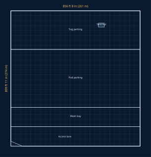

# P1-14 Gate Yard 1: plan

Footprint 856 ft 8 in (261 m) × 899 ft 11 in (274 m) · structural grid 32 ft 10 in (10 m)

## Levels

| Level | Floor above deck | Height | Floor area |
|---|---|---|---|
| Level 1 · Ground | 0 ft (0 mm) | 13 ft 1 in (4,000 mm) | 1,033 sq ft (96 m²) |

## Elements

| ID | Designation | Type | Name | Level(s) | Size / length | Area | Status |
|---|---|---|---|---|---|---|---|
| E001 | D5F2P1B7A2R1 | zone | Tug parking | L1 | 856 ft 8 in (261 m) × 256 ft 7 in (78 m) | 219,778 sq ft (20,418 m²) | proposed |
| E002 | D5F2P1B7A2R2 | room | Yard hut | L1 | 39 ft 4 in (12 m) × 26 ft 3 in (8,000 mm) | 1,033 sq ft (96 m²) | proposed |
| E003 | D5F2P1B7A2R3 | zone | Pod parking | L1 | 856 ft 8 in (261 m) × 385 ft 2 in (117 m) | 329,948 sq ft (30,653 m²) | proposed |
| E004 | D5F2P1B7A2R4 | zone | Wash bay | L1 | 856 ft 8 in (261 m) × 128 ft 3 in (39 m) | 109,889 sq ft (10,209 m²) | proposed |
| E005 | D5F2P1B7A2R5 | zone | Access lane | L1 | 856 ft 8 in (261 m) × 129 ft 11 in (40 m) | 110,047 sq ft (10,224 m²) | proposed |

## Drawings

### Level 1 · Ground

