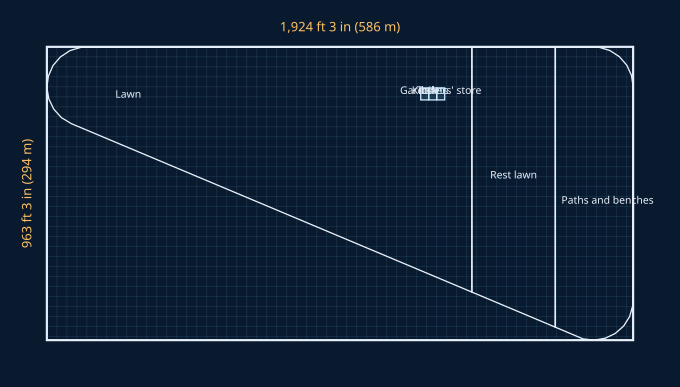

# P1-15 Crew Garden 2: plan

Footprint 1,924 ft 3 in (586 m) × 963 ft 3 in (294 m) · structural grid 32 ft 10 in (10 m)

## Levels

| Level | Floor above deck | Height | Floor area |
|---|---|---|---|
| Level 1 · Ground | 0 ft (0 mm) | 13 ft 1 in (4,000 mm) | 3,100 sq ft (288 m²) |

## Elements

| ID | Designation | Type | Name | Level(s) | Size / length | Area | Status |
|---|---|---|---|---|---|---|---|
| E001 | D5F2P1B8A1R1 | zone | Lawn | L1 | 1,395 ft (425 m) × 804 ft 2 in (245 m) | 707,149 sq ft (65,696 m²) | proposed |
| E002 | D5F2P1B8A1R2 | room | Kiosk | L1 | 26 ft 3 in (8,000 mm) × 39 ft 4 in (12 m) | 1,033 sq ft (96 m²) | proposed |
| E003 | D5F2P1B8A1R3 | room | Toilets | L1 | 26 ft 3 in (8,000 mm) × 39 ft 4 in (12 m) | 1,033 sq ft (96 m²) | proposed |
| E004 | D5F2P1B8A1R4 | room | Gardeners' store | L1 | 26 ft 3 in (8,000 mm) × 39 ft 4 in (12 m) | 1,033 sq ft (96 m²) | proposed |
| E005 | D5F2P1B8A1R5 | zone | Rest lawn | L1 | 273 ft 7 in (83 m) × 919 ft 3 in (280 m) | 235,784 sq ft (21,905 m²) | proposed |
| E006 | D5F2P1B8A1R6 | zone | Paths and benches | L1 | 255 ft 7 in (78 m) × 961 ft 11 in (293 m) | 235,614 sq ft (21,889 m²) | proposed |

## Drawings

### Level 1 · Ground

