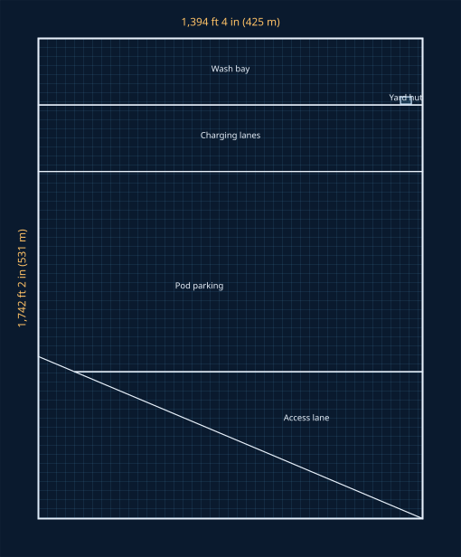

# P1-16 Gate Yard 2: plan

Footprint 1,394 ft 4 in (425 m) × 1,742 ft 2 in (531 m) · structural grid 32 ft 10 in (10 m)

## Levels

| Level | Floor above deck | Height | Floor area |
|---|---|---|---|
| Level 1 · Ground | 0 ft (0 mm) | 13 ft 1 in (4,000 mm) | 1,033 sq ft (96 m²) |

## Elements

| ID | Designation | Type | Name | Level(s) | Size / length | Area | Status |
|---|---|---|---|---|---|---|---|
| E001 | D5F2P1B10A1R1 | zone | Wash bay | L1 | 1,394 ft 4 in (425 m) × 241 ft 6 in (74 m) | 336,695 sq ft (31,280 m²) | proposed |
| E002 | D5F2P1B10A1R2 | room | Yard hut | L1 | 39 ft 4 in (12 m) × 26 ft 3 in (8,000 mm) | 1,033 sq ft (96 m²) | proposed |
| E003 | D5F2P1B10A1R3 | zone | Charging lanes | L1 | 1,394 ft 4 in (425 m) × 241 ft 2 in (74 m) | 336,238 sq ft (31,238 m²) | proposed |
| E004 | D5F2P1B10A1R4 | zone | Pod parking | L1 | 1,394 ft 4 in (425 m) × 726 ft 8 in (222 m) | 1,009,680 sq ft (93,802 m²) | proposed |
| E005 | D5F2P1B10A1R5 | zone | Access lane | L1 | 1,263 ft 5 in (385 m) × 532 ft 10 in (162 m) | 336,589 sq ft (31,270 m²) | proposed |

## Drawings

### Level 1 · Ground

