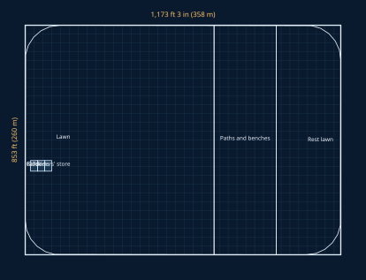

# P1-17 Crew Garden 3: plan

Footprint 1,173 ft 3 in (358 m) × 853 ft (260 m) · structural grid 32 ft 10 in (10 m)

## Levels

| Level | Floor above deck | Height | Floor area |
|---|---|---|---|
| Level 1 · Ground | 0 ft (0 mm) | 13 ft 1 in (4,000 mm) | 3,100 sq ft (288 m²) |

## Elements

| ID | Designation | Type | Name | Level(s) | Size / length | Area | Status |
|---|---|---|---|---|---|---|---|
| E001 | D5F2P1B11A2R1 | zone | Lawn | L1 | 702 ft 1 in (214 m) × 852 ft 8 in (260 m) | 590,500 sq ft (54,859 m²) | proposed |
| E002 | D5F2P1B11A2R2 | room | Kiosk | L1 | 26 ft 3 in (8,000 mm) × 39 ft 4 in (12 m) | 1,033 sq ft (96 m²) | proposed |
| E003 | D5F2P1B11A2R3 | room | Toilets | L1 | 26 ft 3 in (8,000 mm) × 39 ft 4 in (12 m) | 1,033 sq ft (96 m²) | proposed |
| E004 | D5F2P1B11A2R4 | room | Gardeners' store | L1 | 26 ft 3 in (8,000 mm) × 39 ft 4 in (12 m) | 1,033 sq ft (96 m²) | proposed |
| E005 | D5F2P1B11A2R5 | zone | Paths and benches | L1 | 231 ft (70 m) × 852 ft 4 in (260 m) | 196,795 sq ft (18,283 m²) | proposed |
| E006 | D5F2P1B11A2R6 | zone | Rest lawn | L1 | 240 ft 2 in (73 m) × 852 ft (260 m) | 196,958 sq ft (18,298 m²) | proposed |

## Drawings

### Level 1 · Ground

