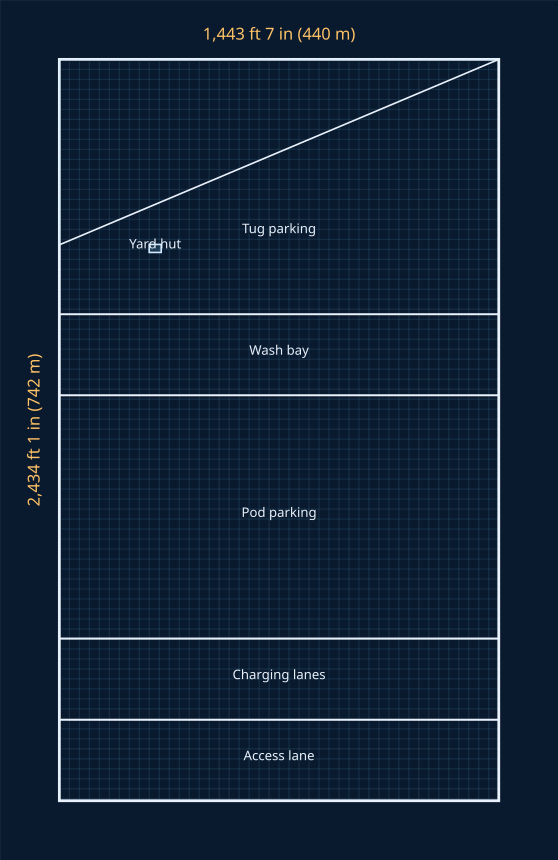

# P1-18 Gate Yard 3: plan

Footprint 1,443 ft 7 in (440 m) × 2,434 ft 1 in (742 m) · structural grid 32 ft 10 in (10 m)

## Levels

| Level | Floor above deck | Height | Floor area |
|---|---|---|---|
| Level 1 · Ground | 0 ft (0 mm) | 13 ft 1 in (4,000 mm) | 1,033 sq ft (96 m²) |

## Elements

| ID | Designation | Type | Name | Level(s) | Size / length | Area | Status |
|---|---|---|---|---|---|---|---|
| E001 | D5F2P1B13A1R1 | zone | Tug parking | L1 | 1,443 ft 7 in (440 m) × 836 ft 11 in (255 m) | 768,672 sq ft (71,412 m²) | proposed |
| E002 | D5F2P1B13A1R2 | room | Yard hut | L1 | 39 ft 4 in (12 m) × 26 ft 3 in (8,000 mm) | 1,033 sq ft (96 m²) | proposed |
| E003 | D5F2P1B13A1R3 | zone | Wash bay | L1 | 1,443 ft 7 in (440 m) × 266 ft 1 in (81 m) | 384,099 sq ft (35,684 m²) | proposed |
| E004 | D5F2P1B13A1R4 | zone | Pod parking | L1 | 1,443 ft 7 in (440 m) × 798 ft 7 in (243 m) | 1,152,772 sq ft (107,096 m²) | proposed |
| E005 | D5F2P1B13A1R5 | zone | Charging lanes | L1 | 1,443 ft 7 in (440 m) × 266 ft 5 in (81 m) | 384,573 sq ft (35,728 m²) | proposed |
| E006 | D5F2P1B13A1R6 | zone | Access lane | L1 | 1,443 ft 7 in (440 m) × 266 ft 1 in (81 m) | 384,099 sq ft (35,684 m²) | proposed |

## Drawings

### Level 1 · Ground

