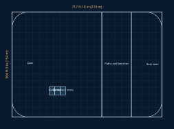

# P1-19 Crew Garden 4: plan

Footprint 717 ft 10 in (219 m) × 504 ft 3 in (154 m) · structural grid 32 ft 10 in (10 m)

## Levels

| Level | Floor above deck | Height | Floor area |
|---|---|---|---|
| Level 1 · Ground | 0 ft (0 mm) | 13 ft 1 in (4,000 mm) | 3,100 sq ft (288 m²) |

## Elements

| ID | Designation | Type | Name | Level(s) | Size / length | Area | Status |
|---|---|---|---|---|---|---|---|
| E001 | D5F2P1B15A2R1 | zone | Lawn | L1 | 429 ft 9 in (131 m) × 503 ft 11 in (154 m) | 213,808 sq ft (19,863 m²) | proposed |
| E002 | D5F2P1B15A2R2 | room | Kiosk | L1 | 26 ft 3 in (8,000 mm) × 39 ft 4 in (12 m) | 1,033 sq ft (96 m²) | proposed |
| E003 | D5F2P1B15A2R3 | room | Toilets | L1 | 26 ft 3 in (8,000 mm) × 39 ft 4 in (12 m) | 1,033 sq ft (96 m²) | proposed |
| E004 | D5F2P1B15A2R4 | room | Gardeners' store | L1 | 26 ft 3 in (8,000 mm) × 39 ft 4 in (12 m) | 1,033 sq ft (96 m²) | proposed |
| E005 | D5F2P1B15A2R5 | zone | Paths and benches | L1 | 141 ft 5 in (43 m) × 503 ft 11 in (154 m) | 71,212 sq ft (6,616 m²) | proposed |
| E006 | D5F2P1B15A2R6 | zone | Rest lawn | L1 | 146 ft 8 in (45 m) × 503 ft 7 in (154 m) | 71,224 sq ft (6,617 m²) | proposed |

## Drawings

### Level 1 · Ground

