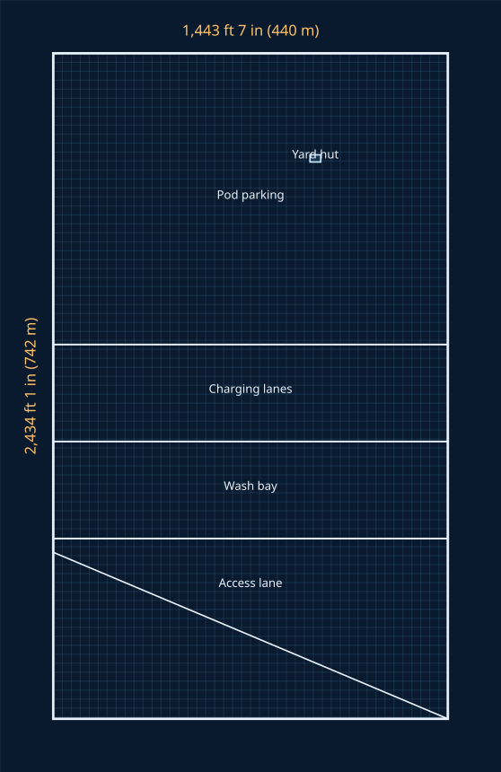

# P1-20 Gate Yard 4: plan

Footprint 1,443 ft 7 in (440 m) × 2,434 ft 1 in (742 m) · structural grid 32 ft 10 in (10 m)

## Levels

| Level | Floor above deck | Height | Floor area |
|---|---|---|---|
| Level 1 · Ground | 0 ft (0 mm) | 13 ft 1 in (4,000 mm) | 1,033 sq ft (96 m²) |

## Elements

| ID | Designation | Type | Name | Level(s) | Size / length | Area | Status |
|---|---|---|---|---|---|---|---|
| E001 | D5F2P1B16A1R1 | zone | Pod parking | L1 | 1,443 ft 7 in (440 m) × 1,065 ft (325 m) | 1,537,345 sq ft (142,824 m²) | proposed |
| E002 | D5F2P1B16A1R2 | room | Yard hut | L1 | 39 ft 4 in (12 m) × 26 ft 3 in (8,000 mm) | 1,033 sq ft (96 m²) | proposed |
| E003 | D5F2P1B16A1R3 | zone | Charging lanes | L1 | 1,443 ft 7 in (440 m) × 354 ft 8 in (108 m) | 511,975 sq ft (47,564 m²) | proposed |
| E004 | D5F2P1B16A1R4 | zone | Wash bay | L1 | 1,443 ft 7 in (440 m) × 355 ft (108 m) | 512,448 sq ft (47,608 m²) | proposed |
| E005 | D5F2P1B16A1R5 | zone | Access lane | L1 | 1,443 ft 7 in (440 m) × 659 ft 5 in (201 m) | 512,448 sq ft (47,608 m²) | proposed |

## Drawings

### Level 1 · Ground

