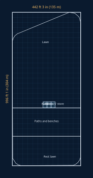

# P1-21 Crew Garden 5: plan

Footprint 442 ft 3 in (135 m) × 996 ft 1 in (304 m) · structural grid 32 ft 10 in (10 m)

## Levels

| Level | Floor above deck | Height | Floor area |
|---|---|---|---|
| Level 1 · Ground | 0 ft (0 mm) | 13 ft 1 in (4,000 mm) | 3,100 sq ft (288 m²) |

## Elements

| ID | Designation | Type | Name | Level(s) | Size / length | Area | Status |
|---|---|---|---|---|---|---|---|
| E001 | D5F2P1B5A2R1 | zone | Lawn | L1 | 441 ft 7 in (135 m) × 620 ft 1 in (189 m) | 244,036 sq ft (22,672 m²) | proposed |
| E002 | D5F2P1B5A2R2 | room | Kiosk | L1 | 26 ft 3 in (8,000 mm) × 39 ft 4 in (12 m) | 1,033 sq ft (96 m²) | proposed |
| E003 | D5F2P1B5A2R3 | room | Toilets | L1 | 26 ft 3 in (8,000 mm) × 39 ft 4 in (12 m) | 1,033 sq ft (96 m²) | proposed |
| E004 | D5F2P1B5A2R4 | room | Gardeners' store | L1 | 26 ft 3 in (8,000 mm) × 39 ft 4 in (12 m) | 1,033 sq ft (96 m²) | proposed |
| E005 | D5F2P1B5A2R5 | zone | Paths and benches | L1 | 440 ft 3 in (134 m) × 185 ft (56 m) | 81,380 sq ft (7,560 m²) | proposed |
| E006 | D5F2P1B5A2R6 | zone | Rest lawn | L1 | 439 ft 4 in (134 m) × 190 ft (58 m) | 81,355 sq ft (7,558 m²) | proposed |

## Drawings

### Level 1 · Ground

