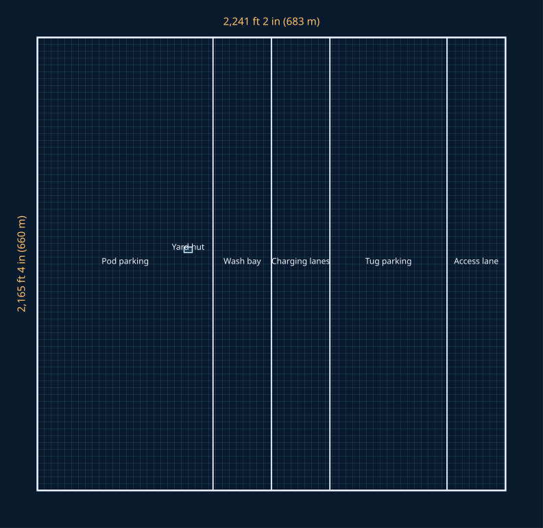

# P1-22 Gate Yard 5: plan

Footprint 2,241 ft 2 in (683 m) × 2,165 ft 4 in (660 m) · structural grid 32 ft 10 in (10 m)

## Levels

| Level | Floor above deck | Height | Floor area |
|---|---|---|---|
| Level 1 · Ground | 0 ft (0 mm) | 13 ft 1 in (4,000 mm) | 1,033 sq ft (96 m²) |

## Elements

| ID | Designation | Type | Name | Level(s) | Size / length | Area | Status |
|---|---|---|---|---|---|---|---|
| E001 | D5F2P1B6A3R1 | zone | Pod parking | L1 | 840 ft 7 in (256 m) × 2,165 ft 4 in (660 m) | 1,820,091 sq ft (169,092 m²) | proposed |
| E002 | D5F2P1B6A3R2 | room | Yard hut | L1 | 39 ft 4 in (12 m) × 26 ft 3 in (8,000 mm) | 1,033 sq ft (96 m²) | proposed |
| E003 | D5F2P1B6A3R3 | zone | Wash bay | L1 | 279 ft 10 in (85 m) × 2,165 ft 4 in (660 m) | 605,987 sq ft (56,298 m²) | proposed |
| E004 | D5F2P1B6A3R4 | zone | Charging lanes | L1 | 280 ft 2 in (85 m) × 2,165 ft 4 in (660 m) | 606,697 sq ft (56,364 m²) | proposed |
| E005 | D5F2P1B6A3R5 | zone | Tug parking | L1 | 560 ft 4 in (171 m) × 2,165 ft 4 in (660 m) | 1,213,394 sq ft (112,728 m²) | proposed |
| E006 | D5F2P1B6A3R6 | zone | Access lane | L1 | 280 ft 2 in (85 m) × 2,165 ft 4 in (660 m) | 606,697 sq ft (56,364 m²) | proposed |

## Drawings

### Level 1 · Ground

