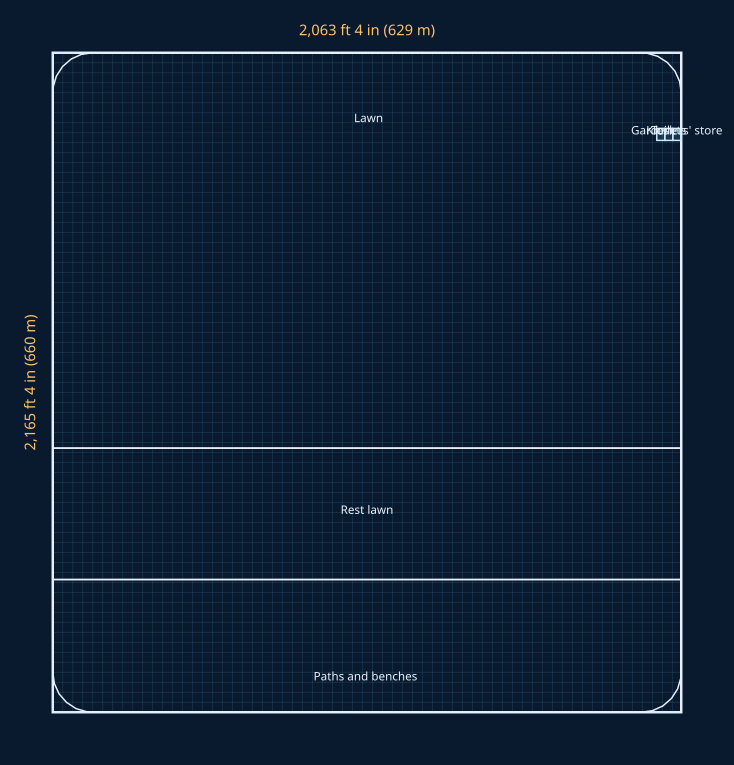

# P1-23 Crew Garden 6: plan

Footprint 2,063 ft 4 in (629 m) × 2,165 ft 4 in (660 m) · structural grid 32 ft 10 in (10 m)

## Levels

| Level | Floor above deck | Height | Floor area |
|---|---|---|---|
| Level 1 · Ground | 0 ft (0 mm) | 13 ft 1 in (4,000 mm) | 3,100 sq ft (288 m²) |

## Elements

| ID | Designation | Type | Name | Level(s) | Size / length | Area | Status |
|---|---|---|---|---|---|---|---|
| E001 | D5F2P1B7A3R1 | zone | Lawn | L1 | 2,062 ft 8 in (629 m) × 1,298 ft 3 in (396 m) | 2,668,221 sq ft (247,886 m²) | proposed |
| E002 | D5F2P1B7A3R2 | room | Kiosk | L1 | 26 ft 3 in (8,000 mm) × 39 ft 4 in (12 m) | 1,033 sq ft (96 m²) | proposed |
| E003 | D5F2P1B7A3R3 | room | Toilets | L1 | 26 ft 3 in (8,000 mm) × 39 ft 4 in (12 m) | 1,033 sq ft (96 m²) | proposed |
| E004 | D5F2P1B7A3R4 | room | Gardeners' store | L1 | 26 ft 3 in (8,000 mm) × 39 ft 4 in (12 m) | 1,033 sq ft (96 m²) | proposed |
| E005 | D5F2P1B7A3R5 | zone | Rest lawn | L1 | 2,062 ft 4 in (629 m) × 431 ft 5 in (132 m) | 889,613 sq ft (82,648 m²) | proposed |
| E006 | D5F2P1B7A3R6 | zone | Paths and benches | L1 | 2,062 ft 4 in (629 m) × 435 ft 8 in (133 m) | 889,668 sq ft (82,653 m²) | proposed |

## Drawings

### Level 1 · Ground

