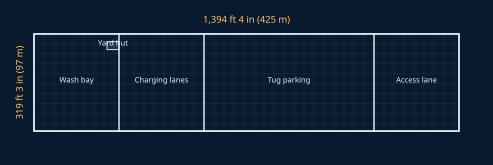

# P1-24 Gate Yard 6: plan

Footprint 1,394 ft 4 in (425 m) × 319 ft 3 in (97 m) · structural grid 32 ft 10 in (10 m)

## Levels

| Level | Floor above deck | Height | Floor area |
|---|---|---|---|
| Level 1 · Ground | 0 ft (0 mm) | 13 ft 1 in (4,000 mm) | 1,033 sq ft (96 m²) |

## Elements

| ID | Designation | Type | Name | Level(s) | Size / length | Area | Status |
|---|---|---|---|---|---|---|---|
| E001 | D5F2P1B9A2R1 | zone | Wash bay | L1 | 278 ft 10 in (85 m) × 319 ft 3 in (97 m) | 89,023 sq ft (8,270 m²) | proposed |
| E002 | D5F2P1B9A2R2 | room | Yard hut | L1 | 39 ft 4 in (12 m) × 26 ft 3 in (8,000 mm) | 1,033 sq ft (96 m²) | proposed |
| E003 | D5F2P1B9A2R3 | zone | Charging lanes | L1 | 278 ft 10 in (85 m) × 319 ft 3 in (97 m) | 89,023 sq ft (8,270 m²) | proposed |
| E004 | D5F2P1B9A2R4 | zone | Tug parking | L1 | 557 ft 9 in (170 m) × 319 ft 3 in (97 m) | 178,046 sq ft (16,541 m²) | proposed |
| E005 | D5F2P1B9A2R5 | zone | Access lane | L1 | 278 ft 10 in (85 m) × 319 ft 3 in (97 m) | 89,023 sq ft (8,270 m²) | proposed |

## Drawings

### Level 1 · Ground

