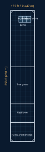

# P1-25 Crew Garden 7: plan

Footprint 155 ft 6 in (47 m) × 853 ft (260 m) · structural grid 32 ft 10 in (10 m)

## Levels

| Level | Floor above deck | Height | Floor area |
|---|---|---|---|
| Level 1 · Ground | 0 ft (0 mm) | 13 ft 1 in (4,000 mm) | 3,100 sq ft (288 m²) |

## Elements

| ID | Designation | Type | Name | Level(s) | Size / length | Area | Status |
|---|---|---|---|---|---|---|---|
| E001 | D5F2P1B11A3R1 | zone | Lawn | L1 | 154 ft 2 in (47 m) × 366 ft 2 in (112 m) | 55,686 sq ft (5,173 m²) | proposed |
| E002 | D5F2P1B11A3R2 | room | Kiosk | L1 | 26 ft 3 in (8,000 mm) × 39 ft 4 in (12 m) | 1,033 sq ft (96 m²) | proposed |
| E003 | D5F2P1B11A3R3 | room | Toilets | L1 | 26 ft 3 in (8,000 mm) × 39 ft 4 in (12 m) | 1,033 sq ft (96 m²) | proposed |
| E004 | D5F2P1B11A3R4 | room | Gardeners' store | L1 | 26 ft 3 in (8,000 mm) × 39 ft 4 in (12 m) | 1,033 sq ft (96 m²) | proposed |
| E005 | D5F2P1B11A3R5 | zone | Tree grove | L1 | 153 ft 10 in (47 m) × 242 ft 2 in (74 m) | 37,097 sq ft (3,446 m²) | proposed |
| E006 | D5F2P1B11A3R6 | zone | Rest lawn | L1 | 153 ft 7 in (47 m) × 121 ft 1 in (37 m) | 18,549 sq ft (1,723 m²) | proposed |
| E007 | D5F2P1B11A3R7 | zone | Paths and benches | L1 | 153 ft 7 in (47 m) × 123 ft 8 in (38 m) | 18,538 sq ft (1,722 m²) | proposed |

## Drawings

### Level 1 · Ground

