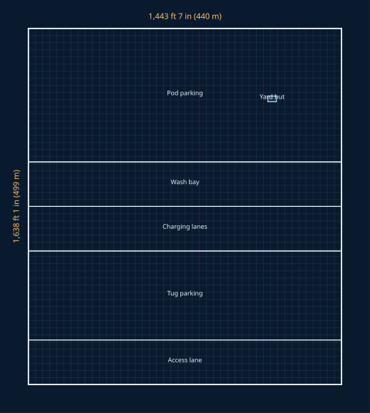

# P1-26 Gate Yard 7: plan

Footprint 1,443 ft 7 in (440 m) × 1,638 ft 1 in (499 m) · structural grid 32 ft 10 in (10 m)

## Levels

| Level | Floor above deck | Height | Floor area |
|---|---|---|---|
| Level 1 · Ground | 0 ft (0 mm) | 13 ft 1 in (4,000 mm) | 1,033 sq ft (96 m²) |

## Elements

| ID | Designation | Type | Name | Level(s) | Size / length | Area | Status |
|---|---|---|---|---|---|---|---|
| E001 | D5F2P1B14A2R1 | zone | Pod parking | L1 | 1,443 ft 7 in (440 m) × 614 ft 2 in (187 m) | 886,602 sq ft (82,368 m²) | proposed |
| E002 | D5F2P1B14A2R2 | room | Yard hut | L1 | 39 ft 4 in (12 m) × 26 ft 3 in (8,000 mm) | 1,033 sq ft (96 m²) | proposed |
| E003 | D5F2P1B14A2R3 | zone | Wash bay | L1 | 1,443 ft 7 in (440 m) × 204 ft 9 in (62 m) | 295,534 sq ft (27,456 m²) | proposed |
| E004 | D5F2P1B14A2R4 | zone | Charging lanes | L1 | 1,443 ft 7 in (440 m) × 205 ft 1 in (63 m) | 296,008 sq ft (27,500 m²) | proposed |
| E005 | D5F2P1B14A2R5 | zone | Tug parking | L1 | 1,443 ft 7 in (440 m) × 409 ft 5 in (125 m) | 591,068 sq ft (54,912 m²) | proposed |
| E006 | D5F2P1B14A2R6 | zone | Access lane | L1 | 1,443 ft 7 in (440 m) × 204 ft 9 in (62 m) | 295,534 sq ft (27,456 m²) | proposed |

## Drawings

### Level 1 · Ground

