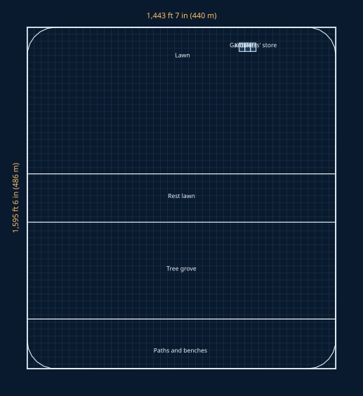

# P1-27 Crew Garden 8: plan

Footprint 1,443 ft 7 in (440 m) × 1,595 ft 6 in (486 m) · structural grid 32 ft 10 in (10 m)

## Levels

| Level | Floor above deck | Height | Floor area |
|---|---|---|---|
| Level 1 · Ground | 0 ft (0 mm) | 13 ft 1 in (4,000 mm) | 3,100 sq ft (288 m²) |

## Elements

| ID | Designation | Type | Name | Level(s) | Size / length | Area | Status |
|---|---|---|---|---|---|---|---|
| E001 | D5F2P1B15A3R1 | zone | Lawn | L1 | 1,442 ft 11 in (440 m) × 684 ft 9 in (209 m) | 979,190 sq ft (90,970 m²) | proposed |
| E002 | D5F2P1B15A3R2 | room | Kiosk | L1 | 26 ft 3 in (8,000 mm) × 39 ft 4 in (12 m) | 1,033 sq ft (96 m²) | proposed |
| E003 | D5F2P1B15A3R3 | room | Toilets | L1 | 26 ft 3 in (8,000 mm) × 39 ft 4 in (12 m) | 1,033 sq ft (96 m²) | proposed |
| E004 | D5F2P1B15A3R4 | room | Gardeners' store | L1 | 26 ft 3 in (8,000 mm) × 39 ft 4 in (12 m) | 1,033 sq ft (96 m²) | proposed |
| E005 | D5F2P1B15A3R5 | zone | Rest lawn | L1 | 1,442 ft 3 in (440 m) × 226 ft 1 in (69 m) | 326,022 sq ft (30,288 m²) | proposed |
| E006 | D5F2P1B15A3R6 | zone | Tree grove | L1 | 1,442 ft 11 in (440 m) × 452 ft 9 in (138 m) | 652,991 sq ft (60,665 m²) | proposed |
| E007 | D5F2P1B15A3R7 | zone | Paths and benches | L1 | 1,442 ft 3 in (440 m) × 231 ft 11 in (71 m) | 326,203 sq ft (30,305 m²) | proposed |

## Drawings

### Level 1 · Ground

