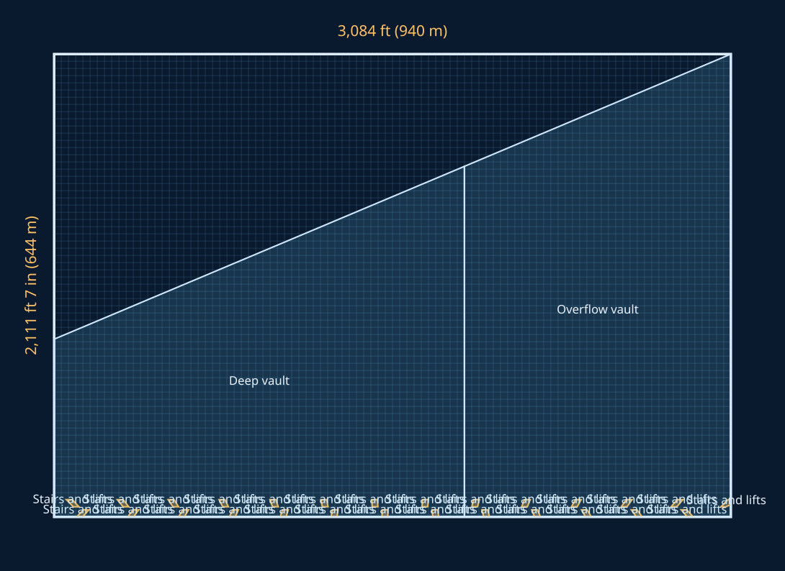
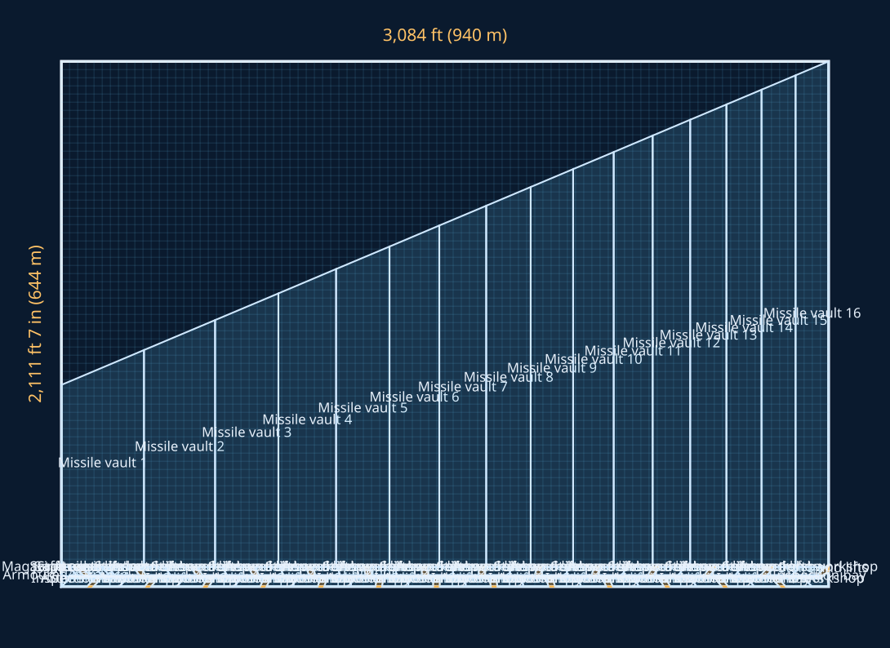

# P2-01 Missile Magazine: plan

Footprint 3,084 ft (940 m) × 2,111 ft 7 in (644 m) · structural grid 32 ft 10 in (10 m)

## Levels

| Level | Floor above deck | Height | Floor area |
|---|---|---|---|
| Level B1 · Deep vault level | −26 ft 3 in (8,000 mm) | 26 ft 3 in (8,000 mm) | 4,506,449 sq ft (418,663 m²) |
| Level 1 · Magazine floor | 0 ft (0 mm) | 32 ft 10 in (10 m) | 4,442,014 sq ft (412,677 m²) |

## Elements

| ID | Designation | Type | Name | Level(s) | Size / length | Area | Status |
|---|---|---|---|---|---|---|---|
| E001 | D5F2P2B1A1L1R1 | room | Missile vault 1 | L1 | 332 ft (101 m) × 872 ft 5 in (266 m) | 266,390 sq ft (24,748 m²) | proposed |
| E002 | D5F2P2B1A1L1R2 | room | Missile vault 2 | L1 | 285 ft 9 in (87 m) × 992 ft 9 in (303 m) | 266,495 sq ft (24,758 m²) | proposed |
| E003 | D5F2P2B1A1L1R3 | room | Missile vault 3 | L1 | 254 ft 7 in (78 m) × 1,100 ft 1 in (335 m) | 266,412 sq ft (24,751 m²) | proposed |
| E004 | D5F2P2B1A1L1R4 | room | Missile vault 4 | L1 | 231 ft 11 in (71 m) × 1,198 ft 2 in (365 m) | 266,543 sq ft (24,763 m²) | proposed |
| E005 | D5F2P2B1A1L1R5 | room | Missile vault 5 | L1 | 214 ft 7 in (65 m) × 1,288 ft 5 in (393 m) | 266,766 sq ft (24,783 m²) | proposed |
| E006 | D5F2P2B1A1L1R6 | room | Missile vault 6 | L1 | 200 ft 2 in (61 m) × 1,373 ft (418 m) | 266,316 sq ft (24,742 m²) | proposed |
| E007 | D5F2P2B1A1L1R7 | room | Missile vault 7 | L1 | 188 ft 8 in (58 m) × 1,452 ft 5 in (443 m) | 266,509 sq ft (24,759 m²) | proposed |
| E008 | D5F2P2B1A1L1R8 | room | Missile vault 8 | L1 | 178 ft 10 in (54 m) × 1,527 ft 11 in (466 m) | 266,449 sq ft (24,754 m²) | proposed |
| E009 | D5F2P2B1A1L1R9 | room | Missile vault 9 | L1 | 170 ft 7 in (52 m) × 1,599 ft 9 in (488 m) | 266,792 sq ft (24,786 m²) | proposed |
| E010 | D5F2P2B1A1L1R10 | room | Missile vault 10 | L1 | 163 ft 1 in (50 m) × 1,668 ft 4 in (508 m) | 266,440 sq ft (24,753 m²) | proposed |
| E011 | D5F2P2B1A1L1R11 | room | Missile vault 11 | L1 | 156 ft 6 in (48 m) × 1,734 ft 7 in (529 m) | 266,269 sq ft (24,737 m²) | proposed |
| E012 | D5F2P2B1A1L1R12 | room | Missile vault 12 | L1 | 150 ft 11 in (46 m) × 1,798 ft 3 in (548 m) | 266,583 sq ft (24,766 m²) | proposed |
| E013 | D5F2P2B1A1L1R13 | room | Missile vault 13 | L1 | 145 ft 8 in (44 m) × 1,859 ft 7 in (567 m) | 266,415 sq ft (24,751 m²) | proposed |
| E014 | D5F2P2B1A1L1R14 | room | Missile vault 14 | L1 | 141 ft 1 in (43 m) × 1,919 ft (585 m) | 266,531 sq ft (24,762 m²) | proposed |
| E015 | D5F2P2B1A1L1R15 | room | Missile vault 15 | L1 | 136 ft 10 in (42 m) × 1,976 ft 8 in (602 m) | 266,485 sq ft (24,757 m²) | proposed |
| E016 | D5F2P2B1A1L1R16 | room | Missile vault 16 | L1 | 132 ft 10 in (40 m) × 2,032 ft 10 in (620 m) | 266,380 sq ft (24,748 m²) | proposed |
| E017 | D5F2P2B1A1LB1R1, D5F2P2B1A1L1R17 | core | Stairs and lifts | LB1, L1 | 57 ft 5 in (18 m) × 32 ft 6 in (9,900 mm) | 853 sq ft (79 m²) | proposed |
| E018 | D5F2P2B1A1LB1R2, D5F2P2B1A1L1R18 | core | Stairs and lifts | LB1, L1 | 52 ft 6 in (16 m) × 32 ft 6 in (9,900 mm) | 853 sq ft (79 m²) | proposed |
| E019 | D5F2P2B1A1LB1R3, D5F2P2B1A1L1R19 | core | Stairs and lifts | LB1, L1 | 47 ft 7 in (14 m) × 32 ft 6 in (9,900 mm) | 853 sq ft (79 m²) | proposed |
| E020 | D5F2P2B1A1LB1R4, D5F2P2B1A1L1R20 | core | Stairs and lifts | LB1, L1 | 42 ft 8 in (13 m) × 32 ft 6 in (9,900 mm) | 853 sq ft (79 m²) | proposed |
| E021 | D5F2P2B1A1LB1R5, D5F2P2B1A1L1R21 | core | Stairs and lifts | LB1, L1 | 37 ft 9 in (12 m) × 32 ft 6 in (9,900 mm) | 853 sq ft (79 m²) | proposed |
| E022 | D5F2P2B1A1LB1R6, D5F2P2B1A1L1R22 | core | Stairs and lifts | LB1, L1 | 32 ft 10 in (10 m) × 32 ft 6 in (9,900 mm) | 853 sq ft (79 m²) | proposed |
| E023 | D5F2P2B1A1LB1R7, D5F2P2B1A1L1R23 | core | Stairs and lifts | LB1, L1 | 27 ft 11 in (8,500 mm) × 32 ft 6 in (9,900 mm) | 847 sq ft (79 m²) | proposed |
| E024 | D5F2P2B1A1LB1R8, D5F2P2B1A1L1R24 | core | Stairs and lifts | LB1, L1 | 29 ft 2 in (8,900 mm) × 32 ft 6 in (9,900 mm) | 853 sq ft (79 m²) | proposed |
| E025 | D5F2P2B1A1LB1R9, D5F2P2B1A1L1R25 | core | Stairs and lifts | LB1, L1 | 34 ft 1 in (10 m) × 32 ft 6 in (9,900 mm) | 853 sq ft (79 m²) | proposed |
| E026 | D5F2P2B1A1LB1R10, D5F2P2B1A1L1R26 | core | Stairs and lifts | LB1, L1 | 39 ft 1 in (12 m) × 32 ft 6 in (9,900 mm) | 853 sq ft (79 m²) | proposed |
| E027 | D5F2P2B1A1LB1R11, D5F2P2B1A1L1R27 | core | Stairs and lifts | LB1, L1 | 44 ft (13 m) × 32 ft 6 in (9,900 mm) | 853 sq ft (79 m²) | proposed |
| E028 | D5F2P2B1A1LB1R12, D5F2P2B1A1L1R28 | core | Stairs and lifts | LB1, L1 | 48 ft 11 in (15 m) × 32 ft 6 in (9,900 mm) | 853 sq ft (79 m²) | proposed |
| E029 | D5F2P2B1A1LB1R13, D5F2P2B1A1L1R29 | core | Stairs and lifts | LB1, L1 | 53 ft 10 in (16 m) × 32 ft 6 in (9,900 mm) | 853 sq ft (79 m²) | proposed |
| E030 | D5F2P2B1A1LB1R14, D5F2P2B1A1L1R30 | core | Stairs and lifts | LB1, L1 | 45 ft 3 in (14 m) × 36 ft 5 in (11 m) | 847 sq ft (79 m²) | proposed |
| E031 | D5F2P2B1A1LB1R15, D5F2P2B1A1L1R31 | core | Stairs and lifts | LB1, L1 | 54 ft 9 in (17 m) × 32 ft 6 in (9,900 mm) | 853 sq ft (79 m²) | proposed |
| E032 | D5F2P2B1A1LB1R16, D5F2P2B1A1L1R32 | core | Stairs and lifts | LB1, L1 | 49 ft 10 in (15 m) × 32 ft 6 in (9,900 mm) | 853 sq ft (79 m²) | proposed |
| E033 | D5F2P2B1A1LB1R17, D5F2P2B1A1L1R33 | core | Stairs and lifts | LB1, L1 | 44 ft 11 in (14 m) × 32 ft 6 in (9,900 mm) | 847 sq ft (79 m²) | proposed |
| E034 | D5F2P2B1A1LB1R18, D5F2P2B1A1L1R34 | core | Stairs and lifts | LB1, L1 | 40 ft 4 in (12 m) × 32 ft 6 in (9,900 mm) | 853 sq ft (79 m²) | proposed |
| E035 | D5F2P2B1A1LB1R19, D5F2P2B1A1L1R35 | core | Stairs and lifts | LB1, L1 | 35 ft 5 in (11 m) × 32 ft 6 in (9,900 mm) | 853 sq ft (79 m²) | proposed |
| E036 | D5F2P2B1A1LB1R20, D5F2P2B1A1L1R36 | core | Stairs and lifts | LB1, L1 | 30 ft 6 in (9,300 mm) × 32 ft 6 in (9,900 mm) | 853 sq ft (79 m²) | proposed |
| E037 | D5F2P2B1A1LB1R21, D5F2P2B1A1L1R37 | core | Stairs and lifts | LB1, L1 | 26 ft 11 in (8,200 mm) × 32 ft 6 in (9,900 mm) | 853 sq ft (79 m²) | proposed |
| E038 | D5F2P2B1A1LB1R22, D5F2P2B1A1L1R38 | core | Stairs and lifts | LB1, L1 | 31 ft 10 in (9,700 mm) × 32 ft 6 in (9,900 mm) | 853 sq ft (79 m²) | proposed |
| E039 | D5F2P2B1A1LB1R23, D5F2P2B1A1L1R39 | core | Stairs and lifts | LB1, L1 | 36 ft 9 in (11 m) × 32 ft 6 in (9,900 mm) | 853 sq ft (79 m²) | proposed |
| E040 | D5F2P2B1A1LB1R24, D5F2P2B1A1L1R40 | core | Stairs and lifts | LB1, L1 | 41 ft 4 in (13 m) × 32 ft 6 in (9,900 mm) | 847 sq ft (79 m²) | proposed |
| E041 | D5F2P2B1A1LB1R25, D5F2P2B1A1L1R41 | core | Stairs and lifts | LB1, L1 | 46 ft 3 in (14 m) × 32 ft 6 in (9,900 mm) | 853 sq ft (79 m²) | proposed |
| E042 | D5F2P2B1A1LB1R26, D5F2P2B1A1L1R42 | core | Stairs and lifts | LB1, L1 | 51 ft 2 in (16 m) × 32 ft 6 in (9,900 mm) | 853 sq ft (79 m²) | proposed |
| E043 | D5F2P2B1A1LB1R27, D5F2P2B1A1L1R43 | core | Stairs and lifts | LB1, L1 | 56 ft 1 in (17 m) × 32 ft 6 in (9,900 mm) | 853 sq ft (79 m²) | proposed |
| E044 | D5F2P2B1A1L1R44 | zone | Corridor | L1 | 3,019 ft (920 m) × 13 ft 9 in (4,200 mm) | 29,754 sq ft (2,764 m²) | proposed |
| E045 | D5F2P2B1A1L1R45 | room | Armoured entrance | L1 | 32 ft 6 in (9,900 mm) × 45 ft 3 in (14 m) | 863 sq ft (80 m²) | proposed |
| E046 | D5F2P2B1A1L1R46 | room | Issue room | L1 | 62 ft (19 m) × 38 ft 5 in (12 m) | 1,609 sq ft (149 m²) | proposed |
| E047 | D5F2P2B1A1L1R47 | room | Magazine control room | L1 | 57 ft 1 in (17 m) × 32 ft 6 in (9,900 mm) | 826 sq ft (77 m²) | proposed |
| E048 | D5F2P2B1A1L1R48 | room | Suppression plant | L1 | 80 ft 1 in (24 m) × 32 ft 6 in (9,900 mm) | 1,620 sq ft (150 m²) | proposed |
| E049 | D5F2P2B1A1L1R49 | room | Locker room | L1 | 59 ft 1 in (18 m) × 32 ft 6 in (9,900 mm) | 970 sq ft (90 m²) | proposed |
| E050 | D5F2P2B1A1L1R50 | room | Staff toilets and showers | L1 | 51 ft 10 in (16 m) × 32 ft 6 in (9,900 mm) | 751 sq ft (70 m²) | proposed |
| E051 | D5F2P2B1A1L1R51 | room | Armourers' workshop | L1 | 127 ft 11 in (39 m) × 32 ft 6 in (9,900 mm) | 3,261 sq ft (303 m²) | proposed |
| E052 | D5F2P2B1A1L1R52 | room | Inspection bay | L1 | 124 ft 4 in (38 m) × 32 ft 6 in (9,900 mm) | 3,234 sq ft (300 m²) | proposed |
| E053 | D5F2P2B1A1L1R53 | room | Armourers' workshop | L1 | 126 ft 4 in (38 m) × 32 ft 6 in (9,900 mm) | 3,367 sq ft (313 m²) | proposed |
| E054 | D5F2P2B1A1L1R54 | room | Inspection bay | L1 | 119 ft 5 in (36 m) × 32 ft 6 in (9,900 mm) | 3,234 sq ft (300 m²) | proposed |
| E055 | D5F2P2B1A1L1R55 | room | Armourers' workshop | L1 | 121 ft 5 in (37 m) × 32 ft 6 in (9,900 mm) | 3,367 sq ft (313 m²) | proposed |
| E056 | D5F2P2B1A1L1R56 | room | Inspection bay | L1 | 114 ft 6 in (35 m) × 32 ft 6 in (9,900 mm) | 3,229 sq ft (300 m²) | proposed |
| E057 | D5F2P2B1A1L1R57 | room | Armourers' workshop | L1 | 116 ft 10 in (36 m) × 32 ft 6 in (9,900 mm) | 3,373 sq ft (313 m²) | proposed |
| E058 | D5F2P2B1A1L1R58 | room | Inspection bay | L1 | 109 ft 7 in (33 m) × 32 ft 6 in (9,900 mm) | 3,229 sq ft (300 m²) | proposed |
| E059 | D5F2P2B1A1L1R59 | room | Armourers' workshop | L1 | 111 ft 11 in (34 m) × 32 ft 6 in (9,900 mm) | 3,373 sq ft (313 m²) | proposed |
| E060 | D5F2P2B1A1L1R60 | room | Inspection bay | L1 | 104 ft 8 in (32 m) × 32 ft 6 in (9,900 mm) | 3,229 sq ft (300 m²) | proposed |
| E061 | D5F2P2B1A1L1R61 | room | Armourers' workshop | L1 | 106 ft 11 in (33 m) × 32 ft 6 in (9,900 mm) | 3,373 sq ft (313 m²) | proposed |
| E062 | D5F2P2B1A1L1R62 | room | Inspection bay | L1 | 100 ft 9 in (31 m) × 32 ft 6 in (9,900 mm) | 3,234 sq ft (300 m²) | proposed |
| E063 | D5F2P2B1A1L1R63 | room | Armourers' workshop | L1 | 105 ft 4 in (32 m) × 32 ft 6 in (9,900 mm) | 3,367 sq ft (313 m²) | proposed |
| E064 | D5F2P2B1A1L1R64 | room | Inspection bay | L1 | 104 ft (32 m) × 32 ft 6 in (9,900 mm) | 3,234 sq ft (300 m²) | proposed |
| E065 | D5F2P2B1A1L1R65 | room | Armourers' workshop | L1 | 110 ft 3 in (34 m) × 32 ft 6 in (9,900 mm) | 3,367 sq ft (313 m²) | proposed |
| E066 | D5F2P2B1A1L1R66 | room | Inspection bay | L1 | 108 ft 11 in (33 m) × 32 ft 6 in (9,900 mm) | 3,234 sq ft (300 m²) | proposed |
| E067 | D5F2P2B1A1L1R67 | room | Armourers' workshop | L1 | 115 ft 2 in (35 m) × 32 ft 6 in (9,900 mm) | 3,367 sq ft (313 m²) | proposed |
| E068 | D5F2P2B1A1L1R68 | room | Inspection bay | L1 | 113 ft 10 in (35 m) × 32 ft 6 in (9,900 mm) | 3,234 sq ft (300 m²) | proposed |
| E069 | D5F2P2B1A1L1R69 | room | Armourers' workshop | L1 | 120 ft 1 in (37 m) × 32 ft 6 in (9,900 mm) | 3,367 sq ft (313 m²) | proposed |
| E070 | D5F2P2B1A1L1R70 | room | Inspection bay | L1 | 118 ft 5 in (36 m) × 32 ft 6 in (9,900 mm) | 3,229 sq ft (300 m²) | proposed |
| E071 | D5F2P2B1A1L1R71 | room | Armourers' workshop | L1 | 125 ft (38 m) × 32 ft 6 in (9,900 mm) | 3,373 sq ft (313 m²) | proposed |
| E072 | D5F2P2B1A1L1R72 | room | Inspection bay | L1 | 123 ft 4 in (38 m) × 32 ft 6 in (9,900 mm) | 3,229 sq ft (300 m²) | proposed |
| E073 | D5F2P2B1A1L1R73 | room | Armourers' workshop | L1 | 129 ft 11 in (40 m) × 32 ft 6 in (9,900 mm) | 3,373 sq ft (313 m²) | proposed |
| E074 | D5F2P2B1A1L1R74 | room | Inspection bay | L1 | 128 ft 3 in (39 m) × 32 ft 6 in (9,900 mm) | 3,229 sq ft (300 m²) | proposed |
| E075 | D5F2P2B1A1L1R75 | room | Armourers' workshop | L1 | 134 ft 10 in (41 m) × 32 ft 6 in (9,900 mm) | 3,373 sq ft (313 m²) | proposed |
| E076 | D5F2P2B1A1L1R76 | room | Inspection bay | L1 | 98 ft 1 in (30 m) × 56 ft 5 in (17 m) | 3,229 sq ft (300 m²) | proposed |
| E077 | D5F2P2B1A1L1R77 | room | Armourers' workshop | L1 | 133 ft 10 in (41 m) × 32 ft 6 in (9,900 mm) | 3,373 sq ft (313 m²) | proposed |
| E078 | D5F2P2B1A1L1R78 | room | Inspection bay | L1 | 126 ft 8 in (39 m) × 32 ft 6 in (9,900 mm) | 3,229 sq ft (300 m²) | proposed |
| E079 | D5F2P2B1A1L1R79 | room | Armourers' workshop | L1 | 128 ft 11 in (39 m) × 32 ft 6 in (9,900 mm) | 3,373 sq ft (313 m²) | proposed |
| E080 | D5F2P2B1A1L1R80 | room | Inspection bay | L1 | 121 ft 9 in (37 m) × 32 ft 6 in (9,900 mm) | 3,229 sq ft (300 m²) | proposed |
| E081 | D5F2P2B1A1L1R81 | room | Armourers' workshop | L1 | 124 ft (38 m) × 32 ft 6 in (9,900 mm) | 3,373 sq ft (313 m²) | proposed |
| E082 | D5F2P2B1A1L1R82 | room | Inspection bay | L1 | 117 ft 2 in (36 m) × 32 ft 6 in (9,900 mm) | 3,234 sq ft (300 m²) | proposed |
| E083 | D5F2P2B1A1L1R83 | room | Armourers' workshop | L1 | 119 ft 1 in (36 m) × 32 ft 6 in (9,900 mm) | 3,367 sq ft (313 m²) | proposed |
| E084 | D5F2P2B1A1L1R84 | room | Inspection bay | L1 | 112 ft 2 in (34 m) × 32 ft 6 in (9,900 mm) | 3,234 sq ft (300 m²) | proposed |
| E085 | D5F2P2B1A1L1R85 | room | Armourers' workshop | L1 | 114 ft 2 in (35 m) × 32 ft 6 in (9,900 mm) | 3,367 sq ft (313 m²) | proposed |
| E086 | D5F2P2B1A1L1R86 | room | Inspection bay | L1 | 107 ft 3 in (33 m) × 32 ft 6 in (9,900 mm) | 3,234 sq ft (300 m²) | proposed |
| E087 | D5F2P2B1A1L1R87 | room | Armourers' workshop | L1 | 109 ft 3 in (33 m) × 32 ft 6 in (9,900 mm) | 3,367 sq ft (313 m²) | proposed |
| E088 | D5F2P2B1A1L1R88 | room | Inspection bay | L1 | 102 ft 4 in (31 m) × 32 ft 6 in (9,900 mm) | 3,234 sq ft (300 m²) | proposed |
| E089 | D5F2P2B1A1L1R89 | room | Armourers' workshop | L1 | 104 ft 8 in (32 m) × 32 ft 6 in (9,900 mm) | 3,367 sq ft (313 m²) | proposed |
| E090 | D5F2P2B1A1L1R90 | room | Inspection bay | L1 | 101 ft 5 in (31 m) × 32 ft 6 in (9,900 mm) | 3,229 sq ft (300 m²) | proposed |
| E091 | D5F2P2B1A1L1R91 | room | Armourers' workshop | L1 | 107 ft 11 in (33 m) × 32 ft 6 in (9,900 mm) | 3,373 sq ft (313 m²) | proposed |
| E092 | D5F2P2B1A1L1R92 | room | Inspection bay | L1 | 106 ft 4 in (32 m) × 32 ft 6 in (9,900 mm) | 3,229 sq ft (300 m²) | proposed |
| E093 | D5F2P2B1A1L1R93 | room | Armourers' workshop | L1 | 112 ft 10 in (34 m) × 32 ft 6 in (9,900 mm) | 3,373 sq ft (313 m²) | proposed |
| E094 | D5F2P2B1A1L1R94 | room | Inspection bay | L1 | 111 ft 3 in (34 m) × 32 ft 6 in (9,900 mm) | 3,229 sq ft (300 m²) | proposed |
| E095 | D5F2P2B1A1L1R95 | room | Armourers' workshop | L1 | 117 ft 9 in (36 m) × 32 ft 6 in (9,900 mm) | 3,373 sq ft (313 m²) | proposed |
| E096 | D5F2P2B1A1L1R96 | room | Inspection bay | L1 | 116 ft 2 in (35 m) × 32 ft 6 in (9,900 mm) | 3,234 sq ft (300 m²) | proposed |
| E097 | D5F2P2B1A1L1R97 | room | Armourers' workshop | L1 | 122 ft 5 in (37 m) × 32 ft 6 in (9,900 mm) | 3,367 sq ft (313 m²) | proposed |
| E098 | D5F2P2B1A1L1R98 | room | Inspection bay | L1 | 121 ft 1 in (37 m) × 32 ft 6 in (9,900 mm) | 3,234 sq ft (300 m²) | proposed |
| E099 | D5F2P2B1A1L1R99 | room | Armourers' workshop | L1 | 127 ft 4 in (39 m) × 32 ft 6 in (9,900 mm) | 3,367 sq ft (313 m²) | proposed |
| E100 | D5F2P2B1A1L1R100 | room | Inspection bay | L1 | 126 ft (38 m) × 32 ft 6 in (9,900 mm) | 3,234 sq ft (300 m²) | proposed |
| E101 | D5F2P2B1A1L1R101 | room | Armourers' workshop | L1 | 132 ft 3 in (40 m) × 32 ft 6 in (9,900 mm) | 3,367 sq ft (313 m²) | proposed |
| E102 | D5F2P2B1A1L1R102 | room | Inspection bay | L1 | 132 ft 10 in (40 m) × 32 ft 6 in (9,900 mm) | 3,298 sq ft (306 m²) | proposed |
| E103 | D5F2P2B1A1LB1R28 | room | Deep vault | LB1 | 1,869 ft 9 in (570 m) × 1,599 ft 5 in (488 m) | 2,253,455 sq ft (209,353 m²) | proposed |
| E104 | D5F2P2B1A1LB1R29 | room | Overflow vault | LB1 | 1,214 ft 3 in (370 m) × 2,111 ft 7 in (644 m) | 2,252,995 sq ft (209,310 m²) | proposed |

## Drawings

### Level B1 · Deep vault level

### Level 1 · Magazine floor

