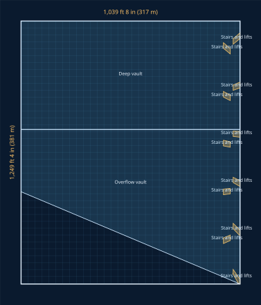
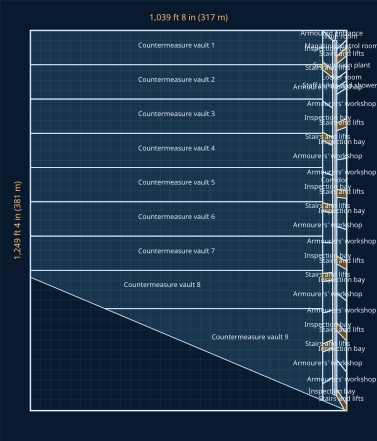

# P2-04 Countermeasure Store: plan

Footprint 1,039 ft 8 in (317 m) × 1,249 ft 4 in (381 m) · structural grid 32 ft 10 in (10 m)

## Levels

| Level | Floor above deck | Height | Floor area |
|---|---|---|---|
| Level B1 · Deep vault level | −26 ft 3 in (8,000 mm) | 26 ft 3 in (8,000 mm) | 1,071,080 sq ft (99,507 m²) |
| Level 1 · Magazine floor | 0 ft (0 mm) | 26 ft 3 in (8,000 mm) | 1,045,640 sq ft (97,143 m²) |

## Elements

| ID | Designation | Type | Name | Level(s) | Size / length | Area | Status |
|---|---|---|---|---|---|---|---|
| E001 | D5F2P2B6A1L1R1 | room | Countermeasure vault 1 | L1 | 960 ft 11 in (293 m) × 112 ft 6 in (34 m) | 108,139 sq ft (10,046 m²) | proposed |
| E002 | D5F2P2B6A1L1R2 | room | Countermeasure vault 2 | L1 | 960 ft 11 in (293 m) × 112 ft 10 in (34 m) | 108,455 sq ft (10,076 m²) | proposed |
| E003 | D5F2P2B6A1L1R3 | room | Countermeasure vault 3 | L1 | 960 ft 11 in (293 m) × 112 ft 6 in (34 m) | 108,139 sq ft (10,046 m²) | proposed |
| E004 | D5F2P2B6A1L1R4 | room | Countermeasure vault 4 | L1 | 960 ft 11 in (293 m) × 112 ft 6 in (34 m) | 108,139 sq ft (10,046 m²) | proposed |
| E005 | D5F2P2B6A1L1R5 | room | Countermeasure vault 5 | L1 | 960 ft 11 in (293 m) × 112 ft 6 in (34 m) | 108,139 sq ft (10,046 m²) | proposed |
| E006 | D5F2P2B6A1L1R6 | room | Countermeasure vault 6 | L1 | 960 ft 11 in (293 m) × 112 ft 10 in (34 m) | 108,455 sq ft (10,076 m²) | proposed |
| E007 | D5F2P2B6A1L1R7 | room | Countermeasure vault 7 | L1 | 960 ft 11 in (293 m) × 112 ft 6 in (34 m) | 108,139 sq ft (10,046 m²) | proposed |
| E008 | D5F2P2B6A1L1R8 | room | Countermeasure vault 8 | L1 | 960 ft 11 in (293 m) × 125 ft 8 in (38 m) | 108,160 sq ft (10,048 m²) | proposed |
| E009 | D5F2P2B6A1L1R9 | room | Countermeasure vault 9 | L1 | 716 ft 6 in (218 m) × 302 ft 2 in (92 m) | 108,256 sq ft (10,057 m²) | proposed |
| E010 | D5F2P2B6A1LB1R1, D5F2P2B6A1L1R10 | core | Stairs and lifts | LB1, L1 | 32 ft 6 in (9,900 mm) × 54 ft 2 in (16 m) | 853 sq ft (79 m²) | proposed |
| E011 | D5F2P2B6A1LB1R2, D5F2P2B6A1L1R11 | core | Stairs and lifts | LB1, L1 | 32 ft 6 in (9,900 mm) × 39 ft 1 in (12 m) | 853 sq ft (79 m²) | proposed |
| E012 | D5F2P2B6A1LB1R3, D5F2P2B6A1L1R12 | core | Stairs and lifts | LB1, L1 | 32 ft 6 in (9,900 mm) × 28 ft 10 in (8,800 mm) | 853 sq ft (79 m²) | proposed |
| E013 | D5F2P2B6A1LB1R4, D5F2P2B6A1L1R13 | core | Stairs and lifts | LB1, L1 | 32 ft 6 in (9,900 mm) × 44 ft (13 m) | 853 sq ft (79 m²) | proposed |
| E014 | D5F2P2B6A1LB1R5, D5F2P2B6A1L1R14 | core | Stairs and lifts | LB1, L1 | 32 ft 6 in (9,900 mm) × 59 ft 5 in (18 m) | 853 sq ft (79 m²) | proposed |
| E015 | D5F2P2B6A1LB1R6, D5F2P2B6A1L1R15 | core | Stairs and lifts | LB1, L1 | 33 ft 10 in (10 m) × 69 ft 3 in (21 m) | 846 sq ft (79 m²) | proposed |
| E016 | D5F2P2B6A1LB1R7, D5F2P2B6A1L1R16 | core | Stairs and lifts | LB1, L1 | 32 ft 6 in (9,900 mm) × 40 ft 4 in (12 m) | 858 sq ft (80 m²) | proposed |
| E017 | D5F2P2B6A1LB1R8, D5F2P2B6A1L1R17 | core | Stairs and lifts | LB1, L1 | 32 ft 6 in (9,900 mm) × 29 ft 10 in (9,100 mm) | 853 sq ft (79 m²) | proposed |
| E018 | D5F2P2B6A1LB1R9, D5F2P2B6A1L1R18 | core | Stairs and lifts | LB1, L1 | 32 ft 6 in (9,900 mm) × 33 ft 2 in (10 m) | 853 sq ft (79 m²) | proposed |
| E019 | D5F2P2B6A1LB1R10, D5F2P2B6A1L1R19 | core | Stairs and lifts | LB1, L1 | 32 ft 6 in (9,900 mm) × 43 ft 4 in (13 m) | 853 sq ft (79 m²) | proposed |
| E020 | D5F2P2B6A1LB1R11, D5F2P2B6A1L1R20 | core | Stairs and lifts | LB1, L1 | 32 ft 6 in (9,900 mm) × 53 ft 6 in (16 m) | 847 sq ft (79 m²) | proposed |
| E021 | D5F2P2B6A1L1R21 | zone | Corridor | L1 | 13 ft 9 in (4,200 mm) × 1,168 ft (356 m) | 11,507 sq ft (1,069 m²) | proposed |
| E022 | D5F2P2B6A1L1R22 | room | Armoured entrance | L1 | 45 ft 3 in (14 m) × 32 ft 6 in (9,900 mm) | 863 sq ft (80 m²) | proposed |
| E023 | D5F2P2B6A1L1R23 | room | Issue room | L1 | 38 ft 5 in (12 m) × 61 ft 4 in (19 m) | 1,614 sq ft (150 m²) | proposed |
| E024 | D5F2P2B6A1L1R24 | room | Magazine control room | L1 | 32 ft 6 in (9,900 mm) × 53 ft 6 in (16 m) | 778 sq ft (72 m²) | proposed |
| E025 | D5F2P2B6A1L1R25 | room | Suppression plant | L1 | 32 ft 6 in (9,900 mm) × 75 ft 2 in (23 m) | 1,614 sq ft (150 m²) | proposed |
| E026 | D5F2P2B6A1L1R26 | room | Locker room | L1 | 32 ft 6 in (9,900 mm) × 52 ft 10 in (16 m) | 975 sq ft (91 m²) | proposed |
| E027 | D5F2P2B6A1L1R27 | room | Staff toilets and showers | L1 | 32 ft 6 in (9,900 mm) × 44 ft (13 m) | 751 sq ft (70 m²) | proposed |
| E028 | D5F2P2B6A1L1R28 | room | Armourers' workshop | L1 | 32 ft 6 in (9,900 mm) × 114 ft 6 in (35 m) | 3,170 sq ft (295 m²) | proposed |
| E029 | D5F2P2B6A1L1R29 | room | Inspection bay | L1 | 32 ft 6 in (9,900 mm) × 107 ft 11 in (33 m) | 3,234 sq ft (300 m²) | proposed |
| E030 | D5F2P2B6A1L1R30 | room | Armourers' workshop | L1 | 32 ft 6 in (9,900 mm) × 104 ft 4 in (32 m) | 3,282 sq ft (305 m²) | proposed |
| E031 | D5F2P2B6A1L1R31 | room | Inspection bay | L1 | 32 ft 6 in (9,900 mm) × 106 ft 4 in (32 m) | 3,229 sq ft (300 m²) | proposed |
| E032 | D5F2P2B6A1L1R32 | room | Armourers' workshop | L1 | 32 ft 6 in (9,900 mm) × 114 ft 6 in (35 m) | 3,282 sq ft (305 m²) | proposed |
| E033 | D5F2P2B6A1L1R33 | room | Inspection bay | L1 | 32 ft 6 in (9,900 mm) × 121 ft 9 in (37 m) | 3,234 sq ft (300 m²) | proposed |
| E034 | D5F2P2B6A1L1R34 | room | Armourers' workshop | L1 | 32 ft 6 in (9,900 mm) × 129 ft 11 in (40 m) | 3,277 sq ft (304 m²) | proposed |
| E035 | D5F2P2B6A1L1R35 | room | Inspection bay | L1 | 32 ft 6 in (9,900 mm) × 136 ft 10 in (42 m) | 3,234 sq ft (300 m²) | proposed |
| E036 | D5F2P2B6A1L1R36 | room | Armourers' workshop | L1 | 32 ft 6 in (9,900 mm) × 145 ft (44 m) | 3,277 sq ft (304 m²) | proposed |
| E037 | D5F2P2B6A1L1R37 | room | Inspection bay | L1 | 70 ft 6 in (22 m) × 104 ft 8 in (32 m) | 3,237 sq ft (301 m²) | proposed |
| E038 | D5F2P2B6A1L1R38 | room | Armourers' workshop | L1 | 32 ft 6 in (9,900 mm) × 117 ft 9 in (36 m) | 3,277 sq ft (304 m²) | proposed |
| E039 | D5F2P2B6A1L1R39 | room | Inspection bay | L1 | 32 ft 6 in (9,900 mm) × 110 ft 7 in (34 m) | 3,229 sq ft (300 m²) | proposed |
| E040 | D5F2P2B6A1L1R40 | room | Armourers' workshop | L1 | 32 ft 6 in (9,900 mm) × 107 ft 7 in (33 m) | 3,282 sq ft (305 m²) | proposed |
| E041 | D5F2P2B6A1L1R41 | room | Inspection bay | L1 | 32 ft 6 in (9,900 mm) × 101 ft 8 in (31 m) | 3,234 sq ft (300 m²) | proposed |
| E042 | D5F2P2B6A1L1R42 | room | Armourers' workshop | L1 | 32 ft 6 in (9,900 mm) × 104 ft 8 in (32 m) | 3,277 sq ft (304 m²) | proposed |
| E043 | D5F2P2B6A1L1R43 | room | Inspection bay | L1 | 32 ft 6 in (9,900 mm) × 109 ft 3 in (33 m) | 3,234 sq ft (300 m²) | proposed |
| E044 | D5F2P2B6A1L1R44 | room | Armourers' workshop | L1 | 32 ft 6 in (9,900 mm) × 115 ft 2 in (35 m) | 3,282 sq ft (305 m²) | proposed |
| E045 | D5F2P2B6A1L1R45 | room | Inspection bay | L1 | 32 ft 6 in (9,900 mm) × 119 ft 5 in (36 m) | 3,229 sq ft (300 m²) | proposed |
| E046 | D5F2P2B6A1L1R46 | room | Armourers' workshop | L1 | 32 ft 6 in (9,900 mm) × 125 ft 8 in (38 m) | 3,282 sq ft (305 m²) | proposed |
| E047 | D5F2P2B6A1L1R47 | room | Inspection bay | L1 | 32 ft 6 in (9,900 mm) × 129 ft 11 in (40 m) | 3,240 sq ft (301 m²) | proposed |
| E048 | D5F2P2B6A1LB1R12 | room | Deep vault | LB1 | 1,039 ft 8 in (317 m) × 515 ft 1 in (157 m) | 535,540 sq ft (49,753 m²) | proposed |
| E049 | D5F2P2B6A1LB1R13 | room | Overflow vault | LB1 | 1,039 ft 8 in (317 m) × 734 ft 3 in (224 m) | 535,540 sq ft (49,753 m²) | proposed |

## Drawings

### Level B1 · Deep vault level

### Level 1 · Magazine floor

