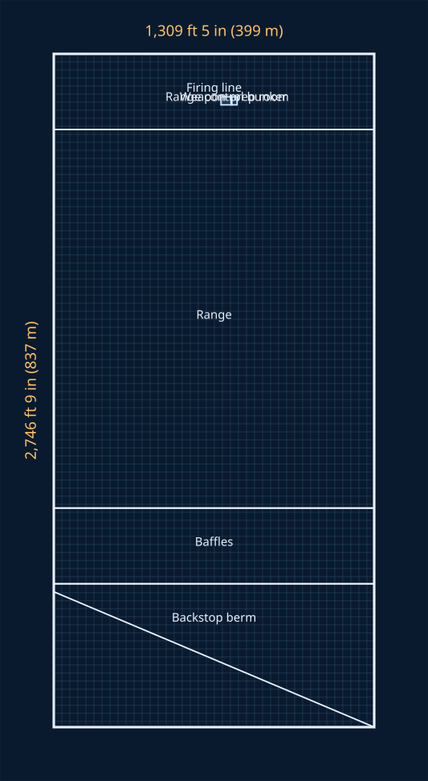

# P2-09 Ordnance Test Range: plan

Footprint 1,309 ft 5 in (399 m) × 2,746 ft 9 in (837 m) · structural grid 32 ft 10 in (10 m)

## Levels

| Level | Floor above deck | Height | Floor area |
|---|---|---|---|
| Level 1 · Ground | 0 ft (0 mm) | 13 ft 1 in (4,000 mm) | 2,153 sq ft (200 m²) |

## Elements

| ID | Designation | Type | Name | Level(s) | Size / length | Area | Status |
|---|---|---|---|---|---|---|---|
| E001 | D5F2P2B14A1R1 | zone | Firing line | L1 | 1,309 ft 5 in (399 m) × 308 ft 9 in (94 m) | 404,242 sq ft (37,555 m²) | proposed |
| E002 | D5F2P2B14A1R2 | room | Range control bunker | L1 | 43 ft 8 in (13 m) × 32 ft 10 in (10 m) | 1,432 sq ft (133 m²) | proposed |
| E003 | D5F2P2B14A1R3 | room | Weapon prep room | L1 | 22 ft (6,700 mm) × 32 ft 10 in (10 m) | 721 sq ft (67 m²) | proposed |
| E004 | D5F2P2B14A1R4 | zone | Range | L1 | 1,309 ft 5 in (399 m) × 1,544 ft 3 in (471 m) | 2,022,069 sq ft (187,856 m²) | proposed |
| E005 | D5F2P2B14A1R5 | zone | Baffles | L1 | 1,309 ft 5 in (399 m) × 308 ft 9 in (94 m) | 404,242 sq ft (37,555 m²) | proposed |
| E006 | D5F2P2B14A1R6 | zone | Backstop berm | L1 | 1,309 ft 5 in (399 m) × 585 ft (178 m) | 404,457 sq ft (37,575 m²) | proposed |

## Drawings

### Level 1 · Ground

