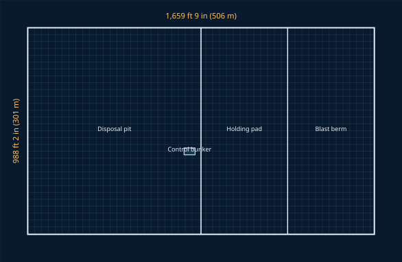

# P2-10 Disposal Pit: plan

Footprint 1,659 ft 9 in (506 m) × 988 ft 2 in (301 m) · structural grid 32 ft 10 in (10 m)

## Levels

| Level | Floor above deck | Height | Floor area |
|---|---|---|---|
| Level 1 · Ground | 0 ft (0 mm) | 13 ft 1 in (4,000 mm) | 1,722 sq ft (160 m²) |

## Elements

| ID | Designation | Type | Name | Level(s) | Size / length | Area | Status |
|---|---|---|---|---|---|---|---|
| E001 | D5F2P2B14A2R1 | zone | Disposal pit | L1 | 829 ft 9 in (253 m) × 988 ft 2 in (301 m) | 819,925 sq ft (76,173 m²) | proposed |
| E002 | D5F2P2B14A2R2 | room | Control bunker | L1 | 52 ft 6 in (16 m) × 32 ft 10 in (10 m) | 1,722 sq ft (160 m²) | proposed |
| E003 | D5F2P2B14A2R3 | zone | Holding pad | L1 | 415 ft (126 m) × 988 ft 2 in (301 m) | 410,124 sq ft (38,102 m²) | proposed |
| E004 | D5F2P2B14A2R4 | zone | Blast berm | L1 | 415 ft (126 m) × 988 ft 2 in (301 m) | 410,124 sq ft (38,102 m²) | proposed |

## Drawings

### Level 1 · Ground

