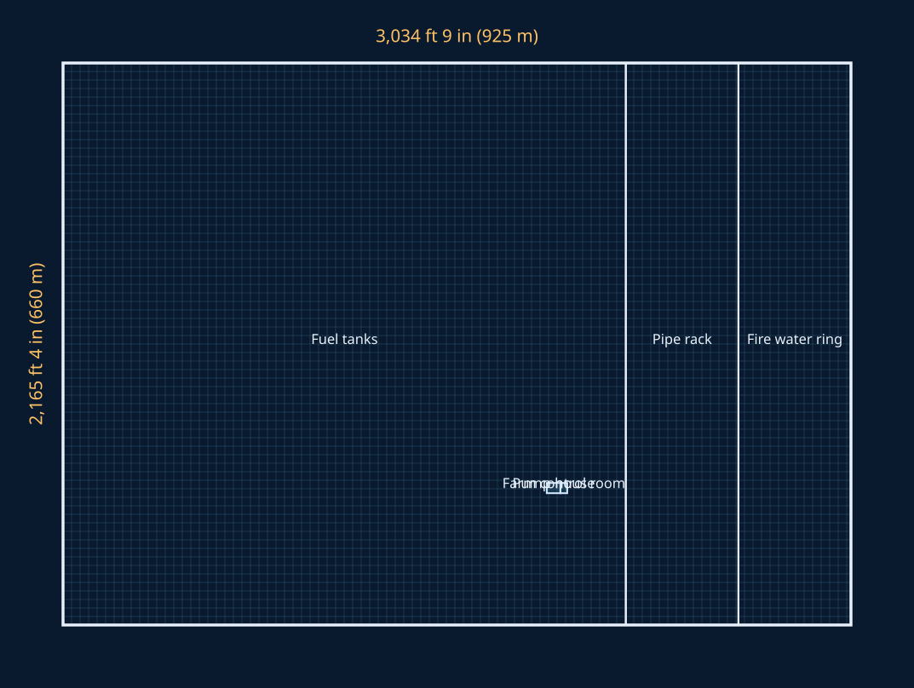

# P2-13 Propellant Tank Farm: plan

Footprint 3,034 ft 9 in (925 m) × 2,165 ft 4 in (660 m) · structural grid 32 ft 10 in (10 m)

## Levels

| Level | Floor above deck | Height | Floor area |
|---|---|---|---|
| Level 1 · Ground | 0 ft (0 mm) | 13 ft 1 in (4,000 mm) | 3,100 sq ft (288 m²) |

## Elements

| ID | Designation | Type | Name | Level(s) | Size / length | Area | Status |
|---|---|---|---|---|---|---|---|
| E001 | D5F2P2B21A1R1 | zone | Fuel tanks | L1 | 2,167 ft 8 in (661 m) × 2,165 ft 4 in (660 m) | 4,693,733 sq ft (436,062 m²) | proposed |
| E002 | D5F2P2B21A1R2 | room | Pump house | L1 | 52 ft 6 in (16 m) × 39 ft 4 in (12 m) | 2,067 sq ft (192 m²) | proposed |
| E003 | D5F2P2B21A1R3 | room | Farm control room | L1 | 26 ft 3 in (8,000 mm) × 39 ft 4 in (12 m) | 1,033 sq ft (96 m²) | proposed |
| E004 | D5F2P2B21A1R4 | zone | Pipe rack | L1 | 433 ft 9 in (132 m) × 2,165 ft 4 in (660 m) | 939,173 sq ft (87,252 m²) | proposed |
| E005 | D5F2P2B21A1R5 | zone | Fire water ring | L1 | 433 ft 5 in (132 m) × 2,165 ft 4 in (660 m) | 938,462 sq ft (87,186 m²) | proposed |

## Drawings

### Level 1 · Ground

