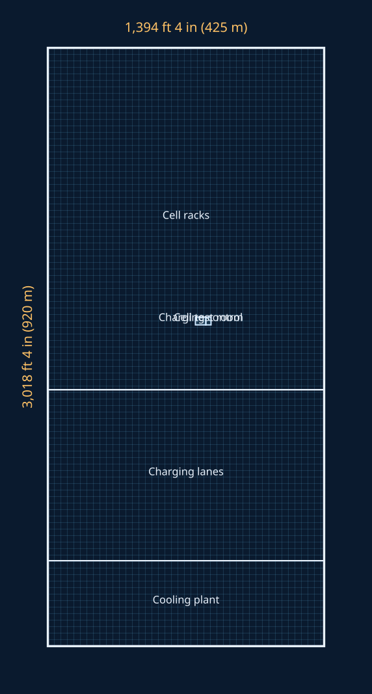

# P2-14 Fuel Cell Farm: plan

Footprint 1,394 ft 4 in (425 m) × 3,018 ft 4 in (920 m) · structural grid 32 ft 10 in (10 m)

## Levels

| Level | Floor above deck | Height | Floor area |
|---|---|---|---|
| Level 1 · Ground | 0 ft (0 mm) | 13 ft 1 in (4,000 mm) | 3,100 sq ft (288 m²) |

## Elements

| ID | Designation | Type | Name | Level(s) | Size / length | Area | Status |
|---|---|---|---|---|---|---|---|
| E001 | D5F2P2B23A1R1 | zone | Cell racks | L1 | 1,394 ft 4 in (425 m) × 1,724 ft 9 in (526 m) | 2,404,900 sq ft (223,423 m²) | proposed |
| E002 | D5F2P2B23A1R2 | room | Charging control | L1 | 52 ft 6 in (16 m) × 39 ft 4 in (12 m) | 2,067 sq ft (192 m²) | proposed |
| E003 | D5F2P2B23A1R3 | room | Cell test room | L1 | 26 ft 3 in (8,000 mm) × 39 ft 4 in (12 m) | 1,033 sq ft (96 m²) | proposed |
| E004 | D5F2P2B23A1R4 | zone | Charging lanes | L1 | 1,394 ft 4 in (425 m) × 862 ft 6 in (263 m) | 1,202,679 sq ft (111,732 m²) | proposed |
| E005 | D5F2P2B23A1R5 | zone | Cooling plant | L1 | 1,394 ft 4 in (425 m) × 431 ft 1 in (131 m) | 601,111 sq ft (55,845 m²) | proposed |

## Drawings

### Level 1 · Ground

