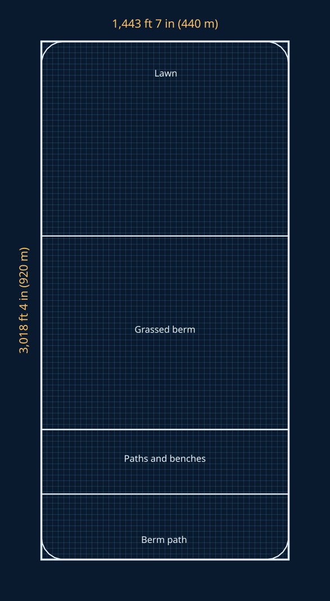

# P2-16 Berm Park: plan

Footprint 1,443 ft 7 in (440 m) × 3,018 ft 4 in (920 m) · structural grid 32 ft 10 in (10 m)

## Levels

| Level | Floor above deck | Height | Floor area |
|---|---|---|---|
| Level 1 · Ground | 0 ft (0 mm) | 13 ft 1 in (4,000 mm) | — |

## Elements

| ID | Designation | Type | Name | Level(s) | Size / length | Area | Status |
|---|---|---|---|---|---|---|---|
| E001 | D5F2P2B27A1R1 | zone | Lawn | L1 | 1,442 ft 7 in (440 m) × 1,133 ft 2 in (345 m) | 1,626,036 sq ft (151,064 m²) | proposed |
| E002 | D5F2P2B27A1R2 | zone | Grassed berm | L1 | 1,442 ft 11 in (440 m) × 1,127 ft 7 in (344 m) | 1,626,325 sq ft (151,091 m²) | proposed |
| E003 | D5F2P2B27A1R3 | zone | Paths and benches | L1 | 1,442 ft 7 in (440 m) × 376 ft (115 m) | 542,266 sq ft (50,378 m²) | proposed |
| E004 | D5F2P2B27A1R4 | zone | Berm path | L1 | 1,442 ft 3 in (440 m) × 381 ft 7 in (116 m) | 541,974 sq ft (50,351 m²) | proposed |

## Drawings

### Level 1 · Ground

