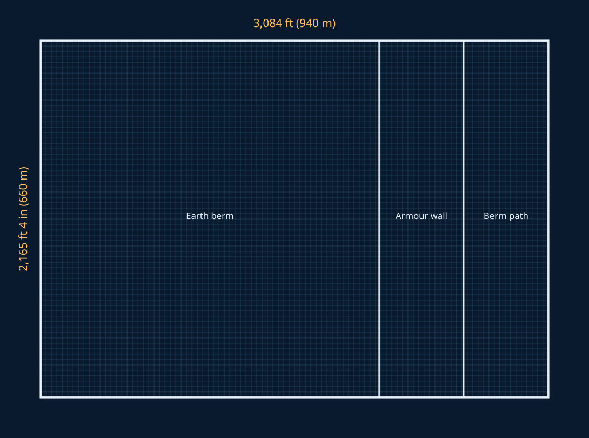

# P2-24 Blast Berm 1: plan

Footprint 3,084 ft (940 m) × 2,165 ft 4 in (660 m) · structural grid 32 ft 10 in (10 m)

## Levels

| Level | Floor above deck | Height | Floor area |
|---|---|---|---|
| Level 1 · Ground | 0 ft (0 mm) | 13 ft 1 in (4,000 mm) | — |

## Elements

| ID | Designation | Type | Name | Level(s) | Size / length | Area | Status |
|---|---|---|---|---|---|---|---|
| E001 | D5F2P2B3A1R1 | zone | Earth berm | L1 | 2,056 ft 1 in (627 m) × 2,165 ft 4 in (660 m) | 4,452,190 sq ft (413,622 m²) | proposed |
| E002 | D5F2P2B3A1R2 | zone | Armour wall | L1 | 513 ft 9 in (157 m) × 2,165 ft 4 in (660 m) | 1,112,515 sq ft (103,356 m²) | proposed |
| E003 | D5F2P2B3A1R3 | zone | Berm path | L1 | 514 ft 1 in (157 m) × 2,165 ft 4 in (660 m) | 1,113,225 sq ft (103,422 m²) | proposed |

## Drawings

### Level 1 · Ground

