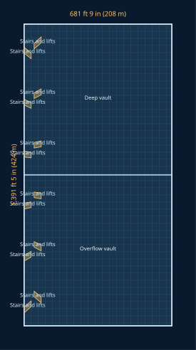
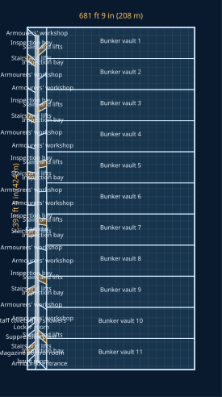

# P2-25 Munitions Bunker 1: plan

Footprint 681 ft 9 in (208 m) × 1,391 ft 5 in (424 m) · structural grid 32 ft 10 in (10 m)

## Levels

| Level | Floor above deck | Height | Floor area |
|---|---|---|---|
| Level B1 · Deep vault level | −26 ft 3 in (8,000 mm) | 26 ft 3 in (8,000 mm) | 948,602 sq ft (88,128 m²) |
| Level 1 · Magazine floor | 0 ft (0 mm) | 19 ft 8 in (6,000 mm) | 920,062 sq ft (85,477 m²) |

## Elements

| ID | Designation | Type | Name | Level(s) | Size / length | Area | Status |
|---|---|---|---|---|---|---|---|
| E001 | D5F2P2B9A2L1R1 | room | Bunker vault 1 | L1 | 603 ft (184 m) × 126 ft 8 in (39 m) | 76,367 sq ft (7,095 m²) | proposed |
| E002 | D5F2P2B9A2L1R2 | room | Bunker vault 2 | L1 | 603 ft (184 m) × 126 ft 4 in (38 m) | 76,169 sq ft (7,076 m²) | proposed |
| E003 | D5F2P2B9A2L1R3 | room | Bunker vault 3 | L1 | 603 ft (184 m) × 126 ft 8 in (39 m) | 76,367 sq ft (7,095 m²) | proposed |
| E004 | D5F2P2B9A2L1R4 | room | Bunker vault 4 | L1 | 603 ft (184 m) × 126 ft 4 in (38 m) | 76,169 sq ft (7,076 m²) | proposed |
| E005 | D5F2P2B9A2L1R5 | room | Bunker vault 5 | L1 | 603 ft (184 m) × 126 ft 8 in (39 m) | 76,367 sq ft (7,095 m²) | proposed |
| E006 | D5F2P2B9A2L1R6 | room | Bunker vault 6 | L1 | 603 ft (184 m) × 126 ft 4 in (38 m) | 76,169 sq ft (7,076 m²) | proposed |
| E007 | D5F2P2B9A2L1R7 | room | Bunker vault 7 | L1 | 603 ft (184 m) × 126 ft 8 in (39 m) | 76,367 sq ft (7,095 m²) | proposed |
| E008 | D5F2P2B9A2L1R8 | room | Bunker vault 8 | L1 | 603 ft (184 m) × 126 ft 4 in (38 m) | 76,169 sq ft (7,076 m²) | proposed |
| E009 | D5F2P2B9A2L1R9 | room | Bunker vault 9 | L1 | 603 ft (184 m) × 126 ft 8 in (39 m) | 76,367 sq ft (7,095 m²) | proposed |
| E010 | D5F2P2B9A2L1R10 | room | Bunker vault 10 | L1 | 603 ft (184 m) × 126 ft 4 in (38 m) | 76,169 sq ft (7,076 m²) | proposed |
| E011 | D5F2P2B9A2L1R11 | room | Bunker vault 11 | L1 | 603 ft (184 m) × 126 ft 8 in (39 m) | 76,367 sq ft (7,095 m²) | proposed |
| E012 | D5F2P2B9A2LB1R1, D5F2P2B9A2L1R12 | core | Stairs and lifts | LB1, L1 | 32 ft 6 in (9,900 mm) × 55 ft 5 in (17 m) | 853 sq ft (79 m²) | proposed |
| E013 | D5F2P2B9A2LB1R2, D5F2P2B9A2L1R13 | core | Stairs and lifts | LB1, L1 | 32 ft 6 in (9,900 mm) × 44 ft (13 m) | 853 sq ft (79 m²) | proposed |
| E014 | D5F2P2B9A2LB1R3, D5F2P2B9A2L1R14 | core | Stairs and lifts | LB1, L1 | 32 ft 6 in (9,900 mm) × 32 ft 10 in (10,000 mm) | 853 sq ft (79 m²) | proposed |
| E015 | D5F2P2B9A2LB1R4, D5F2P2B9A2L1R15 | core | Stairs and lifts | LB1, L1 | 32 ft 6 in (9,900 mm) × 30 ft 10 in (9,400 mm) | 853 sq ft (79 m²) | proposed |
| E016 | D5F2P2B9A2LB1R5, D5F2P2B9A2L1R16 | core | Stairs and lifts | LB1, L1 | 32 ft 6 in (9,900 mm) × 42 ft (13 m) | 853 sq ft (79 m²) | proposed |
| E017 | D5F2P2B9A2LB1R6, D5F2P2B9A2L1R17 | core | Stairs and lifts | LB1, L1 | 32 ft 6 in (9,900 mm) × 52 ft 10 in (16 m) | 847 sq ft (79 m²) | proposed |
| E018 | D5F2P2B9A2LB1R7, D5F2P2B9A2L1R18 | core | Stairs and lifts | LB1, L1 | 32 ft 6 in (9,900 mm) × 55 ft 5 in (17 m) | 853 sq ft (79 m²) | proposed |
| E019 | D5F2P2B9A2LB1R8, D5F2P2B9A2L1R19 | core | Stairs and lifts | LB1, L1 | 32 ft 6 in (9,900 mm) × 44 ft (13 m) | 853 sq ft (79 m²) | proposed |
| E020 | D5F2P2B9A2LB1R9, D5F2P2B9A2L1R20 | core | Stairs and lifts | LB1, L1 | 32 ft 6 in (9,900 mm) × 32 ft 10 in (10 m) | 853 sq ft (79 m²) | proposed |
| E021 | D5F2P2B9A2LB1R10, D5F2P2B9A2L1R21 | core | Stairs and lifts | LB1, L1 | 32 ft 6 in (9,900 mm) × 30 ft 10 in (9,400 mm) | 853 sq ft (79 m²) | proposed |
| E022 | D5F2P2B9A2LB1R11, D5F2P2B9A2L1R22 | core | Stairs and lifts | LB1, L1 | 32 ft 6 in (9,900 mm) × 42 ft (13 m) | 853 sq ft (79 m²) | proposed |
| E023 | D5F2P2B9A2LB1R12, D5F2P2B9A2L1R23 | core | Stairs and lifts | LB1, L1 | 32 ft 6 in (9,900 mm) × 52 ft 10 in (16 m) | 847 sq ft (79 m²) | proposed |
| E024 | D5F2P2B9A2L1R24 | zone | Corridor | L1 | 13 ft 9 in (4,200 mm) × 1,326 ft 5 in (404 m) | 13,094 sq ft (1,216 m²) | proposed |
| E025 | D5F2P2B9A2L1R25 | room | Armoured entrance | L1 | 45 ft 3 in (14 m) × 32 ft 6 in (9,900 mm) | 863 sq ft (80 m²) | proposed |
| E026 | D5F2P2B9A2L1R26 | room | Issue room | L1 | 38 ft 5 in (12 m) × 61 ft 8 in (19 m) | 1,614 sq ft (150 m²) | proposed |
| E027 | D5F2P2B9A2L1R27 | room | Magazine control room | L1 | 32 ft 6 in (9,900 mm) × 56 ft 9 in (17 m) | 858 sq ft (80 m²) | proposed |
| E028 | D5F2P2B9A2L1R28 | room | Suppression plant | L1 | 32 ft 6 in (9,900 mm) × 77 ft 1 in (24 m) | 1,614 sq ft (150 m²) | proposed |
| E029 | D5F2P2B9A2L1R29 | room | Locker room | L1 | 32 ft 6 in (9,900 mm) × 55 ft 5 in (17 m) | 970 sq ft (90 m²) | proposed |
| E030 | D5F2P2B9A2L1R30 | room | Staff toilets and showers | L1 | 32 ft 6 in (9,900 mm) × 47 ft 7 in (14 m) | 757 sq ft (70 m²) | proposed |
| E031 | D5F2P2B9A2L1R31 | room | Armourers' workshop | L1 | 32 ft 6 in (9,900 mm) × 126 ft (38 m) | 3,410 sq ft (317 m²) | proposed |
| E032 | D5F2P2B9A2L1R32 | room | Inspection bay | L1 | 32 ft 6 in (9,900 mm) × 114 ft 6 in (35 m) | 3,234 sq ft (300 m²) | proposed |
| E033 | D5F2P2B9A2L1R33 | room | Armourers' workshop | L1 | 32 ft 6 in (9,900 mm) × 118 ft 5 in (36 m) | 3,522 sq ft (327 m²) | proposed |
| E034 | D5F2P2B9A2L1R34 | room | Inspection bay | L1 | 32 ft 6 in (9,900 mm) × 103 ft (31 m) | 3,229 sq ft (300 m²) | proposed |
| E035 | D5F2P2B9A2L1R35 | room | Armourers' workshop | L1 | 32 ft 6 in (9,900 mm) × 111 ft 3 in (34 m) | 3,527 sq ft (328 m²) | proposed |
| E036 | D5F2P2B9A2L1R36 | room | Inspection bay | L1 | 32 ft 6 in (9,900 mm) × 106 ft 11 in (33 m) | 3,229 sq ft (300 m²) | proposed |
| E037 | D5F2P2B9A2L1R37 | room | Armourers' workshop | L1 | 32 ft 6 in (9,900 mm) × 121 ft 1 in (37 m) | 3,527 sq ft (328 m²) | proposed |
| E038 | D5F2P2B9A2L1R38 | room | Inspection bay | L1 | 32 ft 6 in (9,900 mm) × 118 ft 1 in (36 m) | 3,229 sq ft (300 m²) | proposed |
| E039 | D5F2P2B9A2L1R39 | room | Armourers' workshop | L1 | 32 ft 6 in (9,900 mm) × 132 ft 3 in (40 m) | 3,527 sq ft (328 m²) | proposed |
| E040 | D5F2P2B9A2L1R40 | room | Inspection bay | L1 | 32 ft 6 in (9,900 mm) × 129 ft 3 in (39 m) | 3,234 sq ft (300 m²) | proposed |
| E041 | D5F2P2B9A2L1R41 | room | Armourers' workshop | L1 | 78 ft 9 in (24 m) × 88 ft 11 in (27 m) | 3,522 sq ft (327 m²) | proposed |
| E042 | D5F2P2B9A2L1R42 | room | Inspection bay | L1 | 32 ft 6 in (9,900 mm) × 125 ft 8 in (38 m) | 3,234 sq ft (300 m²) | proposed |
| E043 | D5F2P2B9A2L1R43 | room | Armourers' workshop | L1 | 32 ft 6 in (9,900 mm) × 129 ft 3 in (39 m) | 3,517 sq ft (327 m²) | proposed |
| E044 | D5F2P2B9A2L1R44 | room | Inspection bay | L1 | 32 ft 6 in (9,900 mm) × 114 ft 6 in (35 m) | 3,234 sq ft (300 m²) | proposed |
| E045 | D5F2P2B9A2L1R45 | room | Armourers' workshop | L1 | 32 ft 6 in (9,900 mm) × 118 ft 5 in (36 m) | 3,522 sq ft (327 m²) | proposed |
| E046 | D5F2P2B9A2L1R46 | room | Inspection bay | L1 | 32 ft 6 in (9,900 mm) × 103 ft (31 m) | 3,229 sq ft (300 m²) | proposed |
| E047 | D5F2P2B9A2L1R47 | room | Armourers' workshop | L1 | 32 ft 6 in (9,900 mm) × 111 ft 3 in (34 m) | 3,527 sq ft (328 m²) | proposed |
| E048 | D5F2P2B9A2L1R48 | room | Inspection bay | L1 | 32 ft 6 in (9,900 mm) × 106 ft 11 in (33 m) | 3,229 sq ft (300 m²) | proposed |
| E049 | D5F2P2B9A2L1R49 | room | Armourers' workshop | L1 | 32 ft 6 in (9,900 mm) × 121 ft 1 in (37 m) | 3,527 sq ft (328 m²) | proposed |
| E050 | D5F2P2B9A2L1R50 | room | Inspection bay | L1 | 32 ft 6 in (9,900 mm) × 118 ft 1 in (36 m) | 3,229 sq ft (300 m²) | proposed |
| E051 | D5F2P2B9A2L1R51 | room | Armourers' workshop | L1 | 32 ft 6 in (9,900 mm) × 132 ft 3 in (40 m) | 3,527 sq ft (328 m²) | proposed |
| E052 | D5F2P2B9A2L1R52 | room | Inspection bay | L1 | 32 ft 6 in (9,900 mm) × 133 ft 10 in (41 m) | 3,378 sq ft (314 m²) | proposed |
| E053 | D5F2P2B9A2LB1R13 | room | Deep vault | LB1 | 681 ft 9 in (208 m) × 695 ft 6 in (212 m) | 474,189 sq ft (44,054 m²) | proposed |
| E054 | D5F2P2B9A2LB1R14 | room | Overflow vault | LB1 | 681 ft 9 in (208 m) × 695 ft 10 in (212 m) | 474,413 sq ft (44,074 m²) | proposed |

## Drawings

### Level B1 · Deep vault level

### Level 1 · Magazine floor

