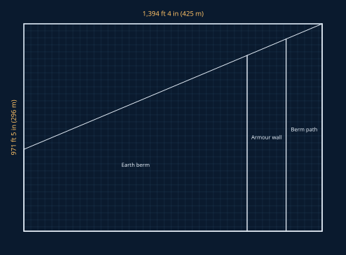

# P2-28 Blast Berm 3: plan

Footprint 1,394 ft 4 in (425 m) × 971 ft 5 in (296 m) · structural grid 32 ft 10 in (10 m)

## Levels

| Level | Floor above deck | Height | Floor area |
|---|---|---|---|
| Level 1 · Ground | 0 ft (0 mm) | 13 ft 1 in (4,000 mm) | — |

## Elements

| ID | Designation | Type | Name | Level(s) | Size / length | Area | Status |
|---|---|---|---|---|---|---|---|
| E001 | D5F2P2B16A1R1 | zone | Earth berm | L1 | 1,043 ft 8 in (318 m) × 823 ft 6 in (251 m) | 629,845 sq ft (58,514 m²) | proposed |
| E002 | D5F2P2B16A1R2 | zone | Armour wall | L1 | 182 ft 5 in (56 m) × 900 ft 7 in (274 m) | 157,249 sq ft (14,609 m²) | proposed |
| E003 | D5F2P2B16A1R3 | zone | Berm path | L1 | 168 ft 4 in (51 m) × 971 ft 5 in (296 m) | 157,539 sq ft (14,636 m²) | proposed |

## Drawings

### Level 1 · Ground

