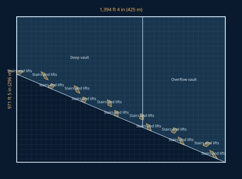
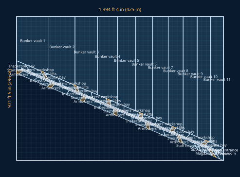

# P2-29 Munitions Bunker 3: plan

Footprint 1,394 ft 4 in (425 m) × 971 ft 5 in (296 m) · structural grid 32 ft 10 in (10 m)

## Levels

| Level | Floor above deck | Height | Floor area |
|---|---|---|---|
| Level B1 · Deep vault level | −26 ft 3 in (8,000 mm) | 26 ft 3 in (8,000 mm) | 944,680 sq ft (87,764 m²) |
| Level 1 · Magazine floor | 0 ft (0 mm) | 19 ft 8 in (6,000 mm) | 913,499 sq ft (84,867 m²) |

## Elements

| ID | Designation | Type | Name | Level(s) | Size / length | Area | Status |
|---|---|---|---|---|---|---|---|
| E001 | D5F2P2B17A1L1R1 | room | Bunker vault 1 | L1 | 218 ft 2 in (66 m) × 390 ft 1 in (119 m) | 75,087 sq ft (6,976 m²) | proposed |
| E002 | D5F2P2B17A1L1R2 | room | Bunker vault 2 | L1 | 175 ft 6 in (54 m) × 464 ft 3 in (142 m) | 74,978 sq ft (6,966 m²) | proposed |
| E003 | D5F2P2B17A1L1R3 | room | Bunker vault 3 | L1 | 151 ft 7 in (46 m) × 527 ft 11 in (161 m) | 75,191 sq ft (6,985 m²) | proposed |
| E004 | D5F2P2B17A1L1R4 | room | Bunker vault 4 | L1 | 134 ft 10 in (41 m) × 584 ft 8 in (178 m) | 75,008 sq ft (6,969 m²) | proposed |
| E005 | D5F2P2B17A1L1R5 | room | Bunker vault 5 | L1 | 122 ft 8 in (37 m) × 636 ft 6 in (194 m) | 74,918 sq ft (6,960 m²) | proposed |
| E006 | D5F2P2B17A1L1R6 | room | Bunker vault 6 | L1 | 113 ft 10 in (35 m) × 684 ft 5 in (209 m) | 75,187 sq ft (6,985 m²) | proposed |
| E007 | D5F2P2B17A1L1R7 | room | Bunker vault 7 | L1 | 106 ft (32 m) × 729 ft 4 in (222 m) | 74,906 sq ft (6,959 m²) | proposed |
| E008 | D5F2P2B17A1L1R8 | room | Bunker vault 8 | L1 | 100 ft 1 in (30 m) × 771 ft 4 in (235 m) | 75,082 sq ft (6,975 m²) | proposed |
| E009 | D5F2P2B17A1L1R9 | room | Bunker vault 9 | L1 | 94 ft 10 in (29 m) × 811 ft 4 in (247 m) | 75,032 sq ft (6,971 m²) | proposed |
| E010 | D5F2P2B17A1L1R10 | room | Bunker vault 10 | L1 | 90 ft 3 in (28 m) × 849 ft 5 in (259 m) | 74,920 sq ft (6,960 m²) | proposed |
| E011 | D5F2P2B17A1L1R11 | room | Bunker vault 11 | L1 | 86 ft 7 in (26 m) × 886 ft 2 in (270 m) | 75,162 sq ft (6,983 m²) | proposed |
| E012 | D5F2P2B17A1LB1R1, D5F2P2B17A1L1R12 | core | Stairs and lifts | LB1, L1 | 53 ft 6 in (16 m) × 57 ft 9 in (18 m) | 849 sq ft (79 m²) | proposed |
| E013 | D5F2P2B17A1LB1R2, D5F2P2B17A1L1R13 | core | Stairs and lifts | LB1, L1 | 43 ft 4 in (13 m) × 53 ft 6 in (16 m) | 842 sq ft (78 m²) | proposed |
| E014 | D5F2P2B17A1LB1R3, D5F2P2B17A1L1R14 | core | Stairs and lifts | LB1, L1 | 33 ft 2 in (10 m) × 49 ft 3 in (15 m) | 844 sq ft (78 m²) | proposed |
| E015 | D5F2P2B17A1LB1R4, D5F2P2B17A1L1R15 | core | Stairs and lifts | LB1, L1 | 25 ft 11 in (7,900 mm) × 44 ft 7 in (14 m) | 853 sq ft (79 m²) | proposed |
| E016 | D5F2P2B17A1LB1R5, D5F2P2B17A1L1R16 | core | Stairs and lifts | LB1, L1 | 36 ft 1 in (11 m) × 40 ft 4 in (12 m) | 853 sq ft (79 m²) | proposed |
| E017 | D5F2P2B17A1LB1R6, D5F2P2B17A1L1R17 | core | Stairs and lifts | LB1, L1 | 46 ft 3 in (14 m) × 36 ft 1 in (11 m) | 850 sq ft (79 m²) | proposed |
| E018 | D5F2P2B17A1LB1R7, D5F2P2B17A1L1R18 | core | Stairs and lifts | LB1, L1 | 44 ft 3 in (14 m) × 30 ft 10 in (9,400 mm) | 858 sq ft (80 m²) | proposed |
| E019 | D5F2P2B17A1LB1R8, D5F2P2B17A1L1R19 | core | Stairs and lifts | LB1, L1 | 48 ft 7 in (15 m) × 55 ft 5 in (17 m) | 843 sq ft (78 m²) | proposed |
| E020 | D5F2P2B17A1LB1R9, D5F2P2B17A1L1R20 | core | Stairs and lifts | LB1, L1 | 38 ft 1 in (12 m) × 51 ft 2 in (16 m) | 847 sq ft (79 m²) | proposed |
| E021 | D5F2P2B17A1LB1R10, D5F2P2B17A1L1R21 | core | Stairs and lifts | LB1, L1 | 27 ft 11 in (8,500 mm) × 46 ft 11 in (14 m) | 848 sq ft (79 m²) | proposed |
| E022 | D5F2P2B17A1LB1R11, D5F2P2B17A1L1R22 | core | Stairs and lifts | LB1, L1 | 30 ft 10 in (9,400 mm) × 42 ft 8 in (13 m) | 852 sq ft (79 m²) | proposed |
| E023 | D5F2P2B17A1LB1R12, D5F2P2B17A1L1R23 | core | Stairs and lifts | LB1, L1 | 41 ft 4 in (13 m) × 38 ft 5 in (12 m) | 857 sq ft (80 m²) | proposed |
| E024 | D5F2P2B17A1LB1R13, D5F2P2B17A1L1R24 | core | Stairs and lifts | LB1, L1 | 51 ft 6 in (16 m) × 33 ft 10 in (10 m) | 850 sq ft (79 m²) | proposed |
| E025 | D5F2P2B17A1L1R25 | zone | Corridor | L1 | 1,329 ft 5 in (405 m) × 575 ft 6 in (175 m) | 14,217 sq ft (1,321 m²) | proposed |
| E026 | D5F2P2B17A1L1R26 | room | Armoured entrance | L1 | 32 ft 6 in (9,900 mm) × 44 ft 11 in (14 m) | 858 sq ft (80 m²) | proposed |
| E027 | D5F2P2B17A1L1R27 | room | Issue room | L1 | 55 ft 9 in (17 m) × 58 ft 9 in (18 m) | 1,612 sq ft (150 m²) | proposed |
| E028 | D5F2P2B17A1L1R28 | room | Magazine control room | L1 | 55 ft 1 in (17 m) × 58 ft 5 in (18 m) | 858 sq ft (80 m²) | proposed |
| E029 | D5F2P2B17A1L1R29 | room | Suppression plant | L1 | 73 ft 10 in (22 m) × 66 ft 3 in (20 m) | 1,615 sq ft (150 m²) | proposed |
| E030 | D5F2P2B17A1L1R30 | room | Locker room | L1 | 53 ft 10 in (16 m) × 57 ft 9 in (18 m) | 973 sq ft (90 m²) | proposed |
| E031 | D5F2P2B17A1L1R31 | room | Staff toilets and showers | L1 | 46 ft 3 in (14 m) × 54 ft 9 in (17 m) | 751 sq ft (70 m²) | proposed |
| E032 | D5F2P2B17A1L1R32 | room | Armourers' workshop | L1 | 119 ft 9 in (36 m) × 85 ft 8 in (26 m) | 3,441 sq ft (320 m²) | proposed |
| E033 | D5F2P2B17A1L1R33 | room | Inspection bay | L1 | 108 ft 3 in (33 m) × 80 ft 9 in (25 m) | 3,240 sq ft (301 m²) | proposed |
| E034 | D5F2P2B17A1L1R34 | room | Armourers' workshop | L1 | 112 ft 6 in (34 m) × 82 ft 8 in (25 m) | 3,546 sq ft (329 m²) | proposed |
| E035 | D5F2P2B17A1L1R35 | room | Inspection bay | L1 | 98 ft 1 in (30 m) × 76 ft 5 in (23 m) | 3,241 sq ft (301 m²) | proposed |
| E036 | D5F2P2B17A1L1R36 | room | Armourers' workshop | L1 | 103 ft (31 m) × 78 ft 5 in (24 m) | 3,550 sq ft (330 m²) | proposed |
| E037 | D5F2P2B17A1L1R37 | room | Inspection bay | L1 | 96 ft 2 in (29 m) × 71 ft 10 in (22 m) | 3,224 sq ft (300 m²) | proposed |
| E038 | D5F2P2B17A1L1R38 | room | Armourers' workshop | L1 | 109 ft 7 in (33 m) × 74 ft 2 in (23 m) | 3,550 sq ft (330 m²) | proposed |
| E039 | D5F2P2B17A1L1R39 | room | Inspection bay | L1 | 106 ft 4 in (32 m) × 67 ft 7 in (21 m) | 3,225 sq ft (300 m²) | proposed |
| E040 | D5F2P2B17A1L1R40 | room | Armourers' workshop | L1 | 119 ft 9 in (36 m) × 69 ft 11 in (21 m) | 3,554 sq ft (330 m²) | proposed |
| E041 | D5F2P2B17A1L1R41 | room | Inspection bay | L1 | 116 ft 10 in (36 m) × 63 ft 4 in (19 m) | 3,228 sq ft (300 m²) | proposed |
| E042 | D5F2P2B17A1L1R42 | room | Armourers' workshop | L1 | 130 ft 3 in (40 m) × 65 ft (20 m) | 3,530 sq ft (328 m²) | proposed |
| E043 | D5F2P2B17A1L1R43 | room | Inspection bay | L1 | 88 ft 7 in (27 m) × 72 ft 6 in (22 m) | 3,226 sq ft (300 m²) | proposed |
| E044 | D5F2P2B17A1L1R44 | room | Armourers' workshop | L1 | 128 ft 3 in (39 m) × 89 ft 3 in (27 m) | 3,553 sq ft (330 m²) | proposed |
| E045 | D5F2P2B17A1L1R45 | room | Inspection bay | L1 | 113 ft 6 in (35 m) × 82 ft 8 in (25 m) | 3,219 sq ft (299 m²) | proposed |
| E046 | D5F2P2B17A1L1R46 | room | Armourers' workshop | L1 | 117 ft 5 in (36 m) × 85 ft (26 m) | 3,535 sq ft (328 m²) | proposed |
| E047 | D5F2P2B17A1L1R47 | room | Inspection bay | L1 | 103 ft (31 m) × 78 ft 5 in (24 m) | 3,232 sq ft (300 m²) | proposed |
| E048 | D5F2P2B17A1L1R48 | room | Armourers' workshop | L1 | 107 ft 3 in (33 m) × 80 ft 9 in (25 m) | 3,553 sq ft (330 m²) | proposed |
| E049 | D5F2P2B17A1L1R49 | room | Inspection bay | L1 | 94 ft 2 in (29 m) × 74 ft 2 in (23 m) | 3,232 sq ft (300 m²) | proposed |
| E050 | D5F2P2B17A1L1R50 | room | Armourers' workshop | L1 | 104 ft 4 in (32 m) × 76 ft 1 in (23 m) | 3,540 sq ft (329 m²) | proposed |
| E051 | D5F2P2B17A1L1R51 | room | Inspection bay | L1 | 101 ft 1 in (31 m) × 69 ft 11 in (21 m) | 3,235 sq ft (301 m²) | proposed |
| E052 | D5F2P2B17A1L1R52 | room | Armourers' workshop | L1 | 114 ft 10 in (35 m) × 71 ft 10 in (22 m) | 3,557 sq ft (330 m²) | proposed |
| E053 | D5F2P2B17A1L1R53 | room | Inspection bay | L1 | 111 ft 7 in (34 m) × 65 ft 7 in (20 m) | 3,235 sq ft (301 m²) | proposed |
| E054 | D5F2P2B17A1L1R54 | room | Armourers' workshop | L1 | 125 ft (38 m) × 67 ft 3 in (20 m) | 3,539 sq ft (329 m²) | proposed |
| E055 | D5F2P2B17A1L1R55 | room | Inspection bay | L1 | 126 ft 4 in (38 m) × 63 ft (19 m) | 3,373 sq ft (313 m²) | proposed |
| E056 | D5F2P2B17A1LB1R14 | room | Deep vault | LB1 | 841 ft 10 in (257 m) × 738 ft 6 in (225 m) | 472,305 sq ft (43,879 m²) | proposed |
| E057 | D5F2P2B17A1LB1R15 | room | Overflow vault | LB1 | 552 ft 6 in (168 m) × 971 ft 5 in (296 m) | 472,375 sq ft (43,885 m²) | proposed |

## Drawings

### Level B1 · Deep vault level

### Level 1 · Magazine floor

