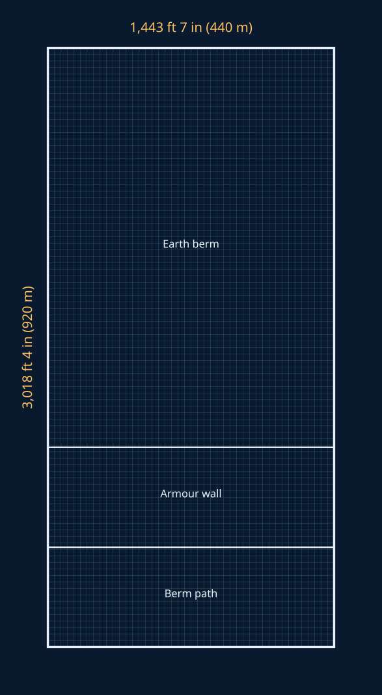

# P2-32 Blast Berm 5: plan

Footprint 1,443 ft 7 in (440 m) × 3,018 ft 4 in (920 m) · structural grid 32 ft 10 in (10 m)

## Levels

| Level | Floor above deck | Height | Floor area |
|---|---|---|---|
| Level 1 · Ground | 0 ft (0 mm) | 13 ft 1 in (4,000 mm) | — |

## Elements

| ID | Designation | Type | Name | Level(s) | Size / length | Area | Status |
|---|---|---|---|---|---|---|---|
| E001 | D5F2P2B26A1R1 | zone | Earth berm | L1 | 1,443 ft 7 in (440 m) × 2,012 ft 2 in (613 m) | 2,904,663 sq ft (269,852 m²) | proposed |
| E002 | D5F2P2B26A1R2 | zone | Armour wall | L1 | 1,443 ft 7 in (440 m) × 503 ft 3 in (153 m) | 726,521 sq ft (67,496 m²) | proposed |
| E003 | D5F2P2B26A1R3 | zone | Berm path | L1 | 1,443 ft 7 in (440 m) × 502 ft 11 in (153 m) | 726,047 sq ft (67,452 m²) | proposed |

## Drawings

### Level 1 · Ground

