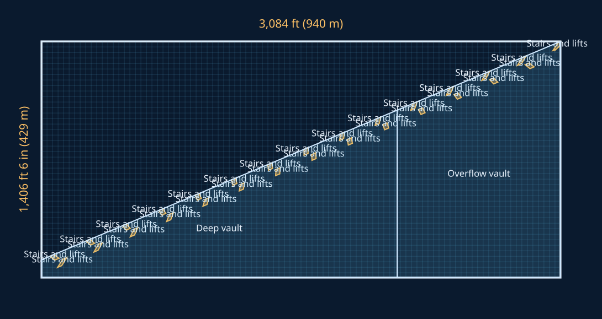
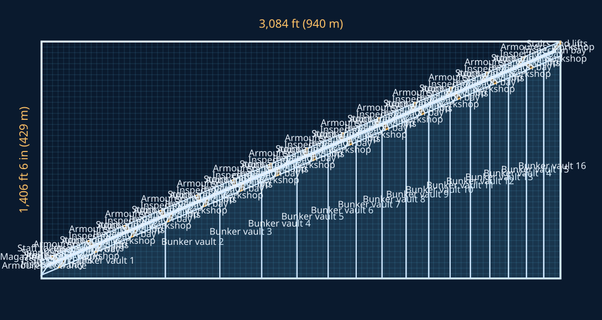

# P2-33 Munitions Bunker 5: plan

Footprint 3,084 ft (940 m) × 1,406 ft 6 in (429 m) · structural grid 32 ft 10 in (10 m)

## Levels

| Level | Floor above deck | Height | Floor area |
|---|---|---|---|
| Level B1 · Deep vault level | −26 ft 3 in (8,000 mm) | 26 ft 3 in (8,000 mm) | 2,332,203 sq ft (216,669 m²) |
| Level 1 · Magazine floor | 0 ft (0 mm) | 19 ft 8 in (6,000 mm) | 2,262,135 sq ft (210,159 m²) |

## Elements

| ID | Designation | Type | Name | Level(s) | Size / length | Area | Status |
|---|---|---|---|---|---|---|---|
| E001 | D5F2P2B30A1L1R1 | room | Bunker vault 1 | L1 | 735 ft 11 in (224 m) × 330 ft 9 in (101 m) | 129,288 sq ft (12,011 m²) | proposed |
| E002 | D5F2P2B30A1L1R2 | room | Bunker vault 2 | L1 | 323 ft 10 in (99 m) × 467 ft 6 in (142 m) | 129,241 sq ft (12,007 m²) | proposed |
| E003 | D5F2P2B30A1L1R3 | room | Bunker vault 3 | L1 | 248 ft 8 in (76 m) × 572 ft 2 in (174 m) | 129,280 sq ft (12,011 m²) | proposed |
| E004 | D5F2P2B30A1L1R4 | room | Bunker vault 4 | L1 | 210 ft (64 m) × 660 ft 9 in (201 m) | 129,442 sq ft (12,026 m²) | proposed |
| E005 | D5F2P2B30A1L1R5 | room | Bunker vault 5 | L1 | 184 ft 9 in (56 m) × 738 ft 6 in (225 m) | 129,231 sq ft (12,006 m²) | proposed |
| E006 | D5F2P2B30A1L1R6 | room | Bunker vault 6 | L1 | 167 ft (51 m) × 809 ft 1 in (247 m) | 129,218 sq ft (12,005 m²) | proposed |
| E007 | D5F2P2B30A1L1R7 | room | Bunker vault 7 | L1 | 153 ft 7 in (47 m) × 874 ft (266 m) | 129,212 sq ft (12,004 m²) | proposed |
| E008 | D5F2P2B30A1L1R8 | room | Bunker vault 8 | L1 | 143 ft 1 in (44 m) × 934 ft 5 in (285 m) | 129,341 sq ft (12,016 m²) | proposed |
| E009 | D5F2P2B30A1L1R9 | room | Bunker vault 9 | L1 | 134 ft 6 in (41 m) × 990 ft 10 in (302 m) | 129,483 sq ft (12,029 m²) | proposed |
| E010 | D5F2P2B30A1L1R10 | room | Bunker vault 10 | L1 | 127 ft (39 m) × 1,044 ft 3 in (318 m) | 129,197 sq ft (12,003 m²) | proposed |
| E011 | D5F2P2B30A1L1R11 | room | Bunker vault 11 | L1 | 120 ft 9 in (37 m) × 1,095 ft 6 in (334 m) | 129,172 sq ft (12,000 m²) | proposed |
| E012 | D5F2P2B30A1L1R12 | room | Bunker vault 12 | L1 | 115 ft 6 in (35 m) × 1,144 ft (349 m) | 129,315 sq ft (12,014 m²) | proposed |
| E013 | D5F2P2B30A1L1R13 | room | Bunker vault 13 | L1 | 110 ft 11 in (34 m) × 1,190 ft 11 in (363 m) | 129,465 sq ft (12,028 m²) | proposed |
| E014 | D5F2P2B30A1L1R14 | room | Bunker vault 14 | L1 | 106 ft 4 in (32 m) × 1,235 ft 11 in (377 m) | 128,985 sq ft (11,983 m²) | proposed |
| E015 | D5F2P2B30A1L1R15 | room | Bunker vault 15 | L1 | 103 ft (31 m) × 1,279 ft 2 in (390 m) | 129,550 sq ft (12,036 m²) | proposed |
| E016 | D5F2P2B30A1L1R16 | room | Bunker vault 16 | L1 | 99 ft 5 in (30 m) × 1,321 ft 2 in (403 m) | 129,252 sq ft (12,008 m²) | proposed |
| E017 | D5F2P2B30A1LB1R1, D5F2P2B30A1L1R17 | core | Stairs and lifts | LB1, L1 | 55 ft 5 in (17 m) × 32 ft 2 in (9,800 mm) | 851 sq ft (79 m²) | proposed |
| E018 | D5F2P2B30A1LB1R2, D5F2P2B30A1L1R18 | core | Stairs and lifts | LB1, L1 | 50 ft 10 in (16 m) × 34 ft 1 in (10 m) | 852 sq ft (79 m²) | proposed |
| E019 | D5F2P2B30A1LB1R3, D5F2P2B30A1L1R19 | core | Stairs and lifts | LB1, L1 | 46 ft 3 in (14 m) × 36 ft 1 in (11 m) | 853 sq ft (79 m²) | proposed |
| E020 | D5F2P2B30A1LB1R4, D5F2P2B30A1L1R20 | core | Stairs and lifts | LB1, L1 | 41 ft 8 in (13 m) × 38 ft 1 in (12 m) | 850 sq ft (79 m²) | proposed |
| E021 | D5F2P2B30A1LB1R5, D5F2P2B30A1L1R21 | core | Stairs and lifts | LB1, L1 | 37 ft 1 in (11 m) × 39 ft 8 in (12 m) | 846 sq ft (79 m²) | proposed |
| E022 | D5F2P2B30A1LB1R6, D5F2P2B30A1L1R22 | core | Stairs and lifts | LB1, L1 | 32 ft 6 in (9,900 mm) × 42 ft (13 m) | 853 sq ft (79 m²) | proposed |
| E023 | D5F2P2B30A1LB1R7, D5F2P2B30A1L1R23 | core | Stairs and lifts | LB1, L1 | 27 ft 11 in (8,500 mm) × 43 ft 8 in (13 m) | 842 sq ft (78 m²) | proposed |
| E024 | D5F2P2B30A1LB1R8, D5F2P2B30A1L1R24 | core | Stairs and lifts | LB1, L1 | 24 ft 7 in (7,500 mm) × 45 ft 7 in (14 m) | 849 sq ft (79 m²) | proposed |
| E025 | D5F2P2B30A1LB1R9, D5F2P2B30A1L1R25 | core | Stairs and lifts | LB1, L1 | 29 ft 6 in (9,000 mm) × 47 ft 11 in (15 m) | 858 sq ft (80 m²) | proposed |
| E026 | D5F2P2B30A1LB1R10, D5F2P2B30A1L1R26 | core | Stairs and lifts | LB1, L1 | 34 ft 1 in (10 m) × 49 ft 6 in (15 m) | 856 sq ft (80 m²) | proposed |
| E027 | D5F2P2B30A1LB1R11, D5F2P2B30A1L1R27 | core | Stairs and lifts | LB1, L1 | 38 ft 5 in (12 m) × 51 ft 6 in (16 m) | 854 sq ft (79 m²) | proposed |
| E028 | D5F2P2B30A1LB1R12, D5F2P2B30A1L1R28 | core | Stairs and lifts | LB1, L1 | 43 ft (13 m) × 53 ft 2 in (16 m) | 860 sq ft (80 m²) | proposed |
| E029 | D5F2P2B30A1LB1R13, D5F2P2B30A1L1R29 | core | Stairs and lifts | LB1, L1 | 47 ft 7 in (14 m) × 55 ft 5 in (17 m) | 845 sq ft (79 m²) | proposed |
| E030 | D5F2P2B30A1LB1R14, D5F2P2B30A1L1R30 | core | Stairs and lifts | LB1, L1 | 52 ft 2 in (16 m) × 57 ft 1 in (17 m) | 846 sq ft (79 m²) | proposed |
| E031 | D5F2P2B30A1LB1R15, D5F2P2B30A1L1R31 | core | Stairs and lifts | LB1, L1 | 44 ft 3 in (14 m) × 53 ft 10 in (16 m) | 845 sq ft (79 m²) | proposed |
| E032 | D5F2P2B30A1LB1R16, D5F2P2B30A1L1R32 | core | Stairs and lifts | LB1, L1 | 53 ft 2 in (16 m) × 33 ft 6 in (10 m) | 860 sq ft (80 m²) | proposed |
| E033 | D5F2P2B30A1LB1R17, D5F2P2B30A1L1R33 | core | Stairs and lifts | LB1, L1 | 48 ft 7 in (15 m) × 35 ft 1 in (11 m) | 852 sq ft (79 m²) | proposed |
| E034 | D5F2P2B30A1LB1R18, D5F2P2B30A1L1R34 | core | Stairs and lifts | LB1, L1 | 44 ft 3 in (14 m) × 37 ft 1 in (11 m) | 857 sq ft (80 m²) | proposed |
| E035 | D5F2P2B30A1LB1R19, D5F2P2B30A1L1R35 | core | Stairs and lifts | LB1, L1 | 39 ft 4 in (12 m) × 39 ft 1 in (12 m) | 851 sq ft (79 m²) | proposed |
| E036 | D5F2P2B30A1LB1R20, D5F2P2B30A1L1R36 | core | Stairs and lifts | LB1, L1 | 34 ft 9 in (11 m) × 41 ft (12 m) | 850 sq ft (79 m²) | proposed |
| E037 | D5F2P2B30A1LB1R21, D5F2P2B30A1L1R37 | core | Stairs and lifts | LB1, L1 | 30 ft 2 in (9,200 mm) × 42 ft 8 in (13 m) | 848 sq ft (79 m²) | proposed |
| E038 | D5F2P2B30A1LB1R22, D5F2P2B30A1L1R38 | core | Stairs and lifts | LB1, L1 | 25 ft 11 in (7,900 mm) × 44 ft 11 in (14 m) | 853 sq ft (79 m²) | proposed |
| E039 | D5F2P2B30A1LB1R23, D5F2P2B30A1L1R39 | core | Stairs and lifts | LB1, L1 | 27 ft 3 in (8,300 mm) × 46 ft 7 in (14 m) | 854 sq ft (79 m²) | proposed |
| E040 | D5F2P2B30A1LB1R24, D5F2P2B30A1L1R40 | core | Stairs and lifts | LB1, L1 | 31 ft 10 in (9,700 mm) × 48 ft 7 in (15 m) | 850 sq ft (79 m²) | proposed |
| E041 | D5F2P2B30A1LB1R25, D5F2P2B30A1L1R41 | core | Stairs and lifts | LB1, L1 | 36 ft 5 in (11 m) × 50 ft 6 in (15 m) | 856 sq ft (80 m²) | proposed |
| E042 | D5F2P2B30A1LB1R26, D5F2P2B30A1L1R42 | core | Stairs and lifts | LB1, L1 | 40 ft 8 in (12 m) × 52 ft 6 in (16 m) | 854 sq ft (79 m²) | proposed |
| E043 | D5F2P2B30A1LB1R27, D5F2P2B30A1L1R43 | core | Stairs and lifts | LB1, L1 | 45 ft 3 in (14 m) × 54 ft 2 in (16 m) | 854 sq ft (79 m²) | proposed |
| E044 | D5F2P2B30A1LB1R28, D5F2P2B30A1L1R44 | core | Stairs and lifts | LB1, L1 | 49 ft 10 in (15 m) × 56 ft 1 in (17 m) | 846 sq ft (79 m²) | proposed |
| E045 | D5F2P2B30A1LB1R29, D5F2P2B30A1L1R45 | core | Stairs and lifts | LB1, L1 | 54 ft 2 in (17 m) × 58 ft 1 in (18 m) | 840 sq ft (78 m²) | proposed |
| E046 | D5F2P2B30A1L1R46 | zone | Corridor | L1 | 3,019 ft (920 m) × 1,288 ft 1 in (393 m) | 32,233 sq ft (2,995 m²) | proposed |
| E047 | D5F2P2B30A1L1R47 | room | Armoured entrance | L1 | 32 ft 6 in (9,900 mm) × 56 ft 9 in (17 m) | 858 sq ft (80 m²) | proposed |
| E048 | D5F2P2B30A1L1R48 | room | Issue room | L1 | 56 ft 1 in (17 m) × 50 ft 6 in (15 m) | 1,613 sq ft (150 m²) | proposed |
| E049 | D5F2P2B30A1L1R49 | room | Magazine control room | L1 | 56 ft 1 in (17 m) × 32 ft 2 in (9,800 mm) | 860 sq ft (80 m²) | proposed |
| E050 | D5F2P2B30A1L1R50 | room | Suppression plant | L1 | 76 ft 1 in (23 m) × 41 ft 8 in (13 m) | 1,609 sq ft (149 m²) | proposed |
| E051 | D5F2P2B30A1L1R51 | room | Locker room | L1 | 57 ft 1 in (17 m) × 34 ft 5 in (10 m) | 972 sq ft (90 m²) | proposed |
| E052 | D5F2P2B30A1L1R52 | room | Staff toilets and showers | L1 | 50 ft 6 in (15 m) × 31 ft 10 in (9,700 mm) | 751 sq ft (70 m²) | proposed |
| E053 | D5F2P2B30A1L1R53 | room | Armourers' workshop | L1 | 122 ft 5 in (37 m) × 63 ft 4 in (19 m) | 3,317 sq ft (308 m²) | proposed |
| E054 | D5F2P2B30A1L1R54 | room | Inspection bay | L1 | 117 ft 2 in (36 m) × 63 ft 4 in (19 m) | 3,241 sq ft (301 m²) | proposed |
| E055 | D5F2P2B30A1L1R55 | room | Armourers' workshop | L1 | 121 ft 1 in (37 m) × 66 ft 7 in (20 m) | 3,448 sq ft (320 m²) | proposed |
| E056 | D5F2P2B30A1L1R56 | room | Inspection bay | L1 | 112 ft 6 in (34 m) × 65 ft 3 in (20 m) | 3,232 sq ft (300 m²) | proposed |
| E057 | D5F2P2B30A1L1R57 | room | Armourers' workshop | L1 | 116 ft 10 in (36 m) × 68 ft 3 in (21 m) | 3,440 sq ft (320 m²) | proposed |
| E058 | D5F2P2B30A1L1R58 | room | Inspection bay | L1 | 107 ft 11 in (33 m) × 66 ft 11 in (20 m) | 3,228 sq ft (300 m²) | proposed |
| E059 | D5F2P2B30A1L1R59 | room | Armourers' workshop | L1 | 111 ft 11 in (34 m) × 70 ft 6 in (22 m) | 3,438 sq ft (319 m²) | proposed |
| E060 | D5F2P2B30A1L1R60 | room | Inspection bay | L1 | 103 ft 8 in (32 m) × 69 ft 3 in (21 m) | 3,247 sq ft (302 m²) | proposed |
| E061 | D5F2P2B30A1L1R61 | room | Armourers' workshop | L1 | 107 ft 3 in (33 m) × 72 ft 6 in (22 m) | 3,457 sq ft (321 m²) | proposed |
| E062 | D5F2P2B30A1L1R62 | room | Inspection bay | L1 | 99 ft 1 in (30 m) × 70 ft 10 in (22 m) | 3,233 sq ft (300 m²) | proposed |
| E063 | D5F2P2B30A1L1R63 | room | Armourers' workshop | L1 | 103 ft (31 m) × 74 ft 2 in (23 m) | 3,440 sq ft (320 m²) | proposed |
| E064 | D5F2P2B30A1L1R64 | room | Inspection bay | L1 | 94 ft 6 in (29 m) × 72 ft 10 in (22 m) | 3,236 sq ft (301 m²) | proposed |
| E065 | D5F2P2B30A1L1R65 | room | Armourers' workshop | L1 | 98 ft 9 in (30 m) × 76 ft 5 in (23 m) | 3,459 sq ft (321 m²) | proposed |
| E066 | D5F2P2B30A1L1R66 | room | Inspection bay | L1 | 93 ft 6 in (28 m) × 74 ft 6 in (23 m) | 3,225 sq ft (300 m²) | proposed |
| E067 | D5F2P2B30A1L1R67 | room | Armourers' workshop | L1 | 101 ft 8 in (31 m) × 78 ft 1 in (24 m) | 3,446 sq ft (320 m²) | proposed |
| E068 | D5F2P2B30A1L1R68 | room | Inspection bay | L1 | 98 ft 1 in (30 m) × 76 ft 9 in (23 m) | 3,242 sq ft (301 m²) | proposed |
| E069 | D5F2P2B30A1L1R69 | room | Armourers' workshop | L1 | 106 ft (32 m) × 80 ft 1 in (24 m) | 3,450 sq ft (321 m²) | proposed |
| E070 | D5F2P2B30A1L1R70 | room | Inspection bay | L1 | 102 ft 8 in (31 m) × 78 ft 5 in (24 m) | 3,215 sq ft (299 m²) | proposed |
| E071 | D5F2P2B30A1L1R71 | room | Armourers' workshop | L1 | 110 ft 7 in (34 m) × 81 ft 8 in (25 m) | 3,435 sq ft (319 m²) | proposed |
| E072 | D5F2P2B30A1L1R72 | room | Inspection bay | L1 | 106 ft 11 in (33 m) × 80 ft 5 in (24 m) | 3,235 sq ft (301 m²) | proposed |
| E073 | D5F2P2B30A1L1R73 | room | Armourers' workshop | L1 | 115 ft 2 in (35 m) × 84 ft (26 m) | 3,451 sq ft (321 m²) | proposed |
| E074 | D5F2P2B30A1L1R74 | room | Inspection bay | L1 | 111 ft 7 in (34 m) × 82 ft 4 in (25 m) | 3,219 sq ft (299 m²) | proposed |
| E075 | D5F2P2B30A1L1R75 | room | Armourers' workshop | L1 | 120 ft 1 in (37 m) × 85 ft 8 in (26 m) | 3,442 sq ft (320 m²) | proposed |
| E076 | D5F2P2B30A1L1R76 | room | Inspection bay | L1 | 116 ft 6 in (36 m) × 84 ft 4 in (26 m) | 3,237 sq ft (301 m²) | proposed |
| E077 | D5F2P2B30A1L1R77 | room | Armourers' workshop | L1 | 124 ft 4 in (38 m) × 87 ft 7 in (27 m) | 3,430 sq ft (319 m²) | proposed |
| E078 | D5F2P2B30A1L1R78 | room | Inspection bay | L1 | 121 ft 1 in (37 m) × 85 ft 11 in (26 m) | 3,229 sq ft (300 m²) | proposed |
| E079 | D5F2P2B30A1L1R79 | room | Armourers' workshop | L1 | 128 ft 11 in (39 m) × 89 ft 7 in (27 m) | 3,427 sq ft (318 m²) | proposed |
| E080 | D5F2P2B30A1L1R80 | room | Inspection bay | L1 | 89 ft 3 in (27 m) × 87 ft 7 in (27 m) | 3,220 sq ft (299 m²) | proposed |
| E081 | D5F2P2B30A1L1R81 | room | Armourers' workshop | L1 | 127 ft 11 in (39 m) × 63 ft 8 in (19 m) | 3,440 sq ft (320 m²) | proposed |
| E082 | D5F2P2B30A1L1R82 | room | Inspection bay | L1 | 119 ft 5 in (36 m) × 62 ft 4 in (19 m) | 3,239 sq ft (301 m²) | proposed |
| E083 | D5F2P2B30A1L1R83 | room | Armourers' workshop | L1 | 123 ft 4 in (38 m) × 65 ft 7 in (20 m) | 3,446 sq ft (320 m²) | proposed |
| E084 | D5F2P2B30A1L1R84 | room | Inspection bay | L1 | 114 ft 10 in (35 m) × 64 ft (20 m) | 3,223 sq ft (299 m²) | proposed |
| E085 | D5F2P2B30A1L1R85 | room | Armourers' workshop | L1 | 119 ft 1 in (36 m) × 67 ft 7 in (21 m) | 3,448 sq ft (320 m²) | proposed |
| E086 | D5F2P2B30A1L1R86 | room | Inspection bay | L1 | 110 ft 3 in (34 m) × 66 ft 3 in (20 m) | 3,247 sq ft (302 m²) | proposed |
| E087 | D5F2P2B30A1L1R87 | room | Armourers' workshop | L1 | 114 ft 6 in (35 m) × 69 ft 7 in (21 m) | 3,461 sq ft (322 m²) | proposed |
| E088 | D5F2P2B30A1L1R88 | room | Inspection bay | L1 | 105 ft 8 in (32 m) × 67 ft 11 in (21 m) | 3,217 sq ft (299 m²) | proposed |
| E089 | D5F2P2B30A1L1R89 | room | Armourers' workshop | L1 | 109 ft 7 in (33 m) × 71 ft 2 in (22 m) | 3,421 sq ft (318 m²) | proposed |
| E090 | D5F2P2B30A1L1R90 | room | Inspection bay | L1 | 101 ft 5 in (31 m) × 69 ft 11 in (21 m) | 3,245 sq ft (301 m²) | proposed |
| E091 | D5F2P2B30A1L1R91 | room | Armourers' workshop | L1 | 105 ft (32 m) × 73 ft 6 in (22 m) | 3,443 sq ft (320 m²) | proposed |
| E092 | D5F2P2B30A1L1R92 | room | Inspection bay | L1 | 96 ft 9 in (30 m) × 71 ft 10 in (22 m) | 3,235 sq ft (301 m²) | proposed |
| E093 | D5F2P2B30A1L1R93 | room | Armourers' workshop | L1 | 100 ft 9 in (31 m) × 75 ft 2 in (23 m) | 3,441 sq ft (320 m²) | proposed |
| E094 | D5F2P2B30A1L1R94 | room | Inspection bay | L1 | 92 ft 10 in (28 m) × 73 ft 10 in (22 m) | 3,238 sq ft (301 m²) | proposed |
| E095 | D5F2P2B30A1L1R95 | room | Armourers' workshop | L1 | 99 ft 5 in (30 m) × 77 ft 1 in (24 m) | 3,445 sq ft (320 m²) | proposed |
| E096 | D5F2P2B30A1L1R96 | room | Inspection bay | L1 | 95 ft 10 in (29 m) × 75 ft 6 in (23 m) | 3,214 sq ft (299 m²) | proposed |
| E097 | D5F2P2B30A1L1R97 | room | Armourers' workshop | L1 | 104 ft (32 m) × 79 ft 1 in (24 m) | 3,431 sq ft (319 m²) | proposed |
| E098 | D5F2P2B30A1L1R98 | room | Inspection bay | L1 | 100 ft 5 in (31 m) × 77 ft 5 in (24 m) | 3,230 sq ft (300 m²) | proposed |
| E099 | D5F2P2B30A1L1R99 | room | Armourers' workshop | L1 | 108 ft 3 in (33 m) × 81 ft (25 m) | 3,452 sq ft (321 m²) | proposed |
| E100 | D5F2P2B30A1L1R100 | room | Inspection bay | L1 | 105 ft (32 m) × 79 ft 5 in (24 m) | 3,216 sq ft (299 m²) | proposed |
| E101 | D5F2P2B30A1L1R101 | room | Armourers' workshop | L1 | 112 ft 10 in (34 m) × 82 ft 8 in (25 m) | 3,436 sq ft (319 m²) | proposed |
| E102 | D5F2P2B30A1L1R102 | room | Inspection bay | L1 | 109 ft 3 in (33 m) × 81 ft 4 in (25 m) | 3,218 sq ft (299 m²) | proposed |
| E103 | D5F2P2B30A1L1R103 | room | Armourers' workshop | L1 | 117 ft 5 in (36 m) × 84 ft 8 in (26 m) | 3,440 sq ft (320 m²) | proposed |
| E104 | D5F2P2B30A1L1R104 | room | Inspection bay | L1 | 113 ft 10 in (35 m) × 83 ft (25 m) | 3,209 sq ft (298 m²) | proposed |
| E105 | D5F2P2B30A1L1R105 | room | Armourers' workshop | L1 | 122 ft 5 in (37 m) × 86 ft 7 in (26 m) | 3,424 sq ft (318 m²) | proposed |
| E106 | D5F2P2B30A1L1R106 | room | Inspection bay | L1 | 118 ft 9 in (36 m) × 85 ft 4 in (26 m) | 3,238 sq ft (301 m²) | proposed |
| E107 | D5F2P2B30A1L1R107 | room | Armourers' workshop | L1 | 126 ft 8 in (39 m) × 88 ft 7 in (27 m) | 3,446 sq ft (320 m²) | proposed |
| E108 | D5F2P2B30A1L1R108 | room | Inspection bay | L1 | 126 ft 4 in (38 m) × 88 ft 3 in (27 m) | 3,333 sq ft (310 m²) | proposed |
| E109 | D5F2P2B30A1LB1R30 | room | Deep vault | LB1 | 2,113 ft 10 in (644 m) × 997 ft 5 in (304 m) | 1,166,152 sq ft (108,339 m²) | proposed |
| E110 | D5F2P2B30A1LB1R31 | room | Overflow vault | LB1 | 970 ft 2 in (296 m) × 1,406 ft 6 in (429 m) | 1,166,051 sq ft (108,330 m²) | proposed |

## Drawings

### Level B1 · Deep vault level

### Level 1 · Magazine floor

