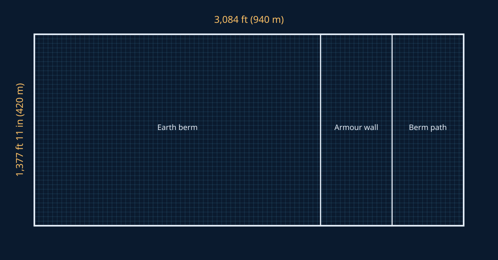

# P2-34 Blast Berm 6: plan

Footprint 3,084 ft (940 m) × 1,377 ft 11 in (420 m) · structural grid 32 ft 10 in (10 m)

## Levels

| Level | Floor above deck | Height | Floor area |
|---|---|---|---|
| Level 1 · Ground | 0 ft (0 mm) | 13 ft 1 in (4,000 mm) | — |

## Elements

| ID | Designation | Type | Name | Level(s) | Size / length | Area | Status |
|---|---|---|---|---|---|---|---|
| E001 | D5F2P2B33A1R1 | zone | Earth berm | L1 | 2,056 ft 1 in (627 m) × 1,377 ft 11 in (420 m) | 2,833,212 sq ft (263,214 m²) | proposed |
| E002 | D5F2P2B33A1R2 | zone | Armour wall | L1 | 513 ft 9 in (157 m) × 1,377 ft 11 in (420 m) | 707,964 sq ft (65,772 m²) | proposed |
| E003 | D5F2P2B33A1R3 | zone | Berm path | L1 | 514 ft 1 in (157 m) × 1,377 ft 11 in (420 m) | 708,416 sq ft (65,814 m²) | proposed |

## Drawings

### Level 1 · Ground

