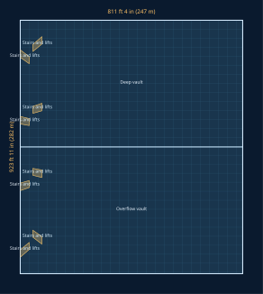
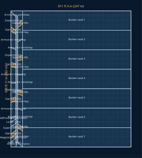

# P2-35 Munitions Bunker 6: plan

Footprint 811 ft 4 in (247 m) × 923 ft 11 in (282 m) · structural grid 32 ft 10 in (10 m)

## Levels

| Level | Floor above deck | Height | Floor area |
|---|---|---|---|
| Level B1 · Deep vault level | −26 ft 3 in (8,000 mm) | 26 ft 3 in (8,000 mm) | 749,595 sq ft (69,640 m²) |
| Level 1 · Magazine floor | 0 ft (0 mm) | 19 ft 8 in (6,000 mm) | 730,908 sq ft (67,904 m²) |

## Elements

| ID | Designation | Type | Name | Level(s) | Size / length | Area | Status |
|---|---|---|---|---|---|---|---|
| E001 | D5F2P2B34A2L1R1 | room | Bunker vault 1 | L1 | 732 ft 7 in (223 m) × 131 ft 11 in (40 m) | 96,624 sq ft (8,977 m²) | proposed |
| E002 | D5F2P2B34A2L1R2 | room | Bunker vault 2 | L1 | 732 ft 7 in (223 m) × 132 ft 3 in (40 m) | 96,864 sq ft (8,999 m²) | proposed |
| E003 | D5F2P2B34A2L1R3 | room | Bunker vault 3 | L1 | 732 ft 7 in (223 m) × 131 ft 11 in (40 m) | 96,624 sq ft (8,977 m²) | proposed |
| E004 | D5F2P2B34A2L1R4 | room | Bunker vault 4 | L1 | 732 ft 7 in (223 m) × 131 ft 11 in (40 m) | 96,624 sq ft (8,977 m²) | proposed |
| E005 | D5F2P2B34A2L1R5 | room | Bunker vault 5 | L1 | 732 ft 7 in (223 m) × 131 ft 11 in (40 m) | 96,624 sq ft (8,977 m²) | proposed |
| E006 | D5F2P2B34A2L1R6 | room | Bunker vault 6 | L1 | 732 ft 7 in (223 m) × 132 ft 3 in (40 m) | 96,864 sq ft (8,999 m²) | proposed |
| E007 | D5F2P2B34A2L1R7 | room | Bunker vault 7 | L1 | 732 ft 7 in (223 m) × 131 ft 11 in (40 m) | 96,624 sq ft (8,977 m²) | proposed |
| E008 | D5F2P2B34A2LB1R1, D5F2P2B34A2L1R8 | core | Stairs and lifts | LB1, L1 | 32 ft 6 in (9,900 mm) × 53 ft 6 in (16 m) | 847 sq ft (79 m²) | proposed |
| E009 | D5F2P2B34A2LB1R2, D5F2P2B34A2L1R9 | core | Stairs and lifts | LB1, L1 | 32 ft 6 in (9,900 mm) × 36 ft 5 in (11 m) | 853 sq ft (79 m²) | proposed |
| E010 | D5F2P2B34A2LB1R3, D5F2P2B34A2L1R10 | core | Stairs and lifts | LB1, L1 | 32 ft 6 in (9,900 mm) × 33 ft 2 in (10 m) | 853 sq ft (79 m²) | proposed |
| E011 | D5F2P2B34A2LB1R4, D5F2P2B34A2L1R11 | core | Stairs and lifts | LB1, L1 | 32 ft 6 in (9,900 mm) × 50 ft 2 in (15 m) | 853 sq ft (79 m²) | proposed |
| E012 | D5F2P2B34A2LB1R5, D5F2P2B34A2L1R12 | core | Stairs and lifts | LB1, L1 | 32 ft 6 in (9,900 mm) × 53 ft 6 in (16 m) | 847 sq ft (79 m²) | proposed |
| E013 | D5F2P2B34A2LB1R6, D5F2P2B34A2L1R13 | core | Stairs and lifts | LB1, L1 | 32 ft 6 in (9,900 mm) × 36 ft 5 in (11 m) | 853 sq ft (79 m²) | proposed |
| E014 | D5F2P2B34A2LB1R7, D5F2P2B34A2L1R14 | core | Stairs and lifts | LB1, L1 | 32 ft 6 in (9,900 mm) × 33 ft 2 in (10 m) | 853 sq ft (79 m²) | proposed |
| E015 | D5F2P2B34A2LB1R8, D5F2P2B34A2L1R15 | core | Stairs and lifts | LB1, L1 | 32 ft 6 in (9,900 mm) × 50 ft 2 in (15 m) | 853 sq ft (79 m²) | proposed |
| E016 | D5F2P2B34A2L1R16 | zone | Corridor | L1 | 13 ft 9 in (4,200 mm) × 858 ft 11 in (262 m) | 8,493 sq ft (789 m²) | proposed |
| E017 | D5F2P2B34A2L1R17 | room | Armoured entrance | L1 | 45 ft 3 in (14 m) × 32 ft 6 in (9,900 mm) | 863 sq ft (80 m²) | proposed |
| E018 | D5F2P2B34A2L1R18 | room | Issue room | L1 | 38 ft 5 in (12 m) × 61 ft 4 in (19 m) | 1,614 sq ft (150 m²) | proposed |
| E019 | D5F2P2B34A2L1R19 | room | Magazine control room | L1 | 32 ft 6 in (9,900 mm) × 55 ft 9 in (17 m) | 863 sq ft (80 m²) | proposed |
| E020 | D5F2P2B34A2L1R20 | room | Suppression plant | L1 | 32 ft 6 in (9,900 mm) × 74 ft 6 in (23 m) | 1,620 sq ft (150 m²) | proposed |
| E021 | D5F2P2B34A2L1R21 | room | Locker room | L1 | 32 ft 6 in (9,900 mm) × 51 ft 6 in (16 m) | 970 sq ft (90 m²) | proposed |
| E022 | D5F2P2B34A2L1R22 | room | Staff toilets and showers | L1 | 32 ft 6 in (9,900 mm) × 43 ft (13 m) | 751 sq ft (70 m²) | proposed |
| E023 | D5F2P2B34A2L1R23 | room | Armourers' workshop | L1 | 32 ft 6 in (9,900 mm) × 120 ft 5 in (37 m) | 3,421 sq ft (318 m²) | proposed |
| E024 | D5F2P2B34A2L1R24 | room | Inspection bay | L1 | 32 ft 6 in (9,900 mm) × 105 ft 4 in (32 m) | 3,234 sq ft (300 m²) | proposed |
| E025 | D5F2P2B34A2L1R25 | room | Armourers' workshop | L1 | 32 ft 6 in (9,900 mm) × 112 ft 10 in (34 m) | 3,533 sq ft (328 m²) | proposed |
| E026 | D5F2P2B34A2L1R26 | room | Inspection bay | L1 | 32 ft 6 in (9,900 mm) × 110 ft 11 in (34 m) | 3,229 sq ft (300 m²) | proposed |
| E027 | D5F2P2B34A2L1R27 | room | Armourers' workshop | L1 | 32 ft 6 in (9,900 mm) × 127 ft 7 in (39 m) | 3,527 sq ft (328 m²) | proposed |
| E028 | D5F2P2B34A2L1R28 | room | Inspection bay | L1 | 32 ft 6 in (9,900 mm) × 128 ft 3 in (39 m) | 3,240 sq ft (301 m²) | proposed |
| E029 | D5F2P2B34A2L1R29 | room | Armourers' workshop | L1 | 78 ft 9 in (24 m) × 88 ft 3 in (27 m) | 3,527 sq ft (328 m²) | proposed |
| E030 | D5F2P2B34A2L1R30 | room | Inspection bay | L1 | 32 ft 6 in (9,900 mm) × 122 ft 5 in (37 m) | 3,234 sq ft (300 m²) | proposed |
| E031 | D5F2P2B34A2L1R31 | room | Armourers' workshop | L1 | 32 ft 6 in (9,900 mm) × 123 ft 8 in (38 m) | 3,527 sq ft (328 m²) | proposed |
| E032 | D5F2P2B34A2L1R32 | room | Inspection bay | L1 | 32 ft 6 in (9,900 mm) × 105 ft 4 in (32 m) | 3,234 sq ft (300 m²) | proposed |
| E033 | D5F2P2B34A2L1R33 | room | Armourers' workshop | L1 | 32 ft 6 in (9,900 mm) × 112 ft 10 in (34 m) | 3,533 sq ft (328 m²) | proposed |
| E034 | D5F2P2B34A2L1R34 | room | Inspection bay | L1 | 32 ft 6 in (9,900 mm) × 110 ft 11 in (34 m) | 3,229 sq ft (300 m²) | proposed |
| E035 | D5F2P2B34A2L1R35 | room | Armourers' workshop | L1 | 32 ft 6 in (9,900 mm) × 127 ft 7 in (39 m) | 3,527 sq ft (328 m²) | proposed |
| E036 | D5F2P2B34A2L1R36 | room | Inspection bay | L1 | 32 ft 6 in (9,900 mm) × 132 ft 10 in (41 m) | 3,383 sq ft (314 m²) | proposed |
| E037 | D5F2P2B34A2LB1R9 | room | Deep vault | LB1 | 811 ft 4 in (247 m) × 461 ft 11 in (141 m) | 374,798 sq ft (34,820 m²) | proposed |
| E038 | D5F2P2B34A2LB1R10 | room | Overflow vault | LB1 | 811 ft 4 in (247 m) × 461 ft 11 in (141 m) | 374,798 sq ft (34,820 m²) | proposed |

## Drawings

### Level B1 · Deep vault level

### Level 1 · Magazine floor

