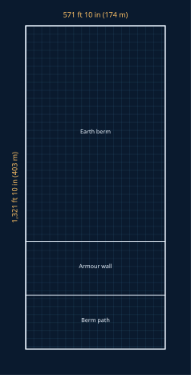

# P2-36 Blast Berm 7: plan

Footprint 571 ft 10 in (174 m) × 1,321 ft 10 in (403 m) · structural grid 32 ft 10 in (10 m)

## Levels

| Level | Floor above deck | Height | Floor area |
|---|---|---|---|
| Level 1 · Ground | 0 ft (0 mm) | 13 ft 1 in (4,000 mm) | — |

## Elements

| ID | Designation | Type | Name | Level(s) | Size / length | Area | Status |
|---|---|---|---|---|---|---|---|
| E001 | D5F2P2B35A2R1 | zone | Earth berm | L1 | 571 ft 10 in (174 m) × 881 ft 3 in (269 m) | 503,934 sq ft (46,817 m²) | proposed |
| E002 | D5F2P2B35A2R2 | zone | Armour wall | L1 | 571 ft 10 in (174 m) × 220 ft 2 in (67 m) | 125,890 sq ft (11,696 m²) | proposed |
| E003 | D5F2P2B35A2R3 | zone | Berm path | L1 | 571 ft 10 in (174 m) × 220 ft 6 in (67 m) | 126,077 sq ft (11,713 m²) | proposed |

## Drawings

### Level 1 · Ground

